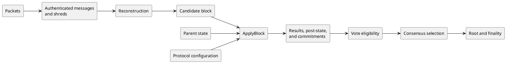
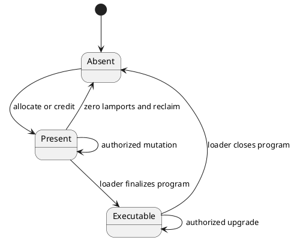
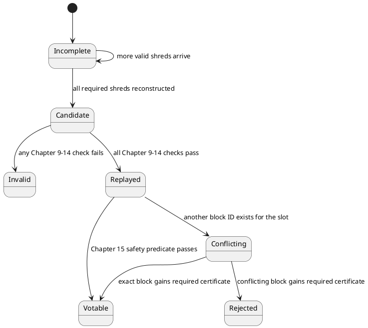
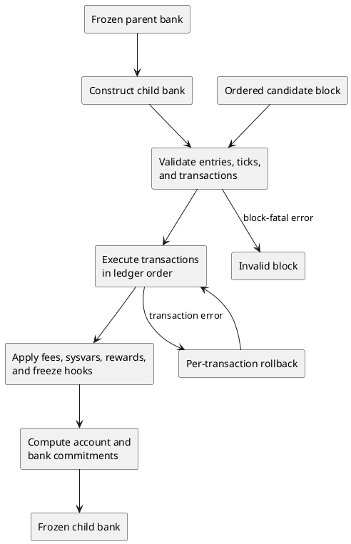
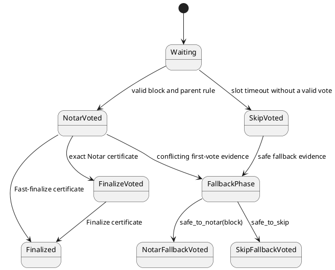

# Solana Protocol Specification

Mainnet reference epoch: `E = 1072`

## Table of contents

1. [Scope and conformance](#1-scope-and-conformance)
2. [Normative language and conventions](#2-normative-language-and-conventions)
3. [Terminology and system model](#3-terminology-and-system-model)
4. [Account state](#4-account-state)
5. [Common types, cryptography, and serialization](#5-common-types-cryptography-and-serialization)
6. [Validator wire protocols](#6-validator-wire-protocols)
7. [Transactions and messages](#7-transactions-and-messages)
8. [Proof of History and entries](#8-proof-of-history-and-entries)
9. [Shreds, erasure coding, and block reconstruction](#9-shreds-erasure-coding-and-block-reconstruction)
10. [Slot and block validity](#10-slot-and-block-validity)
11. [Deterministic state transition](#11-deterministic-state-transition)
12. [SVM, loaders, syscalls, and precompiles](#12-svm-loaders-syscalls-and-precompiles)
13. [Protocol-owned programs and sysvars](#13-protocol-owned-programs-and-sysvars)
14. [Consensus hashes and commitments](#14-consensus-hashes-and-commitments)
15. [Consensus, voting, and finality](#15-consensus-voting-and-finality)
16. [Epochs, leader schedule, stake, fees, and rewards](#16-epochs-leader-schedule-stake-fees-and-rewards)
17. [Feature activation, versioning, and hard forks](#17-feature-activation-versioning-and-hard-forks)
18. [Security and adversarial considerations](#18-security-and-adversarial-considerations)

Appendices:

- [Appendix A — Constants, identifiers, and limits](#appendix-a--constants-identifiers-and-limits)
- [Appendix B — Wire-layout and disposition index](#appendix-b--wire-layout-and-disposition-index)
- [Appendix C — Mainnet feature manifest](#appendix-c--mainnet-feature-manifest)
- [Appendix D — Source references](#appendix-d--source-references)

## Revision history

**Informative table.**

| Epoch for feature activation | SIMD links | Change description |
|---:|---|---|
| `1072` | [SIMD-0326](https://github.com/solana-foundation/solana-improvement-documents/blob/4f80d8a6938f86b9394e792253a2a52e01346314/proposals/0326-alpenglow.md), [SIMD-0385](https://github.com/solana-foundation/solana-improvement-documents/blob/4f80d8a6938f86b9394e792253a2a52e01346314/proposals/0385-transaction-v1.md), [SIMD-0391](https://github.com/solana-foundation/solana-improvement-documents/blob/4f80d8a6938f86b9394e792253a2a52e01346314/proposals/0391-replace-stake-program-floating-point.md), [SIMD-0525](https://github.com/solana-foundation/solana-improvement-documents/blob/4f80d8a6938f86b9394e792253a2a52e01346314/proposals/0525-reduce-slot-times.md) | Mainnet configuration with Alpenglow consensus, 200 ms slots, transaction v1, Stake Program v5.1 fixed-point stake arithmetic, current rent, and the current commission collectors. |

# 1. Scope and conformance

## 1.1 Scope

This specification defines the observable protocol rules needed to decode and produce
interoperable Mainnet data, decide validity, reconstruct ordered blocks, execute
deterministic state transitions, calculate consensus commitments, and participate safely
in consensus under the protocol configuration active in reference epoch `E`.

The scope is forward conformance only. An implementation starts from a trusted epoch-`E`
snapshot or another state authenticated to an epoch-`E` root and continues under this
specification. It need not ingest, replay, emit, or preserve encodings and rule branches
that ceased to be accepted before `E`. Activation epochs remain in Appendix C only to
identify how the epoch-`E` configuration was selected; they do not re-enable historical
behavior. A later Mainnet activation requires a revised specification whose affected
normative sections describe the new behavior directly.

The specification applies to banks whose derived epoch is `E`. If the trusted starting
root is the last bank before `E`, child-bank construction applies the epoch-`E` boundary
transition exactly once before that child's transactions. If the trusted starting state
is already within `E`, that state already includes the boundary transition and it must
not be applied again. This specification does not define the first bank of `E+1`.

This specification does not standardize process architecture, stages, channels,
databases, caches, thread scheduling, host execution strategy, or operator interfaces.

## 1.2 Conformance roles

The following codes identify independently referenceable protocol roles and the rules
applicable to each component.

**Normative table.**

| Code | Role | Applicable chapters | Required outcome |
|---|---|---|---|
| `SOL-CNF-0001` | Validator Wire Receiver | 5–6, Appendix B | Decode, authenticate, and disposition required inbound validator messages. |
| `SOL-CNF-0002` | Validator Wire Sender | 5–6, Appendix B | Produce canonical required outbound validator messages. |
| `SOL-CNF-0003` | Block Processor | 4–5, 8–14 | Reconstruct an ordered block and derive its deterministic post-state and commitments. |
| `SOL-CNF-0004` | Transaction Validator | 4–5, 7, 10 | Make the pre-execution acceptance decisions specified by this specification. |
| `SOL-CNF-0005` | SVM Runtime and State Transition | 4, 7, 10–14, 16–17 | Derive the specified post-state and transaction results from the same parent and ordered block. |
| `SOL-CNF-0006` | Consensus Participant | 6, 10, 14–17 | Select, vote, and root according to the consensus rules and preserve safety-critical state. |
| `SOL-CNF-0007` | Validator | All normative chapters | Compose the preceding roles for validator operation. |

When this specification gives an exact byte representation, `SOL-CNF-0002` emits that
canonical representation and `SOL-CNF-0001` applies the specified accepted domain.
Chapter 6 requirements define minimum codec, authentication, and peer-interaction
interoperability. Its explicitly informative active-liveness profiles document deployed
operating parameters but are not additional conformance roles.

## 1.3 Explicit exclusions

JSON-RPC schemas, CLI output, explorers, telemetry, local blockstore and account-index
layouts, snapshot archive compression, bootstrap convenience flows, operating-system
configuration, hardware sizing, performance tuning, peer-scoring heuristics,
transaction-selection policy, and arbitrary application-program semantics are outside
scope except when a specific rule demonstrably changes protocol interoperability,
validity, deterministic state, a consensus commitment, voting, consensus selection,
finality, or necessary liveness.

# 2. Normative language and conventions

## 2.1 Requirement force

The uppercase terms **MUST**, **MUST NOT**, **SHOULD**, **SHOULD NOT**, and **MAY**
carry normative force only inside a paragraph bearing a requirement identifier. “Must”
indicates an absolute condition; “should” indicates a condition for which a documented,
interoperability-safe exception can exist; “may” grants an option. Lowercase forms and
“shall” have no normative force in this specification.

## 2.2 Numeric conventions

`u8`, `u16`, `u32`, `u64`, and `u128` denote unsigned integers of the stated width.
`i64` denotes a two's-complement signed 64-bit integer. `LE(x,n)` and `BE(x,n)` denote
the `n`-byte little- and big-endian encodings of integer `x`. Byte intervals use
half-open notation `[start,end)`. Unless a requirement states otherwise, mathematical
pseudocode uses unbounded integers; conversion to a fixed-width type is permitted only
after its stated range check.

Arithmetic that contributes to validity, state, scheduling, or a commitment uses the
checked, saturating, wrapping, or truncating behavior named by the applicable algorithm;
host-language default overflow behavior never determines a protocol result.

Byte strings concatenate with `||`. `len(x)` is a nonnegative mathematical integer.
Array indices are zero-based. A public-key comparison is lexicographic comparison of its
32 raw bytes unless stated otherwise.

## 2.3 Ordering and ties

When a threshold is written as `a/b > p`, equality does not pass. When written
`a/b >= p`, equality passes. Implementations use the exact integer cross-multiplication
form where one is specified; a floating-point expression quoted as implementation
evidence is not itself permission to substitute a numerically different comparison.

## 2.4 Diagrams, examples, and evidence

Tables and pseudocode labeled Normative are authoritative. Diagrams, rationale,
examples, source anchors, and implementation notes are informative unless an identified
requirement incorporates a value or relation they contain. The sources in Appendix D and
the SIMDs in Appendix C do not silently extend the numbered requirements.

# 3. Terminology and system model

## 3.1 Terms

**Normative table.**

| Term | Meaning in this specification |
|---|---|
| account | State cell keyed by a 32-byte address and carrying lamports, owner, data, executable flag, and rent epoch. |
| bank state | Protocol state at one slot boundary; not a reference to a software object or database. |
| block | The ordered entries and transactions reconstructed for one slot and accepted under Chapter 10. |
| candidate block | Reconstructed slot content before all validity and state-transition checks pass. |
| commitment | A consensus-visible hash or identifier catalogued in Chapter 14. |
| bank hash | The Chapter 14 commitment to one frozen bank and the value checked by the Alpenglow block footer; Alpenglow votes identify a block by its block ID, not by this hash. |
| terminal FEC root | The full 32-byte Merkle root of a slot's final FEC set; it binds shred-chain and repair data but is not a bank hash. |
| entry | A PoH-linked record containing zero or more ordered transactions. |
| feature | An on-chain Feature Gate account whose decoded activation state selects a protocol rule. |
| finalized | The commitment/finality condition defined by Chapter 15, not an RPC label by itself. |
| fork | A parent-linked sequence of slot states sharing an ancestor. |
| reference epoch `E` | Mainnet epoch 1072, whose feature state determines this specification's protocol configuration. |
| root | A locally persisted/pruned consensus anchor advanced only by the active consensus rules. |
| shred | A signed data or coding unit used to disseminate and reconstruct slot payload. |
| slot | A `u64` position in the ledger schedule. A skipped slot has no accepted block. |
| transaction result | Pre-execution rejection or executed success/failure plus the specified committed effects. |

## 3.2 System model

A protocol configuration contains immutable chain identity, the feature state active in
reference epoch `E`, and the parameters needed to interpret blocks. A parent state
contains all accounts and consensus metadata committed at its slot. A candidate block
supplies its parent relation, leader, shreds, entries, and ordered transactions. The
protocol validates representation and block structure, applies the deterministic state
transition, freezes commitments, and exposes the resulting bank state to consensus.

**Informative diagram.**



## 3.3 Determinism boundary

Determinism applies at four different boundaries:

**Normative table.**

| Boundary | Required determinism |
|---|---|
| Pure transition | Equal parent bank, ordered block, and protocol configuration produce the same transaction outcomes, post-state, and commitments. |
| Network observation | Peers may observe different valid messages and arrival orders; an observation-dependent rule must state which authenticated observation set it consumes. |
| Local safety state | Persisted Alpenglow vote history depends on the participant's own prior votes, but the update and voting rules are deterministic for equal local safety state and equal observations. |
| Local policy | Peer choice, retry timing, packet queues, transaction selection, resource scheduling, and storage strategy may vary and do not define protocol validity. |

Accepted byte domains, ordered block content, committed account state,
capitalization, consensus hashes, stake weight, leader assignment, consensus selection
for a given observation set, safe Alpenglow votes, roots, and finality may not vary
for equal applicable protocol inputs. Storage layout, execution strategy, and local
retention policy do not enter any commitment.

# 4. Account state

## 4.1 Account map and value

Protocol state is a map from a 32-byte account address to a nonzero-lamport account
value. The address is the map key and is not repeated inside the account value. A
committed zero-lamport value is logical deletion: later transactions in that bank and
all descendants load the address as absent. An executor may retain a transient
zero-lamport record while committing or rolling back a transaction, but that record is
not a distinct protocol account state.

**Normative table.**

| Account-value field | Exact type | Constraint and meaning |
|---|---|---|
| `lamports` | `u64` | Native-token balance in lamports. |
| `data` | `0..=10,485,760` bytes | Program-owned state; the maximum is exactly 10 MiB. |
| `owner` | 32 raw bytes | Address of the program permitted to modify `data` or assign the account under the ownership rules. |
| `executable` | one logical Boolean | Legacy executable marker retained in state; account-storage encoding is not protocol-visible. |
| `rent_epoch` | `u64` | Rent metadata; the SBF input ABI presents `u64::MAX` as specified in Section 12.8.6. |

There is no universal wire serialization for an account value. Transactions name
accounts by address, protocol-owned programs define the byte grammar of their `data`,
the SBF program-input representation is defined in Section 12.8.6, and account hashing
is defined in Section 14.4. A database record layout is not a protocol encoding.

[SOL-ACC-0001] A bank **MUST** reject any state transition that would produce account
data longer than `10,485,760` bytes, a lamport value outside `u64`, or an account value
lacking exactly one 32-byte owner.

[SOL-ACC-0002] Every account replacement **MUST** be keyed by the account's 32-byte
address and **MUST** update capitalization and account-state commitments according to
Chapters 11 and 14.

## 4.2 Ownership and mutation limits

An instruction may change an account only through the privileges and ownership rules
established by the transaction and invocation context. SBF ABI v1 reserves 10,240 bytes
after each account's original data for growth during one instruction. Across a
transaction, the aggregate positive data-length change is at most 20,971,520 bytes,
while every individual account remains bounded by 10,485,760 bytes.

[SOL-ACC-0003] An instruction **MUST NOT** increase one account's data length by more
than `10,240` bytes relative to that instruction's entry length, and a transaction
**MUST NOT** produce aggregate positive account-data growth greater than `20,971,520`
bytes.

[SOL-ACC-0004] Only the account owner **MAY** modify account data or change its
length, except for an explicit protocol-program transition; only a writable account
**MAY** have lamports, data, owner, or executable state changed.

[SOL-ACC-0005] An instruction **MUST** conserve the sum of lamports across its
instruction accounts, may debit lamports only from accounts owned by the executing
program, and **MUST** treat any account that commits with zero lamports as logical
deletion regardless of its transient data, owner, or executable fields.

## 4.3 Account lifecycle

**Informative diagram.**



[SOL-ACC-0006] Creation, allocation, assignment, executable transition, truncation, and
closure **MUST** occur only through the protocol-program rule authorizing that
transition. A committed account with zero lamports **MUST** be removed from the logical
account map before the next transaction is loaded; just writing a field-shaped byte
sequence does not create protocol state.

## 4.4 Bank metadata

Consensus metadata associated with the account map includes slot and epoch data, recent
blockhashes, replay-protection ancestry, transaction/signature/compute counters,
capitalization, reward and fee accumulators, the accounts-state accumulator, and the
bank hash. These values are bank state even when they are not represented by ordinary
accounts.

# 5. Common types, cryptography, and serialization

## 5.1 Scope and notation

This chapter defines the byte-level primitives used by the validator wire and ledger
chapters.  It is intentionally a small, protocol-specific subset of the libraries from
which the behavior was recovered.  Presentation encodings such as base58 are not wire
encodings unless another chapter explicitly says so.

## 5.2 SHA-256 and Ed25519

`SHA256(x)` below means FIPS 180-4 SHA-256 over the exact byte string `x`.  It does not
include a length, terminator, or serialization wrapper.

[SOL-GEN-0003] A protocol hash written `SHA256(x1 || ... || xn)` **MUST** feed the
listed byte strings to one SHA-256 invocation in the listed order and **MUST NOT** hash
a textual rendering of any operand.

[SOL-GEN-0004] Verification of a signed gossip value, gossip ping or pong, signed repair
request, or leader-signed shred **MUST** reject a malformed public key or signature, an
`S` scalar greater than or equal to the Ed25519 group order, a small-order public key or
`R` point, or a signature that fails the Ed25519 verification equation. A receiver
**MUST NOT** broaden this strict Mainnet rule just because its cryptographic library
accepts additional noncanonical compressed Edwards encodings.

[SOL-GEN-0005] A signature **MUST** be verified against the signer, message bytes, and
domain construction named by the enclosing protocol; a valid signature for a different
field serialization or domain **MUST NOT** authenticate the object.

## 5.3 Codec registry and canonical fixed-integer serialization

A reference to a serialization library, including “bincode” or “wincode,” is not
sufficiently precise for a protocol boundary. This specification therefore assigns a
named codec to every reusable protocol-object family with a byte grammar and defines the
accepted bytes directly. An implementation may use any serializer that produces and
accepts exactly these bytes; a library name, version, default configuration, or
host-language data layout never overrides this section or an enclosing type table.

A codec may compose another codec. For example, a repair response can contain one raw
shred, and a ledger component can contain transactions inside Entries. Transport state
machines, erasure-code mathematics, cryptographic preimage recipes, and raw fixed-size
keys, signatures, or hashes are not separate codecs just because their algorithms
consume bytes. Their enclosing section remains authoritative.

**Normative table. Codec registry.**

| Codec | Surfaces | Controlling rules |
|---|---|---|
| `FIXINT-LE` | Primitive fields and containers in an enclosing codec that explicitly selects canonical fixed-integer serialization | This section's primitive table plus the enclosing field table. Counts are `u64`; enum tags are `u32`; no padding is implicit. |
| `SHORT-U16` | Transaction counts, instruction counts and explicitly named compact sequences | Section 5.4 only. |
| `ULEB128` | ContactInfo version, wallclock, and other explicitly named unsigned compact fields wider than `ShortU16` | Section 5.4. The declared integer width bounds the group count; overflow and nonminimal final zero groups are rejected. |
| `CRDS-E1072` | Gossip datagrams, `CrdsValue`, ContactInfo and nested CRDS types | Sections 6.2–6.5. This is a closed schema composing `FIXINT-LE`, `SHORT-U16`, and `ULEB128`; zero-byte deprecated variants and field-specific bounds are exactly as stated there. |
| `REPAIR-E1072` | Repair requests, ordinary shred responses, repair ping challenges, ancestor-hash responses, and block-ID repair | Section 6.7. Requests and specialized responses use their stated discriminants and fields; an ordinary response is one `SHRED-E1072` followed by a `u32` nonce. |
| `ALPENGLOW-WIRE-E1072` | Alpenglow votes and certificates carried in QUIC datagrams | Sections 6.6 and 15.2. The codec is the exact Wincode subset stated there, including explicit enum tags and length encodings. |
| `ALPENGLOW-STATE-E1072` | Epoch inflation account state used by Alpenglow vote rewards | Section 16.6.2. This is the exact fixed-integer Wincode record stated there, including the one-byte previous-state option tag. |
| `TX-E1072` | Legacy, version-0, and version-1 transactions and messages | Sections 7.1–7.4. Legacy and v0 compose `SHORT-U16`; v1 uses its bespoke fixed-count layout and places signatures after the message. |
| `ENTRY-E1072` | Deshredded ledger components, Alpenglow block markers, and Entries | Sections 8.3 and 9.6. |
| `SHRED-E1072` | Raw Turbine shreds and shreds embedded in repair responses | Sections 9.1–9.5 and 14.6. This is a fixed-offset, variant-dependent format with exact lengths, padding, Merkle coverage, and Reed–Solomon regions; it is not a general-purpose struct serialization. |
| `SBF-ELF-E1072` | Deployed SBF ELF objects and their eight-byte instruction words | Sections 12.8.1, 12.8.3, and 12.8.5. ELF acceptance and instruction decoding depend on the selected active SBF version. |
| `SBF-ABI-E1072` | Loader ABI-v0 and ABI-v1 program inputs and outputs, plus syscall guest-memory structures | Sections 12.8.6–12.8.7. The loader selects v0 or v1; syscall structures use their exact field order, widths, padding, alignment, and access rules. |
| `PRECOMPILE-E1072` | Ed25519, secp256k1, and secp256r1 signature-verification instruction data | Section 12.6. Prefixes, offset records, referenced byte ranges, and program-specific key and signature encodings are exact. |
| `PROGRAM-E1072` | Compute Budget, System, Vote, Stake, Config, Feature, ALT, loader, and ZK ElGamal instructions and account states | Sections 7.6, 13.3, and 17.1. Each program's byte tables control; `FIXINT-LE` applies only where explicitly selected, and bespoke one-byte and POD layouts remain bespoke. |
| `SYSVAR-E1072` | Persistent sysvar account data and the synthesized Instructions sysvar | Sections 13.4 and 13.6. Persistent sysvars compose `FIXINT-LE` where stated; the Instructions sysvar uses its own `u16`-offset framing. |

[SOL-GEN-0006] A protocol object belonging to a registered surface **MUST** be encoded
with the assigned enclosing codec and every nested codec it names. A receiver
**MUST NOT** retry a failed decode with another serializer configuration, accept a
variable-integer substitute for a fixed integer, or derive field order from reflection
metadata.

[SOL-GEN-0007] A value described as using canonical fixed-integer serialization **MUST**
use the applicable layout below. Fields are serialized in the order in which the
enclosing table lists them, with no alignment, padding, field names, or end marker
unless that table explicitly includes one.

**Normative table. `FIXINT-LE` primitive layouts.**

| Value kind | Exact byte layout |
|---|---|
| `u8`, `u16`, `u32`, `u64`, `u128` | Exactly `1`, `2`, `4`, `8`, or `16` bytes, least-significant byte first |
| `i8`, `i16`, `i32`, `i64`, `i128` | Two's-complement bit pattern of the stated width, least-significant byte first |
| `f32`, `f64` | IEEE-754 binary32 or binary64 bit pattern encoded as a little-endian `u32` or `u64`; no numeric text conversion |
| Boolean | One byte: `00` for false or `01` for true; every other value is invalid |
| unit / zero-sized marker | Zero bytes |
| tuple or struct | Encodings of its fields concatenated in the declared table order; no field count or tags |
| enum variant | Variant discriminant as `u32` little-endian, followed immediately by that variant's fields |
| sequence of `length` elements | `LE(length,8)`, followed by exactly `length` element encodings |
| byte string | `LE(length,8)`, followed by exactly `length` raw bytes |
| UTF-8 string | `LE(length,8)`, followed by exactly `length` bytes of valid UTF-8; no terminator |
| `Option::None` | One tag byte `00` |
| `Option::Some(value)` | One tag byte `01`, followed by the value encoding |
| fixed-size array | Exactly the consecutive element encodings; no length prefix |
| ordered map | `LE(count,8)`, followed by exactly `count` key/value pairs in the order required by the enclosing type |

An enclosing byte-layout table may deliberately specify a different tag, length width,
compact integer, conditional field, padding region, or trailing capacity. That more
specific table controls that type. A map without an enclosing key order has no canonical
protocol encoding; hash-table iteration order is never an encoding rule.

[SOL-GEN-0008] A decoder for a datagram or a complete QUIC application message **MUST**
consume the entire application byte string and **MUST** reject a truncated field, an
impossible length, integer overflow, or trailing bytes not assigned by that message
format.

The exception to exact consumption is an enclosing format that gives an explicit length
or expressly permits unused capacity or trailing bytes, such as a data shred's `size`
field, the four-byte repair nonce after a shred, a Vote account, or a program
instruction whose section says that its decoder permits a suffix.

## 5.4 `ShortU16` and compact integers

`ShortU16` is an unsigned, least-significant-group-first base-128 integer.  The low
seven bits of each byte carry data and bit 7 indicates another byte.

**Normative table. `SHORT-U16` canonical ranges.**

| Encoded length | Canonical value range | Byte constraints |
|---:|---:|---|
| 1 byte | `0..127` | byte 0 continuation bit is clear |
| 2 bytes | `128..16383` | byte 0 continuation bit is set; byte 1 continuation bit is clear and its value group is nonzero |
| 3 bytes | `16384..65535` | bytes 0 and 1 continuation bits are set; byte 2 continuation bit is clear, its value group is nonzero, and only its low two bits may be set |

[SOL-GEN-0009] A canonical `ShortU16` **MUST** encode values 0 through 127 in one byte,
128 through 16383 in two bytes, and 16384 through 65535 in three bytes; a sender
**MUST** use the shortest form.

[SOL-GEN-0010] A `ShortU16` receiver **MUST** reject a fourth byte, continuation on the
third byte, nonzero bits above bit 15, and an overlong encoding whose last seven-bit
group is zero.

The ContactInfo version and wallclock fields use the same unsigned base-128 rule at
their stated `u16` or `u64` width rather than the three-byte `ShortU16` cap.

[SOL-GEN-0011] An unsigned LEB128 field **MUST** terminate within the number of
seven-bit groups required by its declared width and **MUST** reject overflow and a
non-minimal final zero group.

## 5.5 Program-derived addresses

Although program-derived addresses are most visible during execution, they are a common
32-byte identity primitive and are fixed here once.

[SOL-GEN-0012] `create_program_address(seeds, program_id)` **MUST** reject more than 16
seeds or any seed longer than 32 bytes, then compute
`SHA256(seed[0] || ... || seed[n-1] || program_id || "ProgramDerivedAddress")`, where
the marker is the 21 ASCII bytes and `program_id` is 32 raw bytes.

[SOL-GEN-0013] The digest from `create_program_address` **MUST** be rejected if it
decompresses as an Ed25519 curve point and otherwise **MUST** be returned as the 32-byte
address.

[SOL-GEN-0014] `find_program_address` **MUST** append a one-byte bump seed to the
caller's seed list, try bump values from 255 down through 1, and return the first
address accepted by `create_program_address` together with that bump. If none of those
255 values succeeds, the search has no result; bump zero is not tested by the active
search operation. Because the appended bump counts as a seed, a caller list of 16 seeds
cannot produce a result under the 16-seed `create_program_address` ceiling.

## 5.6 Resource-safe decoding

[SOL-GEN-0015] Before allocating or advancing by a peer-supplied count or length, a
receiver **MUST** prove that the operation fits both the remaining input and the
protocol-specific bound; allocation failure or host-width conversion **MUST NOT** change
acceptance into partial decoding.

# 6. Validator wire protocols

## 6.1 Datagram boundary and dispatch

[SOL-WIR-0001] A gossip, repair, TPU-vote, or TVU receiver **MUST** treat one UDP
datagram as one complete application message, enforce the 1,232-byte limit, and reject a
message if its grammar does not consume the datagram exactly.

## 6.2 Gossip envelope and CRDS pull filter

Every gossip datagram begins with a `u32` little-endian `Protocol` discriminant. A
`Vec<T>` below is the Chapter 5 sequence form: an eight-byte little-endian count
followed by that many `T` values.

**Normative table.**

| Discriminant | Variant | Exact payload after discriminant |
|---:|---|---|
| `0` | `PullRequest` | `CrdsFilter`, then one `CrdsValue` |
| `1` | `PullResponse` | sender public key `[32]`, then `Vec<CrdsValue>` |
| `2` | `PushMessage` | sender public key `[32]`, then `Vec<CrdsValue>` |
| `3` | `PruneMessage` | outer public key `[32]`, then `PruneData` |
| `4` | `PingMessage` | `Ping` `[128]` |
| `5` | `PongMessage` | `Pong` `[128]` |

[SOL-WIR-0002] A gossip decoder **MUST** reject a discriminant outside `0..=5`, an
invalid nested value, a payload larger than 1,232 bytes, or trailing bytes. The combined
serialized `CrdsValue` bytes in a push or pull response **MUST NOT** exceed 1,188 bytes.

`CrdsFilter` is serialized in the following order. `BitVec<u64>` bit number `i` is bit
`(i mod 64)`—least significant bit first—of block `floor(i/64)`.

**Normative table.**

| Order | `CrdsFilter` field | Exact encoding |
|---:|---|---|
| 1 | Bloom keys | `u64` count, then that many `u64` little-endian seeds |
| 2 | Bloom blocks | option tag `u8`; `0` for no blocks, or `1`, a `u64` block count, and that many `u64` little-endian blocks |
| 3 | Bloom bit length | `u64` little-endian |
| 4 | Bloom `num_bits_set` | `u64` little-endian |
| 5 | `mask` | `u64` little-endian |
| 6 | `mask_bits` | `u32` little-endian |

The Bloom phantom type has zero bytes. For a CRDS identity hash `h[32]`, let
`hu = LE_decode(h[0..8])`, `low = (!0u64) >> mask_bits` when `mask_bits < 64` and `0`
otherwise, and `canonical_mask = mask | low`. The hash belongs to the filter's partition
exactly when `(hu | low) == canonical_mask`.

For every Bloom seed `k`, calculate a seeded FNV-1a state over all 32 bytes of `h`:
initialize `state = k`; for each byte `b`, set
`state = (state XOR b) * 0x00000100000001b3 mod 2^64`. Its Bloom position is
`state mod bit_length`. Membership is true only if the partition comparison passes, the
keys and bit vector are both nonempty, and every seeded position is set.

[SOL-WIR-0003] An accepted pull filter **MUST** have `mask_bits >= 6`; its bit length
**MUST NOT** exceed the capacity of its serialized blocks. A sender **MUST** set every
low bit of `mask` selected by `low`, while a receiver **MUST** ignore those low bits by
using `canonical_mask` as defined above.

[SOL-WIR-0004] In answering a PullRequest, a validator **MUST** consider only CRDS
values whose identity hash belongs to the requested mask partition and is absent from
the Bloom filter; a Bloom false positive may omit a value but **MUST NOT** make an
out-of-partition value eligible.

## 6.3 CRDS values and payload grammars

A `CrdsValue` is a 64-byte Ed25519 signature followed by a `CrdsData`: a four-byte
little-endian discriminant and its payload. Its cached identity is not serialized.

**Normative table. CRDS discriminants and independent processing status.**

| Disc. | Payload after discriminant | Decoder | Receiver sanitation | CRDS insertion | Locally originate in `E` | Return in ordinary pull |
|---:|---|---|---|---|---|---|
| `0` | legacy ContactInfo: zero bytes | known tag; payload decode fails | unreachable | unavailable | no | no |
| `1` | `index:u8`, then `Vote` | accept | require `index < 32` and valid Vote | accept if the Section 6.3.1 comparison wins | yes; sender chooses `index < 12` | yes |
| `2` | `index:u8`, then `LowestSlot` | accept only when `index == 0` | require valid LowestSlot | accept if comparison wins | yes | yes |
| `3` | legacy SnapshotHashes: zero bytes | known tag; payload decode fails | unreachable | unavailable | no | no |
| `4` | AccountsHashes: zero bytes | known tag; payload decode fails | unreachable | unavailable | no | no |
| `5` | `index:u8`, then `EpochSlots` | accept | require `index < 255` and valid EpochSlots | accept if comparison wins | yes | yes |
| `6` | legacy Version: zero bytes | known tag; payload decode fails | unreachable | unavailable | no | no |
| `7` | Version: zero bytes | known tag; payload decode fails | unreachable | unavailable | no | no |
| `8` | NodeInstance: zero bytes | known tag; payload decode fails | unreachable | unavailable; no duplicate transition | no | no |
| `9` | `index:u16`, then `DuplicateShred` | accept | require `index < 512` and valid chunk metadata | accept if comparison wins | yes | yes |
| `10` | `SnapshotHashes` | accept | require valid bounded hash lists | accept if comparison wins | yes | yes |
| `11` | `ContactInfo` | accept | require Section 6.5 validity | accept if comparison wins | yes | yes |
| `12` | `RestartLastVotedForkSlots` below | accept | require valid bounded fields | accept if comparison wins | only during a coordinated restart | no |
| `13` | `RestartHeaviestFork` below | accept | require valid bounded fields | accept if comparison wins | only during a coordinated restart | no |

For discriminants `0`, `3`, `4`, `6`, `7`, and `8`, “known tag” means only that the enum
discriminant is assigned. The epoch-`E` decoder deliberately returns an error while
decoding its zero-sized deprecated payload, before signature verification, sanitation,
label derivation, or insertion. In particular, deprecated `NodeInstance` values are
never compared as duplicates or retained in the CRDS table.

All `wallclock` and slot values identified as bounded in this section must be strictly
less than `10^15`. The exact non-ContactInfo payload layouts are:

**Normative table.**

| Payload | Exact field sequence |
|---|---|
| `Vote` | `from[32]`, one Chapter 7 transaction, `wallclock:u64` |
| `LowestSlot` | `from[32]`, `root:u64`, `lowest:u64`, `slots:u64 count` followed by ascending unique `u64` slots, `stash:u64 length` followed by bytes, `wallclock:u64` |
| `EpochSlots` | `from[32]`, `u64` count of `CompressedSlots`, those values, `wallclock:u64` |
| `SnapshotHashes` | `from[32]`, full snapshot `(slot:u64,hash[32])`, `u64` incremental count, that many `(slot:u64,hash[32])`, `wallclock:u64` |
| `DuplicateShred` | `from[32]`, `wallclock:u64`, `slot:u64`, unused `u32`, unused `u8`, `num_chunks:u8`, `chunk_index:u8`, `chunk:u64 length` followed by bytes |
| `RestartLastVotedForkSlots` | `from[32]`, `wallclock:u64`, `SlotsOffsets`, `last_voted_slot:u64`, `last_voted_hash[32]`, `shred_version:u16` |
| `RestartHeaviestFork` | `from[32]`, `wallclock:u64`, `last_slot:u64`, `last_slot_hash[32]`, `observed_stake:u64`, `shred_version:u16` |

A `CompressedSlots` starts with a `u32` discriminant and has one of these layouts.
`BitVec<u8>` uses the same option/count/bit-length grammar as the Bloom bit vector,
except its blocks are bytes and bits within a byte are least-significant-bit first.

**Normative table.**

| Discriminant | Form | Exact fields after discriminant |
|---:|---|---|
| `0` | raw DEFLATE | `first_slot:u64`, `num:u64`, byte-string length `u64`, then raw DEFLATE bytes |
| `1` | uncompressed | `first_slot:u64`, `num:u64`, `BitVec<u8>` |

The compressed form is RFC 1951 DEFLATE without a zlib header. Inflation must terminate
successfully; the output bytes form the `BitVec` blocks. For either form,
`first_slot < 10^15`, `num < 16,384`, and selected bit `i` denotes slot `first_slot + i`
for `0 <= i < num`. An uncompressed vector's bit length must be a multiple of eight and
equal its block capacity.

`SlotsOffsets` starts with `u32` discriminant `0` for run-length encoding or `1` for raw
offsets. Run-length encoding is a `u64` element count followed by canonical
unsigned-LEB128 `u16` run lengths; runs alternate selected, unselected, selected,
beginning with selected. Raw offsets is `BitVec<u8>`. In either form selected offset `i`
denotes `last_voted_slot - i`; an underflow does not denote a slot.

[SOL-WIR-0005] A CRDS Vote transaction **MUST** satisfy Chapter 7 transaction sanitation
and decode as a vote instruction; LowestSlot **MUST** have zero `root`, empty `slots`,
empty `stash`, and bounded `lowest` and `wallclock`. Every SnapshotHashes incremental
slot **MUST** be bounded and strictly greater than the full-snapshot slot; a sender
**MUST NOT** publish more than 25 incremental hashes in one value.

[SOL-WIR-0006] A CRDS-valid DuplicateShred chunk **MUST** have `num_chunks > 0` and
`chunk_index < num_chunks`; insertion does not impose the assembly limit. A
duplicate-proof consumer **MUST** discard a chunk from assembly when `num_chunks > 3`.
Assembly state is keyed by `(from,slot)`, not by the outer CRDS index. Receiving an
assembly-eligible chunk replaces the buffered chunk at its `chunk_index`; when the
number of occupied indices equals the received `num_chunks`, every buffered chunk
**MUST** agree on `slot` and `num_chunks`. Concatenating chunk bytes in index order
`0..num_chunks-1` then yields exactly `u64 length || shred1 || u64 length || shred2`.
Both nested shreds **MUST** pass Chapter 9 and constitute a valid same-slot duplicate
proof. The outer index is only the CRDS table label and **MUST NOT** partition assembly
state.

[SOL-WIR-0007] A `CrdsValue` signature **MUST** verify under the `from` or ContactInfo
public key contained in its payload over the exact bytes beginning with the `CrdsData`
discriminant. Its identity **MUST** be `SHA256(signature[64] || serialized_CrdsData)`. A
PullRequest's embedded value **MUST** be discriminant 11 ContactInfo; every pushed or
returned value **MUST** pass its payload constraints and strict signature verification.

### 6.3.1 CRDS replicated-table transition

**Normative table. CRDS label derivation.**

| Value | Table label |
|---|---|
| Vote | `(Vote, index, from)` |
| LowestSlot | `(LowestSlot, from)`; the encoded index is constrained to zero and is not part of the label |
| EpochSlots | `(EpochSlots, index, from)` |
| DuplicateShred | `(DuplicateShred, index, from)` |
| SnapshotHashes | `(SnapshotHashes, from)` |
| ContactInfo | `(ContactInfo, public_key)` |
| RestartLastVotedForkSlots | `(RestartLastVotedForkSlots, from)` |
| RestartHeaviestFork | `(RestartHeaviestFork, from)` |

For a label already present, `new` replaces `old` according to this total order.
ContactInfo first compares `(outset, wallclock)` lexicographically when the public keys
agree. If those tuples differ, the larger tuple wins. For all other cases, and for equal
ContactInfo tuples, larger wallclock wins; equal wallclocks are broken by the
lexicographically larger 32-byte CRDS identity hash. Replacing a value records the
displaced hash in the recently-purged set. An unequal losing value records its own hash
there. An equal hash is a duplicate: it leaves table bytes and insertion order
unchanged; a push-route duplicate increments only its saturating local duplicate count.

[SOL-WIR-0008] A CRDS table **MUST** derive labels and apply replacement in the order
above. An implementation **MUST NOT** merge two values sharing an origin but having
different indexed labels. In particular, EpochSlots is a logical union only when
consumed: decode each surviving indexed value, union selected slots for the origin,
remove duplicates, and order the resulting slots ascending.

Push accepts a signed value only when its wallclock is in the inclusive window
`[now-15,000 ms, now+15,000 ms]`. Pull accepts a caller ContactInfo only when its
wallclock is in the half-open window `[now-15,000 ms, now+15,000 ms)`. One
responder-wide random jitter `j` in `0..3,750 ms` is added to the caller wallclock; a
pull response selects, in table insertion order, nondeprecated values matching the
requested partition, absent from the Bloom filter, satisfying
`value.wallclock <= caller+j`, and fitting the response byte budget. A receiver inserts
an otherwise-new pull value if `now <= value.wallclock + timeout(origin)`; an expired
value may be retained only when ContactInfo for its origin already exists, so it can
assist replacement and purge decisions.

The default origin timeout is `15,000 ms`. The local identity never expires. An identity
with positive epoch stake uses `max(15,000 ms, epoch_duration_ms)`; when every supplied
stake is zero, all identities use that extended timeout. If an origin's ContactInfo has
`min(value.wallclock, local_receive_time)+timeout > now`, every label of that origin is
retained. Otherwise each label expires when the same expression is `<= now`. Displaced
and rejected-outdated hashes remain in pull Bloom filters for `20,000 ms`.

The preceding windows, insertion-order response selection, retention timeouts, and
Bloom-filter retention describe the active network's liveness profile. They are
informative: local time and peer observation are not replicated state, and a different
safe retention or selection policy does not make a bank invalid. Signed-value
constraints, labels, replacement order, filter partitioning, response byte grammar,
and receiver-side revalidation remain normative.

[SOL-WIR-0009] Push duplicate suppression, pull selection, expiration, and purge
**MAY** vary without changing protocol state. A pull response **MUST** contain only
individually valid values in the requested partition and **MUST NOT** knowingly include
a value selected by the requester's Bloom filter. The receiver **MUST** independently
apply `SOL-WIR-0007` and `SOL-WIR-0008`. Completed DuplicateShred evidence **MUST**
follow `SOL-WIR-0006`; incomplete assembly may be evicted at any time and has no
consensus effect.

The push active set contains 12 peers per stake bucket and sends each eligible new value
to the first nine unpruned peers. There are 25 buckets. For stake `s` lamports define
`b(s)=min(24, bit_length(floor(s/1,000,000,000)))`; a value owned by `o` uses bucket
`min(b(local_stake),b(stake(o)))`. Peer sampling is without replacement with weight
`(min(peer_bucket,bucket)+1)^2`; zero-weight peers follow positive-weight peers. A valid
Prune applies only at its named destination, only within `500 ms` of local time, and
marks each named origin as suppressed for pushes to the prune sender in the applicable
bucket. A node's own values are never suppressed by a prune false positive.

[SOL-WIR-0010] A sender **MUST** honor authenticated, timely prune state. Active-set
size, stake buckets, sampling, rotation timing, and fanout cap are informative liveness
policy. A sender **MUST NOT** send a value to a peer for which the applicable prune
filter positively contains that origin, except its own origin as stated above.

## 6.4 Ping, pong, and prune

**Normative table.**

| Object | Byte range | Field |
|---|---|---|
| Ping | `[0,32)` | `from` public key |
| Ping | `[32,64)` | 32-byte token |
| Ping | `[64,128)` | signature |
| Pong | `[0,32)` | `from` public key |
| Pong | `[32,64)` | 32-byte token hash |
| Pong | `[64,128)` | signature |

[SOL-WIR-0011] A Ping signature **MUST** verify under `from` over the 32 token bytes.
Its expected Pong hash **MUST** be `SHA256("SOLANA_PING_PONG" || token)`, where the
prefix is the 16 ASCII bytes. A Pong signature **MUST** verify under its `from` key over
the hash, and a Pong used as reachability evidence **MUST** match an outstanding Ping.

**Normative table.**

| Order | `PruneData` field | Exact encoding |
|---:|---|---|
| 1 | `pubkey` | 32 bytes |
| 2 | pruned keys | `u64` count followed by 32 bytes per key |
| 3 | signature | 64 bytes |
| 4 | destination | 32 bytes |
| 5 | wallclock | `u64` little-endian |

[SOL-WIR-0012] A PruneMessage **MUST** have an outer key equal to `PruneData.pubkey`, no
more than 32 pruned keys, and `wallclock < 10^15`. The signature **MUST** verify over
the serialization of `(pubkey, pruned keys, destination, wallclock)`, either directly or
preceded by the byte string `ff 53 4f 4c 41 4e 41 5f 50 52 55 4e 45 5f 44 41 54 41`; the
prefixed form includes `LE(18,8)` before those 18 prefix bytes.

## 6.5 ContactInfo

Mainnet uses shred version `50093` in epoch `E`. ContactInfo discriminant 11 has this
exact field order:

**Normative table.**

| Order | Field | Exact encoding |
|---:|---|---|
| 1 | public key | 32 bytes |
| 2 | wallclock | canonical unsigned-LEB128 `u64`, milliseconds |
| 3 | outset | `u64` little-endian, microseconds |
| 4 | shred version | `u16` little-endian |
| 5 | version major | canonical unsigned-LEB128 `u16` |
| 6 | packed minor | canonical unsigned-LEB128 `u16` |
| 7 | patch or prerelease number | canonical unsigned-LEB128 `u16` |
| 8 | source identifier | `u32` little-endian |
| 9 | feature-set identifier | `u32` little-endian |
| 10 | implementation identifier | canonical unsigned-LEB128 `u16` |
| 11 | addresses | `ShortU16` count followed by `IpAddr` records |
| 12 | sockets | `ShortU16` count followed by `SocketEntry` records |
| 13 | extensions | `ShortU16` count followed by TLV records |

The low 14 bits of packed minor are the minor version. Bits 14–15 select stable (`0`),
release candidate (`1`), beta (`2`), or alpha (`3`). For stable, the next value is the
semantic patch; otherwise the semantic patch is zero and the next value is the
prerelease number.

**Normative table.**

| Nested type | Exact encoding |
|---|---|
| IPv4 `IpAddr` | discriminant `LE(0,4)`, then four network-order address octets |
| IPv6 `IpAddr` | discriminant `LE(1,4)`, then sixteen network-order address octets; rejected by ContactInfo sanitation |
| `SocketEntry` | `key:u8`, address `index:u8`, canonical unsigned-LEB128 `offset:u16` |
| extension TLV | `type:u8`, `ShortU16` byte length, then exactly that many bytes |

The socket port accumulator begins at zero. For each entry in encoded order, add its
offset with checked `u16` arithmetic; that accumulated port and the indexed address form
the endpoint.

**Normative table. ContactInfo socket-key registry.**

| Key | Defined endpoint | Epoch-`E` protocol use |
|---:|---|---|
| `0` | gossip UDP | active |
| `1` | repair QUIC | recognized; no repair QUIC service, and a placeholder port is permitted |
| `2` | JSON-RPC | discovery only; RPC is outside scope |
| `3` | RPC pubsub | discovery only; RPC is outside scope |
| `4` | repair UDP | active |
| `5` | TPU UDP | reserved and not used; does not authorize UDP transaction ingestion |
| `6` | TPU-forward UDP | reserved and not used |
| `7` | TPU-forward QUIC | active |
| `8` | TPU QUIC | active |
| `9` | TPU-vote UDP | active |
| `10` | TVU UDP | active |
| `11` | TVU QUIC | recognized but inactive |
| `12` | TPU-vote QUIC | active |
| `13` | Alpenglow votor QUIC | active; QUIC DATAGRAM consensus messages |

[SOL-WIR-0013] A valid ContactInfo **MUST** contain only unique IPv4 addresses and
unique socket keys, every socket index **MUST** be in range, and every address **MUST**
be referenced. Port addition **MUST NOT** overflow; port zero, unspecified, multicast,
and IPv6 endpoints **MUST** be rejected.

[SOL-WIR-0014] ContactInfo `wallclock` **MUST** be less than `10^15`. A peer used for
Turbine or repair **MUST** advertise shred version `50093`. Unknown extension types
**MUST** be skipped by their declared length and unknown socket keys **MUST NOT** be
assigned a known service meaning.

## 6.6 TPU QUIC, TPU-vote UDP, and TLS

[SOL-WIR-0015] Ordinary TPU and TPU-forward ingestion **MUST** use QUIC and **MUST NOT**
accept transaction application data through ContactInfo keys 5 or 6. A TPU-vote UDP
datagram contains exactly one Chapter 7 transaction with no application framing. A TPU,
TPU-forward, or TPU-vote QUIC connection **MUST** negotiate the ten-byte ALPN
`solana-tpu`, and each completed requester-initiated unidirectional stream **MUST**
contain exactly one transaction. The stream is nonempty, consumes all bytes, and is at
most 4,096 bytes. Chapter 7 then applies the format-specific transaction limit: 1,232
bytes for legacy and version 0, or 4,096 bytes for version 1. The UDP form remains
limited to 1,232 bytes by Section 6.1.

[SOL-WIR-0016] A TPU receiver **MUST** pass only QUIC's ordered, reassembled bytes from
one completed unidirectional stream to the transaction decoder. It **MUST** reject a
bidirectional stream, QUIC datagram application data, or bytes concatenated across
streams. A packet gap leaves the stream incomplete until QUIC retransmission or timeout;
it is not an application decode error. Transport certificates do not authorize a
transaction; Chapter 7 signatures do.

**Informative table. Active QUIC liveness and resource profile.**

| Parameter | Required value or accepted domain |
|---|---|
| QUIC TLS version | TLS 1.3 only, as required by QUIC v1 |
| Key exchange | X25519 |
| TLS 1.3 cipher suites | accept AES-128-GCM-SHA256, AES-256-GCM-SHA384, and ChaCha20-Poly1305-SHA256 |
| ALPN | exactly `solana-tpu` |
| Per-stream receive window and application hard cap | `4,096` bytes |
| Connection receive window | `8,388,608` bytes |
| Initial bidirectional-stream limit | `0` |
| Initial unidirectional-stream limit | `0`, raised after handshake/QoS classification |
| Concurrent inbound unidirectional streams | after handshake, the exact stake-and-RTT formula below; possible advertised values are unstaked `128..=896` and staked `128..=3,584` streams |
| Idle timeout | `30` seconds |
| Handshake timeout | `2` seconds from receipt of Initial through receipt of Handshake |
| Incomplete-stream chunk timeout | `2` seconds |
| QUIC DATAGRAM | disabled |
| Path migration | disabled |
| 0-RTT | server acceptance disabled; clients may attempt resumption but application bytes are processed only after a completed handshake |
| Default connection admission | at most `2,000` staked and `2,000` unstaked connections; `16` per staked identity and `8` per unstaked IP |
| Per-source connection rate | `8` new connections per source IP per minute with burst capacity `80`; all sources together `2,500` connections/second with burst capacity `1,000` |
| Stream arrival throttle | `500` new streams per millisecond |

Let `peer_stake` and `total_stake` be unsigned epoch-stake lamports and let
`rtt_ms = min(floor(measured_RTT_in_microseconds / 1000),350)`. Compute the
post-handshake unidirectional-stream limit with unsigned floor arithmetic:

**Normative algorithm.**

```text
if peer is unstaked:
    base = 128
else if total_stake == 0 or peer_stake > total_stake:
    base = 128
else:
    base = clamp(floor(binary64(peer_stake) / binary64(total_stake) * 99872)
                 + 128,
                 128, 512)

stream_limit = floor(base * clamp(rtt_ms,50,350) / 50)
```

The two integer stake values are converted separately to IEEE-754 binary64; the quotient
and multiplication are binary64 round-to-nearest-ties-to-even, and conversion to `u32`
truncates toward zero before adding `128`. The final multiply saturates in `u32` before
integer division.

The canonical active sender profile presents one Ed25519 end-entity certificate. Its
DER certificate is 249 bytes: the fixed X.509 template has Ed25519 OID `1.3.101.112`,
serial `01` repeated
eight times, issuer CN `Solana node`, validity 1970-01-01 through 4096-01-01, empty
subject, a critical DNS SAN `localhost`, critical empty basic constraints, and a
deliberately invalid 64-byte all-`ff` certificate signature. The only variable
certificate bytes are the 32-byte Ed25519 SubjectPublicKeyInfo. The corresponding PKCS#8
private key is the 16-byte prefix `30 2e 02 01 00 30 05 06 03 2b 65 70 04 22 04 20`
followed by the 32-byte Ed25519 secret scalar.

**Informative table. Canonical dummy-certificate byte construction.**

| Byte range | Exact bytes |
|---|---|
| `[0,100)` | `30 81 f6 30 81 a9 a0 03 02 01 02 02 08 01 01 01 01 01 01 01 01 30 05 06 03 2b 65 70 30 16 31 14 30 12 06 03 55 04 03 0c 0b 53 6f 6c 61 6e 61 20 6e 6f 64 65 30 20 17 0d 37 30 30 31 30 31 30 30 30 30 30 30 5a 18 0f 34 30 39 36 30 31 30 31 30 30 30 30 30 30 5a 30 00 30 2a 30 05 06 03 2b 65 70 03 21 00` |
| `[100,132)` | the identity's 32 raw Ed25519 public-key bytes |
| `[132,249)` | `a3 29 30 27 30 17 06 03 55 1d 11 01 01 ff 04 0d 30 0b 82 09 6c 6f 63 61 6c 68 6f 73 74 30 0c 06 03 55 1d 13 01 01 ff 04 02 30 00 30 05 06 03 2b 65 70 03 41 00 ff ff ff ff ff ff ff ff ff ff ff ff ff ff ff ff ff ff ff ff ff ff ff ff ff ff ff ff ff ff ff ff ff ff ff ff ff ff ff ff ff ff ff ff ff ff ff ff ff ff ff ff ff ff ff ff ff ff ff ff ff ff ff ff` |

Certificate-chain, issuer, time, SAN, SNI and certificate-signature validation are
deliberately not trust anchors. The TLS 1.3 CertificateVerify signature under the
certificate public key is mandatory. A server extracts a peer identity for stake QoS
only from a one-certificate chain whose SPKI is exactly 32 Ed25519 bytes; failure to
extract it classifies the peer as unstaked rather than authenticating a transaction. A
requester supplies SNI `<decimal-IP>.<decimal-port>.sol`; the responder does not match
it to the SAN.

[SOL-WIR-0017] Both endpoints **MUST** verify TLS handshake signatures and **MUST**
require client authentication at the handshake, while ignoring PKI chain, name, time,
and dummy-certificate-signature validation as described above. A transport identity
**MUST NOT** replace transaction signatures.

[SOL-WIR-0018] A requester **MUST** finish each transaction stream. EOF after
`1..=4,096` bytes delivers one packet to the Chapter 7 decoder; reset, stop, timeout,
zero bytes, `4,097` bytes, a second transaction in the stream, or a transaction split
between streams discards that stream without an application response. A responder
**MAY** close or reset throttled streams or connections; the sender then retries by
opening a new stream or connection and **MUST NOT** infer transaction acceptance from
transport completion.

**Informative table. QUIC application close codes in the active liveness profile.**

| Code | UTF-8 reason | First use |
|---:|---|---|
| `1` | `dropped` | an admitted connection-table entry is displaced |
| `2` | `disallowed` | peer or connection classification is not admitted |
| `4` | `too_many` | the applicable connection limit is exceeded |
| `5` | `invalid_stream` | an empty or oversized transaction stream is received |

Repair and TVU use UDP in epoch `E`; their recognized QUIC socket keys do not select
this TPU ALPN or transaction stream grammar. TPU, TPU-forward, and TPU-vote QUIC differ
only in advertised endpoint and downstream transaction classification. TPU-vote
additionally accepts the UDP form above.

### 6.6.1 Alpenglow votor QUIC datagrams

The ContactInfo key-13 endpoint carries Alpenglow votes and certificates. This service
is independent of TPU transaction ingestion.

**Normative table. Alpenglow transport profile.**

| Parameter | Active value |
|---|---|
| QUIC version | version 1 |
| TLS version | TLS 1.3 |
| TLS 1.3 cipher suites | AES-128-GCM-SHA256, AES-256-GCM-SHA384, and ChaCha20-Poly1305-SHA256 |
| ALPN | ASCII `alpenglow-v1` |
| application carriage | QUIC DATAGRAM only |
| bidirectional and unidirectional streams | disabled; initial limits are zero |
| path MTU | `1,280` bytes; path-MTU discovery disabled |
| connection migration | disabled |
| idle timeout | `5` seconds |
| keepalive interval | `2` seconds |
| 0-RTT | disabled |
| peer identity | node-identity Ed25519 public key extracted from the mutually authenticated certificate |
| peer admission | identity must belong to the admitted staked-node set for the relevant epoch window |
| inbound connections per admitted peer | at most `2` |

Certificate construction and acceptance use the identity-certificate rules in Section
6.6. The TLS CertificateVerify signature binds possession of the advertised node
identity. A certificate whose Ed25519 public key cannot be extracted, or whose identity
is not in the admitted staked-node set, does not create an unstaked Alpenglow peer; the
connection is rejected. Vote verification maps that node identity to its vote-account
rank, effective stake, and BLS public key for the target slot's epoch.

[SOL-WIR-0019] An Alpenglow endpoint **MUST** negotiate the transport profile above,
**MUST NOT** accept consensus messages on a QUIC stream, and **MUST NOT** accept early
data. It **MUST** discard a datagram that is truncated, has trailing bytes, has another
shred version, has an unknown version or kind, or exceeds the negotiated datagram size.
Transport receipt is not a vote: Chapter 15 signature, rank, and stake checks remain
mandatory.

The datagram payload uses the `ALPENGLOW-WIRE-E1072` codec in Section 15.2. QUIC
connection counts, handshake-rate governors, send retry intervals, and queue capacities
beyond the interoperability values above are local liveness policy rather than consensus
or ledger validity rules.

## 6.7 Repair

Repair requests use a `u32` little-endian top-level discriminant. Variants `0..=6` are
obsolete unsigned forms and are rejected. Variant 7 is a `Pong`; variants `8..=11`
begin with this signed header:

**Normative table.**

| Byte range | Header field |
|---|---|
| `[4,68)` | signature `[64]` |
| `[68,100)` | sender public key `[32]` |
| `[100,132)` | recipient public key `[32]` |
| `[132,140)` | Unix timestamp in milliseconds, `u64` |
| `[140,144)` | nonce, `u32` |

**Normative table.**

| Disc. | Request | Exact fields after header | Total bytes |
|---:|---|---|---:|
| `7` | Pong | no header; `from[32], hash[32], signature[64]` | 132 |
| `8` | WindowIndex | `slot:u64, shred_index:u64` | 160 |
| `9` | HighestWindowIndex | `slot:u64, shred_index:u64` | 160 |
| `10` | Orphan | `slot:u64` | 152 |
| `11` | AncestorHashes | `slot:u64` | 152 |

[SOL-WIR-0020] The signature for variants `8..=11` **MUST** verify under the header
sender over `LE(discriminant,4) || bytes[68..end]`; the signature field itself is
omitted. The recipient **MUST** be the receiving identity and the timestamp **MUST** be
within 600,000 milliseconds of current Unix time.

Ordinary shred responses are one raw Chapter 9 shred followed by the request nonce as
`u32` little-endian. Repair ping challenges use discriminant `0`, then the 128-byte Ping
layout from Section 6.4, for a total of 132 bytes.

**Normative table.**

| Specialized response | Discriminant and exact payload before trailing nonce |
|---|---|
| `AncestorHashesResponse::Hashes` | `LE(0,4)`, `u64` count, then at most 30 `(slot:u64,hash[32])` records |
| `AncestorHashesResponse::Ping` | `LE(1,4)`, Ping `[128]` |

[SOL-WIR-0021] A repair response **MUST** end in the outstanding request's nonce and
match its request: WindowIndex requires the exact slot and index; HighestWindowIndex
requires the exact slot and an index not below the request; Orphan permits at most 11
responses with shred slot not above the request; AncestorHashes permits at most 30
pairs. Every returned shred **MUST** pass Chapter 9 before use.

## 6.8 Turbine carriage

[SOL-WIR-0022] A TVU UDP datagram **MUST** carry exactly one raw Chapter 9 shred without
an application header. Before reconstruction, the receiver **MUST** validate the shred's
version, byte layout, Merkle proof, and leader signature.

[SOL-WIR-0023] Forwarding **MUST NOT** alter bytes covered by the leader-signed Merkle
root. A retransmitter signature, when present in its Chapter 9 trailer, is carried
unchanged by subsequent forwarding and does not replace leader authentication.

### 6.8.1 Epoch-`E` Turbine topology

This subsection is the minimum network-liveness profile for a validator wire sender.
Its permutation and forwarding requirements promote interoperable delivery, but a peer's
fanout choice is not ledger data and does not make an otherwise valid shred or block
invalid.

For one shred identity `(slot,index,type)` and scheduled leader `L`, form the 32-byte
seed `SHA256(LE(slot,8) || type_u8 || LE(index,4) || L[32])`, where `type_u8` is `0xa5`
for data and `0x5a` for coding shreds. Initialize ChaCha8 with this seed, counter zero,
stream zero, the RFC 8439 constants, and four column/diagonal double rounds per 64-byte
block. The RNG exposes each block as consecutive little-endian `u32` words; `next_u64`
concatenates the next two words with the first as the low half.

Construct the candidate node vector from every positive-stake identity in the slot's
epoch stake map, every current gossip identity with a valid key-10 TVU UDP address, and
the local identity. Sort by descending `(stake,pubkey)` and deduplicate by pubkey,
preferring the record with ContactInfo. Then traverse that order and retain only the
first usable key-10 endpoint for each exact `(UDP,socket-address)` and only the first
usable key-10 endpoint for each IP address. For a later duplicate, remove its endpoint:
retain the identity if its stake is positive, but drop it when its stake is zero and it
has no other active TVU endpoint. This address deduplication is part of the permutation
input, not just a send-time filter. The leader is removed. Give node `i` weight equal
to its epoch stake in lamports. To sample from total positive weight `T`, set
`zone=(T << leading_zeros(T))-1`; repeatedly draw RNG `x`, compute `p=x*T` as `u128`,
`hi=p>>64`, `lo=p mod 2^64`, and accept `hi` when `lo<=zone`. Select the least index
whose cumulative remaining weight exceeds `hi`, remove that weight, and repeat. After
positive weights are exhausted, select zero-weight indices uniformly by the same
multiply-high method and swap-remove each selected index. This produces the per-shred
permutation `P`.

**Normative algorithm. Turbine fanout tree (`F=200`).**

```text
leader sends the shred to P[0]
for a node at permutation index i:
    offset = saturating_sub(i, 1) mod F
    anchor = i - offset
    step = 1 if i == 0 else F
    child indices are the first F in
        anchor*F + offset + 1, +step, +step, ...
        that are less than len(P)
parent(i):
    none when i == 0
    offset = (i-1) mod F
    q = floor((i-1)/F)
    base = q - saturating_sub(q,1) mod F
    parent index = base if base == 0 else base + offset
```

[SOL-WIR-0024] A leader **MUST** originate each valid shred to `P[0]`. A TVU participant
receiving a newly accepted broadcast shred **MUST** forward it to the available key-10
UDP addresses at its child indices, in tree order, with at most 200 children and at most
four hops. It **MUST NOT** retransmit a shred received as a repair response. Missing,
stale, duplicate-IP, or invalid TVU addresses are skipped; repair under Section 6.7 is
the fallback for the resulting holes.

[SOL-WIR-0025] Turbine membership is evaluated from the participant's current
authenticated gossip view, so two participants may omit different unreachable addresses
without changing shred or block validity. The stake weights, seed, ChaCha8 word stream,
sampling rule, and index-to-child mapping **MUST NOT** be replaced by an
implementation-dependent shuffle.

# 7. Transactions and messages

## 7.1 Scope and notation

This chapter specifies the three Mainnet message formats in epoch `E`: legacy, version
0, and version 1. It defines their envelopes, sanitation, address resolution, signature
checks, compute-budget interpretation, fee-payer validation, and account loading.

Every `compact-u16` in this chapter is the single authoritative `ShortU16` codec in
Section 5.4; this chapter does not define a second compact-integer encoding.

[SOL-TXN-0001] A transaction decoder **MUST** apply the complete Section 5.4
canonicality and range checks to every `compact-u16` field before using its value as a
count or length.

Unless a rule names a later disposition, failure of envelope parsing or message
sanitation makes the transaction unprocessable: it consumes no fee, executes no
instruction, and creates no replay-cache entry.

## 7.2 Transaction envelope and message encodings

The legacy and version-0 transaction envelope is:

**Normative table.**

| Order | Field | Encoding / length |
|---:|---|---|
| 1 | `signature_count` | canonical `compact-u16` |
| 2 | `signatures` | `signature_count` consecutive 64-byte Ed25519 signatures |
| 3 | `message` | all remaining bytes, in one of the message layouts below |

The bytes from the first byte of `message` through the end of the transaction are the
signed message bytes.

**Normative table.**

| Order | Legacy message field | Encoding / length |
|---:|---|---|
| 1 | `header` | three bytes, detailed below |
| 2 | `static_account_count` | canonical `compact-u16` |
| 3 | `static_account_keys` | `static_account_count` consecutive 32-byte keys |
| 4 | `recent_blockhash` | 32 bytes |
| 5 | `instruction_count` | canonical `compact-u16` |
| 6 | `instructions` | `instruction_count` consecutive compiled-instruction records |

**Normative table.**

| Order | Version-0 message field | Encoding / length |
|---:|---|---|
| 1 | version prefix | one byte `0x80` |
| 2 | legacy fields | every legacy field above, starting with its three-byte header |
| 3 | `lookup_count` | canonical `compact-u16` |
| 4 | `address_table_lookups` | `lookup_count` consecutive lookup records |

Version 1 replaces the preceding envelope and vector codecs with a bounded layout. Its
signatures follow the message rather than preceding it, and it does not carry a
signature-count field. The header's `required_signature_count` determines their count.

**Normative table. Version-1 transaction layout.**

| Order | Field | Encoding / length |
|---:|---|---|
| 1 | version | one byte `0x81` |
| 2 | header | three bytes in the header table below |
| 3 | configuration mask | `u32` little-endian |
| 4 | lifetime blockhash | 32 bytes |
| 5 | instruction count | `u8` |
| 6 | address count | `u8` |
| 7 | static account keys | `address_count` consecutive 32-byte keys |
| 8 | configuration values | fields selected by the mask, in increasing bit order |
| 9 | instruction headers | `instruction_count` records, four bytes each |
| 10 | instruction account indices | concatenated records in instruction order |
| 11 | instruction data | concatenated records in instruction order |
| 12 | signatures | `required_signature_count` consecutive 64-byte signatures |

The signed message is every byte from the `0x81` version byte through the final byte of
the concatenated instruction data. Signatures are not included in the signed message.

**Normative table. Version-1 configuration mask.**

| Bit | Field when set | Encoding | Absent value |
|---:|---|---|---:|
| `0` | priority-fee low word | `u32` little-endian | `0` |
| `1` | priority-fee high word | `u32` little-endian | `0` |
| `2` | compute-unit limit | `u32` little-endian | `0` compute units |
| `3` | loaded-account-data limit | `u32` little-endian | `0` bytes |
| `4` | heap-frame size | `u32` little-endian | `32,768` bytes |

Bits 0 and 1 are one `u64` little-endian priority fee and **MUST** either both be set or
both be clear. Bits 5 through 31 are invalid.

**Normative table. Version-1 instruction header.**

| Offset | Field | Encoding |
|---:|---|---|
| `0` | program-ID index | `u8` |
| `1` | account-index count | `u8` |
| `2` | instruction-data length | `u16` little-endian |

For each instruction, the declared account indices occur in the shared account-index
region and the declared data bytes occur in the shared data region. Both regions
preserve instruction order.

**Normative table.**

| Header offset | Field | Encoding |
|---:|---|---|
| 0 | `required_signature_count` | `u8` |
| 1 | `readonly_signed_count` | `u8` |
| 2 | `readonly_unsigned_count` | `u8` |

**Normative table.**

| Order | Compiled-instruction field | Encoding / length |
|---:|---|---|
| 1 | `program_id_index` | `u8` |
| 2 | `account_index_count` | canonical `compact-u16` |
| 3 | `account_indices` | `account_index_count` bytes |
| 4 | `data_length` | canonical `compact-u16` |
| 5 | `data` | `data_length` bytes |

**Normative table.**

| Order | Address-table-lookup field | Encoding / length |
|---:|---|---|
| 1 | `table_account_key` | 32 bytes |
| 2 | `writable_index_count` | canonical `compact-u16` |
| 3 | `writable_table_indices` | `writable_index_count` bytes |
| 4 | `readonly_index_count` | canonical `compact-u16` |
| 5 | `readonly_table_indices` | `readonly_index_count` bytes |

[SOL-TXN-0002] An accepted legacy or version-0 transaction **MUST** be at most 1,232
bytes, contain between 1 and 12 signatures inclusive, and have
`signature_count == required_signature_count`.

[SOL-TXN-0003] A decoder **MUST** interpret a message first byte with its high bit clear
as the legacy header's `required_signature_count`. In the legacy/version-0 envelope it
**MUST** accept a high-bit-set message byte only when it is `0x80`. An entire transaction
whose first byte is `0x81` selects the version-1 grammar instead.

[SOL-TXN-0004] A decoder **MUST** consume every byte of the transaction according to the
selected grammar and **MUST** reject truncation, integer overflow, a vector extending
past the envelope, or trailing bytes.

[SOL-TXN-0035] A version-1 transaction **MUST** be at most `4,096` bytes, contain
`1..=12` signatures, `1..=64` addresses, and at most `64` top-level instructions. Each
instruction **MUST** reference at most `255` accounts, every account and program index
**MUST** be less than the address count, the program index **MUST** be nonzero, and all
account keys **MUST** be distinct. Version 1 **MUST NOT** contain address-table lookups.

[SOL-TXN-0036] A version-1 heap request **MUST** be a multiple of `1,024` bytes in
`[32,768,262,144]`. The decoder **MUST** reject an unknown configuration bit, only one
priority-fee word, an overflowing concatenated region, or trailing bytes. Compute Budget
program instructions remain executable successful no-ops for version-1 configuration;
the header configuration is authoritative, and those instructions still incur their
ordinary instruction and execution cost.

## 7.3 Header and account-key sanitation

Let `S` be the ordered static account keys. For version 0, let `LW` be addresses
selected by writable lookup indices in lookup-entry order and let `LR` be addresses
selected by readonly lookup indices in lookup-entry order. The complete account-key
vector is `K = S || LW || LR`.

[SOL-TXN-0005] The static-key count **MUST** be at least `required_signature_count`,
`readonly_signed_count` **MUST** be less than `required_signature_count`, and
`readonly_unsigned_count` **MUST** be no greater than `|S| - required_signature_count`.

Static keys are classified in four consecutive ranges: writable signed, readonly signed,
writable unsigned, and readonly unsigned. Version-0 loaded writable keys follow every
static key and are writable unsigned; loaded readonly keys follow them and are readonly
unsigned.

[SOL-TXN-0006] Account-key resolution **MUST** preserve the order `S || LW || LR`, and
every instruction account index **MUST** be less than `|K|`.

[SOL-TXN-0007] Every compiled instruction's `program_id_index` **MUST** be nonzero and
less than `|S|`; a program identifier **MUST NOT** be supplied by an address-table
lookup.

[SOL-TXN-0008] Only after every version-0 address lookup has resolved, the runtime
**MUST** first reject `|K| > 128` as `TransactionError::TooManyAccountLocks`, then scan
`K` in order and reject its first duplicate public key as
`TransactionError::AccountLoadedTwice`. A duplicate among static and loaded addresses is
detected by this same scan; the implementation **MUST NOT** report the duplicate before
an excessive resolved lock count.

[SOL-TXN-0009] The runtime **MUST** apply the reserved-key set in Section 13.7 when
deriving writability, and a reserved key **MUST NOT** remain writable when the
transaction reaches account locking or execution.

The transaction signature vector is not part of `K`. The first
`required_signature_count` static keys identify the signature-verification public keys
in order.

## 7.4 Version-0 address-table resolution

An address-lookup-table account has length `56 + 32*N`, where `0 <= N <= 256`. Address
`i` is the 32 raw bytes at `[56+32*i, 88+32*i)`. Its first 56 bytes are:

**Normative table.**

| Byte range | Field | Accepted encoding |
|---|---|---|
| `[0,4)` | state discriminant | `LE(1,4)` for initialized LookupTable; `LE(0,4)` is uninitialized and unusable |
| `[4,12)` | `deactivation_slot` | `u64` LE; `u64::MAX` means not deactivating |
| `[12,20)` | `last_extended_slot` | `u64` LE |
| `[20,21)` | `last_extended_slot_start_index` | `u8` |
| `[21,22)` | authority option | `0` for none or `1` for some |
| `[22,54)` | authority | present only for option `1`; 32 raw bytes |
| following 2 bytes | padding | canonically `LE(0,2)` |
| through byte 56 | reserved | canonically zero-filled; for option `0`, bytes `[24,56)` are reserved |

The bytes after the conditional metadata decoder through offset 56 are not addresses. A
nonmultiple-of-32 address region, more than 256 protocol-state addresses, or an unknown
state/option discriminant makes the table invalid. Canonical program writes zero the
padding and reserved region; resolution does not interpret those bytes as fields or
addresses.

[SOL-TXN-0010] Each version-0 lookup entry **MUST** contain at least one writable or
readonly table index.

[SOL-TXN-0011] A lookup-table account **MUST** exist, be owned by the
address-lookup-table program, deserialize as a valid lookup table, and be usable at the
bank slot under the bank's SlotHashes ancestry; otherwise address loading **MUST** fail
before fees are charged.

[SOL-TXN-0012] Every selected table index **MUST** address an entry visible at the bank
slot, and addresses **MUST** be appended first from all writable selections and then
from all readonly selections while retaining lookup-entry and within-entry index order.

If `deactivation_slot == u64::MAX`, the table is active. Otherwise it remains usable
only at the deactivation slot or while that slot occurs in the current SlotHashes
history. When `bank_slot > last_extended_slot`, all `N` addresses are visible; otherwise
only indices below `last_extended_slot_start_index` are visible.

## 7.5 Signatures, age, and replay checks

A durable-nonce account is system-owned and has exactly 80 data bytes. Its current
initialized form is:

**Normative table.**

| Byte range | Field | Exact encoding |
|---|---|---|
| `[0,4)` | nonce version | `LE(1,4)` for Current; `LE(0,4)` is Legacy and cannot authorize a durable transaction |
| `[4,8)` | state | `LE(1,4)` for Initialized; `LE(0,4)` is Uninitialized |
| `[8,40)` | authority | 32 raw public-key bytes |
| `[40,72)` | durable nonce | 32 raw hash bytes |
| `[72,80)` | fee rate | `lamports_per_signature:u64` LE |

For an uninitialized state, the remaining account-data bytes are zero padding. Given the
bank's latest registered blockhash `H`, its next durable nonce is
`SHA256("DURABLE_NONCE" || H)`, where the domain is the 13 ASCII bytes. Instruction zero
marks a durable transaction only when its program ID is the System program, its data
begins `04 00 00 00`, and its first account index selects the nonce account; bytes after
that four-byte discriminant do not affect marker recognition.

[SOL-TXN-0013] For signature index `i`, the runtime **MUST** verify the 64-byte Ed25519
signature against the exact serialized message bytes using static key `S[i]`, and any
failed required signature **MUST** make the transaction unprocessable.

The transaction message hash used by replay protection is specified in
Chapter 14.

The recent-blockhash queue retains at most 300 registered blockhashes. Its newest value
has age zero, the next-newest age one, and so on. Ordinary transaction processing
accepts an age through 150 inclusive; older retained values remain available for
non-admission lookups but do not satisfy transaction age.

[SOL-TXN-0014] Before charging a fee, the runtime **MUST** require either that
`recent_blockhash` is present in the bank's recent-blockhash queue with age at most
`150`, or that instruction zero and the referenced nonce account form a valid
durable-nonce transaction for that bank.

[SOL-TXN-0015] A durable-nonce transaction **MUST** identify the nonce account through
the instruction-zero marker above, find an exactly 80-byte system-owned
Current/Initialized nonce state whose stored durable nonce equals the transaction's
`recent_blockhash`, require the stored authority among instruction zero's signers, and
require the bank's next durable nonce to differ from the stored value.

[SOL-TXN-0016] The runtime **MUST** reject a transaction already present in the
applicable replay-protection relation for the same message hash and recent blockhash
before account execution.

## 7.6 Compute-budget instructions and fees

The compute-budget program recognizes one setting of each of these parameters: requested
heap bytes, compute-unit limit, compute-unit price in micro-lamports per compute unit,
and loaded-account-data byte limit. Recognition occurs while scanning top-level
instructions before account loading.

Compute-budget instruction data is the following little-endian enum. The decoder reads
the discriminant and payload shown; trailing bytes are ignored. Discriminant `0` is
reserved and is rejected.

**Normative table.**

| Discriminant | Payload bytes | Meaning |
|---:|---|---|
| `1` | `[1,5)` `heap_frame_bytes:u32` | Request heap frame |
| `2` | `[1,5)` `compute_unit_limit:u32` | Set compute-unit limit |
| `3` | `[1,9)` `micro_lamports_per_compute_unit:u64` | Set compute-unit price |
| `4` | `[1,5)` `loaded_account_data_bytes:u32` | Set loaded-account-data limit |

[SOL-TXN-0017] A duplicate recognized compute-budget setting or a malformed recognized
compute-budget instruction **MUST** make the transaction unprocessable.

[SOL-TXN-0018] An explicit heap request **MUST** be a multiple of 1,024 in the inclusive
range 32,768 through 262,144 bytes; the default is 32,768 bytes.

**Normative table. Default requested compute units per top-level instruction.**

| Program classification using the authoritative identifiers in Section 13.2 | Default requested units |
|---|---:|
| System Program | `3,000` CU |
| Compute Budget Program | `3,000` CU |
| Upgradeable BPF Loader | `3,000` CU |
| deprecated BPF Loader | `3,000` CU |
| BPF Loader | `3,000` CU |
| reserved Loader-v4 address | `3,000` CU |
| secp256k1 precompile | `3,000` CU |
| Ed25519 precompile | `3,000` CU |
| Vote Program | `200,000` CU; its SIMD-0387 removal from builtin default-cost classification is active |
| secp256r1 precompile and every other program identifier, including all Core-BPF programs | `200,000` CU |

This table classifies only the default transaction request when no explicit limit
exists. It does not replace the actual native instruction costs or SBF metering in
Section 12.8.8.

[SOL-TXN-0019] An explicit compute-unit limit **MUST** be capped at `1,400,000`. Without
one, assign `3,000` units to each top-level instruction whose program is System, Compute
Budget, Upgradeable BPF Loader, deprecated BPF Loader, BPF Loader, the reserved
Loader-v4 address, secp256k1, or Ed25519; assign `200,000` units to every other
top-level instruction, including Vote; add with saturating `u32` arithmetic and cap the
result at `1,400,000`.

[SOL-TXN-0020] The loaded-account-data byte limit **MUST** be nonzero and capped at
67,108,864 bytes; an absent request selects 67,108,864 bytes.

[SOL-TXN-0021] The prioritization fee in lamports **MUST** be
`ceil(compute_unit_price_micro_lamports * compute_unit_limit / 1,000,000)`, calculated
in a width that cannot overflow the product and saturated to `u64::MAX`.

[SOL-TXN-0022] The signature fee **MUST** count the transaction's required signatures
plus the signature operations declared by each active signature-verification precompile,
and **MUST** multiply that count by the lamports-per-signature value associated with the
accepted recent blockhash, or by the nonce account's stored fee rate for a durable-nonce
transaction, using saturating `u64` arithmetic.

[SOL-TXN-0023] The charged transaction fee **MUST** be the saturating sum of the
signature fee and prioritization fee; its collection and later distribution **MUST**
follow Chapters 11 and 15.

## 7.7 Fee payer and account loading

[SOL-TXN-0024] The fee payer **MUST** be the first static account key, **MUST** be
writable and signed, and **MUST** hold either a system account or an initialized system
nonce account.

[SOL-TXN-0025] Fee validation **MUST** reject a payer that cannot pay the full fee while
retaining the rent-exempt reserve required by its post-fee account state, and it
**MUST** reject a post-fee rent-paying state reached from a rent-exempt pre-fee state.

[SOL-TXN-0026] After fee validation succeeds, the runtime **MUST** deduct the fee before
program execution; an instruction failure **MUST NOT** refund that deduction.

[SOL-TXN-0027] Account loading **MUST** load resolved transaction accounts from the bank
state, synthesize an absent ordinary account as a zero-lamport default account, and
synthesize the instructions sysvar rather than read a persistent instructions-sysvar
account.

[SOL-TXN-0028] The loaded-data meter **MUST** apply the byte-exact algorithm below;
exceeding the transaction's loaded-account-data limit **MUST** stop loading with
`TransactionError::MaxLoadedAccountsDataSizeExceeded`.

[SOL-TXN-0029] A top-level program account **MUST** exist and be owned by an active
native or SBF loader accepted by the protocol configuration. The account's legacy
`executable` Boolean is not an invocation gate in epoch `E` and **MUST NOT** by itself
cause `AccountNotExecutable` or `InvalidProgramForExecution`. A missing program account
is `TransactionError::ProgramAccountNotFound`; an unsupported owner or invalid loader
state is `TransactionError::InvalidProgramForExecution` during loading, or
`TransactionError::InstructionError(i, InstructionError::UnsupportedProgramId)` when
program resolution first occurs for instruction `i`.

[SOL-TXN-0030] If failure occurs only after fee-payer deduction, including a
post-deduction account-loading failure, the transaction **MUST** produce the fee-only
rollback state defined by Chapter 11 and **MUST NOT** expose partial loaded-account
changes.

[SOL-TXN-0031] A legacy or version-0 message **MUST NOT** contain more than 64 top-level
instructions or more than 255 account indices in one compiled instruction.

### 7.7.1 Loaded-account-data meter

Let `limit` be the sanitized nonzero requested limit from Section 7.6 and `total=0u32`.
Additions are checked after each item. If an item length cannot convert to `u32`, or if
`total + item` overflows `u32`, set the observable meter to `u32::MAX` and fail.
Otherwise set `total=total+item` and fail when `total > limit`; equality succeeds.

**Normative table. Loaded-account-data byte charges and order.**

| Phase/order | Item | Bytes added |
|---:|---|---:|
| 1 | Each address-table descriptor in message lookup order | `8,248` bytes, once per descriptor, including repeated table addresses |
| 2 | Existing fee-payer account | `64 + data_length` bytes |
| 3 | Remaining resolved keys in `K` order | for each existing nonzero-lamport account, `64 + data_length` bytes |
| immediately after its Program key | Separately loaded upgradeable-loader-v3 ProgramData | `64 + programdata_data_length` bytes when it exists, is not itself in `K`, and has not already been added through another Program |
| any key | Missing or zero-lamport account synthesized as default | `0` bytes |
| instructions sysvar | Synthesized account | `0` bytes |
| builtin/native program account named in `K` | Ordinary existing account | `64 + data_length` bytes; no additional cache or executable charge |
| loaded ALT address | Target account | no address-only charge; its target account is charged by the ordinary `K` rule |
| any synthesized sysvar other than instructions | Ordinary account if present in `K` | `64 + data_length` bytes; synthesis itself has no extra charge |

The `64` bytes are account-loading overhead and are not part of account data. The set
used to deduplicate extra ProgramData addresses is initialized with all of `K`, so an
explicitly named ProgramData account is charged exactly once at its position in `K`.
ProgramData deduplication is across every referencing Program. Failure to find the
referenced ProgramData does not add bytes; the later program-state/owner check returns
the applicable program-loading error.

[SOL-TXN-0032] The meter **MUST** add lookup overhead before the fee payer, then load
the fee payer, then remaining keys in `K` order, adding an eligible extra ProgramData
account immediately after the Program that refers to it. It **MUST** check the limit
after every addition and **MUST NOT** count account data twice just because the key is
referenced by multiple instructions.

[SOL-TXN-0033] A meter failure after successful fee deduction **MUST** be a fee-only
committed transaction. It charges the complete fee; commits durable nonce advancement
when the transaction used one; records the transaction identity in replay protection;
executes no instruction; consumes `0` execution compute units; records loaded bytes as
`min(total,limit)` when `total` is representable and `limit` after overflow; and is a
transaction-level result. During block replay it is not by itself block-fatal.

## 7.8 Error disposition summary

The following four outcome classes are authoritative wherever another section names an
exact error but does not repeat every observable effect.

**Normative table. Error outcome classes.**

| Class | Fee charged | Durable nonce | Replay protection | Execution CU | Production disposition | Replay disposition |
|---|---|---|---|---|---|---|
| `P0` pre-fee rejection | no | unchanged | unchanged | `0` CU | omit the transaction | `BF`: a block containing it is invalid |
| `P1` fee-only load failure | full fee | advancement commits | identity recorded | `0` execution CU | record the failed transaction | committed transaction-level failure |
| `P2` executed failure | full fee | advancement commits | identity recorded | actual CU through failure; full requested CU for a depleting SBF VM failure under Section 12.8.9 | record the failed transaction | committed transaction-level failure |
| `BF` block-fatal | no additional debit beyond effects of earlier transactions already replayed | only effects of earlier committed transactions remain | candidate is not committed | no block result | do not produce the candidate | invalidate the candidate |

For `P1` and `P2`, fee-payer and durable-nonce rollback accounts are committed as
Section 11.4 specifies. Logs, return-data snapshots, diagnostic strings, and persistent
transaction metadata are not consensus state. They may be retained or discarded after
the execution path has used them.

**Normative table. Complete `TransactionError` domain and default outcome.**

| Exact variant | First-producing phase / precedence | Outcome |
|---|---|---|
| `AccountLoadedTwice` | phase 4, after `TooManyAccountLocks` | `P0` admission; `BF` replay |
| `AccountNotFound` | phase 8 fee debit or phase 9 required debit account | `P0` admission and `BF` replay before deduction; `P1` after deduction |
| `ProgramAccountNotFound` | phase 9 first missing invoked program | `P1` |
| `InsufficientFundsForFee` | phase 8 | `P0` admission; `BF` replay |
| `InvalidAccountForFee` | phase 8 | `P0` admission; `BF` replay |
| `AlreadyProcessed` | phase 7 | `P0` admission; `BF` replay |
| `BlockhashNotFound` | phase 6 | `P0` admission; `BF` replay |
| `InstructionError(i,e)` | phase 10 or post-instruction validation; exact `e` is Section 12.7 | `P2` |
| `InvalidAccountIndex` | phase 1 static message check | `P0` admission; `BF` replay |
| `SignatureFailure` | phase 2 | `P0` admission; `BF` replay |
| `InvalidProgramForExecution` | phase 9 owner/state check | `P1` |
| `SanitizeFailure` | phase 1 | `P0` admission; `BF` replay |
| `WouldExceedMaxBlockCostLimit` | producer reservation or replay cost check | `P0` in production; `BF` in replay |
| `UnsupportedVersion` | phase 1 | `P0` admission; `BF` replay |
| `WouldExceedMaxAccountCostLimit` | producer reservation or replay cost check | `P0` in production; `BF` in replay |
| `WouldExceedAccountDataBlockLimit` | producer reservation or replay allocation check | `P0` in production; `BF` in replay |
| `TooManyAccountLocks` | phase 4 before duplicate scan | `P0` admission; `BF` replay |
| `AddressLookupTableNotFound` | phase 3 | `P0` admission; `BF` replay |
| `InvalidAddressLookupTableOwner` | phase 3 | `P0` admission; `BF` replay |
| `InvalidAddressLookupTableData` | phase 3 | `P0` admission; `BF` replay |
| `InvalidAddressLookupTableIndex` | phase 3 | `P0` admission; `BF` replay |
| `InvalidRentPayingAccount` | phase 8 or phase 11 | `P0` admission and `BF` replay at fee validation; `P2` after execution |
| `DuplicateInstruction(i)` | phase 5 first repeated singleton setting at index `i` | `P0` admission; `BF` replay |
| `InsufficientFundsForRent{account_index}` | phase 11, lowest failing account index | `P2` |
| `MaxLoadedAccountsDataSizeExceeded` | phase 9 meter order | `P1` |
| `InvalidLoadedAccountsDataSizeLimit` | phase 5 | `P0` admission; `BF` replay |
| `UnbalancedTransaction` | phase 11 aggregate lamport check | `P2` |

[SOL-TXN-0034] A failure **MUST** expose the exact `TransactionError` variant and
outcome in the table above. When multiple conditions are false, the phase order in
Section 11.3 and the within-phase order in this table select one error; an
implementation **MUST NOT** choose a later or more convenient error.

Account contention, maintenance mode, a stale locally prepared transaction,
executable-preparation capacity, and scheduling cancellation are local admission or
retry conditions. They are not protocol transaction results, consume no protocol
resources, and cannot be committed as the status of a transaction in an accepted
block. Serializable `TransactionError` compatibility variants such as `AccountInUse`,
`CallChainTooDeep`, `MissingSignatureForFee`, `ClusterMaintenance`,
`AccountBorrowOutstanding`, `InvalidWritableAccount`,
`WouldExceedAccountDataTotalLimit`, `ResanitizationNeeded`,
`ProgramExecutionTemporarilyRestricted`, `ProgramCacheHitMaxLimit`, and
`CommitCancelled` therefore do not belong to the epoch-`E` protocol error domain.

The signature-verification precompile byte formats and counting rules are specified in
Section 12.6.

# 8. Proof of History and entries

## 8.1 PoH operations

Let `H` be the current 32-byte PoH state and `M` a 32-byte mixin.

[SOL-POH-0001] A PoH append step **MUST** replace `H` with `SHA256(H)`, and `append(n)`
**MUST** apply exactly `n` such sequential steps.

[SOL-POH-0002] A PoH mixin step **MUST** replace `H` with `SHA256(H || M)` and count as
one PoH hash; it **MUST NOT** first hash `M` again.

## 8.2 Transaction-signature mixin

For an entry, flatten transaction signatures in transaction order and, within each
transaction, signature-array order.  Define this Merkle tree:

* leaf `i = SHA256(0x00 || signature[i])`;
* parent `= SHA256(0x01 || left[32] || right[32])`;
* duplicate the last node when a level has an odd node count;
* the empty-list root is 32 zero bytes.

[SOL-POH-0003] A transaction-bearing entry's mixin **MUST** be the Merkle root defined
above over all of its flattened 64-byte signatures.

This signature tree is distinct from the shred Merkle tree: its prefixes are single
bytes, its parent inputs are full 32-byte hashes, and its leaves are signatures only.

## 8.3 Entry bytes and hash transition

An Entry has this canonical fixed-integer layout:

**Normative table.**

| Offset | Field |
|---:|---|
| 0 | `num_hashes:u64` |
| 8 | `hash[32]` |
| 40 | `transactions` sequence count as `u64` |
| 48 | serialized transactions in order |

A batch of entries uses this outer layout; transaction encoding is specified in Chapter
7.

**Normative table.**

| Order | Field | Encoding / length |
|---:|---|---|
| 1 | entry count | `u64` LE |
| 2 | entries | the declared number of consecutive Entry encodings |

[SOL-POH-0004] An Entry sender **MUST** encode the fields and sequence counts above
without alignment bytes, and an Entry receiver **MUST** preserve entry and transaction
order.

Given previous state `P`, count `n`, and transaction vector `T`, the expected entry hash
is:

**Normative algorithm.**

```text
if n == 0 and len(T) == 0: P
otherwise let Q = append(P, saturating_sub(n, 1))
if len(T) == 0:            SHA256(Q)
else:                      SHA256(Q || signature_merkle_root(T))
```

[SOL-POH-0005] An Entry **MUST** be accepted in the PoH chain only when its stored
`hash` equals the expected hash above using the preceding Entry hash, or the parent
block's final Entry hash for the first Entry.

[SOL-POH-0006] An Entry with an empty transaction vector **MUST** be classified as a
tick; an Entry with one or more transactions **MUST** be classified as a record even if
a malformed transaction would later fail validation.

[SOL-POH-0007] Entry PoH verification **MUST** be sequential across every reconstructed
batch in ledger order; parallel computation **MUST NOT** change which preceding hash is
supplied to an Entry.

## 8.4 Tick accounting

Alpenglow uses low-power PoH. An active bank has no `hashes_per_tick` target and a block
contains one terminal tick, called the alpentick. Every Entry advances the hash chain by
one hash regardless of whether it contains transactions. The alpentick is the only empty
transaction Entry permitted as a tick and is the final ledger component after the
footer.

**Normative table. Epoch-`E` PoH and tick parameters.**

| Parameter | Active value |
|---|---:|
| target slot duration | `200,000,000` nanoseconds |
| `hashes_per_tick` | absent |
| inherited bank tick-height interval | `64` ticks/slot |
| initial tick height of a replayed Alpenglow bank | `max_tick_height - 1` |
| tick Entries serialized in one block | exactly `1`, the terminal alpentick |
| Entry `num_hashes` | exactly `1` |

The inherited 64-tick interval remains part of bank tick-height arithmetic. Alpenglow
does not serialize 64 tick Entries: replay initializes the bank one tick below its
maximum, and the single alpentick reaches that maximum.

[SOL-POH-0008] Every Entry in an epoch-`E` block **MUST** have `num_hashes == 1` and
**MUST** satisfy the sequential hash transition in Section 8.3. Absence of a
`hashes_per_tick` target disables only the legacy accumulated-hash-count comparison; it
does not disable Entry hashing.

[SOL-POH-0009] A valid block **MUST** contain exactly one tick Entry. It **MUST** have
an empty transaction vector, follow the BlockFooter component immediately, and be the
last Entry and last component in the block. A transaction Entry, footer, marker, or
additional tick after it is block-fatal.

[SOL-POH-0010] Replay **MUST** increment the bank tick height exactly once for the
terminal alpentick and require the resulting height to equal the bank maximum tick
height. It **MUST NOT** synthesize legacy ticks or substitute a local PoH profile.

# 9. Shreds, erasure coding, and block reconstruction

## 9.1 Mainnet shred family

[SOL-SHD-0001] A Mainnet receiver **MUST** accept only the structurally valid
chained-Merkle data and coding variants in this chapter and **MUST** reject every other
shred variant byte.

Mainnet FEC sets contain exactly 32 data shreds and 32 coding shreds.

[SOL-SHD-0002] Every FEC set **MUST** contain logical positions 0 through 31 for data
shreds and 32 through 63 for coding shreds; its `fec_set_index` **MUST** be a multiple
of 32 and a data shred's index **MUST** lie in `[fec_set_index,fec_set_index+32)`.

## 9.2 Header layout

Every shred starts with this 83-byte common header:

**Normative table.**

| Byte range | Field |
|---|---|
| `[0,64)` | leader signature |
| `[64,65)` | variant |
| `[65,73)` | slot `u64` LE |
| `[73,77)` | index `u32` LE |
| `[77,79)` | shred version `u16` LE |
| `[79,83)` | FEC-set index `u32` LE |

The data-header suffix is:

**Normative table.**

| Byte range | Field |
|---|---|
| `[83,85)` | `parent_offset:u16` LE |
| `[85,86)` | flags byte |
| `[86,88)` | `size:u16` LE |

The coding-header suffix is:

**Normative table.**

| Byte range | Field |
|---|---|
| `[83,85)` | `data_count:u16` LE |
| `[85,87)` | `code_count:u16` LE |
| `[87,89)` | `position:u16` LE |

[SOL-SHD-0003] A shred encoder and decoder **MUST** use the offsets above; all
multi-byte header integers **MUST** be little-endian.

[SOL-SHD-0004] The active fixed-set coding header **MUST** have `data_count == 32`,
`code_count == 32`, and `position` in `[0,32)`; its logical leaf position **MUST** be
`32 + position`.

The low six data-flag bits are `reference_tick`.  Bit `0x40` is DATA_COMPLETE.  The
LAST_IN_SLOT value is `0xc0` and therefore includes DATA_COMPLETE; `0x80` without `0x40`
is invalid.

[SOL-SHD-0005] A data shred marked LAST_IN_SLOT **MUST** also be marked DATA_COMPLETE,
and a DATA_COMPLETE index **MUST** equal `fec_set_index + 31`; a LAST_IN_SLOT index plus
one **MUST** be divisible by 32.

[SOL-SHD-0006] Except for `(slot,parent) == (0,0)`, a data-shred parent **MUST** equal
`slot - parent_offset`, `parent_offset` **MUST** be nonzero, and the resulting parent
**MUST** be less than the slot and not less than the receiver's rooted slot. In epoch
`E`, both data- and coding-shred indices **MUST** be less than `16,384`; consequently a
slot contains at most `512` 32+32 FEC sets.

## 9.3 Payload and active variants

The fixed 64-leaf tree has six 20-byte proof entries.  Active bytes are:

**Normative table.**

| Variant byte | Meaning | Length |
|---:|---|---:|
| `0x96` | chained data | 1203 |
| `0x66` | chained coding | 1228 |
| `0xb6` | chained data with retransmitter trailer | 1203 |
| `0x76` | chained coding with retransmitter trailer | 1228 |

[SOL-SHD-0007] The variant's low nibble **MUST** equal the Merkle-proof entry count, and
for the 32+32 set it **MUST** equal 6; a Turbine payload **MUST** have the exact length
shown in the table.

For proof count `p` and `r` equal to 64 for a retransmitter trailer or zero otherwise, a
data shred uses these regions:

**Normative table.**

| Region | Byte range / calculation | Length |
|---|---|---:|
| data header | `[0,88)` | 88 |
| ledger-data capacity | `[88, 88 + capacity)` | `capacity = 1203 - 88 - 32 - 20p - r` |
| chained root | `[chain_offset, proof_offset)` where `chain_offset = 88 + capacity` | 32 |
| Merkle proof | `[proof_offset, proof_offset + 20p)` where `proof_offset = chain_offset + 32` | `20p` |
| retransmitter trailer | final region, when present | `r` |

The coding shred uses header size 89 and total size 1228 in the same formulas. At `p=6`,
data capacity is 963 bytes without a trailer and 899 with one; the Reed-Solomon shard
size is respectively 987 or 923 bytes.

[SOL-SHD-0008] A data shred's `size` **MUST** be in `[88,88+capacity]`, and its
ledger-data bytes **MUST** be exactly `[88,size)`; bytes from `size` to the chain root
are padding and **MUST NOT** enter reconstructed ledger data.

[SOL-SHD-0009] The 32 bytes at `chain_offset` **MUST** be the preceding FEC set's full
Merkle root in the chain selected for the slot; the first set's incoming root **MUST**
be the terminal chained root accepted for the parent block. Conflicting roots identify
distinct candidate versions and **MUST NOT** be combined.

## 9.4 Shred Merkle authentication

For each shred, define:

**Normative algorithm.**

```text
leaf = SHA256(0x00 || "SOLANA_MERKLE_SHREDS_LEAF" || payload[64:proof_offset])
node = SHA256(0x01 || "SOLANA_MERKLE_SHREDS_NODE" || left[0:20] || right[0:20])
```

The ASCII suffixes contain 25 bytes after their one-byte domain prefix.  At an odd tree
level the last node is paired with itself.  A proof entry is the first 20 bytes of the
sibling hash, from leaf level upward.

[SOL-SHD-0010] A receiver **MUST** derive the leaf index as `data.index - fec_set_index`
for data or `32 + coding.position` for coding, fold the six proof entries according to
the index bits, and reject unless the fold ends at one root with no remaining high index
bits.

[SOL-SHD-0011] The 64-byte common-header signature **MUST** verify under the scheduled
leader key for the shred's slot over the 32 raw bytes of the reconstructed full Merkle
root.

[SOL-SHD-0012] All shreds combined into one FEC set **MUST** agree on slot, FEC-set
index, leader signature, variant family, counts, proof depth, chain root, and
reconstructed Merkle root; a receiver **MUST NOT** combine shards from inconsistent
sets.

[SOL-SHD-0013] In a resigned variant, the final 64 bytes **MUST** be excluded from the
leader Merkle leaf and Reed-Solomon shard and carried as the retransmitter-signature
trailer. The trailer is not an acceptance predicate in epoch `E` and **MUST NOT**
replace the leader-signature check.

## 9.5 Reed-Solomon recovery

The erasure inputs are 64 equal-length byte columns over `GF(2^8)`. Field addition is
XOR. Multiplication is polynomial multiplication modulo `x^8 + x^4 + x^3 + x^2 + 1`
(`0x11d`), with `2` as the generator of the 255 nonzero elements. Data shard `i` is
payload `[64,chain_offset)` from data shred `fec_set_index+i`.  Coding shard `j` is
payload `[89,chain_offset)` from coding position `j`.  Thus data common/data headers
after the leader signature are protected; coding headers and all Merkle proofs are not.

Define a `64 x 32` Vandermonde matrix `V` by `V[r,c] = r^c` in that field, including
`0^0 = 1`. Let `T = V[0..32,0..32]` and let the systematic generator matrix be
`G = V * inverse(T)`. Thus rows `0..31` of `G` are the identity and row `32+j` produces
coding shard `j`. Each output byte position is the field dot product of its generator
row with the 32 data bytes at that position.

[SOL-SHD-0014] Encoding and recovery **MUST** use generator matrix `G`, with data
positions followed by coding positions in the order above. Recovery **MUST** fail with
fewer than 32 valid, mutually consistent shards; otherwise it **MUST** invert the 32-row
submatrix selected by any 32 available logical positions to recover the original 32 data
shards. Shard ordering **MUST NOT** vary.

[SOL-SHD-0015] After Reed-Solomon recovery, each recovered data header **MUST** be
decoded and sanitized, and every recovered shard's leaf, proof, root, and leader
signature **MUST** be regenerated or verified before its ledger bytes are used.

## 9.6 Deshredding

[SOL-SHD-0016] To deshred one ledger component, a receiver **MUST** order data shreds by
increasing index, require consecutive indices, append only each shred's `[88,size)`
bytes, stop at the first DATA_COMPLETE shred, and reject a missing DATA_COMPLETE marker
or any trailing shred in that component.

[SOL-SHD-0017] A slot **MUST** be considered shred-complete only when data indices begin
at zero, are consecutive through a unique LAST_IN_SLOT shred, and every component
boundary needed to decode the concatenated Entry batches is present. A zero-entry
component or unconsumed bytes after a decoded entry batch **MUST** invalidate the
candidate; padding outside each data shred's declared `size` never enters the deshredded
component.

An ordinary DATA_COMPLETE component is independently framed as exactly one
`ENTRY-E1072` outer sequence:

**Normative table. Deshredded component framing.**

| Offset/order | Field | Exact encoding and constraint |
|---:|---|---|
| 0 | `entry_count` | `u64` little-endian; `1..=component_bytes/48` in epoch `E` |
| 8 | Entries | exactly `entry_count` consecutive Section 8.3 Entry records |
| end | trailing bytes | none |

The active fixed-FEC rule permits DATA_COMPLETE only on the final data shred of each
32-data-shred FEC set; LAST_IN_SLOT implies DATA_COMPLETE. Therefore a slot has at most
`512` components. Entry and transaction fields cannot continue into another component.
The combined serialized Entry batches in a slot **MUST NOT** exceed `10,485,760` bytes.

An eight-byte zero count selects a block marker rather than an empty Entry batch. Every
marker has the following exact preamble:

**Normative table. Block-marker preamble.**

| Byte range | Field | Accepted value |
|---|---|---|
| `[0,8)` | Entry count | `LE(0,8)` |
| `[8,10)` | marker version | `LE(1,2)` |
| `[10,11)` | marker kind | `0` footer, `1` header, `2` update-parent, `3` genesis certificate |
| `[11,13)` | body byte length | `u16` little-endian |
| `[13,13+length)` | marker body | exactly `length` bytes |

The first body byte is the selected marker's version and is exactly `1`. Header and
update-parent bodies are each 41 bytes: the version byte, a `u64` little-endian parent
slot, and a 32-byte parent block ID. The footer body is:

**Normative table. BlockFooterV1 body.**

| Order | Field | Exact encoding |
|---:|---|---|
| 1 | footer version | `u8 = 1` |
| 2 | bank hash | 32 bytes |
| 3 | block-producer time | `u64` little-endian nanoseconds |
| 4 | user-agent length | `u8` |
| 5 | user-agent | the declared `0..=255` bytes |
| 6 | finalization-certificate option | `u8` tag `0` or `1`, followed by the value when `1` |
| 7 | skip-reward-certificate option | `u8` tag `0` or `1`, followed by the value when `1` |
| 8 | notar-reward-certificate option | `u8` tag `0` or `1`, followed by the value when `1` |

**Normative table. Footer certificate records.**

| Record | Exact fields in order |
|---|---|
| votes aggregate | compressed BLS signature, 96 bytes; bitmap byte length, `u16` LE; signer bitmap |
| finalization certificate | slot, `u64` LE; block ID, 32 bytes; final votes aggregate; notar aggregate option tag `u8`, then aggregate when `1` |
| skip reward certificate | slot, `u64` LE; compressed BLS signature, 96 bytes; `ShortU16` bitmap byte length; signer bitmap |
| notar reward certificate | slot, `u64` LE; block ID, 32 bytes; compressed BLS signature, 96 bytes; `ShortU16` bitmap byte length; signer bitmap |

A signer bitmap is version byte `0`, bit count as `u16` little-endian, then exactly
`ceil(bit_count/8)` bytes. Bits are packed least-significant bit first and identify
validators by the epoch rank map. Unused high bits in the last byte are zero.

[SOL-SHD-0018] The component sequence **MUST** be one header, zero or more nonempty
Entry batches, one footer, and one terminal alpentick Entry batch, in that order. The
header is the first component; the footer is followed immediately by a batch containing
exactly the one tick described in Section 8.4; and that batch is the last component.
No component may follow it. Each component **MUST** consume its bytes exactly.

[SOL-SHD-0019] The header parent slot **MUST** equal the selected bank parent and its
parent block ID **MUST** equal that parent's Section 14.5 block ID. The footer timestamp
must fit `i64` and lie inclusively in
`[parent_time_nanos + 1, parent_time_nanos + 2*elapsed_slot_duration_nanos]`, using
saturating arithmetic. The footer bank hash **MUST** equal the hash of the frozen bank.
An update-parent or genesis-certificate marker is structurally decodable but invalid in
the epoch-`E` steady-state profile.

[SOL-SHD-0020] Framing precedence **MUST** validate shred/FEC structure and a
DATA_COMPLETE boundary first. At a present boundary, decode the `u64` count; zero enters
the marker grammar and nonzero enters the Entry grammar. Then require exact consumption.
A truncated count, field crossing the boundary, mismatched marker length, empty ordinary
batch, or leftover byte is block-fatal. A receiver **MUST NOT** concatenate components
to repair a truncated field. Any data shred after LAST_IN_SLOT, more than `512`
components, or more than `10,485,760` Entry bytes is block-fatal.

The `InvalidBlock::*` names in this section are specification disposition codes. They
are not ledger bytes, network error codes, or names imported from any validator
implementation.

# 10. Slot and block validity

## 10.1 Candidate, incomplete, invalid, and duplicate states

A candidate block is the ordered ledger-data result for one slot and one parent. Network
arrival order, local database layout, and replay-stage thread boundaries do not define
candidate order.

**Informative diagram.**



[SOL-BLK-0001] A validator **MUST** keep “incomplete” distinct from “invalid”: absence
of required data or parity is incomplete, while a failed structural, authentication,
PoH, transaction, execution, or commitment rule is invalid.

[SOL-BLK-0002] Two different authenticated byte strings with the same
`(slot,index,shred-type)` identity **MUST** be treated as duplicate/equivocation
evidence and **MUST NOT** be spliced into one candidate block.

The same slot participates in several typed identities. They are not interchangeable:

**Normative table. Candidate and duplicate identity keys.**

| Domain | Exact key | Binding rule |
|---|---|---|
| shred equivocation | `(slot:u64, index:u32, shred_type)` | two authenticated unequal shred byte strings at the same key are conflicting evidence |
| reconstructed candidate | `(slot:u64, parent_slot:u64, block_id[32])` | the ordered FEC roots and parent commitment produce the Section 14.5 block ID |
| frozen execution result | `(slot:u64, block_id[32], bank_hash[32])` | replay must produce the bank hash committed by that candidate's footer |
| consensus vote or certificate | `(kind,slot,block_id)` for block-bearing kinds; `(kind,slot)` otherwise | stake and signatures accumulate only for the exact typed target |
| repair version | `(slot:u64, block_id[32])` | returned shreds must reconstruct that block ID and then pass replay |
| consensus ancestry | `(slot:u64, block_id[32])` | parent edge comes from the validated block header |

[SOL-BLK-0003] Conflicting blocks in one slot **MUST** remain separate by block ID.
Votes for different block IDs **MUST NOT** be combined into a threshold, and a
certificate for one block ID **MUST NOT** make another candidate valid. A participant
that has emitted its first Notar or Skip vote for the slot **MUST NOT** emit a conflicting
first vote after discovering a duplicate.

[SOL-BLK-0004] A participant that has not yet cast its first slot vote **MUST** apply
the Chapter 15 safe-to-vote predicate independently to each valid, replayed candidate.
An authenticated duplicate is not itself permission to vote. After a Notar certificate
for one exact candidate is observed, descendants and finalization decisions **MUST** use
that certified block and its committed ancestry; an uncertified conflicting candidate
is not votable just because it was received first.

[SOL-BLK-0005] A certificate never repairs a structurally invalid or unreplayed block.
If the certified block is absent, incomplete, dead, has the wrong block ID, or freezes
to another bank hash, the participant **MUST** abstain, obtain the exact certified
version through repair, and rerun Chapters 9 through 14 before voting for it or a
descendant.

## 10.2 Structural completeness

[SOL-BLK-0006] A candidate block **MUST** use data shreds for one slot, one shred
version, one scheduled leader, one parent slot, and one consistent chain of FEC Merkle
roots; all indices from zero through the LAST_IN_SLOT index **MUST** be present or
validly reconstructed exactly once.

[SOL-BLK-0007] Every FEC set contributing to a candidate **MUST** satisfy Chapter 9,
every DATA_COMPLETE boundary **MUST** terminate exactly one deshredded component, and
the unique LAST_IN_SLOT shred **MUST** terminate the last component.

[SOL-BLK-0008] Each deshredded component **MUST** decode as its declared sequence of
Entries and transactions with all counts in bounds; malformed or unconsumed ledger bytes
**MUST** invalidate the candidate rather than be ignored as another component.

## 10.3 Cryptographic and temporal validity

[SOL-BLK-0009] Every shred in a candidate **MUST** have a valid scheduled-leader
signature and Merkle proof, and every reconstructed Entry **MUST** extend the parent
block's final Entry hash through the sequential Chapter 8 PoH transition.

[SOL-BLK-0010] A full candidate **MUST** contain exactly the tick progress required to
reach the bank's maximum tick height, **MUST** end in a tick, and **MUST NOT** contain
an Entry after that final tick.

[SOL-BLK-0011] The tick-hash accumulator **MUST** satisfy the rule in Chapter 8 across
component boundaries; a component boundary **MUST NOT** reset PoH state or the partial
tick-hash count.

## 10.4 Transaction and state-transition validity

[SOL-BLK-0012] Transactions **MUST** be validated in reconstructed ledger order under
Chapter 7, and every transaction signature and message hash that the protocol
configuration requires **MUST** be checked before the block is accepted.

[SOL-BLK-0013] Starting from the selected parent state, the validator **MUST** apply the
ordered transactions and system transitions under Chapters 11 through 13 and **MUST**
reject the candidate if replay returns a block-fatal error or the resulting commitments
fail Chapter 14. Chapter 15 separately determines whether the valid, replayed candidate
is eligible for a local vote or consensus transition.

Transaction-level failure represented as a deterministic transaction result is not
automatically a block-fatal error; the runtime chapters define that boundary.

### 10.4.1 Transaction cost calculation

Cost units used for block admission are not just execution compute units. Let:

**Normative table. Every epoch-`E` cost-model constant factor.**

| Symbol / use | Exact value | Unit | Rounding or application point |
|---|---:|---|---|
| transaction Ed25519 signature | `720` | cost units/signature | multiply by required signature count |
| secp256k1 precompile signature | `6,690` | cost units/signature | multiply by the instruction-declared count byte |
| Ed25519 precompile signature | `2,400` | cost units/signature | multiply by the instruction-declared count byte |
| secp256r1 precompile signature | `4,800` | cost units/signature | multiply by the instruction-declared count byte |
| requested writable account | `300` | cost units/account | count message-requested writable accounts before reserved-key or program demotion |
| instruction-data throughput numerator | `140` | bytes per microsecond | configuration input |
| cost-unit duration | `30` | microseconds per cost unit | produces divisor `floor(140/30)=4` bytes/cost unit |
| instruction-data charge | `floor(D/4)` | cost units | truncate once after summing top-level data bytes |
| loaded-data page size | `32,768` | bytes | started-page rounding |
| loaded-data page charge | `8` | cost units/page | `8*ceil(L/32768)`, zero when `L=0` |
| execution term | `X` | cost units | actual consumed CU in the committed transaction result |
| loaded-data term input | `L` | bytes | actual metered loaded-account bytes in the committed transaction result |
| maximum one transaction request | `1,400,000` | compute units | Section 7.6 cap; not itself the total cost |
| static allocation per account | `10,485,760` | bytes | a larger recognized request makes the transaction's static allocation estimate zero |
| static allocation per transaction | `20,971,520` | bytes | clamp after summing recognized top-level System requests |

No omitted coefficient, floating-point conversion, or implementation-specific cost is part of
the epoch-`E` transaction cost. All products and sums below use saturating `u64`
arithmetic unless an earlier syntax bound makes overflow impossible.

- `n_tx` be the required transaction-signature count, and `n_k1`, `n_ed`, and `n_r1` be
  the sums of the first instruction-data byte of each top-level instruction addressed to
  the respective active secp256k1, Ed25519, and secp256r1 precompile; an empty
  instruction contributes zero, while later precompile validation remains a separate
  execution check;
- `W` be the number of message-requested writable accounts before any writability
  demotion;
- `D` be the sum of all top-level instruction-data lengths in bytes;
- `X` be program-execution compute units; and
- `L` be loaded-account data bytes.

Define `pages(0) = 0` and `pages(L) = 1 + floor((L - 1) / 32768)` for `L > 0`. The
transaction cost is:

**Normative algorithm.**

```text
C_fixed = 720*n_tx + 6690*n_k1 + 2400*n_ed + 4800*n_r1
        + 300*W + floor(D/4)

C_tx = C_fixed + X + 8*pages(L)
```

Thus loaded account data costs exactly 8 cost units for each started 32-KiB page: zero
bytes cost zero, bytes `1..32768` cost 8, and bytes `32769..65536` cost 16. This
admission charge is distinct from the SBF heap charge in Section 12.8.8, although both
use an eight-unit page coefficient.

For final block validity, use actual executed compute units as `X` and actual metered
loaded-account bytes as `L`; the fixed terms do not change. Add the resulting full
`C_tx` once to the block counter and once to the counter of every account that remains
writable after sanitation and writability demotion. A producer may reserve against
requested limits while choosing transactions, but reservation, refund, queue order, and
selection strategy are not ledger rules. A transaction omitted before recording
contributes nothing.

The allocated-data counter is separate from `C_tx`. Scan top-level System program
instructions and sum the requested `space` of CreateAccount, CreateAccountWithSeed,
Allocate, AllocateWithSeed, and CreateAccountAllowPrefund. If any scanned System
instruction cannot be decoded or requests more than `10,485,760` bytes, its transaction
contributes zero to this static counter. Otherwise clamp the transaction sum to
`20,971,520` bytes before adding it to the block counter. CPI and non-System
instructions do not add a static allocation estimate.

[SOL-BLK-0014] Replay **MUST** calculate and attribute every committed transaction's
actual cost and statically requested allocation by the formulas above. It **MUST**
charge the complete transaction cost to every account that remains writable after
demotion and round loaded-account bytes up to 32-KiB pages rather than truncate them.

### 10.4.2 Per-slot production and ledger-envelope limits

The epoch-`E` block budgets are distinct from each transaction's requested compute
limit. The same cost limits are enforced during production admission and again while
replaying the committed transaction results:

**Normative table.**

| Resource | Maximum admitted in one produced block |
|---|---:|
| aggregate transaction cost | `50,000,000` cost units |
| aggregate cost charged to any one writable account | `20,000,000` cost units |
| aggregate statically requested System allocation size | `50,000,000` bytes |
| serialized Entry-batch bytes | `10,485,760` bytes |
| data-shred index domain | `0..=16,383` |
| coding-shred index domain | `0..=16,383` |
| 32+32 FEC sets / DATA_COMPLETE components | `512` |

The ledger envelope independently permits indices `0..16383` for data shreds and
`0..16383` for coding shreds. Because every epoch-`E` FEC set is exactly 32 data plus 32
coding shreds, a slot contains at most 512 FEC sets. The exact shred lengths, payload
capacities, fixed-set rules, and reconstruction threshold are in Chapter 9. There is no
separate epoch-`E` numeric limit on transactions per block or signatures per block: the
transaction envelope, shred envelope, cost counters, and
per-transaction limits bound them. These are all active epoch-`E` per-slot production
counters and shred/FEC count envelopes. Queue capacities, batching targets, cache
bounds, retention limits, and rate limits that only govern a validator's local work are
not block or shred validity limits and therefore are not included.

[SOL-BLK-0015] A block producer **MUST NOT** select a transaction that would make one
of the three epoch-`E` counters exceed the table above. Replay **MUST** independently
recompute actual transaction costs in ledger order for every committed result and apply
the aggregate, per-writable-account, and allocated-data limits.
`WouldExceedMaxBlockCostLimit`, `WouldExceedMaxAccountCostLimit`, or
`WouldExceedAccountDataBlockLimit` encountered in production excludes the transaction;
the same result during replay is block-fatal. The Chapter 9 shred/FEC envelope is the
independent byte-framing bound, including the 10-MiB Entry-byte ceiling. None of these
limits substitutes for the per-transaction
execution meter in Chapter 12.

## 10.5 Acceptance and local disposition

[SOL-BLK-0016] A slot **MUST NOT** become a votable valid block until requirements
SOL-BLK-0006 through SOL-BLK-0015 have all succeeded for the same candidate and parent,
and Chapter 15 permits a vote for that exact block ID under the participant's persisted
safety state.

[SOL-BLK-0017] A validator **MUST** derive block identity, bank hash, vote target, and
consensus eligibility only from the single accepted ordered candidate; local arrival
timing or the first conflicting shred observed **MUST NOT** alter those commitments.

[SOL-BLK-0018] Marking a slot dead in a local store **MAY** suppress repeated local
replay work, but it **MUST NOT** be serialized or interpreted as a network proof that
every competing duplicate candidate for that slot is invalid.

# 11. Deterministic state transition

## 11.1 State and function boundary

The consensus transition is modeled as:

**Normative algorithm.**

```text
ApplyBlock(parent_bank, ordered_block, protocol_configuration) -> child_bank | InvalidBlock
```

The parent bank contains the account state and consensus metadata defined in Chapter 4
and fixed by earlier slots. The ordered block contains the slot identity, leader
identity, entry/transaction order, ticks, and terminal PoH value defined by Chapters 8
through 10. The protocol configuration contains the genesis identity and parameters;
every mutable selector comes from the parent-derived bank state.

**Informative diagram.**



[SOL-STA-0001] `ApplyBlock` **MUST** be a deterministic function of the parent bank, the
byte-identical ordered block, and the protocol configuration; scheduling, thread count,
caches, host time, filesystem order, and network arrival order **MUST NOT** change its
result.

[SOL-STA-0002] `ApplyBlock` **MUST** create a child bank for the candidate slot without
modifying the frozen parent bank.

[SOL-STA-0003] A block that fails any block-wide validity condition **MUST** produce
`InvalidBlock` and **MUST NOT** expose a partially frozen child bank as a valid fork
state.

## 11.2 Child-bank construction and pre-transaction phase

[SOL-STA-0004] Child-bank construction **MUST** derive the child's slot, epoch, parent
hash, block height, tick bounds, feature set, epoch schedule, recent-blockhash queue,
replay-protection ancestry, program environment, capitalization, and inherited account
state from the frozen parent and protocol configuration using checked arithmetic where
the specified domain can overflow.

[SOL-STA-0005] At an epoch boundary, `ApplyBlock` **MUST** perform feature activation,
epoch stake/cache transition, and the applicable epoch-reward initialization before any
transaction in the child slot is executed.

[SOL-STA-0006] Before the first transaction, `ApplyBlock` **MUST** apply the slot's
scheduled partitioned-reward distribution and update the Clock, SlotHashes, StakeHistory
when applicable, LastRestartSlot, and executable sysvar cache in the protocol order
specified by Chapters 13 and 16.

[SOL-STA-0007] Every feature-dependent branch used by child-bank construction,
transaction processing, or freeze **MUST** be selected from the parent-derived bank's
activation state at this slot.

Stake-weighted timestamp and reward formulas are owned by Chapters 13 and 16; this
chapter fixes their position in the transition.

## 11.3 Ordered transaction transition

Let `B_i` be the visible bank state immediately before transaction `i` in ledger order,
including all committed effects of earlier transactions in the slot.

[SOL-STA-0008] Transactions **MUST** be validated, loaded, executed, and committed in
ledger order, and transaction `i` **MUST** read `B_i` rather than a snapshot that omits
an earlier transaction's committed writes.

[SOL-STA-0009] A parallel executor **MAY** speculate or execute concurrently only when
its committed account state, transaction dispositions, counters, fees, and errors are
identical to the sequential transition
required by `SOL-STA-0008`.

**Normative algorithm. Transaction phase and error precedence.**

```text
1  decode envelope and statically sanitize message fields
2  verify every required transaction signature
3  resolve every version-0 lookup table and append LW then LR
4  check resolved key count, then duplicate keys, and derive effective privileges
5  scan compute-budget instructions and derive fee/execution limits
6  validate recent blockhash, else durable nonce
7  query the replay-protection relation
8  load and validate fee payer, validate rent transition, deduct fee,
   and stage durable-nonce advancement
9  meter/load transaction accounts and resolve programs
10 verify precompiles and execute top-level instructions in order
11 validate post-state, then commit success or fee/nonce rollback state
12 update replay protection, signature, compute, fee, and block-cost counters
```

At every numbered phase, the first failing check in message/account order is the
transaction error; later phases are not evaluated for that transaction. Within phase 5,
scan top-level instructions in order and report the first malformed or repeated
compute-budget setting. Within phase 6, an ordinary recent blockhash takes precedence;
durable-nonce recognition is attempted only when the ordinary hash is not valid. Within
phase 9, use the exact ordering in Section 7.7.1. Within phase 10, precompile
verification follows message order and ordinary instruction execution stops at its first
failing index.

[SOL-STA-0010] Each transaction **MUST** pass through the phase order above. In
particular, compute-budget interpretation precedes age/nonce, age/nonce precedes
replay-protection lookup, signature verification precedes address-table resolution,
resolved account-count failure precedes duplicate-key failure, and all of those checks
precede fee deduction. Account contention is not a protocol phase; an implementation
that uses locks **MUST** wait, retry, or serialize without changing the selected error.

[SOL-STA-0011] An unprocessable transaction **MUST** leave the account map, fee
accumulators, processed-signature counter, executed-compute counter, and replay-
protection relation unchanged.

For the currently specified transition, a processed transaction has one of three
relevant results:

**Normative table.**

| Result | Account-map effect | Fee/counter effect | Transaction status |
|---|---|---|---|
| successful execution | commit protocol-permitted changes to touched writable accounts | charge fee and record execution usage | success |
| failed execution | commit only fee-payer and valid durable-nonce rollback accounts | charge fee and record execution usage | instruction/runtime error |
| fee-only loading failure | commit only fee-payer and valid durable-nonce rollback accounts | charge fee; no program execution | load error |

## 11.4 Instruction success and rollback

[SOL-STA-0012] A successfully executed transaction **MUST** commit only
protocol-permitted changes to its touched writable accounts, including account creation
or zero-lamport reclamation, and **MUST NOT** commit a change to a readonly account.

[SOL-STA-0013] A transaction whose instruction processing fails **MUST** discard every
program-produced account change and **MUST** commit only the already-deducted fee-payer
state and the advanced durable-nonce state when those are distinct rollback accounts.

[SOL-STA-0014] A post-fee account-loading failure **MUST** use the same fee-payer and
durable-nonce rollback rule as a failed execution and **MUST NOT** invoke any top-level
instruction.

[SOL-STA-0015] When the fee payer and durable-nonce address are the same, rollback
**MUST** preserve one account value containing both the nonce advancement and the fee
deduction, not two order-dependent overwrites.

[SOL-STA-0016] A valid durable-nonce transaction **MUST** advance the nonce to the
bank-derived next durable nonce before instruction execution, and failed execution or
fee-only loading failure **MUST NOT** roll that advancement back.

[SOL-STA-0017] Top-level instructions **MUST** execute in message order and processing
**MUST** stop at the first instruction error.

[SOL-STA-0018] At every successfully returned instruction boundary, the sum of lamports
across that instruction's transaction accounts **MUST** equal the sum on entry, and
outstanding account-data borrows **MUST** be released; violation **MUST** fail the
transaction.

The ownership, executable, data-length, rent, and CPI privilege rules that determine
whether a program-produced change is permitted are specified in Chapters 12 and 13.

## 11.5 Replay protection, counters, and fees

Define the replay-protection relation abstractly over the recent-blockhash window. Its
protocol key is `(recent_blockhash, message_hash)`, where `message_hash` is Section
14.3. A relation entry says that the message has already been processed on this fork;
its database representation, truncated index keys, and lookup acceleration are outside
scope.

[SOL-STA-0019] Each `P1`, `P2`, or successful processed transaction **MUST** add its
`(recent_blockhash, message_hash)` to the child fork's replay-protection relation, with
the transaction outcome needed by descendants. No signature value is a second
protocol replay key.

[SOL-STA-0020] A processed durable-nonce transaction **MUST** additionally obtain replay
protection from the committed nonce advancement specified in Section 11.4.

[SOL-STA-0021] The slot's processed-signature counter **MUST** add
`required_signature_count` for every processed transaction, whether execution succeeds,
fails, or stops at fee-only loading; precompile signature records affect the fee count
but **MUST NOT** be added to this bank-hash counter.

[SOL-STA-0022] Fee collection **MUST** add the charged base/signature and prioritization
components to the child bank's fee accumulators using the protocol overflow behavior,
and later distribution **MUST NOT** depend on transaction execution success.

[SOL-STA-0023] Compute consumption and transaction cost counters **MUST** be updated
from the processed result in ledger order using the limits and actual execution
measurements selected by Chapters 7 and 12.

## 11.6 Ticks, freeze, and post-state

[SOL-STA-0024] `ApplyBlock` **MUST** verify and register entries and ticks in ledger
order, and the final tick at the slot boundary **MUST** register the terminal PoH hash
in the recent-blockhash queue before incrementing the tick height to its complete value.

[SOL-STA-0025] The recent-blockhash and replay-protection age windows used by later
transactions and child slots **MUST** be derived from the protocol queues after the
ordered tick registrations, not from wall-clock time.

[SOL-STA-0026] Freeze **MUST** occur only after the slot is complete and every accepted
transaction result has been committed.

[SOL-STA-0027] Freeze **MUST** distribute the slot's accumulated fees, update
SlotHistory, process the incinerator account, finish all account-state accumulator
updates, and compute the bank hash in that order where Chapter 14 requires ordering.

[SOL-STA-0028] Incinerator processing **MUST** replace a present incinerator account
with the default zero-lamport account and subtract its former lamports from
capitalization using checked protocol arithmetic.

[SOL-STA-0029] Every protocol-owned account update performed outside a transaction,
including sysvar, reward, fee, and incinerator writes, **MUST** update capitalization
and the accounts-state accumulator by the same observable rules as an equivalent account
replacement.

[SOL-STA-0030] A successfully frozen child bank **MUST** expose the terminal recent
blockhash, complete tick height, final account map, capitalization, replay-protection
additions, accounts-state commitment, and bank hash as the post-state consumed by its
descendants.

## 11.7 Dependencies

This chapter establishes deterministic phase order and transaction commit/rollback
behavior. It relies on Chapters 8 through 10 for entry and tick validity, Chapter 12 for
executable semantics, Chapter 13 for protocol-owned state, Chapter 14 for hashes, and
Chapter 16 for epoch, reward, and fee arithmetic.

# 12. SVM, loaders, syscalls, and precompiles

## 12.1 Execution boundary

This chapter fixes the consensus-visible execution environment supplied to native
programs and Solana BPF (SBF) programs. Section 12.8 defines the entire active SBF
instruction set and the Solana-specific loader, memory, syscall, input, compute, and
state rules; no external ISA document is normative.

[SOL-SVM-0001] For every executable program and input state accepted by this
specification, an SVM implementation **MUST** produce the same instruction result,
compute-unit consumption, account changes, return data, and consensus-visible error.

[SOL-SVM-0002] The runtime **MUST** select the accepted SBF versions, VM configuration,
loader behavior, syscall registry, precompile set, compute schedule, stack-depth rule,
and feature branches from the bank in which the instruction executes.

## 12.2 Program resolution and loading

A program account is resolved through the transaction key vector. A native builtin is
owned by the Native Loader. An SBF program is owned by a supported BPF loader. Under the
upgradeable loader, executable Program state refers to a distinct ProgramData account
containing deployment metadata and program bytes.

Program selection is the pure protocol relation:

**Normative algorithm.**

```text
ResolveProgram(bank_state, program_id, invoking_slot)
    -> Builtin(program_id, behavior)
     | Sbf(loader_id, program_bytes, deployment_slot,
           ProgramEnvironment(execution, loader_id, deployment_slot,
                              invoking_slot, feature_activation_history))
     | ProgramAccountNotFound
     | InvalidProgramForExecution
     | UnsupportedProgramId
```

`ProgramEnvironment(mode, loader_id, deployment_slot, invoking_slot,
feature_activation_history)` is the pure selection of the accepted SBF versions,
verifier rules, memory configuration, syscall set, and compute schedule. Mode is
`deployment` while validating new bytes and `execution` while invoking stored bytes;
the mode-specific and historically retained syscall differences are stated in Sections
12.8.5 and 12.8.7. No compiled artifact, cache generation, eviction event, or host
execution engine is an input to either relation.

[SOL-SVM-0003] Before invocation, the runtime **MUST** require the program identifier to
be present in the transaction's instruction context and **MUST** reject a missing,
unsupported-owner, invalid-state, or unloadable program without entering its code. The
stored `executable` Boolean is passed through the ABI but is not an epoch-`E` invocation
predicate.

[SOL-SVM-0004] A native-loader-owned program **MUST** dispatch to the builtin registered
for that exact program identifier, while a supported BPF-loader-owned program **MUST**
dispatch through its loader and the bank-selected SBF environment.

[SOL-SVM-0005] `ResolveProgram` **MUST** depend only on the invoking bank's account
state, program identifier, invoking slot, and feature activation history, and **MUST**
return the same selected bytes, loader, environment, and error for equal inputs.

[SOL-SVM-0006] Loading an upgradeable program **MUST** validate the
Program-to-ProgramData relationship and use the ProgramData version visible in bank
state; it **MUST NOT** substitute a later deployment or a host-local artifact. A
deployment, upgrade, or Core-BPF migration at slot `d` **MUST NOT** make the new bytes
invocable until slot `d+1`, and **MUST NOT** use the old bytes during that delay.

A successful deploy or upgrade recorded at slot `d` sets deployment slot `d` and
effective slot `d+1`. During the remainder of `d`, resolution of that program does not
fall back to the previous bytes: an attempted invocation fails with
`InstructionError::UnsupportedProgramId`. At slots at or above `d+1`, resolution uses
the new bytes. A checked addition overflow for `d+1` makes deployment invalid.

## 12.3 Instruction execution environment

[SOL-SVM-0007] The runtime **MUST** execute top-level instructions in message order,
initialize each instruction from transaction account privileges and data, and stop the
transaction at the first failed instruction.

[SOL-SVM-0008] Each invocation **MUST** begin with return data reset to empty for the
invoked program and **MUST** expose only return data produced during the current
invocation chain.

[SOL-SVM-0009] The compute meter **MUST** begin at the transaction's sanitized
compute-unit limit, charge native-program work, VM instructions, heap provisioning,
memory operations, syscalls, CPI, and loader work according to the active schedule, and
fail when a required charge exceeds the remaining units. Epoch-`E` precompile
verification consumes zero execution-meter units; its declared signature count is
charged through transaction fees and the Section 10.4.1 block-admission cost.

[SOL-SVM-0010] VM memory translation **MUST** enforce the address ranges, permissions,
alignment, stack layout, heap size, and input mapping in Section 12.8. An invalid guest
access **MUST** produce the specified VM or instruction error without host undefined
behavior.

[SOL-SVM-0011] Program return status, VM fault, compute exhaustion, and loader/runtime
failure **MUST** map to the protocol instruction-error domain before Chapter 11 applies
transaction rollback.

## 12.4 Invocation stack and CPI

An instruction context contains ordered instruction accounts, program accounts,
instruction data, stack height, and its position in the transaction instruction trace.
CPI uses accounts already present in the transaction context; it does not load an
arbitrary account by public key.

[SOL-SVM-0012] Invocation push **MUST** fail when it would exceed the maximum
instruction-stack depth of 5.

[SOL-SVM-0013] Invocation push **MUST** reject reentrancy when the target program
already appears earlier in the invocation stack, except that a program **MAY** directly
invoke itself when it is also the immediate caller.

[SOL-SVM-0014] A CPI instruction **MUST** resolve every account meta and the callee
program to accounts already present in the caller's transaction instruction context, and
a missing account or callee **MUST** fail the caller instruction.

[SOL-SVM-0015] CPI **MUST NOT** elevate a readonly caller account to writable and **MUST
NOT** elevate a nonsigner caller account to signer unless the caller program derives
that account as a valid program-derived address from supplied signer seeds.

[SOL-SVM-0016] Signer seeds **MUST** be interpreted under the caller program identifier,
not the callee identifier, and invalid seed count, seed length, or derived-address
construction **MUST** fail CPI.

[SOL-SVM-0017] A CPI **MUST** reject more than 255 account metas, more than 255
account-info records, more than 16 signer-seed groups, or instruction data longer than
10,240 bytes. The complete instruction trace, including top-level instructions, **MUST
NOT** exceed 64 entries.

[SOL-SVM-0018] CPI **MUST NOT** directly target the Native Loader, a BPF loader, an
active signature precompile, or an upgradeable-loader management instruction outside the
active allowlist.

[SOL-SVM-0019] Before entering a callee and after returning to its caller, the runtime
**MUST** synchronize every shared account's lamports, data, owner, and permitted length
changes without losing aliases or duplicate-account privileges.

[SOL-SVM-0020] Instruction pop **MUST** fail if an account remains borrowed or if
aggregate lamports differ from the aggregate on instruction entry, and the resulting
error **MUST** trigger transaction rollback.

## 12.5 Syscall dispatch

[SOL-SVM-0021] A syscall **MUST** resolve only when registered in the runtime
environment for the bank and program deployment; an unresolved symbol or static target
**MUST** cause ELF verification or execution failure.

[SOL-SVM-0022] Each syscall **MUST** translate and bounds-check guest pointers and
lengths, enforce required alignment and non-overlap rules, validate selectors and
numeric bounds, and charge its specified compute cost before producing an output or
error.

[SOL-SVM-0023] A sysvar syscall **MUST** return the bank-visible value for the current
invocation and slot and **MUST NOT** read host time or stale process-global state.

[SOL-SVM-0024] Hashing and elliptic-curve syscalls **MUST** operate on the exact guest
byte slices and curve/field encodings selected by the syscall's identifiers, with
deterministic rejection of invalid encodings.

[SOL-SVM-0025] `sol_memcpy_` **MUST** reject overlapping source and destination ranges;
`sol_memmove_` **MUST** permit overlap; `sol_memset_` **MUST** write the low byte of its
fill argument; and `sol_memcmp_` **MUST** write the signed comparison result to its
result pointer.

## 12.6 Signature precompiles

Precompiles are processed in top-level message order during instruction execution and
can reference the complete ordered vector of top-level instruction data. They do not run
SBF code and cannot be invoked by CPI. A precompile failure is an executed instruction
error: the transaction fee remains charged and Chapter 11 rolls back program-produced
state.

### 12.6.1 Ed25519 and secp256r1 record layout

Ed25519 and secp256r1 use a two-byte prefix followed by `count` consecutive 14-byte
records. Every integer in a record is an unaligned little-endian `u16`.

**Normative table.**

| Byte range | Field |
|---|---|
| `[0,1)` | signature count (`u8`) |
| `[1,2)` | ignored byte |
| `[2, 2 + 14*count)` | offset records |
| remaining bytes | optional referenced signature, key, and message data |

**Normative table.**

| Record byte range | Field |
|---|---|
| `[0,2)` | signature offset |
| `[2,4)` | signature instruction index |
| `[4,6)` | public-key offset |
| `[6,8)` | public-key instruction index |
| `[8,10)` | message-data offset |
| `[10,12)` | message-data length |
| `[12,14)` | message instruction index |

For either precompile, instruction index `0xffff` selects the current precompile
instruction data; any other value selects that zero-based top-level instruction's data.

**Normative table.**

| Program | Signature bytes | Public key | Message operation | Count rule |
|---|---|---|---|---|
| Ed25519 | 64-byte Ed25519 signature | 32-byte compressed Edwards key | strict Ed25519 verification over referenced message bytes | count `0` is valid only when total data length is exactly 2 |
| secp256r1 | 64 bytes `r \|\| s`, each a 32-byte big-endian integer | 33-byte SEC1 compressed P-256 key | ECDSA with SHA-256; require `1 <= r < n` and `1 <= s <= n/2` | `1..=8` |

### 12.6.2 secp256k1 record layout

The secp256k1 instruction begins with a one-byte count and `count` consecutive 11-byte
records. The `u16` fields are little-endian.

**Normative table.**

| Byte range | Field |
|---|---|
| `[0,1)` | signature count (`u8`) |
| `[1, 1 + 11*count)` | offset records |
| remaining bytes | optional referenced signature, address, and message data |

**Normative table.**

| Record byte range | Field |
|---|---|
| `[0,2)` | signature offset (`u16`) |
| `[2,3)` | signature instruction index (`u8`) |
| `[3,5)` | Ethereum-address offset (`u16`) |
| `[5,6)` | Ethereum-address instruction index (`u8`) |
| `[6,8)` | message-data offset (`u16`) |
| `[8,10)` | message-data length (`u16`) |
| `[10,11)` | message instruction index (`u8`) |

The referenced secp256k1 signature value has this layout:

**Normative table.**

| Relative byte range | Field |
|---|---|
| `[0,64)` | standard compact secp256k1 signature |
| `[64,65)` | recovery identifier |

Verification computes Keccak-256 over the referenced message, recovers the public key,
serializes its 64-byte uncompressed coordinates without the SEC1 prefix, computes
Keccak-256 again, and compares the last 20 bytes with the referenced Ethereum address. A
zero count is valid only when the instruction contains exactly the count byte.

[SOL-SVM-0026] A precompile verifier **MUST** parse the applicable prefix and record
table above, require the complete table to be present, bounds-check every referenced
range with saturating or checked arithmetic, and apply the program-specific verification
rule.

[SOL-SVM-0027] A malformed table, out-of-range instruction reference, invalid key or
signature encoding, failed signature, or invalid count/data combination **MUST** fail
that top-level instruction with the corresponding precompile instruction error, stop
later instructions, and enter the failed-execution rollback path.

[SOL-SVM-0028] Precompile signature counts used for fee and block-admission cost
calculation **MUST** be read from the same active program identifier and instruction
bytes used by verification. Precompile verification itself **MUST NOT** debit the
epoch-`E` transaction execution meter.

[SOL-SVM-0029] A precompile **MUST** observe only the ordered top-level instruction-data
vector; CPI-created instruction data **MUST NOT** be substituted into that vector.

## 12.7 Protocol-visible execution errors

Every instruction failure is returned as `TransactionError::InstructionError(i,e)`,
where `i` is the zero-based top-level message-instruction index even when the failure
arose in CPI and `e` is one exact value from the table below. It is outcome `P2`: the
full fee and any durable-nonce advance commit, replay protection records the message,
account writes roll back, consumed CU remains charged, and the failure is
transaction-level rather than block-fatal. Logs and the final return-data buffer are not
committed protocol outputs.

**Normative table. Complete `InstructionError` domain and first applicable cause.**

| Exact variant | First applicable cause |
|---|---|
| `GenericError` | legacy builtin generic failure |
| `InvalidArgument` | well-formed instruction with invalid value, Boolean, selector, duplicate config key, or incompatible operands |
| `InvalidInstructionData` | instruction bytes cannot decode, have a forbidden discriminant/length, or contain a failed ZK proof |
| `InvalidAccountData` | required account state cannot decode or violates its state invariant |
| `AccountDataTooSmall` | destination account lacks required fixed capacity |
| `InsufficientFunds` | program transition cannot debit requested lamports |
| `IncorrectProgramId` | instruction expected a different program address |
| `MissingRequiredSignature` | first required authority is not an instruction signer |
| `AccountAlreadyInitialized` | initialize targets initialized state |
| `UninitializedAccount` | non-initialize transition targets uninitialized state |
| `UnbalancedInstruction` | invocation-pop lamport sum differs from invocation-push sum |
| `ModifiedProgramId` | post-execution owner changed without owner-assignment authority |
| `ExternalAccountLamportSpend` | program debited an account it does not own |
| `ExternalAccountDataModified` | program changed data it does not own |
| `ReadonlyLamportChange` | first readonly account whose lamports changed |
| `ReadonlyDataModified` | first readonly account whose data changed |
| `DuplicateAccountIndex` | retired compatibility value; not newly produced in epoch `E` |
| `ExecutableModified` | program changed the executable flag |
| `RentEpochModified` | program changed rent epoch |
| `NotEnoughAccountKeys` | a protocol/application program requests more ordered instruction accounts than were supplied |
| `AccountDataSizeChanged` | non-owner changed an account's data length |
| `AccountNotExecutable` | retired executable-bit check; not newly produced under SIMD-0162 behavior |
| `AccountBorrowFailed` | requested borrow conflicts with a live borrow |
| `AccountBorrowOutstanding` | invocation returns while an account borrow remains |
| `DuplicateAccountOutOfSync` | aliased ABI records produced inconsistent mutations |
| `Custom(v)` | program-defined `u32` value `v`; program tables below define protocol-owned values |
| `InvalidError` | nonzero SBF return is neither a defined builtin code nor a `u32` custom value |
| `ExecutableDataModified` | executable account data changed illegally |
| `ExecutableLamportChange` | executable account lamports changed illegally |
| `ExecutableAccountNotRentExempt` | executable account ends below rent exemption |
| `UnsupportedProgramId` | direct invocation/CPI target is forbidden or no longer supported |
| `CallDepth` | invocation stack would exceed 5 |
| `MissingAccount` | first required instruction/CPI account is absent |
| `ReentrancyNotAllowed` | non-direct recursion would re-enter a program already on stack |
| `MaxSeedLengthExceeded` | more than 16 seeds or a seed longer than 32 bytes |
| `InvalidSeeds` | PDA derivation is invalid or does not match the supplied signer |
| `InvalidRealloc` | growth, shrink, or ABI realloc region violates Section 4.2/12.8.6 |
| `ComputationalBudgetExceeded` | next charge exceeds remaining CU |
| `PrivilegeEscalation` | CPI requests signer or writable privilege not held by caller |
| `ProgramEnvironmentSetupFailure` | bank-selected VM environment cannot be constructed |
| `ProgramFailedToComplete` | VM fault, abort, panic, invalid pointer, or unresolved execution path |
| `Immutable` | transition requires an authority but state is immutable |
| `IncorrectAuthority` | supplied signed authority differs from stored authority |
| `BorshIoError` | protocol program's required Borsh decode/encode fails |
| `AccountNotRentExempt` | transition requires rent exemption and balance is too low |
| `InvalidAccountOwner` | account owner differs from the exact required owner |
| `ArithmeticOverflow` | transition requires checked arithmetic and it overflows |
| `UnsupportedSysvar` | requested sysvar is outside the active syscall/cache set |
| `IllegalOwner` | requested new owner is forbidden |
| `MaxAccountsDataAllocationsExceeded` | positive transaction account-data growth exceeds `20,971,520` bytes |
| `MaxAccountsExceeded` | runtime account collection exceeds its protocol bound |
| `MaxInstructionTraceLengthExceeded` | push would exceed 64 trace entries |
| `BuiltinProgramsMustConsumeComputeUnits` | a native dispatch returns without its mandatory charge |

For an SBF `EXIT` at outer depth, `r0 == 0` means success. A value `v` with upper 32
bits zero maps to `Custom(u32(v))`, except zero is success; `Custom(0)` is encoded by
`1<<32`. Builtin return codes `(n<<32)` map as follows.

**Normative table. SBF builtin return-code mapping.**

| `n` | `InstructionError` | `n` | `InstructionError` |
|---:|---|---:|---|
| 1 | `Custom(0)` | 14 | `InvalidSeeds` |
| 2 | `InvalidArgument` | 15 | `BorshIoError` |
| 3 | `InvalidInstructionData` | 16 | `AccountNotRentExempt` |
| 4 | `InvalidAccountData` | 17 | `UnsupportedSysvar` |
| 5 | `AccountDataTooSmall` | 18 | `IllegalOwner` |
| 6 | `InsufficientFunds` | 19 | `MaxAccountsDataAllocationsExceeded` |
| 7 | `IncorrectProgramId` | 20 | `InvalidRealloc` |
| 8 | `MissingRequiredSignature` | 21 | `MaxInstructionTraceLengthExceeded` |
| 9 | `AccountAlreadyInitialized` | 22 | `BuiltinProgramsMustConsumeComputeUnits` |
| 10 | `UninitializedAccount` | 23 | `InvalidAccountOwner` |
| 11 | `NotEnoughAccountKeys` | 24 | `ArithmeticOverflow` |
| 12 | `AccountBorrowFailed` | 25 | `Immutable` |
| 13 | `MaxSeedLengthExceeded` | 26 | `IncorrectAuthority` |

Any other value with nonzero upper 32 bits maps to `InvalidError`. Runtime
postconditions are checked in transaction-account order; the first failing account and
the first applicable row above determine `e`. Within a protocol program, instruction
decoding precedes account acquisition, which precedes owner/state validation,
signer/authority validation, numeric/rent validation, and mutation. Compute charged on
entry or before a cryptographic operation is not refunded when a later check fails.

[SOL-SVM-0030] An implementation **MUST** preserve the protocol distinction among
transaction sanitation/loading errors, instruction errors, custom program errors, VM
faults, compute exhaustion, privilege escalation, unbalanced lamports, and invalid
account-data or ownership transitions wherever that distinction affects replay or
transaction status.

[SOL-SVM-0031] Diagnostic strings, host exception types, executable-preparation
strategy, and performance metrics **MAY** differ, but they **MUST NOT** alter the error
code, consumed compute, committed state, fee, or replay outcome. An implementation's
inability to prepare an SBF program that passes the normative verifier is a local
failure, not `InstructionError::ProgramFailedToCompile`.

## 12.8 SBF abstract machine and runtime ABI

### 12.8.1 Complete active SBF instruction set

This subsection is the complete normative ISA for SBF V0 through V3 in epoch `E`. Names
from BPF literature are mnemonics only; the byte, arithmetic, and version rules below
are authoritative and an implementation does not need an external BPF specification.

[SOL-SVM-0032] An SBF engine **MUST** implement the SBF opcode, verifier, arithmetic,
call, and VM-fault behavior selected by the ELF's V0–V3 version and **MUST NOT** accept
an instruction rejected by that version's verifier.

Every ordinary instruction occupies eight bytes:

**Normative table. SBF instruction word.**

| Byte range | Field | Interpretation |
|---|---|---|
| `[0,1)` | opcode | instruction class, operation, width, and source mode |
| low nibble of byte 1 | destination register | `r0..r10` as permitted by the opcode |
| high nibble of byte 1 | source register | `r0..r10` as permitted by the opcode |
| `[2,4)` | offset | signed `i16`, little-endian |
| `[4,8)` | immediate | signed `i32`, little-endian |

For versions that permit `LDDW`, it occupies two consecutive eight-byte words: the first
word carries the low 32 immediate bits; the second word has opcode zero and carries the
high 32 bits. No jump may target the second word.

Let `D=r[dst]`, `S=r[src]`, `I=sign_extend_i32(imm)`, `U32(x)` be the low 32 bits
interpreted unsigned, `I32(x)` those bits interpreted signed, and
`EA=r[base]+sign_extend_i16(off)` modulo `2^64`. Loads zero-extend the little-endian
value read at `EA`; stores write the low 1, 2, 4, or 8 bytes. Every memory access is
checked under Section 12.8.4 before it changes a register or byte. In the tables, an
`I/R` opcode pair selects `I` with the first opcode and `S` with the second.

**Normative table. Load and store opcodes.**

| Versions | Mnemonic and width | Opcode(s) | Exact operation |
|---|---|---|---|
| V0, V1, V3 | `ldxb/ldxh/ldxw/ldxdw` | `71/69/61/79` | `r[dst] = load_u{8,16,32,64}(r[src]+off)` |
| V0, V1, V3 | `stb/sth/stw/stdw` immediate | `72/6a/62/7a` | `store_u{8,16,32,64}(r[dst]+off, I)` |
| V0, V1, V3 | `stxb/stxh/stxw/stxdw` register | `73/6b/63/7b` | `store_u{8,16,32,64}(r[dst]+off, S)` |
| V2 | `ldxb/ldxh/ldxw/ldxdw` | `2c/3c/8c/9c` | same load operation |
| V2 | `stb/sth/stw/stdw` immediate | `27/37/87/97` | same immediate-store operation |
| V2 | `stxb/stxh/stxw/stxdw` register | `2f/3f/8f/9f` | same register-store operation |
| V0, V1, V3 | `lddw` | `18`, then continuation opcode `00` | `r[dst]=LE(first.imm,4) + 2^32*LE(second.imm,4)`; consumes two words |
| V2 | `hor64` | `f7` | `r[dst] = D OR (U32(imm) << 32)` |

All arithmetic wraps at its stated width. The 32-bit result is zero-extended except that
in V0, V1, and V3 the results of `add32`, `sub32`, and `mul32` are sign-extended from
bit 31; V2 zero-extends those results. V2 defines immediate subtraction as `I-D`; every
other version and every register subtraction uses `D-X`. A register shift uses
`U32(S) mod 32` or `S mod 64`; an immediate shift must be in `0..31` or `0..63` and
otherwise fails verification.

**Normative table. ALU opcodes and semantics.**

| Width | Operation | Immediate/register opcode | Result before the extension rule above | Versions |
|---:|---|---|---|---|
| 32 | add | `04/0c` | `U32(D)+U32(X)` | V0–V3 |
| 32 | subtract | `14/1c` | `U32(D)-U32(X)`, except V2 immediate is `U32(I)-U32(D)` | V0–V3 |
| 32 | multiply | `24/2c` | low 32 bits of `U32(D)*U32(X)` | V0, V1, V3 |
| 32 | unsigned divide | `34/3c` | `U32(D)/U32(X)` | V0, V1, V3 |
| 32 | OR / AND / XOR | `44/4c`, `54/5c`, `a4/ac` | bitwise `D op X` over 32 bits | V0–V3 |
| 32 | left / logical-right / arithmetic-right shift | `64/6c`, `74/7c`, `c4/cc` | `U32(D)<<X`, `U32(D)>>X`, or `I32(D)>>X` | V0–V3 |
| 32 | negate | `84` | low 32 bits of `-I32(D)` | V0, V1, V3 |
| 32 | unsigned remainder | `94/9c` | `U32(D)%U32(X)` | V0, V1, V3 |
| 32 | move | `b4/bc` | `U32(X)`; V2 register form sign-extends `I32(S)` | V0–V3 |
| 32 | byte-order conversion | `d4/dc` | `LE` / `BE` conversion of low `imm` bits, `imm in {16,32,64}` | `LE`: V0,V1,V3; `BE`: V0–V3 |
| 64 | add / subtract | `07/0f`, `17/1f` | `D+X`, `D-X`, except V2 immediate is `I-D` | V0–V3 |
| 64 | multiply / unsigned divide | `27/2f`, `37/3f` | `D*X`, `D/X` | V0, V1, V3 |
| 64 | OR / AND / XOR | `47/4f`, `57/5f`, `a7/af` | bitwise `D op X` | V0–V3 |
| 64 | left / logical-right / arithmetic-right shift | `67/6f`, `77/7f`, `c7/cf` | `D<<X`, `D>>X`, or `I64(D)>>X` | V0–V3 |
| 64 | negate | `87` | two's-complement `-I64(D)` | V0, V1, V3 |
| 64 | unsigned remainder | `97/9f` | `D%X` | V0, V1, V3 |
| 64 | move | `b7/bf` | `X` | V0–V3 |

For an immediate-form row, `X=I`, except V2 unsigned 64-bit PQR immediates use
`U32(imm)`. An immediate zero divisor is rejected by the verifier. A zero register
divisor raises `DivideByZero`; signed `MIN / -1` and `MIN % -1` raise `DivideOverflow`.
No destination is written on either VM fault; externally the transaction records
`InstructionError::ProgramFailedToComplete` at the active instruction index and the
ordinary VM-failure depletion rule in Section 12.8.9 applies.

**Normative table. V2-only product, quotient, and remainder opcodes.**

| Operation | 32-bit immediate/register | 64-bit immediate/register | Exact result |
|---|---|---|---|
| low multiply | `86/8e` | `96/9e` | low 32 or 64 bits of the unsigned product |
| unsigned high multiply | — | `36/3e` | bits `[64,128)` of `u128(D)*u128(X)` |
| signed high multiply | — | `b6/be` | bits `[64,128)` of `i128(I64(D))*i128(I64(X))` |
| unsigned quotient | `46/4e` | `56/5e` | unsigned `D/X` at the stated width |
| unsigned remainder | `66/6e` | `76/7e` | unsigned `D%X` at the stated width |
| signed quotient | `c6/ce` | `d6/de` | signed truncation-toward-zero `D/X` |
| signed remainder | `e6/ee` | `f6/fe` | signed remainder paired with truncation-toward-zero quotient |

For a conditional jump, the taken target is `pc+1+off`; the fall-through is `pc+1`. Both
are instruction-word indices. `JA` always takes its target. Unsigned and signed rows
interpret operands at the width in the table.

**Normative table. Control-flow opcodes.**

| Width | Predicate / operation | Immediate/register opcode | Versions |
|---:|---|---|---|
| 64 | unconditional `JA` | `05` | V0–V3 |
| 64 | `==`, unsigned `>`, unsigned `>=`, bit-set, `!=` | `15/1d`, `25/2d`, `35/3d`, `45/4d`, `55/5d` | V0–V3 |
| 64 | signed `>`, signed `>=` | `65/6d`, `75/7d` | V0–V3 |
| 64 | unsigned `<`, unsigned `<=` | `a5/ad`, `b5/bd` | V0–V3 |
| 64 | signed `<`, signed `<=` | `c5/cd`, `d5/dd` | V0–V3 |
| 32 | `==`, unsigned `>`, unsigned `>=`, bit-set, `!=` | `16/1e`, `26/2e`, `36/3e`, `46/4e`, `56/5e` | V3 |
| 32 | signed `>`, signed `>=` | `66/6e`, `76/7e` | V3 |
| 32 | unsigned `<`, unsigned `<=` | `a6/ae`, `b6/be` | V3 |
| 32 | signed `<`, signed `<=` | `c6/ce`, `d6/de` | V3 |
| — | immediate call | `85` | V0–V3 |
| — | register call (`CALLX`) | `8d` | V0–V3 |
| — | return/exit | `95` | V0–V3 |

For V0–V2 `CALL imm`, `U32(imm)` is the Murmur3-32 symbol key of either a
loader-registered syscall or an internal function. For V3, `src=0` selects a syscall by
the same key, while `src=1` selects the internal target `pc+1+sign_extend_i32(imm)`; any
other `src` is unresolved. `CALLX` takes its virtual target from register number `imm`
in V0/V1, `src` in V2, and `dst` in V3; only `r0..r9` are legal. A call pushes `r6..r9`,
the frame pointer, and the return PC; `EXIT` pops that frame or terminates the program
when depth is zero.

An unknown opcode, illegal version/opcode combination, invalid register, write to `r10`,
invalid branch/call target, branch into an `LDDW` continuation, malformed `LDDW`,
immediate zero divisor, invalid shift/endian immediate, or misaligned V1/V2
`add64 r10,imm` is rejected before execution. V1/V2 alone may write `r10` with
`add64 r10,imm`, and its immediate must be a multiple of 64.

**Normative table. SBF machine limits.**

| Limit / rule | Active value |
|---|---:|
| instruction size | 8 bytes |
| maximum text instructions | 65,536 |
| VM registers | twelve internal `u64` slots; program-visible `r0..r10` |
| local SBF call depth | 64 |
| stack frame | 4,096 bytes |
| instruction-meter checkpoint distance | 10,000 instructions |
| instruction metering | enabled; one compute unit per executed SBF instruction, plus syscall/runtime charges |

### 12.8.2 Registers, calls, and exit

SBF register names use a lowercase `r`: `r0` through `r11`. Indexed notation such as
`r[dst]` denotes the register selected by an instruction field; uppercase symbols such
as `D` and `S` denote values read from registers, not register names.

**Normative table.**

| Register | Meaning |
|---|---|
| `r0` | function return value and program exit status |
| `r1..r5` | call arguments; caller-saved |
| `r6..r9` | callee-saved |
| `r10` | frame pointer; writes are rejected except the version-1/2 dynamic-stack adjustment instruction |
| `r11` | internal program counter, not a program-visible general register |

At program entry, all registers are zero except `r1`, `r2`, `r10`, and the internal
`r11`. `r1` is `0x0000000400000000`, the start of serialized input. `r2` is the virtual
address of instruction data inside that input. `r10` is the version-dependent initial
stack pointer, and `r11` identifies the ELF entry instruction.

[SOL-SVM-0033] Internal calls **MUST** preserve `r6..r9`, enforce call depth 64, and
apply the selected version's static-frame or dynamic-frame rule. A program exit with
`r0 == 0` is success; any other `r0` **MUST** map through the canonical
`u64`-to-`InstructionError` conversion.

### 12.8.3 Active SBF versions

The ELF64 `e_flags` field selects the SBF version: `0`, `1`, `2`, or `3`.

**Normative table.**

| Version | Support in epoch `E` | Solana-specific behavior |
|---|---|---|
| V0 | deployment and execution enabled | fixed 4,096-byte frames with virtual gaps; legacy hashed calls/syscalls; `LDDW` enabled |
| V1 | deployment and execution enabled | dynamic stack frames; permits `add64 r10, imm`; legacy hashed calls/syscalls |
| V2 | deployment and execution enabled | V1 dynamic frames plus PQR arithmetic and instruction-encoding changes; `LDDW`, `NEG`, and `LE` disabled; memory classes moved; `CALLX` register encoded in `src` |
| V3 | deployment and execution enabled | fixed frames; static syscalls; strict ELF program-header format; separate low read-only region; JMP32/eBPF-ISA compatibility; `CALLX` register encoded in `dst` |

[SOL-SVM-0034] The runtime **MUST** select one version solely from `e_flags`, reject a
version outside V0–V3, and apply that version consistently to ELF parsing, verification,
calls, stack behavior, and execution.

### 12.8.4 Virtual address space

Virtual addresses use 32 low address bits within each 4-GiB region. Address translation,
aligned mapping, version-specific stack-frame gaps, and instruction metering apply.
Account data is part of the serialized-input region rather than a separate direct
mapping.

**Normative table.**

| Region | Start address | Access |
|---|---:|---|
| V3 read-only data | `0x0000000000000000` | read-only; region zero is permitted |
| bytecode and V0–V2 read-only image | `0x0000000100000000` | executable/read-only |
| stack | `0x0000000200000000` | read/write within active frames |
| heap | `0x0000000300000000` | read/write, transaction-selected size |
| serialized input | `0x0000000400000000` | metadata and readonly account fields read-only; permitted account fields/data writable as described below |

The default heap is 32,768 bytes. A compute-budget instruction may select a 1,024-byte
multiple from 32,768 through 262,144 bytes. Stack allocation is `64 * 4096 = 262144`
bytes before version-specific gaps/mapping.

[SOL-SVM-0035] Every load, store, syscall pointer, and indirect call **MUST** translate
entirely within a mapped region with the required access permission. Overflow,
cross-region access, write to read-only memory, and unmapped access **MUST** fault
deterministically.

### 12.8.5 ELF loading and verification

V0–V2 use the lenient parser and relocation path; V3 uses the strict parser. Common
acceptance requires a 64-bit little-endian ELF for machine `EM_BPF`, an entry aligned to
an eight-byte instruction, text length divisible by eight, a supported `e_flags`
version, a resolvable entrypoint, no conflicting function hashes, and bytecode accepted
by the requisite verifier.

The V3 strict image has this program-header contract:

**Normative table.**

| Property | Required value |
|---|---|
| ELF class / data / OS ABI | ELF64 / little-endian / System V (`0`) |
| ELF and header versions | current (`1`) |
| program-header offset | immediately after the ELF64 file header |
| program-header count | one executable header, optionally preceded by one read-only header |
| read-only header | `PT_LOAD`, flags `PF_R`, virtual and physical address `0` |
| bytecode header | `PT_LOAD`, flags `PF_X`, virtual and physical address `0x100000000` |
| segment file offset | contiguous after the program-header table/preceding segment and divisible by 8 |
| file and memory size | equal, in bounds, divisible by 8, and less than 4 GiB |
| entry | inside bytecode segment and divisible by 8 |

The verifier rejects empty or non-eight-byte-multiple text, unknown opcodes, invalid
registers, forbidden writes to `r10`, invalid immediate shift/endian/divisor values,
malformed `LDDW`, jumps outside text or into an `LDDW` continuation, invalid `CALLX`
registers, and immediate calls that do not resolve under the selected version.

[SOL-SVM-0036] Deployment and loading **MUST** reject an ELF that violates its version's
header, relocation, symbol, text, entrypoint, syscall-resolution, or
bytecode-verification rule before it can execute.

### 12.8.6 Program input ABI

The deprecated loader uses ABI v0. The supported BPF Loader and Upgradeable BPF Loader
use ABI v1. In both cases input begins at `0x400000000` with `account_count:u64` in
little-endian order. Duplicate account entries contain an index of the first occurrence
and alias that occurrence.

ABI v1 nonduplicate account record:

**Normative table.**

| Order | Field | Encoding / length | Writable by program |
|---:|---|---|---|
| 1 | duplicate marker | byte `0xff` | no |
| 2 | signer flag | `u8`, `0` or `1` | no |
| 3 | writable flag | `u8`, `0` or `1` | no |
| 4 | executable flag | `u8`, `0` or `1` | no |
| 5 | reserved | four zero bytes | no |
| 6 | account key | 32 bytes | no |
| 7 | owner | 32 bytes | only under owner-assignment rules |
| 8 | lamports | `u64` LE | only when the account is writable and balance rules permit |
| 9 | data length | `u64` LE | only when realloc rules permit |
| 10 | account data | original length bytes | only when program ownership/writability permits |
| 11 | realloc reserve | 10,240 zero bytes | used only for permitted growth |
| 12 | alignment padding | zero bytes through the next 8-byte boundary | no |
| 13 | rent epoch | `u64::MAX` LE | no |

An ABI v1 duplicate record has this layout:

**Normative table.**

| Relative byte range | Field | Encoding |
|---|---|---|
| `[0,1)` | duplicate index | index of the first occurrence |
| `[1,8)` | reserved | seven zero bytes |

After all account records, the input ends with:

**Normative table.**

| Order | Field | Encoding / length |
|---:|---|---|
| 1 | instruction-data length | `u64` LE |
| 2 | instruction data | declared number of bytes; `r2` points here |
| 3 | current program identifier | 32 bytes |

ABI v0 uses this nonduplicate record and a one-byte duplicate record:

**Normative table.**

| Order | Field | Encoding / length |
|---:|---|---|
| 1 | duplicate marker | `0xff`, or earlier index for the entire duplicate record |
| 2 | signer flag | `u8` |
| 3 | writable flag | `u8` |
| 4 | account key | 32 bytes |
| 5 | lamports | `u64` LE |
| 6 | data length | `u64` LE |
| 7 | account data | declared length bytes; no realloc reserve |
| 8 | owner | 32 bytes |
| 9 | executable flag | `u8` |
| 10 | rent epoch | `u64::MAX` LE |

**Normative table.**

| ABI v0 duplicate-record field | Encoding / length |
|---|---|
| duplicate index | one byte containing the earlier account index |

[SOL-SVM-0037] On successful VM exit, the runtime **MUST** deserialize only permitted
lamport, owner, data-length, and data changes. ABI v1 growth **MUST NOT** exceed 10,240
bytes over the entry length or the system maximum account-data length; readonly,
ownership, executable, rent, and lamport-conservation rules **MUST** be enforced before
instruction success.

### 12.8.7 Active syscall ABI

Every SBF syscall receives up to five `u64` arguments in `r1..r5` and returns a `u64` in
`r0`, or raises a VM/syscall error. V0–V2 link external symbols by the 32-bit
Murmur3-x86 hash with seed zero over the UTF-8 symbol bytes; V3 encodes the same hash
statically in `CALL imm` with `src=0`. Every guest pointer and integer in the following
structures is an eight-byte little-endian `u64`; Boolean fields are one byte and accept
only `0` or `1`. Thus the table's hash is both the V0–V2 relocation key and the V3
static index.

**Normative table. Common syscall guest structures.**

| Guest structure | Byte layout |
|---|---|
| byte-slice descriptor | `[0,8)` address, `[8,16)` element count |
| slice-of-slices descriptor | the same 16-byte descriptor, pointing to consecutive 16-byte byte-slice descriptors |
| processed-sibling header | `[0,8)` instruction-data length, `[8,16)` account-meta count |
| C instruction | `[0,8)` program-ID address, `[8,16)` account-meta address, `[16,24)` account-meta count, `[24,32)` data address, `[32,40)` data length |
| C account meta | `[0,8)` public-key address, byte `8` writable, byte `9` signer, bytes `[10,16)` padding |
| C account info | `[0,8)` key address, `[8,16)` lamports address, `[16,24)` data length, `[24,32)` data address, `[32,40)` owner address, `[40,48)` rent epoch, bytes `48`, `49`, `50` signer/writable/executable, bytes `[51,56)` padding |
| signer-seed group | one 16-byte descriptor pointing to consecutive byte-slice descriptors; the outer signer list is another descriptor array |
| Rust stable vector | `[0,8)` address, `[8,16)` capacity, `[16,24)` length |
| Rust CPI instruction | `[0,24)` account-meta stable vector, `[24,48)` instruction-data stable vector, `[48,80)` program ID |
| Rust CPI account meta | `[0,32)` public key, byte `32` signer Boolean, byte `33` writable Boolean; exactly 34 bytes |

For a Rust stable vector, capacity is not an accepted element count; it must be at least
length. The address points to `length` consecutive elements of the applicable element
size.

**Normative table. Complete epoch-`E` syscall registry and register ABI.**

| Symbol | Hash / static index | `r1, r2, r3, r4, r5` | `r0` and writes |
|---|---:|---|---|
| `abort` | `b6fc1a11` | ignored | always raises `Abort`; no writes |
| `sol_panic_` | `686093bb` | file bytes, length, line, column, ignored | validates UTF-8 then raises `Panic`; no writes |
| `sol_log_` | `207559bd` | UTF-8 bytes, length, ignored×3 | `0`; one program log |
| `sol_log_64_` | `5c2a3178` | five values | `0`; one hexadecimal-value log |
| `sol_log_pubkey` | `7ef088ca` | key `[32]`, ignored×4 | `0`; one base58-key log |
| `sol_log_compute_units_` | `52ba5096` | ignored×5 | `0`; logs remaining CU after its own charge |
| `sol_log_data` | `7317b434` | slice-descriptor array, count, ignored×3 | `0`; one base64 data log |
| `sol_create_program_address` | `9377323c` | seed descriptors, seed count, program ID `[32]`, output `[32]`, ignored | `0` and address on success; `1` and output unchanged for an on-curve/invalid derivation |
| `sol_try_find_program_address` | `48504a38` | seed descriptors, seed count, program ID `[32]`, address output `[32]`, bump output `[1]` | tries bump `255` down through `1`; `0` and both outputs on success, `1` unchanged if none |
| `sol_sha256` | `11f49d86` | slice descriptors, count, digest output `[32]`, ignored×2 | `0` and SHA-256 concatenation digest |
| `sol_keccak256` | `d7793abb` | slice descriptors, count, digest output `[32]`, ignored×2 | `0` and Keccak-256 concatenation digest |
| `sol_secp256k1_recover` | `17e40350` | digest `[32]`, recovery ID, signature `[64]`, output `[64]`, ignored | `0` and uncompressed `x\|\|y`; `1/2/3` for invalid hash/recovery-ID/signature, output unchanged |
| `sol_curve_validate_point` | `aa2607ca` | curve ID, encoded point, ignored×3 | `0` valid, `1` invalid; no writes |
| `sol_curve_group_op` | `dd1c41a6` | curve ID, operation, left, right, output | `0` and point on success; `1` and output unchanged on invalid input |
| `sol_curve_multiscalar_mul` | `60a40880` | curve ID, scalar array, point array, count, output | `0` and point, or `1` unchanged |
| `sol_curve_decompress` | `080c98b0` | curve ID, compressed point, output, ignored×2 | `0` and uncompressed BLS point, or `1` unchanged |
| `sol_curve_pairing_map` | `f111a47e` | curve ID, pair count, G1 array, G2 array, GT output | `0` and 576-byte GT element, or `1` unchanged |
| `sol_get_clock_sysvar` | `d56b5fe9` | output, ignored×4 | `0`; writes 40-byte Clock in field order from Section 13.4 |
| `sol_get_epoch_schedule_sysvar` | `23a29a61` | output, ignored×4 | `0`; writes the five fields from Section 13.4 in a 40-byte C layout, with seven zero padding bytes after the Boolean |
| `sol_get_rent_sysvar` | `bf7188f6` | output, ignored×4 | `0`; writes the 24-byte C layout below |
| `sol_get_last_restart_slot` | `188a0031` | output, ignored×4 | `0`; writes one `u64` slot |
| `sol_get_epoch_rewards_sysvar` | `fdba2b3b` | output, ignored×4 | `0`; writes the 96-byte aligned C layout below |
| `sol_get_sysvar` | `13c1b505` | sysvar ID `[32]`, output, byte offset, byte length, ignored | `0` and requested bytes; `1` if range exceeds data; `2` if absent; outputs unchanged for `1/2` |
| `sol_get_epoch_stake` | `5be92f4a` | null or vote key `[32]`, ignored×4 | total active epoch stake for null, otherwise stake delegated to key or zero |
| `sol_memcpy_` | `717cc4a3` | destination, source, byte length, ignored×2 | `0`; exact copy; overlap raises `CopyOverlapping` |
| `sol_memmove_` | `434371f8` | destination, source, byte length, ignored×2 | `0`; overlap-safe copy |
| `sol_memset_` | `3770fb22` | destination, value, byte length, ignored×2 | `0`; writes low byte of value |
| `sol_memcmp_` | `5fdcde31` | first, second, byte length, result `i32`, ignored | `0`; result is first differing `u8(first)-u8(second)`, or zero |
| `sol_get_processed_sibling_instruction` | `adb8efc8` | reverse sibling index, header, program-ID output, data output, account-meta output | `1` if found, else `0`; always updates required lengths in header when found, copies program/data/metas only when both supplied capacities suffice |
| `sol_get_stack_height` | `85532d94` | ignored×5 | current instruction stack height, top-level `1` |
| `sol_set_return_data` | `a226d3eb` | bytes, length, ignored×3 | `0`; replaces current return data, maximum 1,024 bytes |
| `sol_get_return_data` | `5d2245e4` | data output, capacity, producer-key output, ignored×2 | full stored length; if copied length is nonzero writes its prefix and producer `[32]`, otherwise writes neither |
| `sol_invoke_signed_c` | `a22b9c85` | C instruction, account-info array, count, signer groups, count | `0` on successful CPI; otherwise raises the callee/CPI error |
| `sol_invoke_signed_rust` | `d7449092` | Rust instruction, account-info array, count, signer groups, count | same |
| `sol_alt_bn128_group_op` | `ae0c318b` | selector, input, input length, output, ignored | `0` and result; `1` unchanged for invalid curve input |
| `sol_alt_bn128_compression` | `334fd5ed` | selector, input, input length, output, ignored | `0` and result; `1` unchanged for invalid curve input |
| `sol_poseidon` | `c4947c21` | parameter ID, endian ID, slice descriptors, count, output `[32]` | `0` and digest; invalid field input returns `1` unchanged; invalid selector/count raises before charging |

Every row in this registry is available to a newly deployed V0, V1, V2, or V3 program in
epoch `E`; the SBF version changes only whether the hash is resolved through an ELF
relocation or a static call. All feature gates that introduce these rows are active at
`E`, so no row has an additional per-program feature condition. Availability for an
already deployed program is derived by `ProgramEnvironment` from its loader and
deployment slot, the invoking slot, and feature activation history, as required by
`SOL-SVM-0039`.

`sol_blake3`, `sol_sha512`, `sol_big_mod_exp`, `sol_remaining_compute_units`, and
`sol_get_fees_sysvar` are not registered in the epoch-`E` environment. `sol_alloc_free_`
is not accepted in a new deployment; a program deployed under a retained historical
environment may resolve it only as described below.

Before any dereference, `address+length` and descriptor-array multiplication are checked
for `u64`/host-size overflow. An output must lie wholly in writable guest memory and
every input wholly in readable guest memory. Typed `u64`, `i32`, descriptor, point,
scalar, CPI, and sysvar pointers have their natural alignment; byte and public-key
buffers have alignment one. With the active parameter-address restriction, fixed/generic
sysvar destinations may not begin in the serialized-input region. With the active
output-overlap rule, cryptographic, PDA, hash, and return-data output intervals must not
overlap an input interval to the same call. CPI additionally pins every supplied key,
owner, lamport, and data pointer to that account's ABI address and requires its mutable
data-length word to be outside serialized account memory.

The direct fixed-sysvar syscalls copy their in-memory `repr(C)` objects, not their
compact account serializations.

**Normative table. Direct-sysvar syscall C layouts.**

| Sysvar / byte range | Field and exact encoding |
|---|---|
| Clock `[0,8)` | `slot:u64` little-endian |
| Clock `[8,16)` | `epoch_start_timestamp:i64` little-endian |
| Clock `[16,24)`, `[24,32)`, `[32,40)` | `epoch:u64`, `leader_schedule_epoch:u64`, `unix_timestamp:i64`; exactly 40 bytes total |
| EpochSchedule `[0,8)`, `[8,16)` | `slots_per_epoch:u64`, `leader_schedule_slot_offset:u64` |
| EpochSchedule `[16,17)`, `[17,24)` | `warmup:u8` Boolean, then seven zero padding bytes |
| EpochSchedule `[24,32)`, `[32,40)` | `first_normal_epoch:u64`, `first_normal_slot:u64`; exactly 40 bytes total |
| Rent `[0,8)`, `[8,16)` | `lamports_per_byte_year:u64`, then the IEEE-754 binary64 bits of `exemption_threshold` |
| Rent `[16,17)`, `[17,24)` | `burn_percent:u8`, then seven zero padding bytes; exactly 24 bytes total |
| LastRestartSlot `[0,8)` | `last_restart_slot:u64`; exactly 8 bytes total |
| EpochRewards `[0,8)`, `[8,16)`, `[16,48)` | `distribution_starting_block_height:u64`, `num_partitions:u64`, `parent_blockhash[32]` |
| EpochRewards `[48,64)`, `[64,72)`, `[72,80)` | 16-byte-aligned `total_points:u128`, `total_rewards:u64`, `distributed_rewards:u64` |
| EpochRewards `[80,81)`, `[81,96)` | `active:u8` Boolean, then fifteen zero padding bytes; exactly 96 bytes total |

These writes require natural alignment and are all-or-nothing.

Except for the documented sibling-header capacity update and operations whose purpose is
memory copying, no syscall makes a partial output: it charges at the point specified in
Section 12.8.8, validates selectors/counts and all input/output mappings, computes into
temporary host state, then writes the complete result. An invalid
pointer/alignment/overlap or arithmetic overflow raises a syscall-originated instruction
error; an ordinary nonzero result in the table does not raise an instruction error.

The curve selectors and fixed operand representations are:

**Normative table. Curve selectors and operands.**

| Curve ID | Representation | Point/scalar bytes | Permitted operation |
|---:|---|---|---|
| `0` | Curve25519 Edwards | point `32`, scalar `32` | validate; group add `0`, subtract `1`, multiply `2`; MSM |
| `1` | Curve25519 Ristretto | point `32`, scalar `32` | validate; group add `0`, subtract `1`, multiply `2`; MSM |
| `4` / `132` | BLS12-381 pairing, little-/big-endian | G1 `96`, G2 `192`, GT `576` | pairing map over `0..=8` pairs |
| `5` / `133` | BLS12-381 G1, little-/big-endian | uncompressed point `96`, compressed point `48`, scalar `32` | validate; group add `0`, subtract `1`, multiply `2`; decompress |
| `6` / `134` | BLS12-381 G2, little-/big-endian | uncompressed point `192`, compressed point `96`, scalar `32` | validate; group add `0`, subtract `1`, multiply `2`; decompress |

For group add and subtract, the left and right pointers each address one point. For
multiply, the left pointer addresses one scalar and the right pointer one point.
Curve25519 MSM addresses consecutive 32-byte scalars and points and accepts `0..=512`
pairs. A successful curve operation returns `0`; an invalid point or scalar returns `1`;
an unsupported selector is an invalid attribute. BLS little-endian encodes each 48-byte
base-field element least significant byte first and orders each G2 extension element as
`c0,c1`; big-endian reverses each base-field element and orders it as `c1,c0`.

BN254 `sol_alt_bn128_group_op` receives
`(selector,input_address,input_length,result_address)`. A BN254 G1 point is
`x[32] || y[32]`; a G2 point is four 32-byte base-field elements. Big-endian G2 order is
`x.c1 || x.c0 || y.c1 || y.c0` as in EIP-197; little-endian order is
`x.c0 || x.c1 || y.c0 || y.c1`. Each coordinate and scalar uses the selector's byte
order.

**Normative table.**

| BN254 selector | Operation | Accepted input and output |
|---:|---|---|
| `0` | big-endian G1 add | input at most `128` bytes, right-padded with zeros to `P[64] \|\| Q[64]`; output `64` bytes |
| `128` | little-endian G1 add | input exactly `128` bytes `P[64] \|\| Q[64]`; output `64` bytes |
| `2` | big-endian G1 multiply | input at most `96` bytes, right-padded with zeros to `P[64] \|\| scalar[32]`; output `64` bytes |
| `130` | little-endian G1 multiply | input exactly `96` bytes `P[64] \|\| scalar[32]`; output `64` bytes |
| `3` / `131` | big-/little-endian pairing | input length a multiple of `192`, each record `G1[64] \|\| G2[128]`; output `32` bytes encoding zero or one |
| `4` / `132` | big-/little-endian G2 add | input exactly `256` bytes `P[128] \|\| Q[128]`; output `128` bytes |
| `6` / `134` | big-/little-endian G2 multiply | input exactly `160` bytes `P[128] \|\| scalar[32]`; output `128` bytes |

BN254 compression uses the same endian flag and independent base selectors:

**Normative table.**

| Selector | Operation | Input | Output |
|---:|---|---:|---:|
| `0` / `128` | big-/little-endian G1 compress | `64` | `32` |
| `1` / `129` | big-/little-endian G1 decompress | `32` | `64` |
| `2` / `130` | big-/little-endian G2 compress | `128` | `64` |
| `3` / `131` | big-/little-endian G2 decompress | `64` | `128` |

Poseidon accepts only parameter ID `0` (BN254, x-to-the-fifth S-box), endian ID `0` for
big-endian or `1` for little-endian, and at most 12 input descriptors. Every nonempty
input is exactly 32 bytes and encodes a field element strictly below the BN254
scalar-field modulus; the result is exactly 32 bytes in the selected byte order. A
zero-input or invalid-field invocation is charged and returns `1` with output unchanged.

[SOL-SVM-0038] Every active cryptographic syscall **MUST** enforce the selector, operand
length, byte order, point/scalar validity, count limit, and output length in the tables
above; it **MUST NOT** truncate an oversized operand or accept a noncanonical field
encoding.

Programs deployed before the active `disable_deploy_of_alloc_free_syscall` boundary may
retain `sol_alloc_free_`; its arguments are allocation size and free address, and a zero
free address allocates from the 32-KiB bump heap.

[SOL-SVM-0039] `ProgramEnvironment` **MUST** select the syscall surface above for new
deployments and derive the historically compatible surface for an already deployed
program from protocol inputs. Only a program deployed before the active
`disable_deploy_of_alloc_free_syscall` boundary may resolve `sol_alloc_free_`. Any
other imported symbol **MUST** fail loading or resolution.

### 12.8.8 Compute schedule

The following active cost parameters are in compute units. A syscall consumes its charge
with checked depletion before returning its result; any overrun is
`ComputationalBudgetExceeded`. Variable-length operations use saturating arithmetic and
the formulas in the syscall contract.

**Normative table.**

| Parameter | CU | Parameter | CU |
|---|---:|---|---:|
| syscall base | 100 | memory-operation base | 10 |
| log five `u64` values | 100 | log public key | 100 |
| create/try-find program address per attempt | 1,500 | CPI invocation base | 946 |
| bytes per CPI CU | 250 | sysvar base | 100 |
| SHA-256/Keccak-256 base | 85 | hash byte coefficient | 1 |
| secp256k1 recover | 25,000 | heap page cost per additional 32 KiB | 8 |
| Edwards validate/add/subtract/multiply | 159 / 473 / 475 / 2,177 | Ristretto validate/add/subtract/multiply | 169 / 521 / 519 / 2,208 |
| Edwards MSM base/increment | 2,273 / 758 | Ristretto MSM base/increment | 2,303 / 788 |
| BN254 G1 add/multiply | 334 / 3,840 | BN254 G2 add/multiply | 535 / 15,670 |
| BN254 pairing first/additional pair | 36,364 / 12,121 | Poseidon coefficient `a` / constant `c` | 61 / 542 |
| BN254 G1 compress/decompress | 30 / 398 | BN254 G2 compress/decompress | 86 / 13,610 |
| BLS G1 add/subtract/multiply | 128 / 129 / 4,627 | BLS G2 add/subtract/multiply | 203 / 204 / 8,255 |
| BLS G1 decompress/validate | 2,100 / 1,565 | BLS G2 decompress/validate | 3,050 / 1,968 |
| BLS pairing first/additional pair | 25,445 / 13,023 | maximum SHA-256 slices | 20,000 |

Native dispatch contributes to the same execution term `X` in Section 10.4.1. The fixed
charge is consumed before the native instruction body returns, so an instruction error
does not refund it. Any nested CPI, SBF execution, syscall, or explicitly additive
operation is charged in addition:

**Normative table.**

| Native dispatch or operation | Exact compute charge |
|---|---:|
| System-program instruction | `150` CU |
| Compute-budget-program instruction | `150` CU |
| Vote-program instruction | `2,100` CU |
| each Vote-program BLS proof-of-possession verification | additional `34,500` CU |
| direct BPF-loader management instruction | `570` CU, then fail as unsupported |
| direct deprecated-BPF-loader management instruction | `1,140` CU, then fail as unsupported |
| upgradeable-BPF-loader management instruction | `2,370` CU |

The ZK ElGamal proof program has zero additional dispatch base and consumes the
following instruction charge before proof verification or context closure:

**Normative table.**

| ZK ElGamal proof instruction | Exact compute charge |
|---|---:|
| CloseContextState | `3,300` CU |
| VerifyZeroCiphertext | `6,000` CU |
| VerifyCiphertextCiphertextEquality | `8,000` CU |
| VerifyCiphertextCommitmentEquality | `6,400` CU |
| VerifyPubkeyValidity | `2,600` CU |
| VerifyPercentageWithCap | `6,500` CU |
| VerifyBatchedRangeProofU64 | `111,000` CU |
| VerifyBatchedRangeProofU128 | `200,000` CU |
| VerifyBatchedRangeProofU256 | `368,000` CU |
| VerifyGroupedCiphertext2HandlesValidity | `6,400` CU |
| VerifyBatchedGroupedCiphertext2HandlesValidity | `13,000` CU |
| VerifyGroupedCiphertext3HandlesValidity | `8,100` CU |
| VerifyBatchedGroupedCiphertext3HandlesValidity | `16,400` CU |

Poseidon cost for `n` inputs is `61*n^2 + 542`. MSM cost for positive length `n` is
`base + (n-1)*increment`. BLS pairing costs `25,445 + 13,023*max(n-1,0)`. BN254 pairing,
where `n=floor(input_length/192)`, costs
`36,364 + 12,121*max(n-1,0) + 85 + input_length + 32`; a malformed nonmultiple length
is still charged by that formula before returning failure. Each generic hash syscall
accepts at most 20,000 slices, charges 85 once, then for each slice of length `L`
charges `max(10, floor(L/2))`. BN254 compression costs `100` plus the applicable 30,
398, 86, or 13,610 row constant.

The byte-dependent and invocation charges are:

**Normative table.**

| Operation | Exact compute charge |
|---|---:|
| executed SBF instruction | `1` CU |
| provision one SBF VM heap of `H` bytes | `8 * (ceil(H / 32768) - 1)` CU |
| `sol_log_` with `L` bytes | `max(100,L)` CU |
| `sol_panic_` with file-name length `L` | `L` CU |
| `sol_log_64_`, `sol_log_pubkey`, or compute-unit log | `100` CU |
| `sol_log_data` with `n` slices of lengths `L_i` | `100 + 100*n + sum(L_i)` CU |
| memory copy, move, set, or compare of `L` bytes | `max(10,floor(L/250))` CU |
| generic hash over slices of lengths `L_i` | `85 + sum(max(10,floor(L_i/2)))` CU |
| create program address | `1,500` CU |
| try-find program address returning bump `b` | `1,500 * (256-b)` CU; bumps are tried `255` down through `1` |
| try-find program address with no successful bump | `1,500 * 256` CU |
| set return data of length `L` | `100 + floor(L/250)` CU |
| get and copy `L` return-data bytes plus producer key | `100 + floor((L+32)/250)` CU; just `100` when `L=0` |
| direct Clock / EpochSchedule / Rent / LastRestartSlot / EpochRewards syscall | `140 / 140 / 124 / 108 / 196` CU |
| generic sysvar copy of `L` bytes | `100 + floor(32/250) + max(10,floor(L/250))` CU |
| epoch stake, null key | `100` CU |
| epoch stake, vote key supplied | `110` CU |
| CPI fixed entry | `946` CU, before argument translation and callee execution |

For one CPI with `m` account metas, `i` account-info records, instruction-data length
`D`, and unique callee account-data lengths `A_j`, argument translation adds:

**Normative algorithm.**

```text
floor(D / 250)
+ floor(34*m / 250)
+ floor(80*i / 250)
+ sum(floor(A_j / 250))
```

The 80-byte account-info term is the active accounting size, independent of whether the
guest used the C or Rust descriptor. Duplicate instruction accounts do not repeat the
`A_j` term. Callee instructions, heap provisioning, syscalls, and nested CPI continue to
draw from the same meter. All divisions in this subsection are unsigned integer floor;
all sums and products saturate unless a named operation requires checked failure.

**Normative table. Syscall charge point and failure charging.**

| Syscall family | Charge ordering |
|---|---|
| panic, logging, PDA, secp recovery, memory, return-data, sibling/stack, fixed/generic sysvar, epoch stake, and CPI | consume the listed base or length charge before translating the first guest pointer; later validation failure retains it |
| generic SHA-256/Keccak-256 | reject a count above 20,000 without charge; otherwise consume 85, validate the output and descriptor array, then consume each slice's charge immediately before hashing that slice |
| Curve25519/BLS group operations | reject an unsupported selector without charge; for a supported selector consume the complete operation/count charge before translating points, scalars, or output |
| BN254 group operation or compression | reject an unsupported/inactive selector without charge; otherwise compute and consume the full selected charge before pointer and curve-input validation |
| Poseidon | reject an invalid parameter ID, endian ID, count above 12, or cost overflow without charge; otherwise consume `61*n^2+542` before pointer, field, and output validation |

No validation failure refunds compute already consumed. A syscall that returns an
ordinary nonzero status instead of raising an instruction error consumes the same charge
as the corresponding successful selected operation.

[SOL-SVM-0040] The runtime **MUST** calculate and consume every native dispatch, SBF
instruction, heap, syscall, memory, cryptographic, return-data, sysvar, and CPI charge
exactly by the tables and formulas above. All such charges **MUST** draw from the same
transaction compute meter, and the remaining units at every protocol-visible boundary
**MUST** follow the same charge sequence.

### 12.8.9 Completion, deserialization, and failure

On an ordinary VM exception other than a syscall-originated instruction error, the
active `deplete_cu_meter_on_vm_failure` rule consumes all remaining transaction compute.
A syscall-originated instruction error retains the compute already charged by that path.
Successful VM exit is not instruction success until parameter deserialization,
account-change validation, lamport balance, borrow checks, and invocation-pop checks all
succeed.

[SOL-SVM-0041] SBF execution **MUST** follow the abstract machine independently of the
host execution strategy. An access fault, arithmetic fault, invalid call, call-depth
failure, verifier escape, or compute exhaustion **MUST NOT** commit program writes; a
nonzero exit status or post-execution account-validation failure **MUST** enter the same
Chapter 11 rollback path.

# 13. Protocol-owned programs and sysvars

## 13.1 Identity and deployment model

Protocol-owned behavior is selected by public key plus bank state, not by a
human-readable program name. A program can be a native builtin, a Core-BPF deployment
under an SBF loader, a stateless precompile, or feature-disabled. Migration can retain a
public program identifier while changing its execution owner and code source.

[SOL-PRG-0001] Protocol-owned dispatch **MUST** use the exact program address and form
listed in Section 13.2 for epoch `E`.

[SOL-PRG-0002] For every Core-BPF protocol program, replay **MUST** resolve and
authenticate from the bank the loader, the ProgramData account when applicable, the
executable bytes, the deployment slot, and the upgrade-authority state, then execute
those bytes under Chapter 12.

[SOL-PRG-0003] A validator **MUST** select dispatch from the program account and active
feature state visible in the bank and **MUST NOT** substitute a builtin just because
the public key is historically associated with one.

[SOL-PRG-0004] A builtin-to-Core-BPF migration **MUST** update the program and
ProgramData accounts, capitalization, program resolution, and execution-cost
classification exactly at the activating bank. The migrated bytes **MUST** have
deployment slot `d` and effective slot `d+1`, where `d` is the activating bank's slot.

## 13.2 Known protocol identifiers

**Normative table.**

| Surface | Program ID | Form in epoch `E` |
|---|---|---|
| System program | `11111111111111111111111111111111` | native builtin |
| Vote program | `Vote111111111111111111111111111111111111111` | native builtin |
| Stake program | `Stake11111111111111111111111111111111111111` | Core BPF |
| Config program | `Config1111111111111111111111111111111111111` | Core BPF |
| Feature program | `Feature111111111111111111111111111111111111` | Core BPF |
| Address lookup table | `AddressLookupTab1e1111111111111111111111111` | Core BPF |
| Compute budget | `ComputeBudget111111111111111111111111111111` | native preflight interpreter |
| Native loader | `NativeLoader1111111111111111111111111111111` | reserved builtin owner/dispatcher |
| Deprecated BPF loader | `BPFLoader1111111111111111111111111111111111` | compatibility execution loader |
| BPF loader | `BPFLoader2111111111111111111111111111111111` | compatibility execution loader |
| Upgradeable BPF loader | `BPFLoaderUpgradeab1e11111111111111111111111` | native loader builtin |
| Loader-v4 address | `LoaderV411111111111111111111111111111111111` | reserved and inactive; retained in default-CU and reserved-account classification only |
| ZK ElGamal proof | `ZkE1Gama1Proof11111111111111111111111111111` | native builtin |
| secp256k1 precompile | `KeccakSecp256k11111111111111111111111111111` | precompile |
| Ed25519 precompile | `Ed25519SigVerify111111111111111111111111111` | precompile |
| secp256r1 precompile | `Secp256r1SigVerify1111111111111111111111111` | precompile |
| Incinerator | `1nc1nerator11111111111111111111111111111111` | freeze-time account hook |

[SOL-PRG-0005] A program identifier absent from the epoch-`E` catalog **MUST NOT**
acquire protocol-owned dispatch.

[SOL-PRG-0006] A native builtin **MUST** follow its normative native transition, while a
Core-BPF program **MUST** follow the authenticated deployed bytes selected by
`ResolveProgram`. A public identifier, historical native behavior, or prose summary
**MUST NOT** override the bank-selected form.

## 13.3 Protocol program state

System, vote, stake, config, address-lookup-table, loader, feature, and proof-program
accounts contain consensus state. Their state tags, byte layouts, authorities,
signer/writable requirements, arithmetic, and error codes form part of consensus even
when the program is implemented natively.

[SOL-PRG-0007] An active protocol program **MUST** decode instruction and account-state
bytes with the exact bank-selected format and **MUST** deterministically reject unknown
discriminants, truncation, invalid lengths, invalid authorities, missing signatures, and
prohibited writable or owner combinations.

[SOL-PRG-0008] A protocol program **MUST** apply checked or saturating arithmetic
exactly where its specified transition requires it and **MUST** return the specified
error without committing partial program changes when a precondition fails.

[SOL-PRG-0009] Address-lookup-table resolution **MUST** use only lookup-table state
produced by the active address-lookup-table program and visible under the bank-slot and
SlotHashes rules in Chapter 7.

[SOL-PRG-0010] System durable-nonce initialization, authorization, advancement,
withdrawal, and deallocation **MUST** preserve the nonce state and replay conditions
used by Chapters 7 and 11.

### 13.3.1 System program

System-program instruction data is a Section 5.3 fixed-integer enum. It begins with the
`u32` little-endian discriminant below. A `string` is
`length:u64 || length UTF-8 bytes`, has no terminator, and is limited to 32 bytes for a
derivation seed. Public keys are 32 raw bytes. The decoder permits trailing
instruction-data bytes after a complete variant.

**Normative table.**

| Disc. | Instruction | Exact payload after discriminant | Required instruction accounts |
|---:|---|---|---|
| `0` | CreateAccount | `lamports:u64, space:u64, owner[32]` | `0` funding writable signer; `1` new writable signer |
| `1` | Assign | `owner[32]` | `0` assigned writable signer |
| `2` | Transfer | `lamports:u64` | `0` funding writable signer; `1` recipient writable |
| `3` | CreateAccountWithSeed | `base[32], seed:string, lamports:u64, space:u64, owner[32]` | `0` funding writable signer; `1` created writable; the named base must be an instruction signer |
| `4` | AdvanceNonceAccount | empty | `0` nonce writable; `1` RecentBlockhashes; `2` nonce-authority signer |
| `5` | WithdrawNonceAccount | `lamports:u64` | `0` nonce writable; `1` recipient writable; `2` RecentBlockhashes; `3` Rent; `4` authority signer |
| `6` | InitializeNonceAccount | `authority[32]` | `0` nonce writable; `1` RecentBlockhashes; `2` Rent |
| `7` | AuthorizeNonceAccount | `new_authority[32]` | `0` nonce writable; `1` current-authority signer |
| `8` | Allocate | `space:u64` | `0` allocated writable signer |
| `9` | AllocateWithSeed | `base[32], seed:string, space:u64, owner[32]` | `0` allocated writable; the named base must be an instruction signer |
| `10` | AssignWithSeed | `base[32], seed:string, owner[32]` | `0` assigned writable; the named base must be an instruction signer |
| `11` | TransferWithSeed | `lamports:u64, from_seed:string, from_owner[32]` | `0` funding writable; `1` base signer; `2` recipient writable |
| `12` | UpgradeNonceAccount | empty | `0` nonce writable |
| `13` | CreateAccountAllowPrefund | `lamports:u64, space:u64, owner[32]` | `0` new writable signer; if lamports is nonzero, `1` funding writable signer |

For a seed-derived address, compute `SHA256(base[32] || seed_bytes || owner[32])`; the
result must equal the address being allocated, assigned, created, or debited. Allocation
requires a system-owned account with empty data and `space <= 10,485,760`; assignment
requires empty data; a lamport transfer may debit only a system-owned account with empty
data. CreateAccount additionally requires the destination balance to be zero.
CreateAccountAllowPrefund omits only that zero-balance condition; all allocation,
signer, derivation, funding, and assignment checks remain.

**Normative table. System Program custom-error domain.**

| Value | Exact custom error | First applicable cause |
|---:|---|---|
| `0` | `AccountAlreadyInUse` | a create destination is already allocated or otherwise in use |
| `1` | `ResultWithNegativeLamports` | a checked debit would make the source balance negative |
| `2` | `InvalidProgramId` | assignment/debit ownership or derived owner is not permitted |
| `3` | `InvalidAccountDataLength` | allocation length or existing data length violates the selected instruction |
| `4` | `MaxSeedLengthExceeded` | a seed exceeds 32 bytes |
| `5` | `AddressWithSeedMismatch` | `SHA256(base \|\| seed \|\| owner)` differs from the addressed account |
| `6` | `NonceNoRecentBlockhashes` | nonce initialization/advance lacks the required recent-blockhash state |
| `7` | `NonceBlockhashNotExpired` | the stored durable nonce is still the bank's next durable nonce |
| `8` | `NonceUnexpectedBlockhashValue` | the supplied/stored nonce does not match the transaction marker |

Instruction decode precedes account-list lookup. Thereafter the System Program checks
account count and signer privilege in listed-account order, address/seed derivation,
ownership and state, data length/allocation, then balances. A named custom error takes
precedence at its predicate; otherwise the exact standard `InstructionError` in Section
12.7 applies.

[SOL-PRG-0011] The System program **MUST** decode the table above, enforce the listed
signer and writable privileges, use checked lamport arithmetic, and perform allocation,
assignment, transfer, and durable-nonce transitions atomically. An invalid derivation,
owner, data length, balance, signature, or account list **MUST** fail the instruction
without a partial System-program transition.

### 13.3.2 Upgradeable BPF loader

Upgradeable-loader state begins with a `u32` little-endian discriminant. The fixed
metadata offsets, rather than the serialized length of an absent option, locate
following program bytes.

**Normative table.**

| State disc. | State | Exact metadata and following bytes |
|---:|---|---|
| `0` | Uninitialized | four-byte discriminant `LE(0,4)` followed by zero or more uninterpreted capacity bytes; a `Close` transition truncates the account to the four-byte discriminant |
| `1` | Buffer | byte `4` authority option (`0` absent, `1` present); bytes `[5,37)` hold the authority when present and are ignored otherwise; program bytes begin at `37` |
| `2` | Program | bytes `[4,36)` ProgramData address; metadata length `36` |
| `3` | ProgramData | `[4,12)` last-deployment slot; byte `12` upgrade-authority option; `[13,45)` authority when present and ignored otherwise; SBF bytes begin at `45` |

Management instruction data is another Section 5.3 fixed-integer enum:

**Normative table.**

| Disc. | Instruction | Exact payload after discriminant |
|---:|---|---|
| `0` | InitializeBuffer | empty |
| `1` | Write | `offset:u32, byte_count:u64, bytes[byte_count]` |
| `2` | DeployWithMaxDataLen | `max_data_len:u64` |
| `3` | Upgrade | empty |
| `4` | SetAuthority | empty; optional new-authority account selects Some or None |
| `5` | Close | empty |
| `6` | ExtendProgram | `additional_bytes:u32` |
| `7` | SetAuthorityChecked | empty |

**Normative table. Upgradeable-loader ordered accounts and transitions.**

| Instruction | Ordered instruction accounts | Exact transition |
|---|---|---|
| InitializeBuffer | `0` Buffer `W`; `1` authority | Require Loader-owned Uninitialized state; store Buffer with `Some(key1)`. Epoch-`E` processing requires account 1 even though older construction APIs described it as optional. |
| Write | `0` Buffer `W`; `1` authority `S` | Require matching present Buffer authority; copy payload to `[37+offset,37+offset+byte_count)` without resizing. |
| DeployWithMaxDataLen | `0` payer `W,S`; `1` ProgramData `W`; `2` Program `W`; `3` Buffer `W`; `4` Rent; `5` Clock; `6` System; `7` authority `S` | Derive account 1 from account 2, first transfer every Buffer lamport to payer, then create/fund ProgramData to `45+max_data_len`; validate/copy the Buffer ELF, store ProgramData with current slot and authority, store Program pointing to ProgramData, set Program executable, and truncate Buffer to its 37-byte metadata. |
| Upgrade | `0` ProgramData `W`; `1` Program `W`; `2` Buffer `W`; `3` spill `W`; `4` Rent; `5` Clock; `6` authority `S` | Require matching Program/ProgramData, a deployment slot older than Clock slot, and matching Buffer and ProgramData authority; verify the Buffer ELF, replace ProgramData bytes and slot, zero the unused suffix, retain exactly its rent-exempt lamports, send the excess combined ProgramData/Buffer lamports to spill, and truncate/drain Buffer. |
| SetAuthority | `0` Buffer or ProgramData `W`; `1` current authority `S`; optional `2` new authority | Require the stored present authority to match account 1. Buffer requires account 2; ProgramData may omit it to become immutable. Store the selected authority without changing deployment slot or bytes. |
| Close | `0` Loader-owned state `W`; `1` recipient `W`; optional `2` authority `S`; optional `3` associated Program `W` | Require accounts 0 and 1 distinct. Uninitialized closes without authority. Buffer requires matching authority. ProgramData additionally requires account 3 to point to account 0, a deployment slot older than Clock slot, and matching authority; close ProgramData and make the associated Program unavailable to `ResolveProgram`. Transfer all lamports to account 1 and logically delete account 0 by setting its lamports to zero. |
| ExtendProgram | `0` ProgramData `W`; `1` Program `W`; optional `2` System; optional `3` payer `W,S` | Require matching Program/ProgramData and present upgrade authority. Increase ProgramData length by the payload amount, subject to the 10-KiB/minimum and 10-MiB limits; if its balance is short, transfer the exact rent-exemption shortfall from payer through System. |
| SetAuthorityChecked | `0` Buffer or ProgramData `W`; `1` current authority `S`; `2` new authority `S` | Require both signatures and the matching present authority; store `Some(account2)` without changing slot or bytes. |

ProgramData is derived from the Program address by the Section 5.5 PDA algorithm with
the Program address as the sole seed and the Upgradeable BPF Loader as program ID. Write
ranges must remain within the Buffer data after byte 37. Deploy and upgrade validate the
resulting ELF under Section 12.8.5, copy program bytes into ProgramData after byte 45,
set the deployment slot, and make the Program account executable. An upgrade or
authority change requires the current authority; `SetAuthorityChecked` also requires the
new authority. `ExtendProgram` adds at least 10,240 bytes unless fewer than 10,240 bytes
remain before the 10-MiB account limit, and cannot exceed that limit.

[SOL-PRG-0012] The Upgradeable BPF Loader **MUST** preserve the state tags, metadata
offsets, PDA relationship, authority checks, minimum extension, deployment slot,
executable transition, and bank-visible program bytes above. A successful deploy or
upgrade at slot `d` **MUST** set effective slot `d+1`; the new bytes are unavailable for
invocation in `d` and become resolvable in the child slot.

### 13.3.3 Vote program

Vote-account data is a Section 5.3 fixed-integer enum followed by unused account
capacity. Its first four bytes are a little-endian state discriminant: `0`
Uninitialized, `1` V1_14_11, `2` V3, or `3` V4. The decoder permits unused trailing
bytes. Serialization overwrites the encoded prefix but preserves any remaining account
bytes, which therefore remain part of the account hash.

The component encodings used below are:

**Normative table.**

| Component | Exact encoding |
|---|---|
| optional value | tag byte `0`, or tag byte `1` followed by the value |
| Lockout | `slot:u64, confirmation_count:u32` |
| LandedVote | `latency:u8`, then Lockout |
| authorized-voter map | `count:u64`, then `count` records `epoch:u64, voter[32]` in increasing epoch order |
| prior-voter ring | 32 records `voter[32], first_epoch:u64, last_epoch:u64`, then `next_index:u64`, then `is_empty:u8` |
| epoch credits | `count:u64`, then `count` records `epoch:u64, credits:u64, previous_credits:u64` |
| block timestamp | `slot:u64, unix_timestamp:i64` |

Legacy states remain decodable because an untouched account can retain them. Their exact
field sequences after the four-byte state discriminant are:

**Normative table.**

| State | Account size | Exact field sequence |
|---|---:|---|
| V1_14_11 (`1`) | 3,731 bytes | `node[32], withdrawer[32], commission:u8, vote_count:u64, vote_count Lockout records, optional root_slot, authorized-voter map, prior-voter ring, epoch credits, block timestamp` |
| V3 (`2`) | 3,762 bytes | `node[32], withdrawer[32], commission:u8, vote_count:u64, vote_count LandedVote records, optional root_slot, authorized-voter map, prior-voter ring, epoch credits, block timestamp` |

Every successful epoch-`E` Vote-program mutation stores V4 and grows a shorter legacy
account to 3,762 bytes only if its balance is rent-exempt at that length. The V4 prefix
after discriminant `3` is:

**Normative table.**

| Order | V4 field | Exact encoding |
|---:|---|---|
| 1 | node identity | 32 bytes |
| 2 | authorized withdrawer | 32 bytes |
| 3 | inflation-rewards collector | 32 bytes |
| 4 | block-revenue collector | 32 bytes |
| 5 | inflation commission | `u16` basis points, `0..=10000` |
| 6 | block-revenue commission | `u16` basis points, `0..=10000` |
| 7 | pending delegator rewards | `u64` |
| 8 | BLS voter key | option tag and, when present, 48 compressed BLS12-381 G1 bytes |
| 9 | landed votes | `count:u64`, then that many LandedVote records, oldest first; at most 31 |
| 10 | root slot | optional `u64` |
| 11 | authorized voters | authorized-voter map |
| 12 | epoch credits | epoch-credits sequence, at most 64 records |
| 13 | last timestamp | block timestamp |

Vote instruction data also begins with a `u32` little-endian discriminant and permits
trailing bytes. Only the following forms execute in epoch `E`; any other
Vote-instruction discriminant is invalid instruction data.

**Normative table.**

| Disc. | Active instruction | Exact payload after discriminant |
|---:|---|---|
| `0` | InitializeAccount | `node[32], authorized_voter[32], authorized_withdrawer[32], commission:u8` |
| `1` | Authorize | `new_authority[32]`, then authority-kind |
| `3` | Withdraw | `lamports:u64` |
| `4` | UpdateValidatorIdentity | empty |
| `5` | UpdateCommission | `commission_percent:u8` |
| `7` | AuthorizeChecked | authority-kind; new authority is an instruction account signer |
| `10` | AuthorizeWithSeed | authority-kind, `derived_owner[32], seed:string, new_authority[32]` |
| `11` | AuthorizeCheckedWithSeed | authority-kind, `derived_owner[32], seed:string`; new authority is an instruction account signer |
| `14` | TowerSync | compact tower shown below |
| `15` | TowerSyncSwitch | compact tower, then `switch_proof_hash[32]` |
| `18` | UpdateCommissionBps | `commission_bps:u16, commission_kind:u32`; kind `0` is inflation rewards, and other kinds are unavailable in epoch `E` |

Authority-kind is `LE(0,4)` for a voter, `LE(1,4)` for a withdrawer, or
`LE(2,4) || bls_key[48] || proof_of_possession[96]` for a BLS voter. A seed string uses
`length:u64 || UTF-8 bytes` and is at most 32 bytes.

**Normative table.**

| Compact-tower order | Exact encoding |
|---:|---|
| 1 | root `u64`; `u64::MAX` means no root |
| 2 | lockout count as canonical `compact-u16`, at most 31 |
| 3 | for each lockout: canonical unsigned-LEB128 `u64` offset from the root (or zero when no root) for the first, then from the preceding vote; followed by `confirmation_count:u8` |
| 4 | voted-bank hash `[32]` |
| 5 | timestamp option tag and, when present, `unix_timestamp:i64` |
| 6 | terminal FEC root `[32]` |

Offsets are accumulated with checked `u64` addition and must produce strictly increasing
vote slots. The voted-bank hash must equal SlotHashes for the last vote, and the block
identifier field is the Chapter 14 terminal FEC root for the same slot. Vote lockouts, roots,
authorization, timestamp monotonicity, credit accrual, withdrawals, collector fields,
and commission updates are applied to the V4 fields as specified by Chapters 15 and 16.

[SOL-PRG-0013] The Vote program **MUST** accept only the epoch-`E` instruction forms
above, decode legacy account states exactly, store every successful mutation as V4, and
enforce the named authority, tower, SlotHashes, timestamp, rent, credit, withdrawal, and
commission rules without partially updating the vote account on failure.

**Normative table. Vote Program custom-error domain.**

| Value | Exact custom error | Value | Exact custom error |
|---:|---|---:|---|
| `0` | `VoteTooOld` | `11` | `ConfirmationTooLarge` |
| `1` | `SlotsMismatch` | `12` | `RootRollBack` |
| `2` | `SlotHashMismatch` | `13` | `ConfirmationRollBack` |
| `3` | `EmptySlots` | `14` | `SlotSmallerThanRoot` |
| `4` | `TimestampTooOld` | `15` | `TooManyVotes` |
| `5` | `TooSoonToReauthorize` | `16` | `VotesTooOldAllFiltered` |
| `6` | `LockoutConflict` | `17` | `RootOnDifferentFork` |
| `7` | `NewVoteStateLockoutMismatch` | `18` | `ActiveVoteAccountClose` |
| `8` | `SlotsNotOrdered` | `19` | `CommissionUpdateTooLate` |
| `9` | `ConfirmationsNotOrdered` | `20` | `AssertionFailed` |
| `10` | `ZeroConfirmations` |  |  |

Vote instruction decode and account-count/signature checks precede these semantic
errors. For a vote/tower update, test empty/ordered/bounded tower shape, old-slot
filtering, SlotHashes membership and bank hash, proposed-root ancestry, lockout
consistency, then timestamp monotonicity; the first failing predicate supplies the value
above. Authority/owner/account-data failures use the exact standard `InstructionError`
from Section 12.7.

### 13.3.4 Stake Program v5

A Stake account is exactly 200 bytes, owned by the Stake Program, and decoded with
`FIXINT-LE`. Bytes not occupied by the selected state are retained as zero/unused
capacity and remain committed by the account hash.

**Normative table. Stake v5 state byte layout.**

| State tag / range | Field | Exact encoding |
|---|---|---|
| `[0,4)` | state | `u32`: `0` Uninitialized, `1` Initialized, `2` Stake, `3` RewardsPool |
| `[4,12)` | rent-exempt reserve | `u64` lamports; present for tags 1 and 2 |
| `[12,44)`, `[44,76)` | staker, withdrawer | two public keys; tags 1 and 2 |
| `[76,84)`, `[84,92)`, `[92,124)` | lockup | Unix timestamp `i64` seconds, epoch `u64`, custodian `[32]`; tags 1 and 2 |
| `[124,156)` | delegated vote address | public key; tag 2 |
| `[156,164)` | delegated stake | `u64` lamports; tag 2 |
| `[164,172)`, `[172,180)` | activation/deactivation epoch | two `u64`; `u64::MAX` means bootstrap activation or no deactivation; tag 2 |
| `[180,188)` | reserved rate | eight bytes retained for compatibility; tag 2 |
| `[188,196)` | credits observed | vote credits `u64`; tag 2 |
| `[196,197)` | flags | bit 0 means fully activate before deactivation; bits 1–7 zero; tag 2 |
| remaining through byte 200 | unused capacity | preserved/zero-filled by canonical state writes |

Stake instructions use `FIXINT-LE`: a `u32` discriminant followed by the payload below.
`Option<T>` is tag byte `0`, or `1||T`; `StakeAuthorize` is `u32` `0` staker or `1`
withdrawer. `LockupArgs` is optional `i64`, optional `u64`, optional key; the checked
form omits the key and takes a signed new custodian account. A seed string is
`u64 length || UTF-8` and at most 32 bytes.

**Normative table. Stake v5 instructions and ordered accounts.**

| Disc. | Instruction / payload | Ordered instruction accounts and transition |
|---:|---|---|
| 0 | Initialize: Authorized, Lockup | stake `W`; Rent. Require tag 0, 200 bytes, and rent exemption; store tag 1. |
| 1 | Authorize: new key, kind | stake `W`; Clock; current authority `S`; optional lockup custodian `S`. Replace selected authority; an in-force withdrawer lockup additionally requires custodian. |
| 2 | DelegateStake | stake `W`; vote; Clock; StakeHistory; unused StakeConfig; staker `S`. Require tag 1 or eligible tag 2, valid vote state, and delegation at least 1,000,000,000 lamports after reserve; set voter, stake, activation epoch, no-deactivation, and observed credits. |
| 3 | Split: `u64` lamports | source stake `W`; uninitialized destination `W`; staker `S`. Preserve Meta/delegation proportionally; each nonzero delegated remainder satisfies minimum delegation and each account preserves its rent reserve. |
| 4 | Withdraw: `u64` lamports | stake `W`; recipient `W`; Clock; StakeHistory; withdrawer `S`; optional custodian `S`. Withdraw only lamports not effective/activating stake and not required reserve unless closing; enforce lockup. |
| 5 | Deactivate | stake `W`; Clock; staker `S`. Require delegated state and no prior deactivation; set deactivation to current epoch, subject to flag. |
| 6 | SetLockup: LockupArgs | stake `W`; authority `S`. While lockup is in force require current custodian; otherwise require withdrawer; replace each present field. |
| 7 | Merge | destination `W`; source `W`; Clock; StakeHistory; staker `S`. Require identical authorities/lockup and compatible inactive, activating, or active delegations; active voter and credits must match; add balances/delegation checked and drain source. |
| 8 | AuthorizeWithSeed | stake `W`; base `S`; Clock; optional custodian `S`. Derive current authority by Section 5.5 seed form, then apply disc. 1. |
| 9 | InitializeChecked | stake `W`; Rent; staker; withdrawer `S`. Store tag 1 with no lockup. |
| 10 | AuthorizeChecked: kind | stake `W`; Clock; current authority `S`; new authority `S`; optional custodian `S`. Apply disc. 1 using account 3 as new key. |
| 11 | AuthorizeCheckedWithSeed | stake `W`; base `S`; Clock; new authority `S`; optional custodian `S`. Seed payload supplies kind/seed/owner; apply checked authorization. |
| 12 | SetLockupChecked | stake `W`; current authority `S`; optional new custodian `S`. Apply disc. 6 and take a present custodian from account 2. |
| 13 | GetMinimumDelegation | none. Set return data to `LE(1,000,000,000,8)`. |
| 14 | DeactivateDelinquent | stake `W`; delinquent vote; reference vote. Require stake voter match, the reference voted within the last five epochs, and delinquent did not; set current deactivation epoch. |
| 15 | Redelegate | inactive in `E`; return `InvalidInstructionData`. |
| 16 | MoveStake: `u64` lamports | active source `W`; active or inactive destination `W`; staker `S`. Require identical Meta, fully active source, compatible voter/credits, minimum source remainder and destination delegation; move only active stake. |
| 17 | MoveLamports: `u64` lamports | fully active/inactive source `W`; mergeable destination `W`; staker `S`. Require identical Meta and move only lamports above delegated backing and rent reserve. |

Effective, activating, and deactivating amounts are computed from the Delegation fields
and StakeHistory by Section 16.4 before any withdraw, split, merge, delinquent
deactivation, move, or reward operation. A lockup is in force when
`lockup.unix_timestamp > Clock.unix_timestamp` or `lockup.epoch > Clock.epoch`, unless
its custodian signed. Stake mutations other than reward redemption fail with
`Custom(16)` while EpochRewards is active.

**Normative table. Stake custom-error domain.**

| Value | Name | Value | Name |
|---:|---|---:|---|
| 0 | NoCreditsToRedeem | 9 | InsufficientReferenceVotes |
| 1 | LockupInForce | 10 | VoteAddressMismatch |
| 2 | AlreadyDeactivated | 11 | MinimumDelinquentEpochsForDeactivationNotMet |
| 3 | TooSoonToRedelegate | 12 | InsufficientDelegation |
| 4 | InsufficientStake | 13 | RedelegateTransientOrInactiveStake |
| 5 | MergeTransientStake | 14 | RedelegateToSameVoteAccount |
| 6 | MergeMismatch | 15 | RedelegatedStakeMustFullyActivateBeforeDeactivationIsPermitted |
| 7 | CustodianMissing | 16 | EpochRewardsActive |
| 8 | CustodianSignatureMissing |  |  |

All other failures use the exact standard `InstructionError` named by the failed
predicate: owner, state bytes, account count, signature, authority, funds, rent, or
checked arithmetic are tested in that order after instruction decode. Stake reward
redemption uses the vote-credit and commission algorithm in Section 16.6. An ordinary
zero-lamport reward does not advance `credits_observed`; only the activation-epoch and
credits-rewind forced updates named there do so without a payout.

### 13.3.5 Config Program

A Config account is owned by the Config Program. Its data begins with a canonical
`ShortU16` key count `N`, then `N` records of public key `[32]` and Boolean signer byte,
followed by opaque configuration bytes. The entire instruction data uses the same layout
and replaces the account prefix; there is no instruction discriminant.

**Normative table. Config transition and exact precedence.**

| Step | Rule / exact error |
|---:|---|
| 1 | Decode incoming key list; malformed input is `InvalidInstructionData`. |
| 2 | Account 0 must be Config-owned (`InvalidAccountOwner`) and current key prefix must decode (`InvalidAccountData`). |
| 3 | If the current signer list is empty, account 0 must sign (`MissingRequiredSignature`). |
| 4 | Visit incoming signer records in order. For each signer other than account 0, consume the next instruction account and require the same key and signer privilege; account-0 records require account 0 to sign. On an initialized config, every incoming signer must occur in the current signer set. First failure is `MissingRequiredSignature`. |
| 5 | Duplicate `(key,is_signer)` records are `InvalidArgument`. If the number of current signer records exceeds the number supplied, return `MissingRequiredSignature`. |
| 6 | If account data length is smaller than instruction-data length, return `InvalidInstructionData`; otherwise copy the complete instruction bytes to offset zero and leave the remaining account bytes unchanged. |

The fixed Core-BPF behavior consumes SBF compute under Chapter 12; the former native
450-CU dispatch constant is not applied. This transition is the only Config instruction
and provides no interpretation of the opaque suffix.

### 13.3.6 Feature Program

The single authoritative Feature-account layout and decoder are in Section 17.1. A
Feature-Program-created account has the nine-byte canonical length; the bank feature
scan applies Section 17.1's explicitly broader accepted domain for already-present
account state.

Feature activation is not a Feature-Program instruction. It is an atomic transaction
sequence that System-transfers the rent-exempt balance, allocates nine bytes, and
assigns the signed feature address to the Feature Program. At the next new-bank feature
scan, a pending account selected for activation is written as `1||LE(current_slot,8)`;
the behavioral side effects in Appendix C and Section 17.4 are applied in that same bank
before transactions.

The sole Feature instruction is byte `00`, RevokePendingActivation, with feature account
0 `W,S`, incinerator account 1 `W`, and System Program account 2 readonly. Require
Feature ownership and a decodable pending state; an active state returns `Custom(0)`
(`FeatureAlreadyActivated`). On success transfer all lamports to the incinerator, resize
the feature account to zero, and assign it to the System Program. Revocation after
activation cannot undo a rule. A Core-BPF migration changes only execution form; it
neither activates nor revokes any Feature account.

### 13.3.7 Address Lookup Table Program

Lookup-table instruction data is `FIXINT-LE`: `u32` discriminants `0` Create
(`recent_slot:u64,bump:u8`), `1` Freeze, `2` Extend (`count:u64` then that many 32-byte
addresses), `3` Deactivate, and `4` Close. State is `u32` tag `0` Uninitialized or tag
`1` LookupTable followed by the metadata below.

**Normative table. Lookup-table account bytes.**

| Range | Field |
|---|---|
| `[0,4)` | state tag `1` |
| `[4,12)` | deactivation slot; `u64::MAX` means active |
| `[12,20)` | last-extended slot |
| `[20,21)` | start index of the addresses appended in that slot |
| `[21,22)` | authority option tag |
| `[22,54)` | authority when present, ignored/zero when absent |
| `[54,56)` | zero `u16` padding |
| `[56,56+32*N)` | `N`, `0..=256`, consecutive addresses |

**Normative table. Lookup-table lifecycle.**

| Instruction | Ordered accounts and exact transition |
|---|---|
| Create | table `W`; authority; payer `W,S`; System. `recent_slot` must occur in SlotHashes and table must equal PDA(`authority\|\|LE(recent_slot,8)`, bump). If already ALT-owned, succeed idempotently. Otherwise fund to `max(1,rent_minimum(56))`, allocate 56, assign ALT owner, and store active metadata with authority. |
| Extend | table `W`; authority `S`; optional payer `W,S` and System when more rent is required. Require owner, present matching authority, active state, at least one new key, and total `<=256`. On the first extension in a slot, store the old `N` as start index; append keys and fund new rent minimum. |
| Freeze | table `W`; authority `S`. Require present matching authority, active state, and `N>0`; set authority absent. A frozen table is immutable and cannot close. |
| Deactivate | table `W`; authority `S`. Require present matching authority and active state; set deactivation slot to current Clock slot. |
| Close | table `W`; authority `S`; recipient `W`. Require distinct table/recipient, present matching authority, and deactivation slot absent from SlotHashes and unequal current slot. Transfer all lamports, set table data length and lamports to zero. |

An active/deactivating table remains usable while its deactivation slot is the current
slot or occurs in SlotHashes. It becomes deactivated when that slot is absent. For
lookup in current slot `s`, if `s == last_extended_slot`, only indices below
`last_extended_slot_start_index` are visible; otherwise all `N` are visible. Invalid
state/owner/index map to the four exact transaction errors in Section 7.8 during message
loading. Program-instruction failures use `InvalidAccountOwner`,
`MissingRequiredSignature`, `Immutable`, `IncorrectAuthority`,
`AccountAlreadyInitialized`, `InvalidArgument`, or `InvalidInstructionData` in the
predicate order shown above.

### 13.3.8 Native Loader and BPF loader execution

The Native Loader address is a reserved dispatch owner, not a general-purpose
instruction program. Directly invoking it returns `UnsupportedProgramId`. A
Native-Loader-owned program account dispatches only when its key is in the bank's
builtin registry; an unregistered key produces
`TransactionError::InvalidProgramForExecution` during loading. The program's own
instruction accounts exclude the loader-owner account.

The deprecated and current BPF loaders may execute already-deployed program accounts
using ABI v0 and v1 respectively, but direct management instructions return
`UnsupportedProgramId` after the fixed loader charge in Section 12.8.8. The Upgradeable
Loader alone accepts the management state machine in Section 13.3.2. CPI directly to any
loader, and CPI to an Upgradeable-Loader Upgrade, SetAuthority, SetAuthorityChecked, or
Close instruction, returns `UnsupportedProgramId` before the nested invocation begins.

### 13.3.9 ZK ElGamal Proof Program

Instruction byte zero is the `u8` discriminant below. For a verify instruction, the
remaining bytes are either the exact proof-data POD value or exactly four bytes
`proof_offset:u32`; the latter reads that POD at the offset in readonly account 0. A
verification with no context needs no more accounts. To store the verified statement,
supply a writable context account followed by the context authority; when proof bytes
came from account 0 those are accounts 1 and 2.

**Normative table. ZK ElGamal proof instructions and complete POD envelopes.**

| Disc. | Instruction | Context POD, in byte order | Context bytes | Proof bytes | Inline proof-data bytes | Stored context-state bytes | CU |
|---:|---|---|---:|---:|---:|---:|---:|
| 0 | CloseContextState | not applicable | — | — | exactly 1 | existing account length | 3,300 |
| 1 | VerifyZeroCiphertext | `pubkey[32], ciphertext[64]` | 96 | 96 | 193 | 129 | 6,000 |
| 2 | VerifyCiphertextCiphertextEquality | `first_pubkey[32], second_pubkey[32], first_ciphertext[64], second_ciphertext[64]` | 192 | 224 | 417 | 225 | 8,000 |
| 3 | VerifyCiphertextCommitmentEquality | `pubkey[32], ciphertext[64], commitment[32]` | 128 | 192 | 321 | 161 | 6,400 |
| 4 | VerifyPubkeyValidity | `pubkey[32]` | 32 | 64 | 97 | 65 | 2,600 |
| 5 | VerifyPercentageWithCap | `percentage_commitment[32], delta_commitment[32], claimed_commitment[32], max_value_le[8]` | 104 | 256 | 361 | 137 | 6,500 |
| 6 | VerifyBatchedRangeProofU64 | `commitments[8][32], bit_lengths[8]` | 264 | 672 | 937 | 297 | 111,000 |
| 7 | VerifyBatchedRangeProofU128 | same | 264 | 736 | 1,001 | 297 | 200,000 |
| 8 | VerifyBatchedRangeProofU256 | same | 264 | 800 | 1,065 | 297 | 368,000 |
| 9 | VerifyGroupedCiphertext2HandlesValidity | `pubkey0[32], pubkey1[32], grouped_ciphertext[96]` | 160 | 160 | 321 | 193 | 6,400 |
| 10 | VerifyBatchedGroupedCiphertext2HandlesValidity | `pubkey0[32], pubkey1[32], grouped_ciphertext_lo[96], grouped_ciphertext_hi[96]` | 256 | 160 | 417 | 289 | 13,000 |
| 11 | VerifyGroupedCiphertext3HandlesValidity | `pubkey0[32], pubkey1[32], pubkey2[32], grouped_ciphertext[128]` | 224 | 192 | 417 | 257 | 8,100 |
| 12 | VerifyBatchedGroupedCiphertext3HandlesValidity | `pubkey0[32], pubkey1[32], pubkey2[32], grouped_ciphertext_lo[128], grouped_ciphertext_hi[128]` | 352 | 192 | 545 | 385 | 16,400 |

Every inline proof envelope is exactly `discriminant:u8 || context_POD || proof_POD`,
with no padding or trailing bytes. The five-byte account form is exactly
`discriminant:u8 || proof_offset:u32_le`; its readonly proof account must contain
`context_POD || proof_POD` at
`[proof_offset, proof_offset + context_bytes + proof_bytes)`. A stored context state is
exactly `authority[32] || proof_type:u8 || context_POD`, which yields the lengths in the
table.

All keys, ciphertext components, commitments, and proof points are canonical compressed
Ristretto encodings; each proof scalar is canonical modulo the Ristretto scalar order.
An ElGamal ciphertext is `commitment[32] || decryption_handle[32]`; a two- or
three-handle grouped ciphertext is one commitment followed by two or three 32-byte
handles. The proof relations are, respectively: encryption of zero; equality of the two
ciphertext plaintexts; equality of a ciphertext plaintext and a Pedersen commitment
opening; knowledge of the secret key corresponding to the supplied public key; either
`percentage == max_value` or `delta == claimed`; membership of every committed value in
its declared unsigned bit range; and validity of every grouped decryption handle for one
shared commitment. Batched grouped proofs check both the low and high grouped ciphertext
under the same supplied keys.

For a batched range context, selected commitments are the prefix before the first
all-zero 32-byte commitment, so there are at most eight. The equally long prefix of
`bit_lengths` supplies the selected unsigned `u8` widths; its sum must be exactly `64`,
`128`, or `256` for discriminants 6, 7, or 8. The remaining commitment and length slots
are not selected, but their raw bytes remain bound into the transcript and are not
required to be zero. Verification uses the named proof's fixed Fiat–Shamir transcript
and rejects a noncanonical scalar, invalid compressed point, identity commitment where
prohibited, malformed range vector, or false relation. Any POD decode or verification
failure is `InvalidInstructionData` after the row's full CU is charged.

A context account is Proof-Program-owned and exactly
`authority[32] || proof_type:u8 || context_POD`. It must contain proof type 0
Uninitialized and have exactly the resulting length; otherwise return
`AccountAlreadyInitialized` or `InvalidAccountData`. Success replaces the entire bytes.
Close takes context `W`, distinct destination `W`, authority `S`; it validates owner,
initialized type, and exact authority in that order, transfers all lamports, truncates
data, and assigns System ownership. Failures are respectively
`MissingRequiredSignature`, `InvalidInstructionData`, `InvalidAccountOwner`,
`UninitializedAccount`, or `InvalidAccountOwner` for an authority mismatch.

### 13.3.10 Core-BPF migration and upgrade side effects

At an activating bank, a protocol-owned migration first authenticates the source
Upgradeable-Loader Buffer state, its configured address and authority, and any
configured verified-build hash; authenticates the target's expected
builtin/stateless/Core-BPF form; derives the target ProgramData PDA; constructs the
Program and ProgramData states from Section 13.3.2; and validates/deploys the source ELF
under the bank's Chapter 12 environment. No bank account is changed if any check fails.

On success it replaces the target Program/ProgramData accounts, logically deletes the
source buffer by setting its lamports to zero, removes any native builtin registration,
and adjusts capitalization by the following checked expression:

**Normative algorithm.**

```text
new_program_lamports + new_programdata_lamports
    - old_target_lamports - old_programdata_lamports - buffer_lamports
```

A Core-BPF upgrade retains the Program account and authority,
replaces only ProgramData, clears the buffer, updates the deployment slot, and adjusts
the same capitalization components. For migration or upgrade slot `d`, the new bytes
have effective slot `d+1`; `ResolveProgram` does not dispatch the old or new form during
`d`. These are bank-creation transitions, not transaction instructions, so a configured
authentication/ELF/hash failure is bank-fatal rather than a transaction error.

For a Core-BPF row, execution follows Chapter 12 using deployed account bytes in the
bank. The public program identifier and migration feature do not substitute for the
Program/ProgramData relationship or executable bytes.

## 13.4 Sysvar account identities

Sysvar accounts use owner `Sysvar1111111111111111111111111111111111111` unless a
specific protocol exception is specified. Known addresses are:

**Normative table.**

| Sysvar | Address | Lifetime/update role |
|---|---|---|
| Clock | `SysvarC1ock11111111111111111111111111111111` | updated for each child bank before transactions |
| EpochRewards | `SysvarEpochRewards1111111111111111111111111` | initialized/updated during partitioned rewards |
| EpochSchedule | `SysvarEpochSchedu1e111111111111111111111111` | genesis-derived schedule |
| Instructions | `Sysvar1nstructions1111111111111111111111111` | transaction-local synthesized account |
| LastRestartSlot | `SysvarLastRestartS1ot1111111111111111111111` | updated before transactions when required |
| RecentBlockhashes | `SysvarRecentB1ockHashes11111111111111111111` | legacy queue view updated at block boundary |
| Rent | `SysvarRent111111111111111111111111111111111` | rent-exempt minimum parameters |
| SlotHashes | `SysvarS1otHashes111111111111111111111111111` | parent-slot/hash ancestry updated before transactions |
| SlotHistory | `SysvarS1otHistory11111111111111111111111111` | updated during freeze |
| StakeHistory | `SysvarStakeHistory1111111111111111111111111` | updated at epoch transition |

Sysvar account data uses the Chapter 5 fixed-width and sequence rules. There is no
host-structure padding. The exact data grammars are:

**Normative table.**

| Sysvar | Exact serialized data |
|---|---|
| Clock | `slot:u64`, `epoch_start_timestamp:i64`, `epoch:u64`, `leader_schedule_epoch:u64`, `unix_timestamp:i64`; exactly 40 bytes |
| EpochSchedule | `slots_per_epoch:u64`, `leader_schedule_slot_offset:u64`, `warmup:u8 Boolean`, `first_normal_epoch:u64`, `first_normal_slot:u64`; exactly 33 bytes |
| EpochRewards | `distribution_starting_block_height:u64`, `num_partitions:u64`, `parent_blockhash[32]`, `total_points:u128`, `total_rewards:u64`, `distributed_rewards:u64`, `active:u8 Boolean`; exactly 81 bytes |
| LastRestartSlot | `last_restart_slot:u64`; exactly 8 bytes |
| RecentBlockhashes | `u64` count, at most 150 records of `blockhash[32], lamports_per_signature:u64` in newest-to-oldest order |
| Rent | `lamports_per_byte:u64`, eight threshold bytes, `burn_percent:u8`; exactly 17 bytes |
| SlotHashes | `u64` count, at most 512 records of `slot:u64, hash[32]` in descending slot order |
| StakeHistory | `u64` count, at most 512 records of `epoch:u64, effective:u64, activating:u64, deactivating:u64` in descending epoch order |
| SlotHistory | option tag `1`, block count `LE(16384,8)`, 16,384 `u64` little-endian blocks, bit length `LE(1048576,8)`, then `next_slot:u64`; exactly 131,097 bytes |

SlotHistory bit `i` is the least-significant-bit-first bit `(i mod 64)` in block
`floor(i/64)`. A slot `s` in `[next_slot.saturating_sub(1048576), next_slot)` is present
exactly when bit `s mod 1048576` is set; a slot at or above `next_slot` is future and an
older slot is too old. Mainnet EpochSchedule bytes are `(432000, 432000, false, 0, 0)`.
Mainnet Rent bytes are `LE(5080,8) || 00 00 00 00 00 00 f0 3f || 32`; the final byte is
decimal 50 (`0x32`) and the middle bytes are the little-endian IEEE-754 representation
of `1.0` retained for compatibility.

[SOL-PRG-0014] A persistent sysvar account **MUST** have its canonical address, Sysvar
owner, a false executable flag, a rent-exempt balance, and the exact serialized data for
the child bank.

[SOL-PRG-0015] A sysvar update **MUST** replace the account data using the canonical
serializer and **MUST** adjust capitalization for any protocol-funded rent-exempt
balance change.

[SOL-PRG-0016] The sysvar cache supplied to builtins, SBF syscalls, and loaders **MUST**
reflect the same values as the child bank's canonical sysvar state at the invocation
point.

## 13.5 Sysvar update phases

[SOL-PRG-0017] Before transaction execution, SlotHashes **MUST** incorporate the parent
slot and parent bank hash according to its bounded history rule, and Clock **MUST**
identify the child slot and epoch with the stake-weighted timestamp result below.

[SOL-PRG-0018] StakeHistory **MUST** be updated exactly when the child crosses an epoch
boundary, and LastRestartSlot **MUST** reflect the greatest qualifying hard-fork or
restart slot visible to the child.

[SOL-PRG-0019] EpochRewards **MUST** be initialized and updated in lockstep with the
partitioned epoch-reward state transition, including its active/inactive status and
distributed amount.

[SOL-PRG-0020] At the slot boundary, RecentBlockhashes **MUST** reflect the active
recent-blockhash queue after terminal hash registration; during freeze, SlotHistory
**MUST** record the child slot before bank hashing.

The bounded histories, timestamp estimator, reward fields, and deprecated-sysvar
availability are selected by the bank feature state and the relevant protocol-program
transition.

For child slot `s`, retain each vote account's most recent timestamp only when its
reported slot `r <= s` and `s-r <= 432000`. Advance that timestamp by the PoH duration
from `r+1` through `s`, group equal advanced estimates, and sum the epoch stake
delegated to each group with saturating `u128` arithmetic. The estimate is the smallest
timestamp whose cumulative stake in ascending timestamp order is strictly greater than
half the total included stake. If no stake is included, retain the parent's timestamp.
Relative to the epoch-start PoH estimate, clamp an estimate that is too far behind to
25% behind and one that is too far ahead to 150% ahead; finally, do not permit the child
Unix timestamp to precede its parent's. On an epoch boundary, the resulting value also
becomes `epoch_start_timestamp`.

## 13.6 Instructions sysvar

The instructions sysvar is transaction-scoped. It contains a serialization of the
top-level message instructions and a mutable current top-level instruction index used
during execution; it is not loaded from the parent account database.

**Normative table.**

| Region | Exact encoding |
|---|---|
| header | instruction count `N:u16`, followed by `N` little-endian `u16` offsets from byte zero to each instruction record |
| instruction record | account count `A:u16`; `A` account-meta records; program ID `[32]`; data length `D:u16`; `D` data bytes |
| account-meta record | flags `u8` then public key `[32]`; flag bit 0 is signer, bit 1 writable, and bits 2–7 are zero |
| final field | current top-level instruction index `u16` in the last two data bytes |

Every offset points at the corresponding record's account count. Records are stored in
top-level message order and account metas retain instruction order. All counts, offsets,
and total size must fit `u16`.

[SOL-PRG-0021] When the instructions-sysvar key is present in a transaction, account
loading **MUST** synthesize its data from that transaction's complete top-level
instruction list and **MUST NOT** use any persistent account value at the same address.

[SOL-PRG-0022] Immediately before each top-level instruction is invoked, the runtime
**MUST** set the synthesized instructions sysvar's current index to that instruction's
zero-based message index.

[SOL-PRG-0023] CPI **MUST NOT** append callee instructions to the synthesized top-level
instruction list or change the current index away from the enclosing top-level
instruction.

## 13.7 Reserved protocol accounts and incineration

The epoch-`E` set has no pending or conditionally writable entries. Every row is an
always-readonly base entry; no feature adds or removes it in `E`.

**Normative table. Complete reserved-account set.**

| Reserved surface | Exact address | Feature transition | Writability |
|---|---|---|---|
| Address Lookup Table Program | `AddressLookupTab1e1111111111111111111111111` | base | always readonly |
| BPF Loader | `BPFLoader2111111111111111111111111111111111` | base | always readonly |
| deprecated BPF Loader | `BPFLoader1111111111111111111111111111111111` | base | always readonly |
| Upgradeable BPF Loader | `BPFLoaderUpgradeab1e11111111111111111111111` | base | always readonly |
| Compute Budget Program | `ComputeBudget111111111111111111111111111111` | base | always readonly |
| Config Program | `Config1111111111111111111111111111111111111` | base | always readonly |
| Ed25519 precompile | `Ed25519SigVerify111111111111111111111111111` | base | always readonly |
| Feature Program | `Feature111111111111111111111111111111111111` | base | always readonly |
| abandoned Loader-v4 address | `LoaderV411111111111111111111111111111111111` | base; retained permanently | always readonly |
| secp256k1 precompile | `KeccakSecp256k11111111111111111111111111111` | base | always readonly |
| secp256r1 precompile | `Secp256r1SigVerify1111111111111111111111111` | base | always readonly |
| Stake Config | `StakeConfig11111111111111111111111111111111` | base | always readonly |
| Stake Program | `Stake11111111111111111111111111111111111111` | base | always readonly |
| System Program | `11111111111111111111111111111111` | base | always readonly |
| Vote Program | `Vote111111111111111111111111111111111111111` | base | always readonly |
| ZK ElGamal Proof Program | `ZkE1Gama1Proof11111111111111111111111111111` | base | always readonly |
| ZK Token Proof Program | `ZkTokenProof1111111111111111111111111111111` | base | always readonly |
| Clock sysvar | `SysvarC1ock11111111111111111111111111111111` | base | always readonly |
| EpochRewards sysvar | `SysvarEpochRewards1111111111111111111111111` | base | always readonly |
| EpochSchedule sysvar | `SysvarEpochSchedu1e111111111111111111111111` | base | always readonly |
| Fees sysvar | `SysvarFees111111111111111111111111111111111` | base, deprecated | always readonly |
| Instructions sysvar | `Sysvar1nstructions1111111111111111111111111` | base | always readonly |
| LastRestartSlot sysvar | `SysvarLastRestartS1ot1111111111111111111111` | base | always readonly |
| RecentBlockhashes sysvar | `SysvarRecentB1ockHashes11111111111111111111` | base, deprecated | always readonly |
| Rent sysvar | `SysvarRent111111111111111111111111111111111` | base | always readonly |
| Rewards sysvar | `SysvarRewards111111111111111111111111111111` | base, deprecated | always readonly |
| SlotHashes sysvar | `SysvarS1otHashes111111111111111111111111111` | base | always readonly |
| SlotHistory sysvar | `SysvarS1otHistory11111111111111111111111111` | base | always readonly |
| StakeHistory sysvar | `SysvarStakeHistory1111111111111111111111111` | base | always readonly |
| Native Loader | `NativeLoader1111111111111111111111111111111` | base | always readonly |
| Sysvar owner | `Sysvar1111111111111111111111111111111111111` | base | always readonly |

[SOL-PRG-0024] Immediately after address resolution, sanitation **MUST** demote every
row above to readonly. Demotion changes only the effective writable bitmap: the signed
message bytes and its three header counts remain unchanged. A reserved address requested
writable still contributes one requested-writable-account cost in Section 10.4.1, but
it is not included in effective-writable account cost attribution and does not change
fee calculation.

[SOL-PRG-0025] At freeze, a present incinerator account **MUST** be replaced with the
default account and its lamports **MUST** be removed from capitalization before the
accounts commitment and bank hash are finalized.

[SOL-PRG-0026] Lamports sent to the incinerator after its processing point **MUST NOT**
be retroactively burned in an earlier bank.

[SOL-PRG-0027] A transaction that attempts a state change through a demoted reserved
account **MUST** fail at instruction validation with the applicable
`ReadonlyLamportChange` or `ReadonlyDataModified`; the message is not rejected merely
for having requested that reserved key writable.

[SOL-PRG-0028] A Core-BPF program **MUST** execute the authenticated deployed bytes
selected by `ResolveProgram`; prose in this chapter is not authority to substitute a
native implementation. The Stake, Config, Feature, and Address Lookup Table state
decoders and cross-program rules in Sections 13.3.4 through 13.3.10 remain normative
where the rest of the protocol consumes those accounts. Any mismatch between the prose
and authenticated execution is a defect in this specification, not an alternative
state transition.

## 13.8 Core-BPF programs

The following subsections are an index, not duplicate definitions. Each program's single
authoritative state machine is the referenced Section 13.3 subsection; Chapter 12
supplies its SBF execution semantics and the bank's authenticated Program/ProgramData
bytes supply its code.

### 13.8.1 Stake Program v5

The complete active instruction set, 200-byte state, transitions, and custom error
domain are defined once in Section 13.3.4.

### 13.8.2 Config Program

The key-prefix and opaque-suffix state, sole update transition, and exact error
precedence are defined once in Section 13.3.5.

### 13.8.3 Feature Program

Pending/active state, activation, revocation, and migration behavior are defined once in
Sections 13.3.6 and 17.1–17.4.

### 13.8.4 Address Lookup Table Program

Instruction bytes, 56-byte metadata, address visibility, and the complete lifecycle are
defined once in Sections 13.3.7 and 7.4.

## 13.9 Deployment dependence

Core-BPF executable bytes and upgrade-authority state are ordinary bank state. An
implementation restoring or replaying a bank authenticates those accounts through the
state commitment and executes the version visible at that bank, as required by
`SOL-PRG-0002`; this document does not embed mutable deployed bytes.

# 14. Consensus hashes and commitments

## 14.1 Hash-function notation

`SHA256(x)` has its single authoritative definition in Section 5.2. `BLAKE3-256(x)` is
the first 32 bytes of the unkeyed BLAKE3 output. `BLAKE3-XOF(x,2048)` is the first 2,048
bytes from the unkeyed BLAKE3 extendable-output function. Hash objects are their 32 raw
bytes; base58 text is display encoding and never part of a preimage unless explicitly
stated.

[SOL-HSH-0001] A component **MUST** hash the exact raw byte preimage named by the
applicable commitment and **MUST NOT** hash a base58, JSON, debug, or host-structure
representation in its place.

## 14.2 Catalog

**Normative table.**

| Commitment | Algorithm and preimage | Ordering/domain | Primary use |
|---|---|---|---|
| Mainnet genesis hash | fixed bytes `45296998a6f8e2a784db5d9f95e18fc23f70441a1039446801089879b08c7ef0` (display form `5eykt4UsFv8P8NJdTREpY1vzqKqZKvdpKuc147dw2N9d`) | No runtime serialization step | Chain identity and initial recent blockhash |
| Transaction message hash | `BLAKE3-256("solana-tx-message-v1" \|\| serialized_message)` | Domain literal is 20 ASCII bytes; message bytes are Chapter 7 | Replay-protection key and entry verification support |
| PoH step/tick | `SHA256(previous_hash)` | Repeated sequentially | Time/order chain |
| PoH record | `SHA256(previous_hash \|\| signature_merkle_root)` | Previous first | Commits transaction signatures into entry chain |
| Signature Merkle tree | Section 8.2 | Transaction order, then signature order | PoH record mixin |
| Account lattice element | `BLAKE3-XOF(LE(lamports,8) \|\| data \|\| executable_u8 \|\| owner \|\| address,2048)` | Zero-lamport accounts map to identity | Accounts-state accumulator |
| Accounts lattice hash | 1,024 component-wise sums of `u16` elements modulo `2^16` | Order-independent multiset; each `u16` is little-endian | Bank-hash state commitment |
| Alpenglow block ID | Section 14.5 | FEC roots in ledger order, then parent commitment | Consensus vote, certificate, ancestry, and repair identity |
| Bank hash | Section 14.5 | Parent/order defined below | Vote/state identity |
| Terminal FEC root | Full 32-byte Merkle root of the slot's final FEC set; Chapter 9 | Terminal root of the validated chained sequence | Shred-chain and repair-version identity |
| Shred Merkle nodes and signatures | Chapter 9 | Variant-dependent | Shred authenticity and FEC-set commitment |
| Shred version | Section 14.6 | Genesis plus configured hard-fork list | Network partition identifier |

## 14.3 Transaction and entry commitments

[SOL-HSH-0002] The transaction message hash **MUST** be
`BLAKE3-256(0x736f6c616e612d74782d6d6573736167652d7631 || M)`, where `M` is the
canonical serialized message without its transaction signature-vector prefix.

The flattened-signature order, empty root, leaf domain, parent domain, and odd node rule
are defined only in Section 8.2 and are incorporated here by reference.

[SOL-HSH-0003] A transaction-bearing entry's final PoH step **MUST** mix the signature
Merkle root exactly once as `SHA256(previous || root)`; a tick's final step **MUST** be
`SHA256(previous)` with no mixin.

## 14.4 Accounts lattice hash

For nonzero-lamport account `(address,lamports,data,executable,owner)`, compute 2,048
BLAKE3 XOF bytes over the catalogued preimage, interpret each consecutive pair as a
little-endian `u16`, and obtain vector `L[0..1024)`. A zero-lamport account contributes
the all-zero vector. The full state accumulator is the component-wise wrapping sum of
exactly the latest visible nonzero account version for every address.

[SOL-HSH-0004] Replacing account version `old` with `new` **MUST** update the
accumulator by component-wise `A := A - L(old) + L(new)` modulo `2^16`; absence and a
zero-lamport version both contribute the identity.

[SOL-HSH-0005] The 2,048-byte lattice-hash serialization **MUST** encode accumulator
components in index order as little-endian `u16` values.

## 14.5 Block ID and bank hash

Let `R[0..n)` be the full 32-byte Merkle roots of the block's FEC sets in increasing
`fec_set_index` order, where `n = final_data_shred_index / 32 + 1`. Let `ps` and `pb`
be the header's parent slot and parent block ID. Append this already-hashed parent leaf:

**Normative algorithm.**

```text
R[n] = SHA256(LE(ps,8) || pb || LE(n,4))
```

Reduce the `n+1` 32-byte leaves as a binary Merkle tree. Leaves are used directly; they
do not receive another leaf-domain hash. At each level, duplicate an unpaired final
node, and calculate each parent as:

**Normative algorithm.**

```text
SHA256(0x01 || "SOLANA_MERKLE_SHREDS_NODE" || left[0:20] || right[0:20])
```

The final 32-byte root is the block ID.

[SOL-HSH-0009] Block-ID calculation **MUST** include every FEC root exactly once in
ledger order and the parent leaf exactly once at the end. It **MUST** use `n` as a
little-endian `u32`, the 20-byte child truncation, and odd-node duplication above.

[SOL-HSH-0010] A header parent block ID, repair request, Alpenglow block vote, and
block-bearing certificate **MUST** bind this block ID. A terminal FEC root, bank hash,
or another block's ID **MUST NOT** be substituted.

The bank hash remains the execution-state commitment. Let `P` be the parent bank hash,
`N` the slot's processed signature count as `LE(N,8)`, `H` the slot's final PoH
blockhash, and `A` the 2,048-byte accounts lattice hash.

1. `x := SHA256(P || LE(N,8) || H)`.
2. `x := SHA256(x || A)`.
3. If the configured hard-fork crossing count for `(parent_slot,slot]` is nonzero, let
   `C` be that count encoded `LE(C,8)` and set `x := SHA256(x || C)`.
4. The bank hash is `x`.

The crossing count is the sum of registration multiplicities for configured hard-fork
slots `f` satisfying `parent_slot < f <= slot`. Count addition is saturating in the
configuration structure; conversion to `u64` must be representable in a valid protocol
configuration.

[SOL-HSH-0006] At freeze, the bank hash **MUST** be computed only after deferred fee
distribution, slot-history update, incinerator handling, and all account-lattice updates
for the slot have completed.

[SOL-HSH-0007] The processed signature count in the bank-hash preimage **MUST** be the
protocol-defined count accumulated for processed transactions in the slot, encoded as
unsigned little-endian 64-bit; it is not the number of successful transactions.

## 14.6 Shred version

Start `V` as the 32 raw genesis-hash bytes. For each configured hard-fork registration
in ascending slot order, with registration multiplicity `m`, set
`V := SHA256(V || LE(slot,8) || LE(m,8))`. Initialize bytes `a0=a1=0`; XOR even-position
bytes of `V` into `a0` and odd-position bytes into `a1`. Let `q = (a0 << 8) | a1` as
`u16`; the shred version is saturating `q+1`, so `0xffff` remains `0xffff`.

[SOL-HSH-0008] A validator's emitted shred version **MUST** equal the Section 14.6
result for the specification chain identity and configured hard forks. That result is
`50093` in epoch `E`; shreds with a different version **MUST** be dropped before
reconstruction.

## 14.7 Related commitments

The catalog cross-references the byte-exact shred and entry chapters to avoid duplicate
definitions. Full-accounts snapshot hashes are not vote commitments in the active
lattice-hash bank formula; snapshot verification remains required for trusted-state
restoration but archive layout is outside scope.

# 15. Consensus, voting, and finality

## 15.1 Consensus algorithm

Mainnet epoch `E` uses Alpenglow. Consensus operates on Section 14.5 block IDs and the
current epoch's admitted vote-account stake set. It does not use Tower lockouts, switch
proofs, or heaviest-observed-subtree fork choice.

## 15.2 Consensus wire codec and signer set

An `ALPENGLOW-WIRE-E1072` datagram is Wincode fixed-integer encoding with no alignment
padding. It begins with outer-version byte `1`, then one kind record, then shred version
`u16` little-endian. A block target is slot `u64` little-endian followed by its 32-byte
block ID. Vote signatures are uncompressed BLS12-381 signatures of 192 bytes.

**Normative table. Consensus-message kinds.**

| Tag | Kind | Target and payload before final shred version |
|---:|---|---|
| `1` | Notar vote | block; vote signature |
| `2` | Finalize vote | slot; vote signature |
| `3` | Skip vote | slot; vote signature |
| `4` | Notar-fallback vote | block; vote signature |
| `5` | Skip-fallback vote | slot; vote signature |
| `7` | Finalize certificate | slot; certificate signature |
| `8` | Fast-finalize certificate | block; certificate signature |
| `9` | Notar certificate | block; certificate signature |
| `10` | Notar-fallback certificate | block; certificate signature |
| `11` | Skip certificate | slot; certificate signature |

A certificate signature is a 192-byte uncompressed aggregate BLS signature, a bitmap
byte length as `u64` little-endian, and exactly that many bitmap bytes. Tags 6 and 12 are
reserved and rejected in the epoch-`E` profile. Every other tag is unknown and rejected.

The bitmap bytes begin with the one-byte version in the first column and then use the
corresponding exact encoding:

**Normative table. Certificate signer-map codec.**

| Version | Header | Payload | Permitted certificate kinds |
|---:|---|---|---|
| `0` | bit count, `u16` LE | `ceil(bits/8)` bytes, ranks packed LSB first; unused high bits zero | all active kinds |
| `1` | rank count, `u16` LE | `ceil(ranks/5)` bytes, five base-3 digits per byte | Notar-fallback and Skip only |

For version 1, rank `i` has digit 0 for absent, 1 for the primary vote, and 2 for the
fallback vote. Digits are grouped in increasing rank order; within a byte the first
digit is the least-significant base-3 digit. After the declared digits are removed, the
remaining quotient **MUST** be zero. The two signer sets are disjoint. For
Notar-fallback the primary and fallback payloads are Notar and Notar-fallback; for Skip
they are Skip and Skip-fallback. Version 1 is invalid for every other certificate.

The signed vote payload is Wincode encoding of the same vote tag and target followed by
shred version `u16`. The wire message then carries its own final shred-version field as
well. Certificate verification reconstructs these payloads from the certificate kind,
uses the bitmap ranks to select BLS public keys, and verifies the aggregate signature.

[SOL-CON-0001] A receiver **MUST** require the wire shred version to be `50093`, decode
the datagram exactly, and identify the sender's node identity from its authenticated
connection. It **MUST** map that identity to one admitted vote account and derive its
rank, BLS public key, and effective stake from the target slot's epoch stake map; none
of those values is supplied by the datagram. Signature verification **MUST** reconstruct
the signed vote payload with the same expected shred version.

[SOL-CON-0002] A vote **MUST** verify against the canonical signed payload under the
sender's BLS key. A certificate **MUST** have a canonical rank map, valid selected
public keys, a valid aggregate signature over the appropriate payload or payload pair,
and enough selected effective stake for its kind. A rank contributes at most once.

## 15.3 Certificates and exact stake thresholds

Let `T` be the sum of effective stake of all admitted epoch vote accounts and `S` the
sum for the unique ranks selected by a valid certificate. Compare exact integers; do not
convert them to floating point.

**Normative table. Certificate thresholds.**

| Certificate | Source votes | Acceptance condition |
|---|---|---|
| Notar | Notar for the exact block | `5*S >= 3*T` |
| Notar-fallback | Notar and/or Notar-fallback for the exact block | `5*S >= 3*T` |
| Skip | Skip and/or Skip-fallback for the slot | `5*S >= 3*T` |
| Finalize | Finalize for the slot | `5*S >= 3*T` |
| Fast-finalize | Notar for the exact block | `5*S >= 4*T` |

Equality passes every threshold. A certificate with zero total stake, a rank beyond the
admitted map, or a bitmap length inconsistent with that map is invalid.

[SOL-CON-0003] A participant **MUST** accumulate votes separately by kind and exact
target, construct only the certificate combinations in the table, and apply the integer
threshold before using or forwarding a certificate. Support for conflicting block IDs
or different slots **MUST NOT** be combined. At most four distinct Notar-fallback
certificates can exist for one slot; observing a fifth is a consensus-safety violation
and it **MUST NOT** be added to parent readiness.

## 15.4 Leader windows and parent readiness

One scheduled leader owns four consecutive slots. A slot whose index is divisible by
four is the first slot of its leader window. For a proposed first-slot block `x` with
parent `p`, `p` is parent-ready when:

1. a Notar, Notar-fallback, or Fast-finalize certificate exists for exactly `p`; and
2. every slot from `p.slot + 1` through `x.slot - 1` has a Skip certificate.

Within the remaining three slots of a leader window, the parent must be the immediately
preceding slot's exact block. A validator can extend it only after casting its own Notar
vote for that parent.

When several blocks are parent-ready for the same production window, choose the
lexicographically least `(slot,block_id)` pair. A leader does not produce a stale window
after observing a later parent-ready slot.

[SOL-CON-0004] A first-slot block **MUST NOT** be produced or Notar-voted without the
parent-ready certificate chain above. An intra-window block **MUST** name the preceding
slot and exact block ID, and a participant **MUST NOT** Notar-vote it unless its own
persisted history contains a Notar vote for that parent.

[SOL-CON-0005] Parent readiness **MUST** be derived from verified certificates, not
unaggregated vote counts. Every skipped slot in the gap requires its own Skip
certificate; a later certificate does not silently fill an uncertified gap.

## 15.5 Vote state and safe fallback predicates

For each slot, persistent safety state records the exact votes emitted and whether the
slot is over. The first ordinary vote is either Notar for one replayed block or Skip for
the slot, never both. Later fallback votes do not erase that first vote.

For one slot let `N(b)` be stake that sent a Notar vote for exact block `b`, `K` stake
that sent Skip, `N_all` the sum of Notar stake across all block IDs, and `N_max` the
largest `N(b)`. Count each admitted vote account once in each applicable set.

**Normative algorithm.**

```text
safe_to_notar(b) = N(b) * 5 >= T * 2
                or (N(b) * 5 >= T
                    and (N(b) + K) * 5 >= T * 3)

safe_to_skip = (K + N_all - N_max) * 5 >= T * 2
```

The first predicate means at least 40% Notar for `b`, or at least 20% Notar for `b`
and at least 60% combined Notar-for-`b` plus Skip. The second requires at least 40%
stake that cannot all support one block. Equality passes. Arithmetic uses exact `u128`
products and sums.

After the first-vote window, `safe_to_notar(b)` permits a Notar-fallback vote for `b`;
`safe_to_skip` permits a Skip-fallback vote for the slot. A participant may emit a
Notar-fallback vote once for each of at most three distinct block targets and may emit
one Skip-fallback vote. A fallback matching an already emitted vote is a duplicate, not
a second contribution. Every fallback retains the prior first vote.

**Normative table. Per-validator vote exclusions for one slot.**

| Proposed vote | Existing vote state that forbids it | Duplicate that contributes no additional stake |
|---|---|---|
| Notar for `b` | ordinary Skip; ordinary Notar for a different block | ordinary Notar or Notar-fallback for `b` |
| Skip | Finalize; ordinary Notar | prior Skip or Skip-fallback |
| Notar-fallback for `b` | Finalize; three distinct prior Notar-fallback targets | prior Notar or Notar-fallback for `b` |
| Skip-fallback | Finalize | prior Skip or Skip-fallback |
| Finalize | Skip, Skip-fallback, or any Notar-fallback | prior Finalize |

The exclusions apply irrespective of arrival order. An invalid combination is not
counted toward any predicate or certificate. An ordinary first vote and its permitted
fallback votes remain distinct signed messages, but one rank contributes at most once
to a certificate's union signer set.

[SOL-CON-0006] A participant **MUST** persist every emitted vote before another vote
that could conflict with it becomes externally visible. Restart, identity change, or
process failure **MUST NOT** permit two ordinary first votes, ordinary Notar votes for
different targets, more than three distinct Notar-fallback targets, or another
combination forbidden by the table for one slot.

[SOL-CON-0007] Fallback votes **MUST** use the exact predicates above and verified
first-vote observations. A participant **MUST NOT** treat a timeout, missing block, or
local preference as evidence that either stake predicate passed.

## 15.6 Notarization and finalization transitions

A validator emits a Notar vote only after the exact candidate has passed replay and the
parent rule in Section 15.4. On observing a Notar certificate for block `b`, it may emit
Finalize for `b.slot` only if its persisted first vote for that slot was Notar for exact
`b`, it has not already finalized the slot, and the leader window has not entered a
conflicting skip/fallback state. Finalize names only the slot because the prerequisite
local Notar vote binds the block.

**Informative diagram.**



[SOL-CON-0008] A participant **MUST NOT** Finalize a slot unless it previously Notar-
voted the exact certified block and the Notar certificate passes Section 15.3. It
**MUST NOT** emit Finalize for two blocks indirectly by changing its remembered first
vote.

[SOL-CON-0009] An observed certificate changes consensus state only after its aggregate
signature, signer map, threshold, target, shred version, and ancestry have all verified.
Unknown or unreplayed targets may trigger repair but **MUST NOT** be treated as locally
valid or rooted before replay succeeds.

## 15.7 Finality and ancestry

A block is fast-finalized by a valid Fast-finalize certificate for its exact block ID.
It is slow-finalized by a valid Notar certificate for the exact block plus a valid
Finalize certificate for its slot. Either route uses the thresholds in Section 15.3.
Finalizing a block also finalizes every block on its validated parent chain and skips
slots omitted by that chain.

[SOL-CON-0010] A participant **MUST** accept finality only for an exact block whose
header ancestry is available and internally consistent. Before advancing the execution
root, it **MUST** reconstruct and replay the block, match the Section 14.5 block ID, and
match the footer bank hash to the frozen bank. A certificate alone is not an execution
state commitment.

## 15.8 Duplicates, repair, and root advancement

Different block IDs at one slot are competing Alpenglow proposals. Votes and
certificates remain keyed to their exact target as required by Section 10.1. A valid
Notar or stronger certificate identifies the block version that may extend consensus;
it does not make missing ledger bytes, an invalid footer, or a bank-hash mismatch valid.

[SOL-CON-0011] On learning a certificate for an absent or conflicting version, a
participant **MUST** request and authenticate shreds for the certified block ID, keep
conflicting FEC sets separate, and replay the certified version before voting on a
descendant or advancing its root. It **MUST NOT** combine a certificate's stake with
votes for another block ID.

[SOL-CON-0012] Root advancement **MUST** follow a locally replayed finalized block.
Selectable state not descending from the new root is discarded; bytes retained for
equivocation evidence or repair remain nonselectable. A restart **MUST** restore the
highest durable root, emitted-vote history, and highest parent-ready state without
creating an opportunity to equivocate.

## 15.9 Timing and liveness policy

The protocol target is `200` milliseconds per slot. A leader window spans four slots.
Let `t0` be the local instant when parent readiness starts the window. The nominal
handover allowance is `400` milliseconds and each block allowance is `200`
milliseconds. The four nominal ordinary-Skip deadlines are therefore
`t0 + 600 ms`, `t0 + 800 ms`, `t0 + 1,000 ms`, and `t0 + 1,200 ms`. An already emitted
ordinary first vote suppresses the corresponding Skip.

Network synchrony analysis uses `DELTA = 250` milliseconds. Standstill backoff, a
separate crashed-leader notification, and delaying or abstaining from an otherwise
permitted Skip are local liveness policy. These clocks create Skip opportunities but do
not make an otherwise invalid vote or certificate valid.

[SOL-CON-0013] Persisted vote safety, exact-target separation, certificate thresholds,
parent readiness, and rooted-fork pruning are protocol requirements. Retry cadence,
certificate rebroadcast, standstill detection, queue sizing, and voluntary abstention
are local liveness policy except where a wire or timeout value is explicitly required
for interoperability.

# 16. Epochs, leader schedule, stake, fees, and rewards

## 16.1 Epoch schedule

Mainnet has `slots_per_epoch = 432000`, `leader_schedule_slot_offset = 432000`,
`warmup = false`, `first_normal_epoch = 0`, and `first_normal_slot = 0`. Consequently,
`first(e) = 432000 * e`, `epoch(s) = floor(s / 432000)`, and the index of slot `s`
within its epoch is `s mod 432000`.

The active epoch-`E` slot-parameter profile has a target duration of exactly
`200,000,000` nanoseconds per slot. This target supplies the `157,784,629.968`
slots-per-year value used by Section 16.6; wall-clock arrival before or after that
target does not by itself make a block valid or invalid.

[SOL-EPO-0001] Slot `s` **MUST** map to the unique epoch `e` satisfying
`first(e) <= s < first(e)+slots(e)`, with slot index `s-first(e)`.

The leader-schedule epoch at every Mainnet slot `s` is `epoch(s) + 1`.

[SOL-EPO-0002] The stake snapshot used to construct an epoch's leader schedule **MUST**
be the ancestor-derived epoch-vote-account snapshot selected at the leader-schedule
boundary, not live stake observed later in that epoch.

## 16.2 Leader schedule input

For each vote account in the selected epoch snapshot with positive effective stake, form
`(node_identity, vote_address, stake)`. Sort records by decreasing stake; for equal
stake, sort by decreasing lexicographic vote-address bytes. Identical
`(vote_address,stake)` records collapse to one. Let the sorted stake weights be
`w[0..n)` and require `n>0` and checked `u64` sum `T>0`.

[SOL-EPO-0003] The leader schedule **MUST** contain exactly `slots(epoch)` assignments
and **MUST** repeat every sampled leader for four consecutive slot indices.

## 16.3 Deterministic weighted sampling

Initialize a ChaCha20 random generator with the following 32-byte seed; initial stream
and word position are zero.

**Normative table.**

| Byte offset | Size | Value |
|---:|---:|---|
| 0 | 8 | `LE(epoch,8)` |
| 8 | 24 | all zero bytes |

For each group of four slots, draw `r` as the generator's next little-endian `u64`. To
sample uniformly in `[0,T)` without modulo bias:

**Normative algorithm.**

```text
reject = (2^64 - T) mod T
zone   = (2^64 - 1) - reject
repeat:
    r = next_u64()
    z = r * T                         // exact u128
    hi = floor(z / 2^64)
    lo = z mod 2^64
until lo <= zone
x = hi
```

Construct checked prefix sums `p[i]=sum(w[0..=i])`. Select the least index `i` with
`p[i] > x`.

[SOL-EPO-0004] A leader scheduler **MUST** use the Section 16.3 rejection sampler and
first-prefix-greater selection; `% T`, floating-point weighted choice, or a different
random stream violates this rule even if its distribution is statistically equivalent.

[SOL-EPO-0005] Global slot `s` **MUST** be assigned to the leader at schedule index
`s-first(epoch(s))`; a block from another identity is not a votable candidate for that
slot.

## 16.4 Effective stake

Effective stake is derived from stake-account delegation
`(stake, activation_epoch,deactivation_epoch)`, its delegated vote address, and the
StakeHistory records in Section 13.4. The warmup/cooldown-rate transition activated at
slot `244,080,000`, the first slot of epoch `565`. For a change entering epoch `e`, the
integer rate is `2,500` basis points when `e < 565` and `900` basis points when
`e >= 565`.

[SOL-EPO-0006] Stake weight used for leader selection, voting thresholds, consensus
certificates, and rewards **MUST** come from the specific epoch snapshot named by the
applicable algorithm; current account lamports or a later epoch's effective stake
**MUST NOT** be substituted. Effective stake **MUST** use the epoch-565 rate transition
and the activation/deactivation arithmetic below.

For activation, begin with zero effective stake at `activation_epoch`. For each
following epoch, using the preceding StakeHistory record, let `A` be the account's
remaining activating stake, `CA` the cluster activating stake, `CE` cluster effective
stake, and `r` the selected basis-point rate. Calculate:

**Normative algorithm.**

```text
allowance = min(A, floor(sat_u128(A * CE * r) / (u128(CA) * 10000)))
delta = min(A, max(1, allowance))
```

If `A` is zero, stop. If `CA` is zero, stop without applying a delta. If `CE` is zero,
`allowance = 0` and the one-lamport progress rule applies. Add `delta`, capped at
delegated stake. Stop at the target or deactivation epoch, on missing later history, or
when fully effective. Missing the initial activation record makes the delegation fully
effective.

For deactivation, begin with the stake effective at `deactivation_epoch` and apply the
same formula with `A` equal to remaining effective stake and `CA` equal to cluster
deactivating stake; subtract `delta` saturating. Missing the initial deactivation record
makes the delegation fully inactive. All products are saturating `u128`; the denominator
is exact `u128`; division is integer floor. No floating-point operation is used.

## 16.5 Fees

A transaction's fee effects are part of Chapter 11's ordered state transition. The fee
contains the bank's signature fee and compute-budget-derived prioritization component.
Pre-execution rejection is distinct from an executed instruction failure; only the
latter class and the loading-failure class in Chapter 7 have the charged-fee/rollback
behavior stated in Chapters 7 and 11.

[SOL-EPO-0007] Fee calculation **MUST** use the arithmetic in Chapter 7, and fee debit,
burn, and collector credit **MUST** be committed or rolled back according to the
transaction disposition rather than instruction success alone.

[SOL-EPO-0008] Collected fees **MUST** be distributed during bank freeze before the bank
hash. Fifty percent of base fees **MUST** be burned and fifty percent credited to the
valid leader fee collector; priority fees **MUST** be credited in full to that
collector. An invalid collector causes its distributable amount to be burned.

The collector is read from the scheduled leader's vote state in the epoch-stakes
snapshot used to construct the current leader schedule. Use its V4
`block_revenue_collector`; if that field is unavailable, use the scheduled node identity.
Let `deposit` be the full priority fee plus the unburned half of the base/signature fee.
If `deposit=0`, do nothing. Otherwise load the collector account, substituting a default
zero-lamport System-owned account when absent, and add with checked `u64` arithmetic.

If the collector is the leader's vote address, the checked addition is sufficient. For
another address, validate in this order: its owner is the System Program; it is not in
the reserved set; and either it is the incinerator, or its rent rule passes. Because the
relaxed post-execution minimum-balance rule is active, a non-incinerator account with a
nonzero pre-balance may remain rent-paying after deposit; a zero-pre-balance account must
be rent-exempt after deposit. The incinerator bypasses the rent check and is burned at
the normal freeze point.

[SOL-EPO-0009] Fee-collector selection and validation **MUST** use the snapshot and
ordered rules above. Overflow maps to `DepositFeeError::LamportOverflow`; external
invalid owner to `InvalidAccountOwner`; reserved address to `ReservedCollector`; and
rent failure to `InvalidRentPayingAccount`. On the first failure, do not store the
account and burn the entire deposit. These are deterministic freeze-time dispositions,
not `TransactionError` values and not block-fatal. Capitalization **MUST** decrease by
the base burn plus every failed deposit.

## 16.6 Inflation and epoch rewards

### 16.6.1 Validator admission and the epoch boundary

Let `d` be a distribution epoch and `r = d-1` its rewarded epoch. At the first bank in
`d`, construct the distribution vote-account map from effective delegated stake. An
account is eligible only when it has nonzero delegated stake, a compressed BLS public
key, and enough lamports for its V4 vote-state rent minimum plus one Validator Admission
Ticket (VAT).

**Normative table. Epoch-`E` admission values.**

| Parameter | Active value |
|---|---:|
| maximum admitted vote accounts | `2,000` accounts |
| VoteStateV4 data length | `3,762` bytes |
| rent storage overhead | `128` bytes |
| rent lamports per byte-year | `5,080` lamports |
| exemption threshold | `1.0` years |
| rent-exempt vote minimum | `19,761,200` lamports |
| VAT per admitted account | `800,000,000` lamports/epoch |
| admission minimum balance | `819,761,200` lamports |
| stake-reward account stores | `2,048` accounts/block |

If more than 2,000 accounts pass the BLS, stake, and balance filters, determine the stake
of the first truncated entry after descending-stake selection and retain only accounts
with stake strictly greater than that value. Every account tied across the boundary is
removed; a public key is not a tie-breaker. The resulting set and rank map govern
Alpenglow transport, consensus stake, leader scheduling, reward certificates, and epoch
reward distribution.

For every admitted account, subtract exactly `800,000,000` lamports with checked
arithmetic, record a VAT-debit reward, and credit the sum to the incinerator. The normal
freeze-time incinerator transition removes that sum from capitalization.

[SOL-EPO-0010] Epoch-boundary processing **MUST** apply the filters, tie rule, and VAT
debit above before publishing the new epoch stake set. A vote account omitted from the
set contributes no Alpenglow stake and a delegation to it receives no inflation reward
for the distribution. The VAT is charged only to admitted accounts and is burned, not
paid to the leader or carried into the inflation pool.

### 16.6.2 Inflation curve and reward pool

The epoch inflation state is stored at
`3vJzniWALu2qGFJ1ZY6JD3Y2ZmA5zWqmVdDX7yBXHgu7`. This is the off-curve program
address derived with seed bytes `vote_reward_account`, bump `253`, and program ID
`A1pengvuM6JEcyNuTnMqepBKhwHE3N6PmUrdATGawhJS`. The account is System-owned,
nonexecutable, and rent-exempt. With the 49-byte epoch-`E` data and Section 3.1 rent
parameters, its balance is exactly `899,160` lamports. Its data is the following
Wincode fixed-integer record with no alignment padding.

**Normative table. Epoch-`E` inflation-state account data.**

| Byte range | Field | Epoch-1072 value |
|---:|---|---:|
| `[0,8)` | `current.max_possible_validator_reward:u64` LE | `62,395,745,304,053` lamports |
| `[8,16)` | `current.slots_per_epoch:u64` LE | `432,000` slots |
| `[16,24)` | `current.epoch:u64` LE | `1,072` |
| `[24,25)` | previous-state option tag, `u8` | `1` |
| `[25,33)` | `previous.max_possible_validator_reward:u64` LE | `62,417,544,028,268` lamports |
| `[33,41)` | `previous.slots_per_epoch:u64` LE | `432,000` slots |
| `[41,49)` | `previous.epoch:u64` LE | `1,071` |

An option tag of `0` ends the record at byte 25; tag `1` requires the complete 24-byte
previous state; every other tag, length, or trailing byte is invalid. At an epoch
boundary, move the old current state to previous, calculate the new current state from
the boundary capitalization and additional partitioned rewards below, serialize the
record, and set the account balance to the exact rent-exempt minimum for its data size.

[SOL-EPO-0011] A validator **MUST** decode, update, and use the epoch inflation account
at the address and with the byte layout above. A reward certificate for an epoch other
than the stored current or previous epoch has no inflation state and **MUST NOT** credit
rewards. In epoch `1072`, the account data **MUST** be the 49-byte state in the table.

Mainnet full inflation has the following binary64 inputs. Foundation inflation is
disabled, so the validator rate equals the total rate.

**Normative table.**

| Curve parameter | Value |
|---|---:|
| initial annual rate `i` | `0.08` |
| terminal annual rate `z` | `0.015` |
| annual taper `a` | `0.15` |
| foundation fraction | `0.0` |
| foundation term | `0.0` years |

For elapsed inflation time `t` in years, the annual rate is:

**Normative algorithm.**

```text
tapered(t)  = i * pow(1-a, t)
total(t)    = max(z, tapered(t))
foundation(t) = 0
validator(t)  = total(t)
```

Full inflation activated at slot `64,800,004`. The elapsed-time origin is aligned to the
first slot of the preceding epoch:

**Normative algorithm.**

```text
activation_epoch = floor(64,800,004 / 432,000) = 150
inflation_origin  = first(activation_epoch - 1) = 64,368,000
```

Elapsed inflation time is the sum of the wall-clock fractions in every active slot-time
regime. The transition applies at the first slot of the listed effective epoch:

**Normative table. Inflation-time regimes.**

| Slot range | Effective epoch | Slot duration | Slots/year binary64 input |
|---|---:|---:|---:|
| `[64,368,000,440,640,000)` | legacy through `1019` | `400,000,000` ns | `78,892,314.984` |
| `[440,640,000,442,368,000)` | `1020` | `350,000,000` ns | `90,162,645.696` |
| `[442,368,000,447,984,000)` | `1024` | `300,000,000` ns | `105,189,753.312` |
| `[447,984,000,454,896,000)` | `1037` | `250,000,000` ns | `126,227,703.974` |
| `[454,896,000,...)` | `1053` | `200,000,000` ns | `157,784,629.968` |

For current epoch `d`, let `t_d` be the sum of `(slots in regime)/(regime slots/year)`
from inflation origin through `first(d)`. Its epoch duration uses the slots/year value
active at `first(d)`:

**Normative algorithm.**

```text
t_d      = sum_regimes(64,368,000, first(d))
period_d = slots(d) / slots_per_year_at(first(d))
```

The only reward boundary in this specification has these exact binary64 results. The bit
pattern column is the `u64` interpretation of the IEEE-754 binary64 encoding.

**Normative table.**

| Quantity | Decimal rendering | Binary64 bits |
|---|---:|---:|
| current slots/year | `157784629.96799999475479126` | `0x41a2cf346bef9db2` |
| `t_1072` | `4.94877099346360882` | `0x4013cb8a9f91474d` |
| `pow(0.85,t_1072)` | `0.44741488333907337` | `0x3fdca27208ebd6a3` |
| `validator(t_1072)` | `0.03579319066712587` | `0x3fa2537c2eab6aa6` |
| `period_1072` | `0.00273790926332694` | `0x3f666dcfd7da5ad5` |
| `validator(t_1072) * period_1072` | `0.00009799850829155` | `0x3f19b0918d7c2c6d` |

At the epoch boundary, let `C` be capitalization before the new reward budget and let
`A` be the partitioned rewards from the preceding epoch that are committed but not yet
credited. Convert `C+A` to binary64 using round-to-nearest, ties-to-even. The current
epoch's maximum validator-reward budget `R` is calculated in this exact operation order:

**Normative algorithm.**

```text
x0 = binary64(C + A)
x1 = round_binary64(0x3fa2537c2eab6aa6 * x0)
x2 = round_binary64(x1 * 0x3f666dcfd7da5ad5)
R  = trunc_u64(x2)
```

The hexadecimal operands in this pseudocode denote binary64 bit patterns, not integer
multiplication. Each multiplication rounds separately; reassociation to
`C * (rate * period)` or contraction into a fused operation is not equivalent because
`C` normally exceeds `2^53` lamports.

[SOL-EPO-0012] The annual Mainnet inflation rate **MUST** be
`max(0.015, 0.08 * pow(0.85,t))`, with zero foundation allocation and the elapsed-time
origin at slot `64,368,000`. Elapsed time **MUST** use every historical slot-time regime
in the table. At epoch `1072`, the elapsed time, annual rate, and duration **MUST** have
the exact binary64 bit patterns above.

[SOL-EPO-0013] The epoch-1072 reward budget **MUST** be computed from `C+A` using the
`x0`, `x1`, `x2`, `R` sequence above. Binary64 operations
**MUST** use round-to-nearest, ties-to-even; conversion to `u64` **MUST** truncate
toward zero; and reassociation, extended precision, or fused substitution **MUST NOT**
change `R`.

### 16.6.3 Per-slot reward certificates and vote credits

The footer in block `s+8` may contain a Skip reward certificate, a Notar reward
certificate, both, or neither for slot `s`. If both exist, their slot fields must match.
Each is base-2 signer encoding and verifies the canonical Skip or exact-block Notar
payload for shred version `50093`. Reward certificates have no minimum stake threshold;
every correctly signed selected rank earns its individual share. The union of the two
signer sets is deduplicated by vote-account address.

Let `R_e` be the Section 16.6.2 budget recorded for the epoch of the crediting block,
`V_s` one selected validator's effective delegated stake in the snapshot for slot `s`,
and `T_s` total admitted stake in that snapshot. With `Q = 432,000` slots/epoch:

**Normative algorithm.**

```text
gross_s_v     = floor(u128(R_e) * u128(V_s) / (u128(Q) * u128(T_s)))
validator_s_v = floor(gross_s_v / 2)
leader_s_v    = gross_s_v - validator_s_v
```

For every selected validator, add `validator_s_v` to that vote account's cumulative
epoch credits. Sum `leader_s_v` over all selected validators and add the sum to the
crediting block leader's vote account. These values are credit units denominated in
lamports; vote-account lamports are not minted at this step. The footer timestamp also
advances a selected vote state's latest vote/timestamp. Signers in a valid footer
finalization certificate advance their vote-state root and latest vote to the certified
slot.

[SOL-EPO-0014] A reward certificate **MUST** refer to exactly `current_slot - 8`, use
the rank and stake map for that reward slot, have canonical base-2 encoding, and have a
valid aggregate signature for exactly its selected signer set. A block **MUST** fail if
either certificate is malformed, targets another slot, or lacks its required rank map.
Reward arithmetic **MUST** use the exact `u128` multiply, denominator, floors, half
split, and vote-account updates above. An absent certificate simply issues no credits
for that vote kind.

### 16.6.4 Per-delegation reward and commission

At the next epoch boundary, redeem only the rewarded epoch's final vote-credit record.
For delegation `j`, calculate `earned_j` from its stored `credits_observed` and that
record's `(initial_credits,final_credits)` using:

**Normative algorithm.**

```text
if credits_observed < initial_credits:
    earned_j = final_credits - initial_credits
else if credits_observed < final_credits:
    earned_j = final_credits - credits_observed
else:
    earned_j = 0

gross_j = floor(u128(earned_j) * u128(effective_stake_j_r)
                / u128(total_effective_stake_to_vote_account_r))
```

The denominator is captured at the end of rewarded epoch `r` for the admitted vote
account. A missing or zero denominator, a missing distribution vote account, a record
for another epoch, zero earned credits, or zero effective delegation yields no payout.
For an active or activating delegation, Alpenglow still advances `credits_observed` to
the record's final credits when an integer-floor result is zero.

Commission is deliberately delayed. For distribution epoch `d` and rewarded epoch `r`,
select the commission for a vote address in this order:

1. its vote state in the epoch-stakes snapshot stored under key `r` (the snapshot made
   at the beginning of the epoch preceding `r`);
2. if unavailable because of a discontinuous bank history, its snapshot under key `d`;
3. otherwise, its state in the distribution vote-account map.

For a V4 state, `c` is its inflation commission in basis points. For a legacy state,
`c = 100 * commission_percent`. Clamp `c` to `0..=10,000`. The active Alpenglow split
preserves every whole lamport:

**Normative algorithm.**

```text
staker_j = floor(u128(gross_j) * u128(10000-c) / 10000)
voter_j  = gross_j - staker_j
```

Add `staker_j` to the stake account's lamports and, subject to the rent-adjustment rule,
its delegated stake. Set `credits_observed` to the final rewarded-epoch credits. Credit
`voter_j` to the vote state's `inflation_rewards_collector`, falling back to the vote
account itself if the field is unavailable. A collector equal to the vote account is
accepted. Another collector uses the same System owner, reserved-address, incinerator,
rent, and overflow validation as Section 16.5; a failed external deposit is burned.

[SOL-EPO-0015] Each gross delegation reward **MUST** be the exact `u128`
multiply-and-floor result above, using effective stake and the stored per-vote-account
denominator for the rewarded epoch. Epoch credits **MUST** advance under the zero-reward
credit rules above so old credits cannot be redeemed in a later epoch.

[SOL-EPO-0016] The commission rate **MUST** come from the delayed snapshot selection
above and **MUST** use the remainder-preserving split. Commission **MUST** be credited
to the configured inflation-rewards collector or deterministically burned on failed
external-collector validation.

[SOL-EPO-0017] A successful stake reward **MUST** increase account lamports and
delegated stake by `staker_j` except where the active rent adjustment caps delegated
stake to `post_lamports - rent_minimum`. It **MUST** set `credits_observed` to the
calculated final value and preserve remaining stake state. Commission for the same
collector is accumulated before the epoch-boundary deposit.

### 16.6.5 Partition assignment and distribution

Let `N` be the number of planned stake-account updates, including the named zero-lamport
forced-credit updates but excluding omitted payouts. The number of partitions is:

**Normative algorithm.**

```text
B = clamp(ceil(N / 2048), 1, 432000 / 10)
  = clamp(ceil(N / 2048), 1, 43200)
```

Let `seed` be the 32-byte last blockhash inherited from the parent by the epoch boundary
bank. For each planned stake-account address `A_j`, initialize SipHash-1-3 with 128-bit
key `(0,0)`, write `seed[32]`, then write `A_j[32]`, and let `h_j` be the resulting
unsigned `u64`. Assign the update to:

**Normative algorithm.**

```text
partition_j = floor(u128(B) * u128(h_j) / 2^64)
```

If the epoch-boundary bank has block height `H`, commission is credited in that bank,
reward calculation occupies that bank, and stake partition `k` is applied by the bank
whose block height is `H + 1 + k`. Block height—not slot offset—selects the partition,
so skipped slots do not skip rewards.

**Informative diagram.**

```plantuml
@startuml
left to right direction
rectangle "Inactive before\nepoch boundary" as A
rectangle "Boundary bank\nat height H" as BOUNDARY
rectangle "Calculate R and P;\ncredit vote commission" as C
rectangle "Create B partitions;\nset active to true" as D
rectangle "Height H + 1;\napply partition 0" as E
rectangle "Height H + 1 + k;\napply partition k" as F
diamond "Partition B - 1\napplied?" as G
rectangle "Set active to false" as DONE
A --> BOUNDARY
BOUNDARY --> C
C --> D
D --> E
E --> F
F --> G
G --> F : no
G --> DONE : yes
@enduml
```

[SOL-EPO-0018] The reward transition **MUST** derive `B`, SipHash-1-3 input, unbiased
partition index, and distribution block height exactly as above. Each planned stake
update **MUST** occur in exactly one partition, and a bank **MUST NOT** expose a later
partition before all lower block-height partitions on its ancestry have been applied.

At the boundary, create or replace the EpochRewards sysvar with:

**Normative table.**

| Field | Boundary value |
|---|---|
| `distribution_starting_block_height` | `H + 1` |
| `num_partitions` | `B` |
| `parent_blockhash` | `seed` |
| `total_points` | `0` for a full Alpenglow rewarded epoch |
| `total_rewards` | the rewarded epoch's recorded inflation budget `R` |
| `distributed_rewards` | commission lamports credited, sent to the incinerator, or deterministically burned |
| `active` | `true` |

Each partition adds both successfully credited and deterministically discarded
stake-reward lamports to `distributed_rewards`. Successfully credited commission and
stake rewards increase capitalization, except amounts deposited to the incinerator,
which are burned. Overflowed or otherwise uncreditable rewards are not minted. After
partition `B-1`, set `active = false` and burn any remaining amount above the sysvar's
rent-exempt reserve. Integer-floor residue is never minted.

[SOL-EPO-0019] The EpochRewards sysvar **MUST** be initialized, advanced, and made
inactive with the field values and phases above. The inflation-derived capitalization
increase **MUST** contain only rewards actually credited to accounts; undistributed
rounding residue and failed credits **MUST NOT** be minted. Any separately specified
rent-exempt sysvar balance adjustment remains governed by Section 13.4.

# 17. Feature activation, versioning, and hard forks

## 17.1 Feature account representation

The Feature Gate program address is `Feature111111111111111111111111111111111111`. A
recognized feature is identified by its 32-byte account address; a source name or SIMD
number is not its protocol identity.

**Normative table.**

| Byte range | Field | Encoding | Accepted values | Disposition |
|---|---|---|---|---|
| `[0,1)` | `activated_at` tag | `u8` | `0` = pending; `1` = present | Other tag: account does not decode as a feature. |
| `[1,9)` | activation slot | `u64` little-endian | Meaningful when tag is 1 | With tag 0, ignored padding in the nine-byte account allocation. |
| `[9,len)` | trailing account data | bytes | Decoder-compatible trailing data | Does not alter `activated_at`; retained as account data. |

[SOL-FTR-0001] A recognized feature account **MUST** be treated as decodable only when
its owner is the Feature Gate program, its data length is at least 9 bytes, and its data
decodes to tag 0 or tag 1 with the tag-1 `u64` in little-endian order; otherwise that
recognized feature remains inactive.

## 17.2 Active and pending state

For bank slot `s`, begin with the parent's active feature-address set. For every
recognized address not yet active, load its account from the bank's fixed-root account
view and decode it as Section 17.1.

[SOL-FTR-0002] At ordinary bank construction or snapshot restoration, a recognized
feature whose decoded activation slot is `a` **MUST** enter the active set exactly when
`s >= a`; a pending feature (tag 0) **MUST NOT** enter the active set at an ordinary
non-boundary bank.

[SOL-FTR-0003] At the first bank of an epoch, every recognized pending feature **MUST**
enter the active set with activation slot equal to that boundary bank's slot, and its
on-chain feature account **MUST** be rewritten to tag 1 with that slot before the
boundary state is frozen.

The pending activation slot for a tag-0 feature observed during epoch `e` is
`first(e+1)`. A feature whose activation epoch is greater than `E` is not part of this
specification's protocol rules.

[SOL-FTR-0004] An unrecognized feature address **MUST NOT** change executable behavior
just because its account is owned by the Feature Gate program.

## 17.3 Specification resolution

The header identifies reference epoch `E`, and Appendix C lists the feature-linked SIMDs
active by that epoch. Normative chapters state the resulting behavior directly.

[SOL-FTR-0005] Protocol behavior for a block at slot `s` **MUST** be selected from
feature state in that block's ancestor-derived bank state, not from the wall clock, a
validator version string, a compiled feature-set number, a SIMD status, or this
specification's publication time.

[SOL-FTR-0006] A compiled feature-set identifier **MUST NOT** be interpreted as an
on-chain active-feature bitmap; it identifies software capability only.

## 17.4 Activation side effects

Some feature activations alter more than a branch predicate: they may update rent
parameters or inflation, add a builtin or precompile, migrate a builtin to Core BPF, or
upgrade a protocol-owned program from a designated buffer. Such a change is part of the
epoch-boundary state transition.

[SOL-FTR-0007] A Runtime/State-Transition implementation **MUST** apply every side
effect of all newly activated features as one epoch-boundary transition before
processing an ordinary transaction in that bank; no transaction may observe only a
proper subset of those side effects.

## 17.5 Hard forks and restarts

A hard-fork registration is a trusted chain-identity pair
`(slot:u64, multiplicity:u64)`. Chapter 14 incorporates every registration crossed by a
bank into the bank hash and shred version.

**Normative table. Complete Mainnet hard-fork registration list at `E`.**

| Registration order | Slot | Multiplicity |
|---:|---:|---:|
| 0 | `13,334,463` | `1` |
| 1 | `53,180,900` | `1` |
| 2 | `96,542,804` | `1` |
| 3 | `96,542,805` | `1` |
| 4 | `131,973,970` | `1` |
| 5 | `135,986,379` | `1` |
| 6 | `153,139,220` | `1` |
| 7 | `179,526,403` | `1` |
| 8 | `246,464,040` | `1` |

The list is ordered by increasing slot. Shred-version derivation applies the single
`SHA256(V || LE(slot,8) || LE(multiplicity,8))` step in Section 14.6 for each row, in
table order. The LastRestartSlot sysvar contains only the greatest registered slot not
above the bank slot (`246,464,040` for every bank in epoch `E`); it is not a serialized
copy of the list.

[SOL-FTR-0008] A validator **MUST NOT** invent, omit, or reorder a hard-fork
registration for Mainnet; disagreement produces a different bank hash and shred version.

[SOL-FTR-0009] After restart, a Consensus Participant **MUST** restore a trusted root
and its safety-critical vote state before emitting a vote; loss of that state **MUST
NOT** be treated as permission to vote on a conflicting fork.

[SOL-FTR-0010] A forward-conforming implementation **MUST** initialize the hard-fork
configuration with exactly the nine rows above and multiplicity one. It need not
reproduce the historical restart procedure for those slots, but **MUST** preserve their
continuing bank-hash, shred-version, and LastRestartSlot effects.

# 18. Security and adversarial considerations

## 18.1 Trust boundary

All network bytes, shreds, transactions, vote data, repair responses, snapshot contents,
and RPC observations are adversarial until verified at their applicable boundary. A
finalized RPC response is evidence about a remote node, not a cryptographic proof of
bank state.

## 18.2 Ambiguous encodings

Decoders are frequent consensus-split surfaces. Length prefixes, enum tags, unused
padding, reserved discriminants, duplicate keys, and integer overflow need an explicit
accepted domain. A sender's canonical encoding does not prove that receivers reject
every noncanonical encoding; byte layouts in this specification separate production
rules from receiver acceptance.

## 18.3 Resource exhaustion

Packet, transaction, account-lock, loaded-data, compute, call-depth, shred-index,
erasure-set, and block limits protect both deterministic accounting and liveness.
Implementations can reject work earlier for locally exhausted resources only where doing
so cannot change ledger validity or voting; a local overload drop is not evidence that
the contained transaction or block is protocol-invalid.

## 18.4 Duplicate data and equivocation

Conflicting shreds at equal `(slot,index,type)` can be leader equivocation evidence.
Prematurely discarding all conflicting bytes can prevent proof construction or
correct-version repair; treating every conflict as replayable can admit mixed blocks.
Chapter 9 owns byte validity and Chapter 15 owns candidate-version state.

## 18.5 Vote safety

Persisted Alpenglow vote history is a safety boundary. Operators must treat lost or
rolled-back first-vote, fallback-vote, finalize-vote, parent-ready, or root state as a
potential equivocation condition, not just an availability incident. Trusted roots,
hard forks, epoch rank maps, BLS keys, and node-identity keys are configuration inputs
whose mismatch can partition a validator or cause unsafe votes.

## 18.6 Cryptographic domains

Solana uses several SHA-256 and BLAKE3 constructions with different prefixes and
preimages. Reusing a digest API without the specified domain bytes, interpreting a
hash's base58 text as bytes, or changing signature strictness can split validity.
Chapter 14 centralizes commitments; format chapters define signature preimages.

## 18.7 Specification updates

Activation of a new protocol feature, adoption of a hard fork, upgrade of a
protocol-owned program, or consensus migration requires a specification revision aligned
with the activation epoch. On-chain state does not silently rewrite this document.

# Appendix A — Constants, identifiers, and limits

This table gathers the limits most likely to be confused across protocol domains. It
includes every per-slot/block production limit and every shred/FEC limit. Intrinsic
integer ranges and exact field lengths already visible in a byte-layout table are not
repeated here. CRDS retention, QUIC resource, and Turbine topology rows summarize the
informative active liveness profile; they are not block-validity limits.

**Informative table.**

| Domain | Limit | Epoch-`E` value | Governing section |
|---|---|---:|---|
| account state | account data length | `10,485,760` bytes | 4.1 |
| account state | growth of one account in one instruction | `10,240` bytes | 4.2 |
| account state | aggregate positive growth in one transaction | `20,971,520` bytes | 4.2 |
| derived address | seeds / bytes per seed | `16` / `32` | 5.5 |
| UDP / TPU-vote transaction | application datagram or serialized transaction | `1,232` bytes | 6.1, 6.6, 7.2 |
| gossip | combined CRDS values in push/pull response | `1,188` bytes | 6.2 |
| gossip | pull-filter `mask_bits` minimum | `6` | 6.2 |
| gossip | canonical/accepted CRDS Vote index | `<12` / `<32` | 6.3 |
| gossip | EpochSlots / DuplicateShred index | `<255` / `<512` | 6.3 |
| gossip | DuplicateShred proof-consumer assembly | `1..=3` chunks | 6.3 |
| gossip | bounded slot or wallclock field | `< 10^15` | 6.3–6.5 |
| gossip | push/contact wallclock window | `±15,000` milliseconds | 6.2 |
| gossip | pull caller window / random future jitter | `[-15,000,+15,000)` / `0..3,750` milliseconds | 6.2 |
| gossip | default origin timeout / rejected-hash retention | `15,000` / `20,000` milliseconds | 6.2 |
| gossip | prune wallclock window | `±500` milliseconds | 6.2 |
| gossip | slots in one `CompressedSlots` value | `< 16,384` | 6.3 |
| gossip | incremental snapshot hashes | `25` | 6.3 |
| gossip | pruned keys in one Prune message | `32` | 6.4 |
| gossip push | peers per bucket / sends per value / stake buckets | `12` / `9` / `25` | 6.3.1 |
| QUIC/TLS | TLS version / ALPN | TLS `1.3` / `solana-tpu` | 6.6 |
| QUIC/TLS | generated certificate length / public-key bytes | `249` / `32` bytes | 6.6 |
| TPU QUIC | one transaction stream / connection receive window | `1..=4,096` / `8,388,608` bytes | 6.6 |
| QUIC | inbound unidirectional streams after stake/RTT scaling | unstaked `128..=896`; staked `128..=3,584` | 6.6 |
| QUIC | idle / handshake / incomplete-stream timeout | `30` / `2` / `2` seconds | 6.6 |
| QUIC | admitted connections | `2,000` staked plus `2,000` unstaked | 6.6 |
| QUIC | per-identity/IP admission | `16` per staked identity; `8` per unstaked IP; `8` new per IP per minute with burst `80` | 6.6 |
| QUIC | aggregate connection rate / burst | `2,500` connections per second / `1,000` | 6.6 |
| QUIC | stream-arrival throttle | `500` streams per millisecond | 6.6 |
| QUIC | application close codes | `1`, `2`, `4`, `5` | 6.6 |
| Alpenglow QUIC | ALPN / path MTU / idle timeout | `alpenglow-v1` / `1,280` bytes / `5` seconds | 6.6.1 |
| Alpenglow QUIC | carriage / streams / inbound connections per peer | DATAGRAM only / `0` / `2` | 6.6.1 |
| repair | signed-request timestamp distance | `600,000` ms | 6.7 |
| repair | Orphan responses / AncestorHashes pairs | `11` / `30` | 6.7 |
| Turbine | fanout / maximum hops in epoch `E` | `200` / `4` | 6.8 |
| transaction | required signatures | `1..=12` | 7.2 |
| transaction | legacy and version-0 / version-1 serialized size | `1,232` / `4,096` bytes | 7.2 |
| transaction | resolved accounts | `128` | 7.3 |
| address table | stored addresses | `256` | 7.4 |
| recent blockhash | queue length / maximum processing age | `300` / `150` | 7.5 |
| transaction | top-level instructions | `64` | 7.7 |
| instruction | account indices / CPI account metas | `255` | 7.7, 12.4 |
| precompile | secp256r1 signature records | `1..=8` | 12.6 |
| compute budget | default small/ordinary top-level request | `3,000` / `200,000` CU | 7.6 |
| compute budget | transaction compute-unit limit | `1,400,000` CU | 7.6 |
| compute budget | heap range and granularity | `32,768..=262,144`, multiple of `1,024` bytes | 7.6, 12.8.4 |
| account loading | loaded account data per transaction | `67,108,864` bytes | 7.6–7.7 |
| account loading | ordinary account overhead / ALT descriptor | `64` / `8,248` bytes | 7.7.1 |
| PoH / block | hashes per tick / bank tick-height interval / serialized tick Entries | absent / `64` / `1` | 8.4 |
| PoH / block | Entry `num_hashes` / target slot duration | `1` / `200,000,000` nanoseconds | 8.4, 16.1 |
| shred FEC | data / coding shreds per set | `32` / `32` | 9.1 |
| shred slot | data-index / coding-index upper bound | each `< 16,384` | 9.2 |
| shred slot | maximum data shreds / coding shreds | `16,384` / `16,384` | 9.2, 10.4.2 |
| shred slot | maximum FEC sets | `512` | 9.2, 10.4.2 |
| shred wire | chained data / coding payload length | `1,203` / `1,228` bytes | 9.3 |
| shred Merkle | proof entries in a 64-shred FEC set | `6` entries of `20` bytes | 9.3–9.4 |
| shred data | ledger capacity without/with retransmitter trailer | `963` / `899` bytes | 9.3 |
| shred recovery | mutually consistent shards required | `32` of `64` | 9.5 |
| ledger framing | maximum DATA_COMPLETE components / serialized Entry bytes | `512` / `10,485,760` bytes | 9.6 |
| block production | aggregate transaction cost | `50,000,000` cost units | 10.4.2 |
| block production | cost attributed to one writable account | `20,000,000` cost units | 10.4.2 |
| block production | statically requested account allocation | `50,000,000` bytes | 10.4.2 |
| block cost model | loaded-account page and charge | `32,768` bytes / `8` cost units | 10.4.1 |
| block cost model | transaction signature / requested write lock | `720` / `300` cost units | 10.4.1 |
| block cost model | secp256k1 / Ed25519 / secp256r1 precompile signature | `6,690` / `2,400` / `4,800` cost units | 10.4.1 |
| block cost model | instruction-data divisor | `4` bytes per cost unit, truncating | 10.4.1 |
| invocation | instruction-stack depth | `5` | 12.4 |
| invocation | complete instruction trace | `64` entries | 12.4 |
| CPI | account metas / account-info records | `255` / `255` | 12.4 |
| CPI | signer-seed groups / instruction data | `16` / `10,240` bytes | 12.4 |
| SBF | text instructions / local call depth | `65,536` / `64` | 12.8.1–12.8.2 |
| SBF | accepted ISA versions | V0 through V3 | 12.8.3 |
| SBF | stack frame / allocated stack | `4,096` / `262,144` bytes | 12.8.1, 12.8.4 |
| SBF | meter checkpoint distance | `10,000` instructions | 12.8.1 |
| syscall | hash slices / Curve25519 MSM points | `20,000` / `512` | 12.8.7–12.8.8 |
| syscall | return data / Poseidon inputs / BLS pairs | `1,024` bytes / `12` / `8` | 12.8.7 |
| syscall | PDA seeds / bytes per seed / signer groups | `16` / `32` bytes / `16` | 5.5, 12.8.7 |
| ZK proof program | batched range commitments | at most `8` | 13.3.9 |
| protocol state | Stake / Vote-v4 / ALT-header bytes | `200` / `3,762` / `56` bytes | 13.3 |
| loader | ProgramData extension minimum / maximum account data | `10,240` / `10,485,760` bytes | 13.3.2 |
| protocol state | ALT stored addresses | `256` | 13.3.7 |
| bounded sysvar | RecentBlockhashes records | `150` | 13.4 |
| bounded sysvar | SlotHashes / StakeHistory records | `512` / `512` | 13.4 |
| bounded sysvar | SlotHistory window | `1,048,576` slots | 13.4 |
| accounts commitment | lattice elements | `1,024` `u16` values | 14.4 |
| accounts commitment | lattice serialization | `2,048` bytes | 14.4 |
| Alpenglow | Notar, Notar-fallback, Skip, and Finalize threshold | `>=60%` admitted stake | 15.3 |
| Alpenglow | Fast-finalize threshold | `>=80%` admitted stake | 15.3 |
| Alpenglow | safe-to-notar / safe-to-skip thresholds | Section 15.5 exact `20%`, `40%`, and `60%` predicates | 15.5 |
| Alpenglow | Notar-fallback targets per validator / certified blocks per slot | `3` / `4` | 15.3, 15.5 |
| Alpenglow | leader window / reward-certificate delay | `4` / `8` slots | 15.4, 16.6.3 |
| Alpenglow | nominal handover / per-slot allowance | `400` / `200` milliseconds | 15.9 |
| epoch | target slot duration / slots per year | `200,000,000` nanoseconds / `157,784,629.968` slots | 16.1, 16.6.2 |
| epoch | normal slots / consecutive leader slots | `432,000` / `4` | 16.1, 16.3 |
| inflation | initial / terminal rate / taper | `8%` / `1.5%` / `15%` | 16.6.2 |
| inflation | state address / epoch-`E` data length | `3vJzniWALu2qGFJ1ZY6JD3Y2ZmA5zWqmVdDX7yBXHgu7` / `49` bytes | 16.6.2 |
| inflation | epoch-1072 / epoch-1071 reward budget | `62,395,745,304,053` / `62,417,544,028,268` lamports | 16.6.2 |
| rewards | admitted vote accounts | `2,000` | 16.6.1 |
| rewards | stake updates per produced block | `2,048` accounts | 16.6.5 |
| rewards | maximum distribution span | `43,200` produced blocks | 16.6.5 |
| feature state | minimum Feature-account data | `9` bytes | 17.1 |
| hard-fork state | registered Mainnet hard forks at `E` | `9` registrations | 17.5 |

# Appendix B — Wire-layout and disposition index

This appendix indexes authoritative tables rather than redefining them.

**Informative table.**

| Object/failure | Authoritative section | Disposition class |
|---|---|---|
| Feature account malformed | 17.1 | Treat feature as inactive; audit malformed account |
| Transaction packet exceeds limit | 6–7 | Drop/reject before execution |
| Transaction signature failure | 7 | Reject before execution; no committed transaction effects |
| Sanitization failure | 7 | Reject before execution |
| Executed instruction error | 11–13 | Record failed execution, roll back instruction writes, retain specified fee/nonce effects |
| Shred signature/version/variant failure | 9 | Drop or mark shred invalid; do not use for reconstruction |
| Incomplete erasure set | 9 | Retain/repair; not a complete slot |
| Entry PoH failure | 8/10 | Reject entry sequence; candidate slot is not votable |
| Competing block ID | 9/10/15 | Keep versions separate; verify the exact certificate; repair and replay before use |
| Unsafe vote or certificate threshold failure | 15 | Abstain or reject the certificate; block validity is unchanged |

# Appendix C — Mainnet feature manifest

The
[Solana Improvement Documents repository](https://github.com/solana-foundation/solana-improvement-documents/tree/4f80d8a6938f86b9394e792253a2a52e01346314)
defines the proposal process and source documents. Governance activity is available
through the [Solana validator-governance site](https://governance.solana.com/). This
appendix lists every feature account active in the Mainnet configuration at reference
epoch `E`; features not active by `E` are outside this specification.

**Informative table. Complete active Mainnet feature manifest at `E = 1072`.**

| Feature address | Protocol selector | Activation epoch | Brief effect | Relevant SIMD | Classification |
|---|---|---:|---|---|---|
| `16FMCmgLzCNNz6eTwGanbyN2ZxvTBSLuQ6DZhgeMshg` | `stop_truncating_strings_in_syscalls` | `556` | Stop truncating strings in syscalls. | — | Consensus/state |
| `21AWDosvp3pBamFW91KB35pNoaoZVTM7ess8nr2nt53B` | `merge_nonce_error_into_system_error` | `351` | Merge NonceError into SystemError. | — | Consensus/state |
| `25vqsfjk7Nv1prsQJmA4Xu1bN61s8LXCBGUPp8Rfy1UF` | `incremental_snapshot_only_incremental_hash_calculation` | `564` | Only hash accounts in incremental snapshot during incremental snapshot creation. | — | Client implementation |
| `265hPS8k8xJ37ot82KEgjRunsUp5w4n4Q4VwwiN9i9ps` | `optimize_epoch_boundary_updates` | `254` | Optimize epoch boundary updates. | — | Client implementation |
| `28s7i3htzhahXQKqmS2ExzbEoUypg9krwvtK2M9UWXh9` | `update_rewards_from_cached_accounts` | `477` | Update rewards from cached accounts. | — | Client implementation |
| `2B2SBNbUcr438LtGXNcJNBP2GBSxjx81F945SdSkUSfC` | `disable_partitioned_rent_collection` | `808` | Disable partitioned rent collection. | [SIMD-0175](https://github.com/solana-foundation/solana-improvement-documents/blob/3b02766490b408294bb21a8da2ac30ccb30269e2/proposals/0175-disable-partitioned-rent-collection.md) | Consensus/state |
| `2Fr57nzzkLYXW695UdDxDeR5fhnZWSttZeZYemrnpGFV` | `migrate_config_program_to_core_bpf` | `753` | Migrate Config program to Core BPF. | [SIMD-0140](https://github.com/solana-foundation/solana-improvement-documents/blob/3b02766490b408294bb21a8da2ac30ccb30269e2/proposals/0140-migrate-config-to-core-bpf.md) | Consensus/state |
| `2GCrNXbzmt4xrwdcKS2RdsLzsgu4V5zHAemW57pcHT6a` | `remove_simple_vote_from_cost_model` | `981` | Removes the static SimpleVote transaction-cost classification. | — | Consensus/state |
| `2HmTkCj9tXuPE4ueHzdD7jPeMf9JGCoZh5AsyoATiWEe` | `remove_bpf_loader_incorrect_program_id` | `549` | Stop incorrectly throwing IncorrectProgramId in bpf_loader. | — | Consensus/state |
| `2R72wpcQ7qV7aTJWUumdn8u5wmmTyXbK7qzEy7YSAgyY` | `include_account_index_in_rent_error` | `357` | Include account index in rent tx error. | — | Consensus/state |
| `2cGj3HJYPhBrtQizd7YbBxEsifFs5qhzabyFjUAp6dBa` | `timestamp_bounding` | `129` | Applies the timestamp bounding protocol change. | — | Resolved historical selector |
| `2h63t332mGCCsWK2nqqqHhN4U9ayyqhLVFvczznHDoTZ` | `update_syscall_base_costs` | `321` | Update syscall base costs. | — | Consensus/state |
| `2jXx2yDmGysmBKfKYNgLj2DQyAQv6mMk2BPh4eSbyB4H` | `disable_fee_calculator` | `342` | Deprecate fee calculator. | — | Consensus/state |
| `2ry7ygxiYURULZCrypHhveanvP5tzZ4toRwVp89oCNSj` | `apply_cost_tracker_during_replay` | `763` | Apply cost tracker to blocks during replay. | — | Consensus/state |
| `36PRUK2Dz6HWYdG9SpjeAsF5F3KxnFCakA2BZMbtMhSb` | `fixed_memcpy_nonoverlapping_check` | `319` | Use correct check for nonoverlapping regions in memcpy syscall. | — | Consensus/state |
| `3BX6SBeEBibHaVQXywdkcgyUk6evfYZkHdztXiDtEpFS` | `warp_timestamp_with_a_vengeance` | `316` | Warp timestamp again, adjust bounding to 150% slow. | — | Consensus/state |
| `3E3jV7v9VcdJL8iYZUMax9DiDno8j7EWUVbhm9RtShj2` | `demote_program_write_locks` | `233` | Demote program write locks to readonly, except when upgradeable loader present. | — | Consensus/state |
| `3Jq7mE2chDpf6oeEDsuGK7orTYEgyQjCPvaRppTNdVGK` | `use_loaded_executables` | `154` | Uses loaded executables. | — | Resolved historical selector |
| `3KZZ6Ks1885aGBQ45fwRcPXVBCtzUvxhUTkwKMR41Tca` | `versioned_tx_message_enabled` | `358` | Enable versioned transaction message processing. | — | Wire/interoperability |
| `3NKRSwpySNwD3TvP5pHnRmkAQRsdkXWRr1WaQh8p4PWX` | `reject_callx_r10` | `646` | Reject SBF `CALLX` instructions that target `r10`. | — | Consensus/state |
| `3QEUpjhgPEt92nz3Mqf6pABkHPGCQwSvKtyGMq4SuQyL` | `add_missing_program_error_mappings` | `235` | Adds missing program error mappings. | — | Resolved historical selector |
| `3XgNukcZWf9o3HdA3fpJbm94XFc4qpvTXc8h1wxYwiPi` | `disable_bpf_deprecated_load_instructions` | `322` | Disable ldabs* and ldind* SBF instructions. | — | Consensus/state |
| `3aJdcZqxoLpSBxgeYGjPwaYS1zzcByxUDqJkbzWAH1Zb` | `record_instruction_in_transaction_context_push` | `328` | Move the CPI stack overflow check to the end of push. | — | Consensus/state |
| `3ccR6QpxGYsAbWyfevEtBNGfWV4xBffxRj2tD6A9i39F` | `check_init_vote_data` | `159` | Check initialized Vote data. | — | Consensus/state |
| `3gtZPqvPpsbXZVCx6hceMfWxtsmrjMzmg8C7PLKSxS2d` | `filter_votes_outside_slot_hashes` | `365` | Filter vote slots older than the slot hashes history. | — | Consensus/state |
| `3h1BQWPDS5veRsq6mDBWruEpgPxRJkfwGexg5iiQ9mYg` | `consistent_recent_blockhashes_sysvar` | `95` | Applies the consistent recent blockhashes sysvar protocol change. | — | Resolved historical selector |
| `3opE3EzAKnUftUDURkzMgwpNgimBAypW1mNDYH4x4Zg7` | `reward_full_priority_fee` | `741` | Reward full priority fee to validators. | [SIMD-0096](https://github.com/solana-foundation/solana-improvement-documents/blob/3b02766490b408294bb21a8da2ac30ccb30269e2/proposals/0096-reward-collected-priority-fee-in-entirety.md) | Consensus/state |
| `3u3Er5Vc2jVcwz4xr2GJeSAXT3fAj6ADHZ4BJMZiScFd` | `nonce_must_be_advanceable` | `320` | Durable nonces must be advanceable. | — | Consensus/state |
| `3uFHb9oKdGfgZGJK9EHaAXN4USvnQtAFC13Fh5gGFS5B` | `update_hashes_per_tick` | `539` | Update desired hashes per tick on epoch boundary. | — | Consensus/state |
| `3uRVPBpyEJRo1emLCrq38eLRFGcu6uKSpUXqGvU8T7SZ` | `check_syscall_outputs_do_not_overlap` | `403` | Check syscall outputs do not overlap. | — | Consensus/state |
| `3zydSLUwuqqsV3wL5wBsaVgyvMox3XTHx7zLEuQf1U2Z` | `timestamp_correction` | `129` | Applies the timestamp correction protocol change. | — | Resolved historical selector |
| `437r62HoAdUb63amq3D7ENnBLDhHT2xY8eFkLJYVKK4x` | `stake_deactivate_delinquent_instruction` | `460` | Enable the deactivate delinquent stake instruction. | — | Consensus/state |
| `4ApgRX3ud6p7LNMJmsuaAcZY5HWctGPr5obAsjB3A54d` | `prevent_calling_precompiles_as_programs` | `332` | Prevent calling precompiles as programs. | — | Consensus/state |
| `4Di3y24QFLt5QEUPZtbnjyfQKfm6ZMTfa6Dw1psfoMKU` | `drop_redundant_turbine_path` | `461` | Drop redundant turbine path. | — | Wire/interoperability |
| `4EJQtF2pkRyawwcTVfQutzq4Sa5hRhibF6QAK1QXhtEX` | `enable_durable_nonce` | `320` | Enable durable nonce. | — | Consensus/state |
| `4RWNif6C2WCNiKVW7otP4G7dkmkHGyKQWRpuZ1pxKU5m` | `pico_inflation` | `133` | Pico inflation. | — | Consensus/state |
| `4UDcAfQ6EcA6bdcadkeHpkarkhZGJ7Bpq7wTAiRMjkoi` | `disable_builtin_loader_ownership_chains` | `480` | Disable builtin loader ownership chains. | — | Consensus/state |
| `4VvpgRD6UsHvkXwpuQhtR5NG1G4esMaExeWuSEpsYRUa` | `turbine_peers_shuffle` | `294` | Applies the turbine peers shuffle protocol change. | — | Resolved historical selector |
| `4WeHX6QoXCCwqbSFgi6dxnB6QsPo6YApaNTH7P4MLQ99` | `relax_intrabatch_account_locks` | `953` | Allow batched transactions to read/write and write/write the same accounts. | [SIMD-0083](https://github.com/solana-foundation/solana-improvement-documents/blob/3b02766490b408294bb21a8da2ac30ccb30269e2/proposals/0083-relax-entry-constraints.md) | Consensus/state |
| `4d5AKtxoh93Dwm1vHXUU3iRATuMndx1c431KgT2td52r` | `add_compute_budget_program` | `271` | Add compute_budget_program. | — | Consensus/state |
| `4eohviozzEeivk1y9UbrnekbAFMDQyJz5JjA9Y6gyvky` | `migrate_feature_gate_program_to_core_bpf` | `752` | Migrate Feature Gate program to Core BPF (programify). | [SIMD-0089](https://github.com/solana-foundation/solana-improvement-documents/blob/3b02766490b408294bb21a8da2ac30ccb30269e2/proposals/0089-programify-feature-gate-program.md) | Consensus/state |
| `4kpdyrcj5jS47CZb2oJGfVxjYbsMm2Kx97gFyZrxxwXz` | `no_overflow_rent_distribution` | `119` | No overflow rent distribution. | — | Consensus/state |
| `4yuaYAj2jGMGTh1sSmi4G2eFscsDq8qjugJXZoBN6YEa` | `disable_bpf_unresolved_symbols_at_runtime` | `322` | Disable reporting of unresolved SBF symbols at runtime. | — | Consensus/state |
| `54KAoNiUERNoWWUhTWWwXgym94gzoXFVnHyQwPA18V9A` | `libsecp256k1_fail_on_bad_count2` | `465` | Fail libsecp256k1_verify if count appears wrong. | — | Consensus/state |
| `59dM4SV6dPEKXPfkrkhFkRdn4K6xwKxdNAPMyXG7J1wT` | `per_byte_logging_cost` | `154` | Applies the per byte logging cost protocol change. | — | Resolved historical selector |
| `5GpmAKxaGsWWbPp4bNXFLJxZVvG92ctxf7jQnzTQjF3n` | `epoch_accounts_hash` | `529` | Enable epoch accounts hash calculation. | — | Client implementation |
| `5JsG4NWH8Jbrqdd8uL6BNwnyZK3dQSoieRXG5vmofj9y` | `enable_vote_address_leader_schedule` | `841` | Enable vote address leader schedule. | [SIMD-0180](https://github.com/solana-foundation/solana-improvement-documents/blob/3b02766490b408294bb21a8da2ac30ccb30269e2/proposals/0180-vote-account-leader-schedule.md) | Consensus/state |
| `5KLGJSASDVxKPjLCDWNtnABLpZjsQSrYZ8HKwcEdAMC8` | `drop_unchained_merkle_shreds` | `821` | Drops unchained Merkle shreds. | [SIMD-0313](https://github.com/solana-foundation/solana-improvement-documents/blob/3b02766490b408294bb21a8da2ac30ccb30269e2/proposals/0313-drop-unchained-merkle-shreds.md) | Wire/interoperability |
| `5Lu3JnWSFwRYpXzwDMkanWSk6XqSuF2i5fpnVhzB5CTc` | `turbine_retransmit_peers_patch` | `146` | Applies the turbine retransmit peers patch protocol change. | — | Resolved historical selector |
| `5N4NikcJLEiZNqwndhNyvZw15LvFXp1oF7AJQTNTZY5k` | `reject_section_virtual_address_file_offset_mismatch` | `266` | Rejects section virtual address file offset mismatch. | — | Resolved historical selector |
| `5Pecy6ie6XGm22pc9d4P9W5c31BugcFBuy6hsP2zkETv` | `checked_arithmetic_in_fee_validation` | `543` | Checked arithmetic in fee validation. | — | Consensus/state |
| `5RzEHTnf6D7JPZCvwEzjM19kzBsyjSU3HoMfXaQmVgnZ` | `pull_request_ping_pong_check` | `130` | Applies the pull request ping pong check protocol change. | — | Resolved historical selector |
| `5S9JDUb4vKY1CUxLf5oc96ZxjGrephj1jcPeTi62sYmP` | `enable` | `150` | Legacy full-inflation enable selector. | — | Consensus/state |
| `5WLtuUJA5VVA1Cc28qULPfGs8anhoBev8uNqaaXeasnf` | `max_cpi_instruction_size_ipv6_mtu` | `141` | Applies the max CPI instruction size IPv6 mtu protocol change. | — | Resolved historical selector |
| `5XnbR5Es9YXEARRuP6mdvoxiW3hx5atNNeBmwVd8P3QD` | `check_program_owner` | `173` | Checks program owner. | — | Resolved historical selector |
| `5ZCcFAzJ1zsFKe1KSZa9K92jhx7gkcKj97ci2DBo1vwj` | `simplify_writable_program_account_check` | `558` | Simplify checks performed for writable upgradeable program accounts. | — | Consensus/state |
| `5cC3foj77CWun58pC51ebHFUWavHWKarWyR5UUik7dnC` | `enable_sbpf_v3_deployment_and_execution` | `993` | Enable deployment and execution of SBPFv3 programs. | [SIMD-0178](https://github.com/solana-foundation/solana-improvement-documents/blob/3b02766490b408294bb21a8da2ac30ccb30269e2/proposals/0178-static-syscalls.md), [SIMD-0189](https://github.com/solana-foundation/solana-improvement-documents/blob/3b02766490b408294bb21a8da2ac30ccb30269e2/proposals/0189-sbpf-stricter-elf-headers.md), [SIMD-0377](https://github.com/solana-foundation/solana-improvement-documents/blob/3b02766490b408294bb21a8da2ac30ccb30269e2/proposals/0377-ebpf-isa-compatibility.md) | Consensus/state |
| `5ekBxc8itEnPv4NzGJtr8BVVQLNMQuLMNQQj7pHoLNZ9` | `tx_wide_compute_cap` | `313` | Transaction wide compute cap. | — | Consensus/state |
| `5oMCU3JPaFLr8Zr4ct7yFA7jdk6Mw1RmB8K4u9ZbS42z` | `raise_block_limits_to_50m` | `770` | Raise block limit to 50M. | [SIMD-0207](https://github.com/solana-foundation/solana-improvement-documents/blob/3b02766490b408294bb21a8da2ac30ccb30269e2/proposals/0207-raise-block-limits-to-50M.md) | Consensus/state |
| `5wAGiy15X1Jb2hkHnPDCM8oB9V42VNA9ftNVFK84dEgv` | `set_exempt_rent_epoch_max` | `570` | Set rent epoch to Epoch::MAX for rent-exempt accounts. | — | Consensus/state |
| `5x3825XS7M2A3Ekbn5VGGkvFoAg5qrRWkTrY4bARP1GL` | `enable_bpf_loader_set_authority_checked_ix` | `582` | Enable bpf upgradeable loader SetAuthorityChecked instruction. | — | Consensus/state |
| `5xXZc66h4UdB6Yq7FzdBxBiRAFMMScMLwHxk2QZDaNZL` | `provide_instruction_data_offset_in_vm_r2` | `950` | Provide the VM instruction-data pointer in `r2`. | [SIMD-0321](https://github.com/solana-foundation/solana-improvement-documents/blob/3b02766490b408294bb21a8da2ac30ccb30269e2/proposals/0321-vm-r2-instruction-data-pointer.md) | Consensus/state |
| `64ixypL1HPu8WtJhNSMb9mSgfFaJvsANuRkTbHyuLfnx` | `static_instruction_limit` | `936` | static instruction limit. | [SIMD-0160](https://github.com/solana-foundation/solana-improvement-documents/blob/3b02766490b408294bb21a8da2ac30ccb30269e2/proposals/0160-static-instruction-limit.md) | Consensus/state |
| `6M4oQ6eXneVhtLoiAr4yRYQY43eVLjrKbiDZDJc892yk` | `migrate_stake_program_to_core_bpf` | `823` | Migrate Stake program to Core BPF. | [SIMD-0196](https://github.com/solana-foundation/solana-improvement-documents/blob/3b02766490b408294bb21a8da2ac30ccb30269e2/proposals/0196-migrate-stake-to-core-bpf.md) | Consensus/state |
| `6Qob9Z4RwGdf599FDVCqsjuKjR8ZFR3oVs2ByRLWBsua` | `enforce_aligned_host_addrs` | `217` | Enforces aligned host addrs. | — | Resolved historical selector |
| `6RvdSWHh8oh72Dp7wMTS2DBkf3fRPtChfNrAo3cZZoXJ` | `secp256k1_recover_syscall_enabled` | `243` | Secp256k1_recover syscall. | — | Consensus/state |
| `6Uf8S75PVh91MYgPQSHnjRAPQq6an5BDv9vomrCwDqLe` | `deprecate_unused_legacy_vote_plumbing` | `656` | Deprecate unused legacy vote tx plumbing. | [SIMD-0138](https://github.com/solana-foundation/solana-improvement-documents/blob/3b02766490b408294bb21a8da2ac30ccb30269e2/proposals/0138-deprecate-legacy-vote-instructions.md) | Consensus/state |
| `6YsBCejwK96GZCkJ6mkZ4b68oP63z2PLoQmWjC7ggTqZ` | `consume_blockstore_duplicate_proofs` | `602` | Consume duplicate proofs from blockstore in consensus. | — | Consensus/state |
| `6aHuNsUmwSzCEMjrBzBCYaxHAyAcQBjVES92JigHBDuC` | `limit_instruction_accounts` | `1000` | Maximum instruction accounts. | [SIMD-0406](https://github.com/solana-foundation/solana-improvement-documents/blob/3b02766490b408294bb21a8da2ac30ccb30269e2/proposals/0406-maximum-instruction-accounts.md) | Consensus/state |
| `6ap2eGy7wx5JmsWUmQ5sHwEWrFSDUxSti2k5Hbfv5BZG` | `rewrite_stake` | `129` | Applies the rewrite stake protocol change. | — | Resolved historical selector |
| `6iyggb5MTcsvdcugX7bEKbHV8c6jdLbpHwkncrgLMhfo` | `fix_recent_blockhashes` | `474` | Stop adding hashes for skipped slots to recent blockhashes. | — | Consensus/state |
| `6oMCUgfY6BzZ6jwB681J6ju5Bh6CjVXbd7NeWYqiXBSu` | `raise_block_limits_to_60m` | `822` | Raise block limit to 60M. | [SIMD-0256](https://github.com/solana-foundation/solana-improvement-documents/blob/3b02766490b408294bb21a8da2ac30ccb30269e2/proposals/0256-raise-block-limits-to-60M.md) | Consensus/state |
| `6oNzd5Z3M2L1xo4Q5hoox7CR2DuW7m1ETLWH5jHJthwa` | `require_stake_for_gossip` | `216` | Requires stake for gossip. | — | Resolved historical selector |
| `6ppMXNYLhVd7GcsZ5uV11wQEW7spppiMVfqQv5SXhDpX` | `ed25519_program_enabled` | `273` | Enable builtin ed25519 signature verify program. | — | Consensus/state |
| `6sPDzwyARRExKH52LECxcGoqziH8G7SZofwuxi8Ja331` | `create_account_allow_prefund` | `979` | Enable CreateAccountAllowPrefund system program instruction. | [SIMD-0312](https://github.com/solana-foundation/solana-improvement-documents/blob/3b02766490b408294bb21a8da2ac30ccb30269e2/proposals/0312-create-account-allow-prefund.md) | Consensus/state |
| `6tRxEYKuy2L5nnv5bgn7iT28MxUbYxp5h7F3Ncf1exrT` | `vote_authorize_with_seed` | `344` | An instruction you can use to change a vote accounts authority when the current authority is a derived key. | — | Consensus/state |
| `6uaHcKPGUy4J7emLBgUTeufhJdiwhngW6a1R9B7c2ob9` | `sol_log_data_syscall_enabled` | `273` | Enable sol_log_data syscall. | — | Consensus/state |
| `7411E6gFQLDhQkdRjmpXwM1hzHMMoYQUjHicmvGPC1Nf` | `sysvar_via_syscall` | `193` | Applies the sysvar via syscall protocol change. | — | Resolved historical selector |
| `74CoWuBmt3rUVUrCb2JiSTvh6nXyBWUsK4SaMj3CtE3T` | `move_serialized_len_ptr_in_cpi` | `469` | Cpi ignore serialized_len_ptr. | — | Consensus/state |
| `75m6ysz33AfLA5DDEzWM1obBrnPQRSsdVQ2nRmc8Vuu1` | `do_support_realloc` | `310` | Support account data reallocation. | — | Consensus/state |
| `76dHtohc2s5dR3ahJyBxs7eJJVipFkaPdih9CLgTTb4B` | `delay_commission_updates` | `991` | Delay Commission Updates. | [SIMD-0249](https://github.com/solana-foundation/solana-improvement-documents/blob/3b02766490b408294bb21a8da2ac30ccb30269e2/proposals/0249-delay-commission-updates.md) | Consensus/state |
| `79HWsX9rpnnJBPcdNURVqygpMAfxdrAirzAGAVmf92im` | `disable_deploy_of_alloc_free_syscall` | `484` | Disable new deployments of deprecated sol_alloc_free_ syscall. | — | Consensus/state |
| `7GUcYgq4tVtaqNCKT3dho9r4665Qp5TxCZ27Qgjx3829` | `executables_incur_cpi_data_cost` | `323` | Executables incur CPI data costs. | — | Consensus/state |
| `7K5HFrS1WAq6ND7RQbShXZXbtAookyTfaDQPTJNuZpze` | `return_none_for_zero_lamport_accounts` | `354` | Return none for zero lamport accounts. | — | Resolved historical selector |
| `7Tr5C1tdcCeBVD8jxtHYnvjL1DGdFboYBHCJkEFdenBb` | `fix_write_privs` | `235` | Fixes write privs. | — | Resolved historical selector |
| `7Ua8mFtahVfA3WCY9LoXDAJJdvJRJHckvSSr1dD8FTWc` | `keccak256_syscall_enabled` | `201` | Enables Keccak-256 syscall. | — | Resolved historical selector |
| `7VVhpg5oAjAmnmz1zCcSHb2Z9ecZB2FQqpnEwReka9Zm` | `require_static_nonce_account` | `890` | Static Nonce Account Only. | [SIMD-0242](https://github.com/solana-foundation/solana-improvement-documents/blob/3b02766490b408294bb21a8da2ac30ccb30269e2/proposals/0242-static-nonce-account.md) | Consensus/state |
| `7Vced912WrRnfjaiKRiNBcbuFw7RrnLv3E3z95Y4GTNc` | `enable_early_verification_of_account_modifications` | `514` | Enable early verification of account modifications. | — | Consensus/state |
| `7WeS1vfPRgeeoXArLh7879YcB9mgE9ktjPDtajXeWfXn` | `disable_bpf_loader_instructions` | `601` | Disable bpf loader management instructions. | [SIMD-0093](https://github.com/solana-foundation/solana-improvement-documents/blob/3b02766490b408294bb21a8da2ac30ccb30269e2/proposals/0093-disable-bpf-loader-instructions.md) | Consensus/state |
| `7XRJcS5Ud5vxGB54JbK9N2vBZVwnwdBNeJW1ibRgD9gx` | `enable` | `150` | Enables full inflation after the Certus One community vote. | — | Consensus/state |
| `7axKe5BTYBDD87ftzWbk5DfzWMGyRvqmWTduuo22Yaqy` | `vote_state_add_vote_latency` | `585` | Replace Lockout with LandedVote (including vote latency) in vote state. | — | Consensus/state |
| `7bTK6Jis8Xpfrs8ZoUfiMDPazTcdPcTWheZFJTA5Z6X4` | `move_stake_and_move_lamports_ixs` | `727` | Enable MoveStake and MoveLamports stake program instructions. | [SIMD-0148](https://github.com/solana-foundation/solana-improvement-documents/blob/3b02766490b408294bb21a8da2ac30ccb30269e2/proposals/0148-stake-program-move-instructions.md) | Consensus/state |
| `7g9EUwj4j7CS21Yx1wvgWLjSZeh5aPq8x9kpoPwXM8n8` | `limit_secp256k1_recovery_id` | `330` | Limit secp256k1 recovery id. | — | Consensus/state |
| `7rcw5UtqgDTBBv2EcynNfYckgdAaH1MAsCjKgXMkN7Ri` | `curve25519_syscall_enabled` | `637` | Enable curve25519 syscalls. | — | Consensus/state |
| `7txXZZD6Um59YoLMF7XUNimbMjsqsWhc7g2EniiTrmp1` | `reject_non_rent_exempt_vote_withdraws` | `271` | Fail vote withdraw instructions which leave the account non-rent-exempt. | — | Consensus/state |
| `7uZBkJXJ1HkuP6R3MJfZs7mLwymBcDbKdqbF51ZWLier` | `enable_chained_merkle_shreds` | `710` | Enable chained Merkle shreds. | — | Wire/interoperability |
| `812kqX67odAp5NFwM8D2N24cku7WTm9CHUTFUXaDkWPn` | `prevent_crediting_accounts_that_end_rent_paying` | `373` | Prevent crediting rent paying accounts. | — | Consensus/state |
| `8199Q2gMD2kwgfopK5qqVWuDbegLgpuFUFHCcUJQDN8b` | `error_on_syscall_bpf_function_hash_collisions` | `650` | Error on bpf function hash collisions. | — | Consensus/state |
| `86HpNqzutEZwLcPxS6EHDcMNYWk6ikhteg9un7Y2PBKE` | `compact_vote_state_updates` | `491` | Compact vote state updates to lower block size. | — | Consensus/state |
| `86LJYRuq2zgtHuL3FccR6hqFJQMQkFoun4knAxcPiF1P` | `demote_sysvar_write_locks` | `195` | Applies the demote sysvar write locks protocol change. | — | Resolved historical selector |
| `8C8MCtsab5SsfammbzvYz65HHauuUYdbY2DZ4sznH6h5` | `update_hashes_per_tick3` | `591` | Update desired hashes per tick to 4.4M. | — | Consensus/state |
| `8FdwgyHFEjhAdjWfV2vfqk7wA1g9X3fQpKH7SBpEv3kC` | `require_static_program_ids_in_transaction` | `355` | Require static program ids in versioned transactions. | — | Consensus/state |
| `8HYXgkoKGreAMA3MfJkdjbKNVbfZRQP3jqFpa7iqN4v7` | `check_seed_length` | `235` | Checks seed length. | — | Resolved historical selector |
| `8U4skmMVnF6k2kMvrWbQuRUT3qQSiTYpSjqmhmgfthZu` | `add_new_reserved_account_keys` | `743` | Maintain Dynamic Set of Reserved Account Keys. | [SIMD-0105](https://github.com/solana-foundation/solana-improvement-documents/blob/3b02766490b408294bb21a8da2ac30ccb30269e2/proposals/0105-dynamic-reserved-accounts-set.md) | Consensus/state |
| `8We4E7DPwF2WfAN8tRTtWQNhi98B99Qpuj7JoZ3Aikgg` | `update_hashes_per_tick4` | `592` | Update desired hashes per tick to 7.6M. | — | Consensus/state |
| `8ZqTSYHgzyaYCcXJPMViRy6afCFSgNvYooPDeVdyj5GC` | `check_duplicates_by_hash` | `178` | Checks duplicates by hash. | — | Resolved historical selector |
| `8Zs9W7D9MpSEtUWSQdGniZk2cNmV22y6FLJwCx53asme` | `enable_bpf_loader_extend_program_ix` | `532` | Enable bpf upgradeable loader ExtendProgram instruction. | — | Consensus/state |
| `8kEuAshXLsgkUEdcFVLqrjCGGHVWFW99ZZpxvAzzMtBp` | `dedupe_config_program_signers` | `256` | Dedupe config program signers. | — | Consensus/state |
| `8pgXCMNXC8qyEFypuwpXyRxLXZdpM4Qo72gJ6k87A6wL` | `native_programs_consume_cu` | `557` | Native program should consume compute units. | — | Consensus/state |
| `8sKQrMQoUHtQSUP83SPG4ta2JDjSAiWs7t5aJ9uEd6To` | `use_default_units_in_fee_calculation` | `478` | Use default units per instruction in fee calculation. | — | Consensus/state |
| `98std1NSHqXi9WYvFShfVepRdCoq1qvsp8fsR2XZtG8g` | `add_set_compute_unit_price_ix` | `329` | Add compute budget ix for setting a compute unit price. | — | Consensus/state |
| `9gxu85LYRAcZL38We8MYJ4A9AwgBBPtVBAqebMcT1241` | `cap_accounts_data_allocations_per_transaction` | `520` | Cap accounts data allocations per transaction. | — | Consensus/state |
| `9k5ijzTbYPtjzu8wj2ErH9v45xecHzQ1x4PMYMMxFgdM` | `cap_bpf_program_instruction_accounts` | `475` | Enforce max number of accounts per bpf program instruction. | — | Consensus/state |
| `9kdtFSrXHQg3hKkbXkQ6trJ3Ja1xpJ22CTFSNAciEwmL` | `reject_empty_instruction_without_program` | `318` | Fail instructions which have native_loader as program_id directly. | — | Consensus/state |
| `9r69RnnxABmpcPFfj1yhg4n9YFR2MNaLdKJCC6v3Speb` | `simple_capitalization` | `134` | Applies the simple capitalization protocol change. | — | Resolved historical selector |
| `9ypxGLzkMxi89eDerRKXWDXe44UY2z4hBig4mDhNq5Dp` | `move_precompile_verification_to_svm` | `760` | Move precompile verification into SVM. | [SIMD-0159](https://github.com/solana-foundation/solana-improvement-documents/blob/3b02766490b408294bb21a8da2ac30ccb30269e2/proposals/0159-relax-precompile-failure-constraint.md) | Consensus/state |
| `A16q37opZdQMCbe5qJ6xpBB9usykfv8jZaMkxvZQi4GJ` | `enable_alt_bn128_syscall` | `638` | Add alt_bn128 syscalls. | — | Consensus/state |
| `A8xyMHZovGXFkorFqEmVH2PKGLiBip5JD7jt4zsUWo4H` | `remove_congestion_multiplier_from_fee_calculation` | `548` | Remove congestion multiplier from transaction fee calculation. | — | Consensus/state |
| `ALBk3EWdeAg2WAGf6GPDUf1nynyNqCdEVmgouG7rpuCj` | `reject_vote_account_close_unless_zero_credit_epoch` | `395` | Fail vote account withdraw to 0 unless account earned 0 credits in last completed epoch. | — | Consensus/state |
| `AVZS3ZsN4gi6Rkx2QUibYuSJG3S6QHib7xCYhG6vGJxU` | `vote_withdraw_authority_may_change_authorized_voter` | `321` | Vote account withdraw authority may change the authorized voter. | — | Consensus/state |
| `AnAP9zPV4KL7czAPQbFhpDKV2tx7g4UGNbK9wvXwjaRo` | `bls_pubkey_management_in_vote_account` | `999` | BLS Pubkey Management in Vote Account. | [SIMD-0387](https://github.com/solana-foundation/solana-improvement-documents/blob/3b02766490b408294bb21a8da2ac30ccb30269e2/proposals/0387-bls-pubkey-management-in-vote-account.md) | Consensus/state |
| `B5PSjDEJvKJEUQSL7q94N7XCEoWJCYum8XfUg7yuugUU` | `matching_buffer_upgrade_authorities` | `150` | Applies the matching buffer upgrade authorities protocol change. | — | Resolved historical selector |
| `B7H2caeia4ZFcpE3QcgMqbiWiBtWrdBRBSJ1DY6Ktxbq` | `deplete_cu_meter_on_vm_failure` | `759` | Deplete compute meter for vm errors. | [SIMD-0182](https://github.com/solana-foundation/solana-improvement-documents/blob/3b02766490b408294bb21a8da2ac30ccb30269e2/proposals/0182-conditional-cu-metering.md) | Consensus/state |
| `B9cdB55u4jQsDNsdTK525yE9dmSc5Ga7YBaBrDFvEhM9` | `disable_cpi_setting_executable_and_rent_epoch` | `523` | Disable setting is_executable and_rent_epoch in CPI. | — | Consensus/state |
| `BHuZqHAj7JdZc68wVgZZcy51jZykvgrx4zptR44RyChe` | `sol_log_compute_units_syscall` | `129` | Applies the sol log compute units syscall protocol change. | — | Resolved historical selector |
| `BKCPBQQBZqggVnFso5nQ8rQ4RwwogYwjuUt9biBjxwNF` | `rent_for_sysvars` | `243` | Collect rent from accounts owned by sysvars. | — | Consensus/state |
| `BL99GYhdjjcv6ys22C9wPgn2aTVERDbPHHo4NbS3hgp7` | `spl_token_v2_self_transfer_fix` | `154` | Spl-token self-transfer fix. | — | Consensus/state |
| `BTWmtJC8U5ZLMbBUUA1k6As62sYjPEjAiNAT55xYGdJU` | `revise_turbine_epoch_stakes` | `567` | Revise turbine epoch stakes. | — | Wire/interoperability |
| `BUS12ciZ5gCoFafUHWW8qaFMMtwFQGVxjsDheWLdqBE2` | `credits_auto_rewind` | `464` | Auto rewind stake's credits_observed if (accidental) vote recreation is detected. | — | Consensus/state |
| `BcWknVcgvonN8sL4HE4XFuEVgfcee5MwxWPAgP6ZV89X` | `vote_stake_checked_instructions` | `214` | Vote/state program checked instructions. | — | Consensus/state |
| `Bfqm7fGk5MBptqa2WHXWFLH7uJvq8hkJcAQPipy2bAMk` | `warp_testnet_timestamp` | `141` | Applies the warp testnet timestamp protocol change. | — | Resolved historical selector |
| `BiCU7M5w8ZCMykVSyhZ7Q3m2SWoR2qrEQ86ERcDX77ME` | `nonce_must_be_writable` | `317` | Nonce must be writable. | — | Consensus/state |
| `BiNjYd8jCYDgAwMqP91uwZs6skWpuHtKrZbckuKESs8N` | `prevent_upgrade_and_invoke` | `145` | Prevents upgrade and invoke. | — | Resolved historical selector |
| `Bj2jmUsM2iRhfdLLDSTkhM5UQRQvQHm57HSmPibPtEyu` | `clean_up_delegation_errors` | `490` | Return InsufficientDelegation instead of InsufficientFunds or InsufficientStake where applicable. | — | Consensus/state |
| `BkFDxiJQWZXGTZaJQxH7wVEHkAmwCgSEVkrvswFfRJPD` | `require_rent_exempt_accounts` | `309` | Require all new transaction accounts with data to be rent-exempt. | — | Consensus/state |
| `BkPcYCrwHXBoTsv9vMhiRF9gteZmDj3Uwisz9CDjoMKp` | `update_data_on_realloc` | `193` | Updates data on realloc. | — | Resolved historical selector |
| `BrTR9hzw4WBGFP65AJMbpAo64DcA3U6jdPSga9fMV5cS` | `system_transfer_zero_check` | `216` | Perform all checks for transfers of 0 lamports. | — | Consensus/state |
| `BsKLKAn1WM4HVhPRDsjosmqSg2J8Tq5xP2s2daDS6Ni4` | `update_hashes_per_tick5` | `595` | Update desired hashes per tick to 9.2M. | — | Consensus/state |
| `BtVN7YjDzNE6Dk7kTT7YTDgMNUZTNgiSJgsdzAeTg2jF` | `remove_rounding_in_fee_calculation` | `734` | Removing unwanted rounding in fee calculation. | — | Consensus/state |
| `BzBBveUDymEYoYzcMWNQCx3cd4jQs7puaVFHLtsbB6fm` | `vote` | `150` | Records the community vote authorizing full inflation. | — | Consensus/state |
| `C5fh68nJ7uyKAuYZg2x9sEQ5YrVf3dkW6oojNBSc3Jvo` | `send_to_tpu_vote_port` | `234` | Send votes to the tpu vote port. | — | Wire/interoperability |
| `C97eKZygrkU4JxJsZdjgbUY7iQR7rKTr4NyDWo2E5pRm` | `migrate_address_lookup_table_program_to_core_bpf` | `762` | Migrate Address Lookup Table program to Core BPF. | [SIMD-0128](https://github.com/solana-foundation/solana-improvement-documents/blob/3b02766490b408294bb21a8da2ac30ccb30269e2/proposals/0128-migrate-address-lookup-table-to-core-bpf.md) | Consensus/state |
| `C9oAhLxDBm3ssWtJx1yBGzPY55r2rArHmN1pbQn6HogH` | `reserve_minimal_cus_for_builtin_instructions` | `758` | Reserve minimal CUs for builtin instructions. | [SIMD-0170](https://github.com/solana-foundation/solana-improvement-documents/blob/3b02766490b408294bb21a8da2ac30ccb30269e2/proposals/0170-builtin-instruction-cost-and-budget.md) | Consensus/state |
| `CBkDroRDqm8HwHe6ak9cguPjUomrASEkfmxEaZ5CNNxz` | `max_tx_account_locks` | `325` | Enforce max number of locked accounts per transaction. | — | Consensus/state |
| `CCu4boMmfLuqcmfTLPHQiUo22ZdUsXjgzPAURYaWt1Bw` | `requestable_heap_size` | `313` | Requestable heap frame size. | — | Consensus/state |
| `CE2et8pqgyQMP2mQRg3CgvX8nJBKUArMu3wfiQiQKY1y` | `round_up_heap_size` | `545` | Round up heap size when calculating heap cost. | — | Consensus/state |
| `CFK1hRCNy8JJuAAY8Pb2GjLFNdCThS2qwZNe3izzBMgn` | `add_get_processed_sibling_instruction_syscall` | `311` | Add add_get_processed_sibling_instruction_syscall. | — | Consensus/state |
| `CGB2jM8pwZkeeiXQ66kBMyBR6Np61mggL7XUsmLjVcrw` | `skip_rent_rewrites` | `755` | Skip rent rewrites. | [SIMD-0183](https://github.com/solana-foundation/solana-improvement-documents/blob/3b02766490b408294bb21a8da2ac30ccb30269e2/proposals/0183-skip-rent-rewrites.md) | Consensus/state |
| `CHaChatUnR3s6cPyPMMGNJa3VdQQ8PNH2JqdD4LpCKnB` | `switch_to_chacha8_turbine` | `946` | Reduce ChaCha rounds for Turbine from 20 to 8. | [SIMD-0332](https://github.com/solana-foundation/solana-improvement-documents/blob/3b02766490b408294bb21a8da2ac30ccb30269e2/proposals/0332-cha-cha-8.md) | Wire/interoperability |
| `CJzY83ggJHqPGDq8VisV3U91jDJLuEaALZooBrXtnnLU` | `disable_rent_fees_collection` | `756` | Disable rent fees collection. | [SIMD-0084](https://github.com/solana-foundation/solana-improvement-documents/blob/3b02766490b408294bb21a8da2ac30ccb30269e2/proposals/0084-disable-rent-fees-collection.md) | Consensus/state |
| `CLCoTADvV64PSrnR6QXty6Fwrt9Xc6EdxSJE4wLRePjq` | `get_sysvar_syscall_enabled` | `745` | Enable syscall for fetching Sysvar bytes. | [SIMD-0127](https://github.com/solana-foundation/solana-improvement-documents/blob/3b02766490b408294bb21a8da2ac30ccb30269e2/proposals/0127-get-sysvar-syscall.md) | Consensus/state |
| `Cdkc8PPTeTNUPoZEfCY5AyetUrEdkZtNPMgz58nqyaHD` | `switch_to_new_elf_parser` | `634` | Switch to new ELF parser. | — | Consensus/state |
| `CpkdQmspsaZZ8FVAouQTtTWZkc8eeQ7V3uj7dWz543rZ` | `on_load_preserve_rent_epoch_for_rent_exempt_accounts` | `473` | On bank load account, do not try to fix up rent_epoch. | — | Client implementation |
| `CqvdhqAYMc6Eq6tjW3H42Qg39TK2SCsL8ydMsC363PRp` | `start_verify_shift32_imm` | `266` | Applies the start verify shift32 imm protocol change. | — | Resolved historical selector |
| `CveezY6FDLVBToHDcvJRmtMouqzsmj4UXYh5ths5G5Uv` | `vote_state_update_credit_per_dequeue` | `491` | Calculate vote credits for VoteStateUpdate per vote dequeue to match credit awards for Vote instruction. | — | Consensus/state |
| `D2aip4BBr8NPWtU9vLrwrBvbuaQ8w1zV38zFLxx4pfBV` | `require_rent_exempt_split_destination` | `588` | Require stake split destination account to be rent exempt. | — | Consensus/state |
| `D31EFnLgdiysi84Woo3of4JMu7VmasUS3Z7j9HYXCeLY` | `enable_turbine_fanout_experiments` | `572` | Enable turbine fanout experiments. | — | Wire/interoperability |
| `D4jsDcXaqdW8tDAWn8H4R25Cdns2YwLneujSL1zvjW6R` | `require_custodian_for_locked_stake_authorize` | `166` | Require custodian to authorize withdrawer change for locked stake. | — | Consensus/state |
| `D7KfP7bZxpkYtD4Pc38t9htgs1k5k47Yhxe4rp6WDVi8` | `sha256_syscall_enabled` | `129` | Enables SHA-256 syscall. | — | Resolved historical selector |
| `DFBnrgThdzH4W6wZ12uGPoWcMnvfZj11EHnxHcVxLPhD` | `bpf_loader2_program` | `95` | Applies the BPF loader2 program protocol change. | — | Resolved historical selector |
| `DTVTkmw3JSofd8CJVJte8PXEbxNQ2yZijvVr3pe2APPj` | `disable_rehash_for_rent_epoch` | `473` | On accounts hash calculation, do not try to rehash accounts. | — | Client implementation |
| `Dc7djyhP9aLfdq2zktpvskeAjpG56msCU1yexpxXiWZb` | `stake_program_v4` | `193` | Applies the stake program v4 protocol change. | — | Resolved historical selector |
| `DdLwVYuvDz26JohmgSbA7mjpJFgX5zP2dkp8qsF2C33V` | `cap_transaction_accounts_data_size` | `533` | Cap transaction accounts data size up to a limit. | — | Consensus/state |
| `DeMpxgMq51j3rZfNK2hQKZyXknQvqevPSFPJFNTbXxsS` | `reject_all_elf_rw` | `266` | Rejects all ELF rw. | — | Resolved historical selector |
| `DeS7sR48ZcFTUmt5FFEVDr1v1bh73aAbZiZq3SYr8Eh8` | `formalize_loaded_transaction_data_size` | `884` | Loaded transaction data size specification. | [SIMD-0186](https://github.com/solana-foundation/solana-improvement-documents/blob/3b02766490b408294bb21a8da2ac30ccb30269e2/proposals/0186-loaded-transaction-data-size-specification.md) | Consensus/state |
| `DhsYfRjxfnh2g7HKJYSzT79r74Afa1wbHkAgHndrA1oy` | `libsecp256k1_0_5_upgrade_enabled` | `256` | Upgrade libsecp256k1 to v0.5.0. | — | Consensus/state |
| `DpJREPyuMZ5nDfU6H3WTqSqUFSXAfw8u7xqmWtEwJDcP` | `quick_bail_on_panic` | `325` | Quick bail on panic. | — | Client implementation |
| `DqniU3MfvdpU3yhmNF1RKeaM5TZQELZuyFGosASRVUoy` | `reject_deployment_of_unresolved_syscalls` | `266` | Rejects deployment of unresolved syscalls. | — | Resolved historical selector |
| `Ds87KVeqhbv7Jw8W6avsS1mqz3Mw5J3pRTpPoDQ2QdiJ` | `add_shred_type_to_shred_seed` | `318` | Add shred-type to shred seed. | — | Wire/interoperability |
| `DwScAzPUjuv65TMbDnFY7AgwmotzWy3xpEJMXM3hZFaB` | `return_data_syscall_enabled` | `273` | Enable sol_{set,get}_return_data syscall. | — | Consensus/state |
| `E3PHP7w8kB7np3CTQ1qQ2tW3KCtjRSXBQgW9vM2mWv2Y` | `secp256k1_program_enabled` | `95` | Secp256k1 program. | — | Consensus/state |
| `E5JiFDQCwyC6QfT9REFyMpfK2mHcmv1GUDySU1Ue7TYv` | `spl_token_v2_multisig_fix` | `95` | Spl-token multisig fix. | — | Consensus/state |
| `E8MkiWZNNPGU6n55jkGzyj8ghUmjCHRmDFdYYFYHxWhQ` | `leave_nonce_on_success` | `308` | Leave nonce as is on success. | — | Consensus/state |
| `EBeznQDjcPG8491sFsKZYBi5S5jTVXMpAKNDJMQPS2kq` | `reduce_required_deploy_balance` | `238` | Reduce required payer balance for program deploys. | — | Consensus/state |
| `ED5D5a2hQaECHaMmKpnU48GdsfafdCjkb3pgAw5RKbb2` | `abort_on_all_cpi_failures` | `141` | Applies the abort on all CPI failures protocol change. | — | Resolved historical selector |
| `EDGMC5kxFxGk4ixsNkGt8bW7QL5hDMXnbwaZvYMwNfzF` | `syscall_parameter_address_restrictions` | `995` | Syscall Parameter Address Restrictions. | [SIMD-0459](https://github.com/solana-foundation/solana-improvement-documents/blob/3b02766490b408294bb21a8da2ac30ccb30269e2/proposals/0459-syscall-parameter-address-restrictions.md) | Consensus/state |
| `EHFwHg2vhwUb7ifm7BuY9RMbsyt1rS1rUii7yeDJtGnN` | `stop_verify_mul64_imm_nonzero` | `266` | Stops verify mul64 imm nonzero. | — | Resolved historical selector |
| `EJJewYSddEEtSZHiqugnvhQHiWyZKjkFDQASd7oKSagn` | `enable_alt_bn128_compression_syscall` | `641` | Add alt_bn128 compression syscalls. | — | Consensus/state |
| `EMX9Q7TVFAmQ9V1CggAkhMzhXSg8ECp7fHrWQX2G1chf` | `evict_invalid_stakes_cache_entries` | `271` | Evict invalid stakes cache entries on epoch boundaries. | — | Consensus/state |
| `EMsMNadQNhCYDyGpYH5Tx6dGHxiUqKHk782PU5XaWfmi` | `try_find_program_address_syscall_enabled` | `145` | Enables try find program address syscall. | — | Resolved historical selector |
| `ENQi37wsVhTvFz2gUiZAAbqFEWGN2jwFsqdEDTE8A4MU` | `memory_ops_syscalls` | `209` | Applies the memory ops syscalls protocol change. | — | Resolved historical selector |
| `EQMtCuSAkMVF9ZdhGuABtgvyXJLtSRF5AQKv1RNsrhj7` | `close_upgradeable_program_accounts` | `235` | Applies the close upgradeable program accounts protocol change. | — | Resolved historical selector |
| `EQUMpNFr7Nacb1sva56xn1aLfBxppEoSBH8RRVdkcD1x` | `disable_account_loader_special_case` | `728` | Disable account loader special case. | — | Consensus/state |
| `EVW9B5xD9FFK7vw1SBARwMA4s5eRo5eKJdKpsBikzKBz` | `verify_tx_signatures_len` | `238` | Prohibit extra transaction signatures. | — | Consensus/state |
| `EWme9uFqfy1ikK1jhJs8fM5hxWnK336QJpbscNtizkTU` | `update_hashes_per_tick2` | `587` | Update desired hashes per tick to 2.8M. | — | Consensus/state |
| `EYVpEP7uzH1CoXzbD6PubGhYmnxRXPeq3PPsm1ba3gpo` | `stop_sibling_instruction_search_at_parent` | `547` | Stop the search in get_processed_sibling_instruction when the parent instruction is reached. | — | Consensus/state |
| `EdM9xggY5y7AhNMskRG8NgGMnaP4JFNsWi8ZZtyT1af5` | `max_invoke_depth_4` | `97` | Applies the max invoke depth 4 protocol change. | — | Resolved historical selector |
| `EfhYd3SafzGT472tYQDUc4dPd2xdEfKs5fwkowUgVt4W` | `remove_deprecated_request_unit_ix` | `540` | Remove support for RequestUnitsDeprecated instruction. | — | Consensus/state |
| `Eg7tXEwMZzS98xaZ1YHUbdRHsaYZiCsSaR6sKgxreoaj` | `commission_rate_in_basis_points` | `1003` | Commission Rate in Basis Points. | [SIMD-0291](https://github.com/solana-foundation/solana-improvement-documents/blob/3b02766490b408294bb21a8da2ac30ccb30269e2/proposals/0291-commission-rate-in-basis-points.md) | Consensus/state |
| `Ego6nTu7WsBcZBvVqJQKp6Yku2N3mrfG8oYCfaLZkAeK` | `stake_program_v3` | `141` | Applies the stake program v3 protocol change. | — | Resolved historical selector |
| `EnvhHCLvg55P7PDtbvR1NwuTuAeodqpusV3MR5QEK8gs` | `instructions_sysvar_enabled` | `95` | Enables instructions sysvar. | — | Resolved historical selector |
| `F6UVKh1ujTEFK3en2SyAL3cdVnqko1FVEXWhmdLRu6WP` | `enable_sbpf_v2_deployment_and_execution` | `825` | Enable deployment and execution of SBPFv2 programs. | [SIMD-0173](https://github.com/solana-foundation/solana-improvement-documents/blob/3b02766490b408294bb21a8da2ac30ccb30269e2/proposals/0173-sbpf-instruction-encoding-improvements.md), [SIMD-0174](https://github.com/solana-foundation/solana-improvement-documents/blob/3b02766490b408294bb21a8da2ac30ccb30269e2/proposals/0174-sbpf-arithmetics-improvements.md) | Consensus/state |
| `FKAcEvNgSY79RpqsPNUV5gDyumopH4cEHqUxyfm8b8Ap` | `relax_authority_signer_check_for_lookup_table_creation` | `577` | Relax authority signer check for lookup table creation. | — | Consensus/state |
| `FKe75t4LXxGaQnVHdUKM6DSFifVVraGZ8LyNo7oPwy1Z` | `enable_get_epoch_stake_syscall` | `766` | Enable syscall: sol_get_epoch_stake. | [SIMD-0133](https://github.com/solana-foundation/solana-improvement-documents/blob/3b02766490b408294bb21a8da2ac30ccb30269e2/proposals/0133-syscall-get-epoch-stake.md) | Consensus/state |
| `FKu1qYwLQSiehz644H6Si65U5ZQ2cp9GxsyFUfYcuADv` | `update_hashes_per_tick6` | `597` | Update desired hashes per tick to 10M. | — | Consensus/state |
| `FL9RsQA6TVUoh5xJQ9d936RHSebA1NLQqe3Zv9sXZRpr` | `enable_poseidon_syscall` | `644` | Enable Poseidon syscall. | — | Consensus/state |
| `FLjgLeg1PJkZimQCVa5sVFtaq6VmSDPw3NvH8iQ3nyHn` | `use_loaded_program_accounts` | `141` | Uses loaded program accounts. | — | Resolved historical selector |
| `FNKCMBzYUdjhHyPdsKG2LSmdzH8TCHXn3ytj8RNBS4nG` | `enable_gossip_duplicate_proof_ingestion` | `659` | Enable gossip duplicate proof ingestion. | — | Wire/interoperability |
| `FQnc7U4koHqWgRvFaBJjZnV8VPg6L6wWK33yJeDp4yvV` | `stake_split_uses_rent_sysvar` | `472` | Stake split instruction uses rent sysvar. | — | Consensus/state |
| `FToKNBYyiF4ky9s8WsmLBXHCht17Ek7RXaLZGHzzQhJ1` | `spl_token_v2_set_authority_fix` | `216` | Spl-token set_authority fix. | — | Consensus/state |
| `FXs1zh47QbNnhXcnB6YiAQoJ4sGB91tKF3UFHLcKT7PM` | `remove_accounts_executable_flag_checks` | `811` | Remove checks of accounts is_executable flag. | [SIMD-0162](https://github.com/solana-foundation/solana-improvement-documents/blob/3b02766490b408294bb21a8da2ac30ccb30269e2/proposals/0162-remove-accounts-executable-flag-checks.md) | Consensus/state |
| `FaTa17gVKoqbh38HcfiQonPsAaQViyDCCSg71AubYZw8` | `spl_associated_token_account_v1_1_0` | `334` | SPL Associated Token Account Program version 1.1.0 release. | — | Consensus/state |
| `FaTa4SpiaSNH44PGC4z8bnGVTkSRYaWvrBs3KTu8XQQq` | `spl_associated_token_account_v1_0_4` | `302` | SPL Associated Token Account Program release version 1.0.4, tied to token 3.3.0. | — | Consensus/state |
| `Fab5oP3DmsLYCiQZXdjyqT3ukFFPrsmqhXU4WU1AWVVF` | `prevent_rent_paying_rent_recipients` | `542` | Prevent recipients of rent rewards from ending in rent-paying state. | — | Consensus/state |
| `FbhK8HN9qvNHvJcoFVHAEUCNkagHvu7DTWzdnLuVQ5u4` | `bpf_loader_upgradeable_program` | `141` | Applies the BPF loader upgradeable program protocol change. | — | Resolved historical selector |
| `Ff8b1fBeB86q8cjq47ZhsQLgv5EkHu3G1C99zjUfAzrq` | `allow_votes_to_directly_update_vote_state` | `491` | Enable direct vote state update. | — | Consensus/state |
| `Ffswd3egL3tccB6Rv3XY6oqfdzn913vUcjCSnpvCKpfx` | `better_error_codes_for_tx_lamport_check` | `515` | Better error codes for tx lamport check. | — | Consensus/state |
| `FjSRMpFe7mofQ3WrEMT7Smjk2sME1XdAoRxcv55V6M44` | `deterministic_shred_seed_enabled` | `276` | Enables deterministic shred seed. | — | Resolved historical selector |
| `FsPaByos3gA9bUEhp3EimQpQPCoSvCEigHod496NmABQ` | `upgradeable_close_instruction` | `176` | Applies the upgradeable close instruction protocol change. | — | Resolved historical selector |
| `FtjnuAtJTWwX3Kx9m24LduNEhzaGuuPfDW6e14SX2Fy5` | `cumulative_rent_related_fixes` | `107` | Applies the cumulative rent related fixes protocol change. | — | Resolved historical selector |
| `Ftok2jhqAqxUWEiCVRrfRs9DPppWP8cgTB7NQNKL88mS` | `spl_token_v3_3_0_release` | `271` | Spl-token v3.3.0 release. | — | Consensus/state |
| `Ftok4njE8b7tDffYkC5bAbCaQv5sL6jispYrprzatUwN` | `spl_token_v3_4_0` | `334` | SPL Token Program version 3.4.0 release. | — | Consensus/state |
| `FuS3FPfJDKSNot99ECLXtp3rueq36hMNStJkPJwWodLh` | `abort_on_invalid_curve` | `722` | Abort when elliptic curve syscalls invoked on invalid curve id. | [SIMD-0137](https://github.com/solana-foundation/solana-improvement-documents/blob/3b02766490b408294bb21a8da2ac30ccb30269e2/proposals/0137-curve25519-error.md) | Consensus/state |
| `G6vbf1UBok8MWb8m25ex86aoQHeKTzDKzuZADHkShqm6` | `add_set_tx_loaded_accounts_data_size_instruction` | `537` | Add compute budget instruction for setting account data size per transaction. | — | Consensus/state |
| `G74BkWBzmsByZ1kxHy44H3wjwp5hp7JbrGRuDpco22tY` | `vote_state_update_root_fix` | `468` | Fix root in vote state updates. | — | Consensus/state |
| `GDH5TVdbTPUpRnXaRyQqiKUa7uZAbZ28Q2N9bhbKoMLm` | `loosen_cpi_size_restriction` | `724` | Loosen cpi size restrictions. | — | Consensus/state |
| `GE7fRxmW46K6EmCD9AMZSbnaJ2e3LfqCZzdHi9hmYAgi` | `filter_stake_delegation_accounts` | `134` | Filter stake_delegation_accounts. | — | Consensus/state |
| `GQALDaC48fEhZGWRj9iL5Q889emJKcj3aCvHF7VCbbF4` | `limit_max_instruction_trace_length` | `519` | Limit max instruction trace length. | — | Consensus/state |
| `GQdjCCptpGECG7QfE35hKTAopB1umGoSrdKfax2VmZWy` | `set_upgrade_authority_via_cpi_enabled` | `192` | Enables set upgrade authority via CPI. | — | Resolved historical selector |
| `GTUMCZ8LTNxVfxdrw7ZsDFTxXb7TutYkzJnFwinpE6dg` | `disable_deprecated_loader` | `387` | Disable the deprecated BPF loader. | — | Consensus/state |
| `GV49KKQdBNaiv2pgqhS2Dy3GWYJGXMTVYbYkdk91orRy` | `drop_legacy_shreds` | `600` | Drops legacy shreds. | — | Wire/interoperability |
| `GVnDbNkECwrzLM7aVBGWpBYo3yH1ACaXB4ottNX8pedZ` | `allow_native_ids` | `235` | Allows native ids. | — | Resolved historical selector |
| `GaBtBJvmS4Arjj5W1NmFcyvPjsHN38UGYDq2MDwbs9Qu` | `deprecate_rewards_sysvar` | `129` | Deprecate unused rewards sysvar. | — | Consensus/state |
| `Gea3ZkK2N4pHuVZVxWcnAtS6UEDdyumdYt4pFcKjA3ar` | `separate_nonce_from_blockhash` | `320` | Separate durable nonce and blockhash domains. | — | Consensus/state |
| `GmC19j9qLn2RFk5NduX6QXaDhVpGncVVBzyM8e9WMz2F` | `check_slice_translation_size` | `481` | Check size when translating slices. | — | Consensus/state |
| `GmuBvtFb2aHfSfMXpuFeWZGHyDeCLPS79s48fmCWCfM5` | `delay_visibility_of_program_deployment` | `530` | Delay visibility of program upgrades. | — | Consensus/state |
| `GvDsGDkH5gyzwpDhxNixx8vtx1kwYHH13RiNAPw27zXb` | `warp_timestamp_again` | `154` | Warp timestamp again, adjust bounding to 25% fast 80% slow. | — | Consensus/state |
| `Gvd9gGJZDHGMNf1b3jkxrfBQSR5etrfTQSBNKCvLSFJN` | `stake_program_v2` | `129` | Applies the stake program v2 protocol change. | — | Resolved historical selector |
| `GwtDQBghCTBgmX2cpEGNPxTEBUTQRaDMGTr5qychdGMj` | `reduce_stake_warmup_cooldown` | `565` | Reduce stake warmup cooldown from 25% to 9%. | — | Consensus/state |
| `Gx4XFcrVMt4HUvPzTpTSVkdDVgcDSjKhDN1RqRS6KDuZ` | `vote_state_v4` | `949` | Vote State v4. | [SIMD-0185](https://github.com/solana-foundation/solana-improvement-documents/blob/3b02766490b408294bb21a8da2ac30ccb30269e2/proposals/0185-vote-account-v4.md) | Consensus/state |
| `H3kBSaKdeiUsyHmeHqjJYNc27jesXZ6zWj3zWkowQbkV` | `instructions_sysvar_owned_by_sysvar` | `353` | Fix owner for instructions sysvar. | — | Consensus/state |
| `H6iVbVaDZgDphcPbcZwc5LoznMPWQfnJ1AM7L1xzqvt5` | `increase_cpi_account_info_limit` | `933` | Increase CPI Account Infos Limit. | [SIMD-0339](https://github.com/solana-foundation/solana-improvement-documents/blob/3b02766490b408294bb21a8da2ac30ccb30269e2/proposals/0339-increase-cpi-account-info-limit.md) | Consensus/state |
| `HFpdDDNQjvcXnXKec697HDDsyk6tFoWS2o8fkxuhQZpL` | `stakes_remove_delegation_if_inactive` | `256` | Remove delegations from stakes cache when inactive. | — | Consensus/state |
| `HH3MUYReL2BvqqA3oEcAa7txju5GY6G4nxJ51zvsEjEZ` | `preserve_rent_epoch_for_rent_exempt_accounts` | `362` | Preserve rent epoch for rent exempt accounts. | — | Client implementation |
| `HTTgmruMYRZEntyL3EdCDdnS6e4D5wRq1FA7kQsb66qq` | `remove_native_loader` | `271` | Remove support for the native loader. | — | Consensus/state |
| `HVPSxqskEtRLRT2ZeEMmkmt9FWqoFX4vrN6f5VaadLED` | `track_writable_deescalation` | `154` | Applies the track writable deescalation protocol change. | — | Resolved historical selector |
| `HooKD5NC9QNxk25QuzCssB8ecrEzGt6eXEPBUxWp1LaR` | `last_restart_slot_sysvar` | `653` | Enable new sysvar last_restart_slot. | [SIMD-0047](https://github.com/solana-foundation/solana-improvement-documents/blob/3b02766490b408294bb21a8da2ac30ccb30269e2/proposals/0047-syscall-and-sysvar-for-last-restart-slot.md) | Consensus/state |
| `Hr1nUA9b7NJ6eChS26o7Vi8gYYDDwWD3YeBfzJkTbU86` | `enable_request_heap_frame_ix` | `503` | Enable transaction to request heap frame using compute budget instruction. | — | Consensus/state |
| `Hrg5bXePPGiAVWZfDHbvjqytSeyBDPAGAQ7v6N5i4gCX` | `cpi_data_cost` | `176` | Applies the CPI data cost protocol change. | — | Resolved historical selector |
| `HxrEu1gXuH7iD3Puua1ohd5n4iUKJyFNtNxk9DVJkvgr` | `nonce_must_be_authorized` | `320` | Nonce must be authorized. | — | Consensus/state |
| `HxvjqDSiF5sYdSYuCXsUnS8UeAoWsMT9iGoFP8pgV1mB` | `compute_budget_balancing` | `97` | Applies the compute budget balancing protocol change. | — | Resolved historical selector |
| `HyrbKftCdJ5CrUfEti6x26Cj7rZLNe32weugk7tLcWb8` | `syscall_saturated_math` | `349` | Syscalls use saturated math. | — | Consensus/state |
| `J2QdYx8crLbTVK8nur1jeLsmc3krDbfjoxoea2V1Uy5Q` | `default_units_per_instruction` | `327` | Default max tx-wide compute units calculated per instruction. | — | Consensus/state |
| `J4HFT8usBxpcF63y46t1upYobJgChmKyZPm5uTBRg25Z` | `enable_program_redeployment_cooldown` | `530` | Enable program redeployment cooldown. | — | Consensus/state |
| `JAN1trEUEtZjgXYzNBYHU9DYd7GnThhXfFP7SzPXkPsG` | `disable_fees_sysvar` | `483` | Disable fees sysvar. | — | Consensus/state |
| `JDn5q3GBeqzvUa7z67BbmVHVdE3EbUAjvFep3weR3jxX` | `simplify_alt_bn128_syscall_error_codes` | `635` | simplify alt_bn128 syscall error codes. | [SIMD-0129](https://github.com/solana-foundation/solana-improvement-documents/blob/3b02766490b408294bb21a8da2ac30ccb30269e2/proposals/0129-alt-bn128-simplified-error-code.md) | Consensus/state |
| `JE86WkYvTrzW8HgNmrHY7dFYpCmSptUpKupbo2AdQ9cG` | `enable_sbpf_v1_deployment_and_execution` | `809` | Enable deployment and execution of SBPFv1 programs. | [SIMD-0166](https://github.com/solana-foundation/solana-improvement-documents/blob/3b02766490b408294bb21a8da2ac30ccb30269e2/proposals/0166-dynamic-stack-frames.md) | Consensus/state |
| `LTDSzjZKFJMKHYpNycG1FrWwGGTaFFwqEFjB5GGLNVD` | `define_ltds_fee_only_semantics` | `1008` | Define fee-only semantics. | [SIMD-0186](https://github.com/solana-foundation/solana-improvement-documents/blob/3b02766490b408294bb21a8da2ac30ccb30269e2/proposals/0186-loaded-transaction-data-size-specification.md) | Consensus/state |
| `LTHasHQX6661DaDD4S6A2TFi6QBuiwXKv66fB1obfHq` | `accounts_lt_hash` | `804` | enables lattice-based accounts hash. | [SIMD-0215](https://github.com/solana-foundation/solana-improvement-documents/blob/3b02766490b408294bb21a8da2ac30ccb30269e2/proposals/0215-accounts-lattice-hash.md) | Consensus/state |
| `LTdLt9Ycbyoipz5fLysCi1NnDnASsZfmJLJXts5ZxZz` | `remove_accounts_delta_hash` | `807` | removes accounts delta hash. | [SIMD-0223](https://github.com/solana-foundation/solana-improvement-documents/blob/3b02766490b408294bb21a8da2ac30ccb30269e2/proposals/0223-removes-accounts-delta-hash.md) | Consensus/state |
| `LTsNAP8h1voEVVToMNBNqoiNQex4aqfUrbFhRH3mSQ2` | `snapshots_lt_hash` | `818` | snapshots use lattice-based accounts hash. | [SIMD-0220](https://github.com/solana-foundation/solana-improvement-documents/blob/3b02766490b408294bb21a8da2ac30ccb30269e2/proposals/0220-snapshots-use-accounts-lattice-hash.md) | Client implementation |
| `MoqiU1vryuCGQSxFKA1SZ316JdLEFFhoAu6cKUNk7dN` | `pubkey_log_syscall_enabled` | `129` | Enables pubkey log syscall. | — | Resolved historical selector |
| `P1BCUMpAC7V2GRBRiJCNUgpMyWZhoqt3LKo712ePqsz` | `raise_block_limits_to_100m` | `1009` | Raise block limit to 100M. | [SIMD-0286](https://github.com/solana-foundation/solana-improvement-documents/blob/3b02766490b408294bb21a8da2ac30ccb30269e2/proposals/0286-raise-block-limits-to-100M.md) | Consensus/state |
| `PERzQrt5gBD1XEe2c9XdFWqwgHY3mr7cYWbm5V772V8` | `partitioned_epoch_rewards_superfeature` | `707` | replaces enable_partitioned_epoch_reward to enable partitioned rewards at epoch boundary. | [SIMD-0118](https://github.com/solana-foundation/solana-improvement-documents/blob/3b02766490b408294bb21a8da2ac30ccb30269e2/proposals/0118-partitioned-epoch-reward-distribution.md) | Consensus/state |
| `PaymEPK2oqwT9TXAVfadjztH2H6KfLEB9Hhd5Q5frvP` | `enable_transaction_loading_failure_fees` | `757` | Enable fees for some additional transaction failures. | [SIMD-0191](https://github.com/solana-foundation/solana-improvement-documents/blob/3b02766490b408294bb21a8da2ac30ccb30269e2/proposals/0191-enable-transaction-loading-failure-fees.md) | Consensus/state |
| `RENtePQcDLrAbxAsP3k8dwVcnNYQ466hi2uKvALjnXx` | `mask_out_rent_epoch_in_vm_serialization` | `801` | Sets rent_epoch to a constant in the VM. | [SIMD-0267](https://github.com/solana-foundation/solana-improvement-documents/blob/3b02766490b408294bb21a8da2ac30ccb30269e2/proposals/0267-rent-epoch-in-vm-is-a-constant.md) | Consensus/state |
| `SAdVFw3RZvzbo6DvySbSdBnHN4gkzSTH9dSxesyKKPj` | `stake_program_advance_activating_credits_observed` | `241` | Enable advancing credits observed for activation epoch. | — | Consensus/state |
| `STk5Xj8hdAx3sTzmtJ3QysKkq6X2A3yj73JtxttiRyk` | `upgrade_bpf_stake_program_to_v5` | `989` | Upgrade BPF Stake Program to v5.0.0. | [SIMD-0490](https://github.com/solana-foundation/solana-improvement-documents/blob/3b02766490b408294bb21a8da2ac30ccb30269e2/proposals/0490-upgrade-stake-to-v5.md) | Consensus/state |
| `SVn36yVApPLYsa8koK3qUcy14zXDnqkNYWyUh1f4oK1` | `account_hash_ignore_slot` | `522` | Ignore slot when calculating an account hash. | — | Client implementation |
| `St8k9dVXP97xT6faW24YmRSYConLbhsMJA4TJTBLmMT` | `add_get_minimum_delegation_instruction_to_stake_program` | `462` | Add GetMinimumDelegation instruction to stake program. | — | Consensus/state |
| `VAT9huvhPjRN9cyrPytq9rwvEJ3J4ADtjdncgZRyANJ` | `validator_admission_ticket` | `1006` | Enables the validator-admission-ticket selector; its burn also requires Alpenglow. | [SIMD-0357](https://github.com/solana-foundation/solana-improvement-documents/blob/3b02766490b408294bb21a8da2ac30ccb30269e2/proposals/0357-alpenglow_validator_admission_ticket.md) | Consensus/state |
| `Vo5siZ442SaZBKPXNocthiXysNviW4UYPwRFggmbgAp` | `bank_transaction_count_fix` | `396` | Fixes Bank::transaction_count to include all committed transactions, not just successful ones. | — | Consensus/state |
| `YCKSgA6XmjtkQrHBQjpyNrX6EMhJPcYcLWMVgWn36iv` | `max_program_call_depth_64` | `97` | Applies the max program call depth 64 protocol change. | — | Resolved historical selector |
| `YbbRLkvenrocjGPGyoQE4wjnvYzTgfsk38NFmcYK7a5` | `loader_v3_minimum_extend_program_size` | `1002` | Loader V3 minimum extend program size. | [SIMD-0431](https://github.com/solana-foundation/solana-improvement-documents/blob/3b02766490b408294bb21a8da2ac30ccb30269e2/proposals/0431-minimum-extend-program-size.md) | Consensus/state |
| `b1sgUiJ3qu7hYm3tNDyyqZNQd6gLGJmJppnLNa93PCQ` | `enable_bls12_381_syscall` | `986` | BLS12-381 syscalls. | [SIMD-0388](https://github.com/solana-foundation/solana-improvement-documents/blob/3b02766490b408294bb21a8da2ac30ccb30269e2/proposals/0388-bls12-381-syscalls.md) | Consensus/state |
| `bn1hKNURMGQaQoEVxahcEAcqiX3NwRs6hgKKNSLeKxH` | `enable_alt_bn128_g2_syscalls` | `985` | Add alt_bn128 G2 syscalls. | [SIMD-0302](https://github.com/solana-foundation/solana-improvement-documents/blob/3b02766490b408294bb21a8da2ac30ccb30269e2/proposals/0302-bn254-g2-syscalls.md) | Consensus/state |
| `bn2oPgpkzQPT3tohMaAsMVGjhDmmDa4jCaVPqCFmtxM` | `alt_bn128_little_endian` | `984` | Add little-endian compatibility for alt_bn128. | [SIMD-0284](https://github.com/solana-foundation/solana-improvement-documents/blob/3b02766490b408294bb21a8da2ac30ccb30269e2/proposals/0284-alt-bn128-little-endian.md) | Consensus/state |
| `bn2puAyxUx6JUabAxYdKdJ5QHbNNmKw8dCGuGCyRrFN` | `fix_alt_bn128_multiplication_input_length` | `836` | fix alt_bn128 multiplication input length. | [SIMD-0222](https://github.com/solana-foundation/solana-improvement-documents/blob/3b02766490b408294bb21a8da2ac30ccb30269e2/proposals/0222-fix-alt-bn128-multiplication-length-check.md) | Consensus/state |
| `bnYzodLwmybj7e1HAe98yZrdJTd7we69eMMLgCXqKZm` | `fix_alt_bn128_pairing_length_check` | `942` | Fix alt_bn128_pairing length check. | [SIMD-0334](https://github.com/solana-foundation/solana-improvement-documents/blob/3b02766490b408294bb21a8da2ac30ccb30269e2/proposals/0334-fix-alt-bn128-pairing-length-check.md) | Consensus/state |
| `decoMktMcnmiq6t3u7g5BfgcQu91nKZr6RvMYf9z1Jb` | `allow_commission_decrease_at_any_time` | `704` | Allow commission decrease at any time in epoch. | [SIMD-0079](https://github.com/solana-foundation/solana-improvement-documents/blob/3b02766490b408294bb21a8da2ac30ccb30269e2/proposals/0079-allow_commission_decrease_at_any_time.md) | Consensus/state |
| `disCA4efguFL6Wqa4pGdG7jpjC7C5uiKzKnhEBqchBe` | `discard_unexpected_data_complete_shreds` | `1005` | Enforce DATA_COMPLETE placement and block-component framing. | [SIMD-0337](https://github.com/solana-foundation/solana-improvement-documents/blob/3b02766490b408294bb21a8da2ac30ccb30269e2/proposals/0337-parent-ready-update-marker.md) | Wire/interoperability |
| `dupPajaLy2SSn8ko42aZz4mHANDNrLe8Nw8VQgFecLa` | `index_erasure_conflict_duplicate_proofs` | `603` | Generate duplicate proofs for index and erasure conflicts. | — | Wire/interoperability |
| `eca6zf6JJRjQsYYPkBHF3N32MTzur4n2WL4QiiacPCL` | `curve25519_restrict_msm_length` | `607` | Restrict curve25519 multiscalar multiplication vector lengths. | — | Consensus/state |
| `ed9tNscbWLYBooxWA7FE2B5KHWs8A6sxfY8EzezEcoo` | `ed25519_precompile_verify_strict` | `714` | Use strict verification in ed25519 precompile. | [SIMD-0152](https://github.com/solana-foundation/solana-improvement-documents/blob/3b02766490b408294bb21a8da2ac30ccb30269e2/proposals/0152-precompiles.md) | Consensus/state |
| `ffecLRhhakKSGhMuc6Fz2Lnfq4uT9q3iu9ZsNaPLxPc` | `vote_only_full_fec_sets` | `769` | Vote only full fec sets. | — | Wire/interoperability |
| `fixfecLZYMfkGzwq6NJA11Yw6KYztzXiK9QcL3K78in` | `enforce_fixed_fec_set` | `935` | Enforce 32 data + 32 coding shreds. | [SIMD-0317](https://github.com/solana-foundation/solana-improvement-documents/blob/3b02766490b408294bb21a8da2ac30ccb30269e2/proposals/0317-enforce-32-data-shreds.md) | Wire/interoperability |
| `htsptAwi2yRoZH83SKaUXykeZGtZHgxkS2QwW1pssR8` | `raise_account_cu_limit` | `878` | Raise account CU limit to 40% max. | [SIMD-0306](https://github.com/solana-foundation/solana-improvement-documents/blob/3b02766490b408294bb21a8da2ac30ccb30269e2/proposals/0306-raise-account-cu-limits.md) | Consensus/state |
| `k15tVxtkgsmo7dy6iJ56N5hBCxuQAtqRgYwoTDuwbia` | `updated_verify_policy` | `217` | Applies the updated verify policy protocol change. | — | Resolved historical selector |
| `meRgp4ArRPhD3KtCY9c5yAf2med7mBLsjKTPeVUHqBL` | `stake_merge_with_unmatched_credits_observed` | `241` | Allow merging active stakes with unmatched credits_observed. | — | Consensus/state |
| `mrkPjRg79B2oK2ZLgd7S3AfEJaX9B6gAF3H9aEykRUS` | `merkle_conflict_duplicate_proofs` | `657` | Generate duplicate proofs for merkle root conflicts. | — | Wire/interoperability |
| `nWBqjr3gpETbiaVj3CBJ3HFC5TMdnJDGt21hnvSTvVZ` | `check_physical_overlapping` | `330` | Check physical overlapping regions. | — | Consensus/state |
| `noRuG2kzACwgaY7TVmLRnUNPLKNVQE1fb7X55YWBehp` | `commission_updates_only_allowed_in_first_half_of_epoch` | `487` | Validator commission updates are only allowed in the first half of an epoch. | — | Consensus/state |
| `poUdAqRXXsNmfqAZ6UqpjbeYgwBygbfQLEvWSqVhSnb` | `poseidon_enforce_padding` | `940` | Enforce padding in Poseidon hash inputs. | [SIMD-0359](https://github.com/solana-foundation/solana-improvement-documents/blob/3b02766490b408294bb21a8da2ac30ccb30269e2/proposals/0359-poseidon-enforce-input-length.md) | Consensus/state |
| `prpFrMtgNmzaNzkPJg9o753fVvbHKqNrNTm76foJ2wm` | `validate_fee_collector_account` | `598` | Validate fee collector account. | [SIMD-0085](https://github.com/solana-foundation/solana-improvement-documents/blob/3b02766490b408294bb21a8da2ac30ccb30269e2/proposals/0085-additional-fee-collector-constraints.md) | Consensus/state |
| `ptokFjwyJtrwCa9Kgo9xoDS59V4QccBGEaRFnRPnSdP` | `replace_spl_token_with_p_token` | `971` | Efficient Token program. | [SIMD-0266](https://github.com/solana-foundation/solana-improvement-documents/blob/3b02766490b408294bb21a8da2ac30ccb30269e2/proposals/0266-efficient-token-program.md) | Consensus/state |
| `rent6iVy6PDoViPBeJ6k5EJQrkj62h7DPyLbWGHwjrC` | `deprecate_rent_exemption_threshold` | `943` | Deprecate rent exemption threshold. | [SIMD-0194](https://github.com/solana-foundation/solana-improvement-documents/blob/3b02766490b408294bb21a8da2ac30ccb30269e2/proposals/0194-deprecate-rent-exemption-threshold.md) | Consensus/state |
| `rexav5eNTUSNT1K2N7cfRjnthwhcP5BC25v2tA4rW4h` | `relax_programdata_account_check_migration` | `956` | Relax program data account check in migration. | [SIMD-0444](https://github.com/solana-foundation/solana-improvement-documents/blob/3b02766490b408294bb21a8da2ac30ccb30269e2/proposals/0444-relaxing-program-data-account-requirements.md) | Consensus/state |
| `sTKz343FM8mqtyGvYWvbLpTThw3ixRM4Xk8QvZ985mw` | `stake_allow_zero_undelegated_amount` | `463` | Allow zero-lamport undelegated amount for initialized stakes. | — | Consensus/state |
| `srremy31J5Y25FrAApwVb9kZcfXbusYMMsvTK9aWv5q` | `enable_secp256r1_precompile` | `800` | Enable secp256r1 precompile. | [SIMD-0075](https://github.com/solana-foundation/solana-improvement-documents/blob/3b02766490b408294bb21a8da2ac30ccb30269e2/proposals/0075-precompile-for-secp256r1-sigverify.md) | Consensus/state |
| `tSynMCspg4xFiCj1v3TDb4c7crMR5tSBhLz4sF7rrNA` | `enable_tower_sync_ix` | `749` | Enable tower sync vote instruction. | [SIMD-0138](https://github.com/solana-foundation/solana-improvement-documents/blob/3b02766490b408294bb21a8da2ac30ccb30269e2/proposals/0138-deprecate-legacy-vote-instructions.md) | Consensus/state |
| `turbnbNRp22nwZCmgVVXFSshz7H7V23zMzQgA46YpmQ` | `disable_turbine_fanout_experiments` | `880` | Disable turbine fanout experiments. | — | Wire/interoperability |
| `tvcF6b1TRz353zKuhBjinZkKzjmihXmBAHJdjNYw1sQ` | `timely_vote_credits` | `703` | Use timeliness of votes in determining credits to award. | [SIMD-0033](https://github.com/solana-foundation/solana-improvement-documents/blob/3b02766490b408294bb21a8da2ac30ccb30269e2/proposals/0033-timely-vote-credits.md) | Consensus/state |
| `vXDCFK7gphrEmyf5VnKgLmqbdJ4UxD2eZH1qbdouYKF` | `mem_overlap_fix` | `235` | Applies the mem overlap fix protocol change. | — | Resolved historical selector |
| `vcmrbYbiMVKaq1snKP6eCacNDcr6qZvpCNUjmk6gxvZ` | `validate_chained_block_id` | `992` | Validate chained block ID. | [SIMD-0340](https://github.com/solana-foundation/solana-improvement-documents/blob/3b02766490b408294bb21a8da2ac30ccb30269e2/proposals/0340-validate-chained-block-id.md) | Wire/interoperability |
| `vcmrw431aNM8ngQ46derkZXipoTGQdbHkEygBDh12dA` | `validate_chained_block_id_2` | `992` | Encompassing check for validate chained block ID. | [SIMD-0340](https://github.com/solana-foundation/solana-improvement-documents/blob/3b02766490b408294bb21a8da2ac30ccb30269e2/proposals/0340-validate-chained-block-id.md) | Wire/interoperability |
| `wLckV1a64ngtcKPRGU4S4grVTestXjmNjxBjaKZrAcn` | `cost_model_requested_write_lock_cost` | `723` | Cost model uses number of requested write locks. | — | Consensus/state |
| `xGbcW7EEC7zMRJ6LaJCob65EJxKryWjwM4rv8f57SRM` | `limit_cpi_loader_invoke` | `141` | Limits CPI loader invoke. | — | Resolved historical selector |
| `zkdoVwnSFnSLtGJG7irJPEYUpmb4i7sGMGcnN6T9rnC` | `disable_zk_elgamal_proof_program` | `805` | Disables zk-elgamal-proof program. | — | Consensus/state |
| `zkexuyPRdyTVbZqEAREueqL2xvvoBhRgth9xGSc1tMN` | `reenable_zk_elgamal_proof_program` | `982` | Re-enables zk-elgamal-proof program. | — | Consensus/state |
| `zkhiy5oLowR7HY4zogXjCjeMXyruLqBwSWH21qcFtnv` | `zk_elgamal_proof_program_enabled` | `731` | Enable ZkElGamalProof program. | [SIMD-0153](https://github.com/solana-foundation/solana-improvement-documents/blob/3b02766490b408294bb21a8da2ac30ccb30269e2/proposals/0153-elgamal-proof-program.md) | Consensus/state |
| `iBRL5RuWhw4yqaAZu96RUULHckHTZAoe2b77qaV38JZ` | `reduce_slot_time_to_350ms` | `1019` | Select the 350-ms slot profile from epoch 1020. | [SIMD-0525](https://github.com/solana-foundation/solana-improvement-documents/blob/4f80d8a6938f86b9394e792253a2a52e01346314/proposals/0525-reduce-slot-times.md) | Consensus/state |
| `iBRLL3k18HST852F1Mf3Lv83waTNQmmqvKDxvYGwQFL` | `reduce_slot_time_to_300ms` | `1023` | Select the 300-ms slot profile from epoch 1024. | [SIMD-0525](https://github.com/solana-foundation/solana-improvement-documents/blob/4f80d8a6938f86b9394e792253a2a52e01346314/proposals/0525-reduce-slot-times.md) | Consensus/state |
| `s51VGwCAgebo2745DSUris72RavoLkXGUmVJosESCXr` | `upgrade_bpf_stake_program_to_v5_1` | `1026` | Upgrade Stake Core-BPF to v5.1 and use fixed-point warmup/cooldown. | [SIMD-0391](https://github.com/solana-foundation/solana-improvement-documents/blob/4f80d8a6938f86b9394e792253a2a52e01346314/proposals/0391-replace-stake-program-floating-point.md) | Consensus/state |
| `BY4JhHLahVzS9ynfDz4exzGPbVXhFmJvEyMWsXbDBqME` | `relax_post_exec_min_balance_check` | `1027` | Permit a pre-existing rent-paying account to remain rent-paying after execution. | [SIMD-0392](https://github.com/solana-foundation/solana-improvement-documents/blob/4f80d8a6938f86b9394e792253a2a52e01346314/proposals/0392-rent-increase-adaptations.md) | Consensus/state |
| `4a6f7o7iTcA8hRDCrPLkSatnt5Ykxiu36wo5p1Tt12wC` | `set_lamports_per_byte_to_6333` | `1028` | Set rent to 6,333 lamports per byte-year. | [SIMD-0437](https://github.com/solana-foundation/solana-improvement-documents/blob/4f80d8a6938f86b9394e792253a2a52e01346314/proposals/0437-incremental-rent-reduction.md) | Consensus/state |
| `3HcSrCTGXTUnrTueHi4DAwNuMxZSsm5xui2Ax3mgxHqf` | `custom_commission_collector` | `1031` | Enable separate block-revenue and inflation commission collectors. | [SIMD-0232](https://github.com/solana-foundation/solana-improvement-documents/blob/4f80d8a6938f86b9394e792253a2a52e01346314/proposals/0232-custom-commission-collector.md) | Consensus/state |
| `61BtM7BkDEE8Yq5fskEVAQT9mYA8qCejJWoLe5apqg81` | `set_lamports_per_byte_to_5080` | `1033` | Set the current rent value to 5,080 lamports per byte-year. | [SIMD-0437](https://github.com/solana-foundation/solana-improvement-documents/blob/4f80d8a6938f86b9394e792253a2a52e01346314/proposals/0437-incremental-rent-reduction.md) | Consensus/state |
| `txv1aq4pp281K9um3tnPgkfX8UqtFT6wcVW3hNezGLL` | `enable_tx_v1` | `1035` | Enable the bounded version-1 transaction codec. | [SIMD-0385](https://github.com/solana-foundation/solana-improvement-documents/blob/4f80d8a6938f86b9394e792253a2a52e01346314/proposals/0385-transaction-v1.md) | Wire/interoperability |
| `iBRLMc81UjRa8fn8A6eE8bJTnRbgQoPTynM51akENCV` | `reduce_slot_time_to_250ms` | `1036` | Select the 250-ms slot profile from epoch 1037. | [SIMD-0525](https://github.com/solana-foundation/solana-improvement-documents/blob/4f80d8a6938f86b9394e792253a2a52e01346314/proposals/0525-reduce-slot-times.md) | Consensus/state |
| `iBRLjhJnkmDZgNoZRDMW11d8ZV7HvsL3vAyRjZB5npW` | `reduce_slot_time_to_200ms` | `1052` | Select the current 200-ms slot profile from epoch 1053. | [SIMD-0525](https://github.com/solana-foundation/solana-improvement-documents/blob/4f80d8a6938f86b9394e792253a2a52e01346314/proposals/0525-reduce-slot-times.md) | Consensus/state |
| `A1pengvuM6JEcyNuTnMqepBKhwHE3N6PmUrdATGawhJS` | `alpenglow` | `1064` | Enable Alpenglow block markers, votes, certificates, rewards, and finality. | [SIMD-0326](https://github.com/solana-foundation/solana-improvement-documents/blob/4f80d8a6938f86b9394e792253a2a52e01346314/proposals/0326-alpenglow.md) | Consensus/state |

[SOL-FTR-0011] Every Appendix C address **MUST** be treated as active from its stated
activation epoch when decoding Feature state. A `Consensus/state` or
`Wire/interoperability` selector affects behavior only through the normative section
that defines its current rule. A `Client implementation` row imposes no protocol
mechanism, and a `Resolved historical selector` has no live branch in epoch `E`; its
enduring result is already incorporated in the current normative rules. A selector
absent from Appendix C **MUST NOT** select epoch-`E` behavior.

[SOL-FTR-0012] The active `validator_admission_ticket` and `alpenglow` selectors
**MUST** apply the admission filter and `800,000,000`-lamport per-epoch burn in Section
16.6.1.

# Appendix D — Source references

These references are informative research material. They do not version this
specification and do not override a numbered protocol requirement.

**Source evidence table. Exact research revisions.**

| Reference | Exact commit | Principal surfaces |
|---|---|---|
| [Agave v4.3.2](https://github.com/anza-xyz/agave/tree/a203300045b405f86c9c84308b2eae76af69ac3b) | `a203300045b405f86c9c84308b2eae76af69ac3b` | Bank/SVM/runtime, Alpenglow consensus and transport, transaction v1, wire, ledger, and feature set |
| [Firedancer v26.10.5](https://github.com/firedancer-io/firedancer/tree/6286f99e400c1d5ac6f95b8cf36491555faa3726) | `6286f99e400c1d5ac6f95b8cf36491555faa3726` | Independent Alpenglow wire/state, block markers, transaction v1, shred, PoH, VM, and hashing evidence |
| [SBF implementation](https://github.com/anza-xyz/sbpf/tree/9476336b901181d68e00c5b38252a15694d4d6aa) | `9476336b901181d68e00c5b38252a15694d4d6aa` | Evidence used to inline the V0–V3 ISA, verifier, ELF, call, and memory rules; not a normative dependency |
| [SIMD repository](https://github.com/solana-foundation/solana-improvement-documents/tree/4f80d8a6938f86b9394e792253a2a52e01346314) | `4f80d8a6938f86b9394e792253a2a52e01346314` | Proposal text, activation intent, and feature identifiers linked from Appendix C |
| [Legacy Solana](https://github.com/solana-labs/solana/tree/cca16a815dbc41c806d198ffdd2943e3c38c6a75) | `cca16a815dbc41c806d198ffdd2943e3c38c6a75` | Historical protocol-program and wire behavior still active in `E` |
| [Stake Core-BPF program v5.1.0](https://github.com/solana-program/stake/tree/3b511b63093618bf12493728e416fc647cb19e5b) | `3b511b63093618bf12493728e416fc647cb19e5b` | Stake Program v5.1 executable behavior and fixed-point stake-arithmetic research |
| [RFC 9669](https://www.rfc-editor.org/rfc/rfc9669.html) | N/A | Base BPF instruction-set semantics, subject to the SBF modifications in Section 12.8 |
