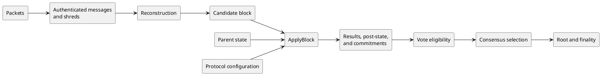

# 3. Terminology and system model

## 3.1 Terms

**Normative table.**

| Term | Meaning in this specification |
|---|---|
| account | State cell keyed by a 32-byte address and carrying lamports, owner, data, executable flag, and rent epoch. |
| bank state | Protocol state at one slot boundary; not a reference to a software object or database. |
| block | The ordered entries and transactions reconstructed for one slot and accepted under Chapter 10. |
| candidate block | Reconstructed slot content before all validity and state-transition checks pass. |
| commitment | A consensus-visible hash or identifier catalogued in Chapter 14. |
| bank hash | The Chapter 14 commitment to one frozen bank and the value checked by the Alpenglow block footer; Alpenglow votes identify a block by its block ID, not by this hash. |
| terminal FEC root | The full 32-byte Merkle root of a slot's final FEC set; it binds shred-chain and repair data but is not a bank hash. |
| entry | A PoH-linked record containing zero or more ordered transactions. |
| feature | An on-chain Feature Gate account whose decoded activation state selects a protocol rule. |
| finalized | The commitment/finality condition defined by Chapter 15, not an RPC label by itself. |
| fork | A parent-linked sequence of slot states sharing an ancestor. |
| reference epoch `E` | Mainnet epoch 1072, whose feature state determines this specification's protocol configuration. |
| root | A locally persisted/pruned consensus anchor advanced only by the active consensus rules. |
| shred | A signed data or coding unit used to disseminate and reconstruct slot payload. |
| slot | A `u64` position in the ledger schedule. A skipped slot has no accepted block. |
| transaction result | Pre-execution rejection or executed success/failure plus the specified committed effects. |

## 3.2 System model

A protocol configuration contains immutable chain identity, the feature state active in
reference epoch `E`, and the parameters needed to interpret blocks. A parent state
contains all accounts and consensus metadata committed at its slot. A candidate block
supplies its parent relation, leader, shreds, entries, and ordered transactions. The
protocol validates representation and block structure, applies the deterministic state
transition, freezes commitments, and exposes the resulting bank state to consensus.

**Informative diagram.**

## 3.3 Determinism boundary

Determinism applies at four different boundaries:

**Normative table.**

| Boundary | Required determinism |
|---|---|
| Pure transition | Equal parent bank, ordered block, and protocol configuration produce the same transaction outcomes, post-state, and commitments. |
| Network observation | Peers may observe different valid messages and arrival orders; an observation-dependent rule must state which authenticated observation set it consumes. |
| Local safety state | Persisted Alpenglow vote history depends on the participant's own prior votes, but the update and voting rules are deterministic for equal local safety state and equal observations. |
| Local policy | Peer choice, retry timing, packet queues, transaction selection, resource scheduling, and storage strategy may vary and do not define protocol validity. |

Accepted byte domains, ordered block content, committed account state,
capitalization, consensus hashes, stake weight, leader assignment, consensus selection
for a given observation set, safe Alpenglow votes, roots, and finality may not vary
for equal applicable protocol inputs. Storage layout, execution strategy, and local
retention policy do not enter any commitment.
