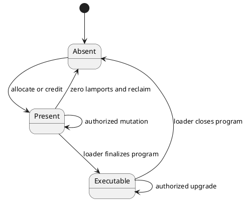

# 4. Account state

## 4.1 Account map and value

Protocol state is a map from a 32-byte account address to a nonzero-lamport account
value. The address is the map key and is not repeated inside the account value. A
committed zero-lamport value is logical deletion: later transactions in that bank and
all descendants load the address as absent. An executor may retain a transient
zero-lamport record while committing or rolling back a transaction, but that record is
not a distinct protocol account state.

**Normative table.**

| Account-value field | Exact type | Constraint and meaning |
|---|---|---|
| `lamports` | `u64` | Native-token balance in lamports. |
| `data` | `0..=10,485,760` bytes | Program-owned state; the maximum is exactly 10 MiB. |
| `owner` | 32 raw bytes | Address of the program permitted to modify `data` or assign the account under the ownership rules. |
| `executable` | one logical Boolean | Legacy executable marker retained in state; account-storage encoding is not protocol-visible. |
| `rent_epoch` | `u64` | Rent metadata; the SBF input ABI presents `u64::MAX` as specified in Section 12.8.6. |

There is no universal wire serialization for an account value. Transactions name
accounts by address, protocol-owned programs define the byte grammar of their `data`,
the SBF program-input representation is defined in Section 12.8.6, and account hashing
is defined in Section 14.4. A database record layout is not a protocol encoding.

[SOL-ACC-0001] A bank **MUST** reject any state transition that would produce account
data longer than `10,485,760` bytes, a lamport value outside `u64`, or an account value
lacking exactly one 32-byte owner.

[SOL-ACC-0002] Every account replacement **MUST** be keyed by the account's 32-byte
address and **MUST** update capitalization and account-state commitments according to
Chapters 11 and 14.

## 4.2 Ownership and mutation limits

An instruction may change an account only through the privileges and ownership rules
established by the transaction and invocation context. SBF ABI v1 reserves 10,240 bytes
after each account's original data for growth during one instruction. Across a
transaction, the aggregate positive data-length change is at most 20,971,520 bytes,
while every individual account remains bounded by 10,485,760 bytes.

[SOL-ACC-0003] An instruction **MUST NOT** increase one account's data length by more
than `10,240` bytes relative to that instruction's entry length, and a transaction
**MUST NOT** produce aggregate positive account-data growth greater than `20,971,520`
bytes.

[SOL-ACC-0004] Only the account owner **MAY** modify account data or change its
length, except for an explicit protocol-program transition; only a writable account
**MAY** have lamports, data, owner, or executable state changed.

[SOL-ACC-0005] An instruction **MUST** conserve the sum of lamports across its
instruction accounts, may debit lamports only from accounts owned by the executing
program, and **MUST** treat any account that commits with zero lamports as logical
deletion regardless of its transient data, owner, or executable fields.

## 4.3 Account lifecycle

**Informative diagram.**

[SOL-ACC-0006] Creation, allocation, assignment, executable transition, truncation, and
closure **MUST** occur only through the protocol-program rule authorizing that
transition. A committed account with zero lamports **MUST** be removed from the logical
account map before the next transaction is loaded; just writing a field-shaped byte
sequence does not create protocol state.

## 4.4 Bank metadata

Consensus metadata associated with the account map includes slot and epoch data, recent
blockhashes, replay-protection ancestry, transaction/signature/compute counters,
capitalization, reward and fee accumulators, the accounts-state accumulator, and the
bank hash. These values are bank state even when they are not represented by ordinary
accounts.
