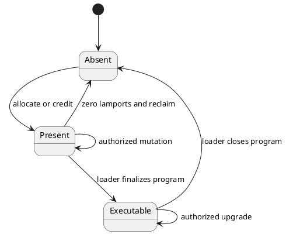

# 4. Account state

## 4.1 Account map and value

Protocol state is a map from a 32-byte account address to a nonzero-lamport account
value. The address is the map key and is not repeated inside the account value. A
committed zero-lamport value is logical deletion: later transactions in that bank and
all descendants load the address as absent. An executor may retain a transient
zero-lamport record while committing or rolling back a transaction, but that record is
not a distinct protocol account state.

**Normative table.**

| Account-value field | Exact type | Constraint and meaning |
|---|---|---|
| `lamports` | `u64` | Native-token balance in lamports. |
| `data` | `0..=10,485,760` bytes | Program-owned state; the maximum is exactly 10 MiB. |
| `owner` | 32 raw bytes | Address of the program permitted to modify `data` or assign the account under the ownership rules. |
| `executable` | one logical Boolean | Legacy executable marker retained in state; account-storage encoding is not protocol-visible. |
| `rent_epoch` | `u64` | Rent metadata; the SBF input ABI presents `u64::MAX` as specified in Section 12.8.6. |

There is no universal wire serialization for an account value. Transactions name
accounts by address, protocol-owned programs define the byte grammar of their `data`,
the SBF program-input representation is defined in Section 12.8.6, and account hashing
is defined in Section 14.4. A database record layout is not a protocol encoding.

[SOL-ACC-0001] A bank **MUST** reject any state transition that would produce account
data longer than `10,485,760` bytes, a lamport value outside `u64`, or an account value
lacking exactly one 32-byte owner.

[SOL-ACC-0002] Every account replacement **MUST** be keyed by the account's 32-byte
address and **MUST** update capitalization and account-state commitments according to
Chapters 11 and 14.

## 4.2 Ownership and mutation limits

An instruction may change an account only through the privileges and ownership rules
established by the transaction and invocation context. The account-size ceiling in
Section 4.1 applies to native and SBF programs alike. The additional SBF input-buffer
and CPI reallocation bounds are defined in Sections 12.8.6 and 12.4; they are not a
universal limit on native instructions. In particular, a System Program allocation
may allocate an account up to the Section 4.1 ceiling in one instruction.

[SOL-ACC-0003] A transaction **MUST** maintain a signed `i64` resize counter, initially
zero. Before each account-length change from `old` to `new`, it **MUST** reject
`new > 10,485,760` as `InvalidRealloc`, then reject
`counter.saturating_add(new - old) > 20,971,520` as
`MaxAccountsDataAllocationsExceeded`. An accepted change adds `new - old` to the
counter with signed saturating arithmetic. Shrinking an account releases resize
capacity; the counter is not a sum of positive allocations. Ownership and writability
checks still apply. Program-specific validation and SBF-specific bounds may reject a
request before it reaches this runtime resize primitive.

[SOL-ACC-0004] Only the account owner **MAY** modify account data or change its
length, except for an explicit protocol-program transition; only a writable account
**MAY** have lamports, data, owner, or executable state changed.

[SOL-ACC-0005] An instruction **MUST** conserve the sum of lamports across its
instruction accounts, may debit lamports only from accounts owned by the executing
program, and **MUST** treat any account that commits with zero lamports as logical
deletion regardless of its transient data, owner, or executable fields.

## 4.3 Account lifecycle

**Informative diagram.**

[SOL-ACC-0006] Creation, allocation, assignment, executable transition, truncation, and
closure **MUST** occur only through the protocol-program rule authorizing that
transition. A committed account with zero lamports **MUST** be removed from the logical
account map before the next transaction is loaded; just writing a field-shaped byte
sequence does not create protocol state.

## 4.4 Bank metadata

Consensus metadata associated with the account map includes slot and epoch data, recent
blockhashes, replay-protection ancestry, transaction/signature/compute counters,
capitalization, reward and fee accumulators, the accounts-state accumulator, and the
bank hash. These values are bank state even when they are not represented by ordinary
accounts.
