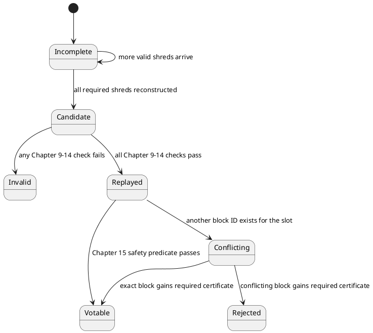

# 10. Slot and block validity

## 10.1 Candidate, incomplete, invalid, and duplicate states

A candidate block is the ordered ledger-data result for one slot and one parent. Network
arrival order, local database layout, and replay-stage thread boundaries do not define
candidate order.

**Informative diagram.**



[SOL-BLK-0001] A validator **MUST** keep “incomplete” distinct from “invalid”: absence
of required data or parity is incomplete, while a failed structural, authentication,
PoH, transaction, execution, or commitment rule is invalid.

[SOL-BLK-0002] Two different authenticated byte strings with the same
`(slot,index,shred-type)` identity **MUST** be treated as duplicate/equivocation
evidence and **MUST NOT** be spliced into one candidate block.

The same slot participates in several typed identities. They are not interchangeable:

**Normative table. Candidate and duplicate identity keys.**

| Domain | Exact key | Binding rule |
|---|---|---|
| shred equivocation | `(slot:u64, index:u32, shred_type)` | two authenticated unequal shred byte strings at the same key are conflicting evidence |
| reconstructed candidate | `(slot:u64, parent_slot:u64, block_id[32])` | the ordered FEC roots and parent commitment produce the Section 14.5 block ID |
| frozen execution result | `(slot:u64, block_id[32], bank_hash[32])` | replay must produce the bank hash committed by that candidate's footer |
| consensus vote or certificate | `(kind,slot,block_id)` for block-bearing kinds; `(kind,slot)` otherwise | stake and signatures accumulate only for the exact typed target |
| repair version | `(slot:u64, block_id[32])` | returned shreds must reconstruct that block ID and then pass replay |
| consensus ancestry | `(slot:u64, block_id[32])` | parent edge comes from the validated block header |

[SOL-BLK-0003] Conflicting blocks in one slot **MUST** remain separate by block ID.
Votes for different block IDs **MUST NOT** be combined into a threshold, and a
certificate for one block ID **MUST NOT** make another candidate valid. A participant
that has emitted its first Notar or Skip vote for the slot **MUST NOT** emit a conflicting
first vote after discovering a duplicate.

[SOL-BLK-0004] A participant that has not yet cast its first slot vote **MUST** apply
the Chapter 15 safe-to-vote predicate independently to each valid, replayed candidate.
An authenticated duplicate is not itself permission to vote. After a Notar certificate
for one exact candidate is observed, descendants and finalization decisions **MUST** use
that certified block and its committed ancestry; an uncertified conflicting candidate
is not votable just because it was received first.

[SOL-BLK-0005] A certificate never repairs a structurally invalid or unreplayed block.
If the certified block is absent, incomplete, dead, has the wrong block ID, or freezes
to another bank hash, the participant **MUST** abstain, obtain the exact certified
version through repair, and rerun Chapters 9 through 14 before voting for it or a
descendant.

## 10.2 Structural completeness

[SOL-BLK-0006] A candidate block **MUST** use data shreds for one slot, one shred
version, one scheduled leader, one parent slot, and one consistent chain of FEC Merkle
roots; all indices from zero through the LAST_IN_SLOT index **MUST** be present or
validly reconstructed exactly once.

[SOL-BLK-0007] Every FEC set contributing to a candidate **MUST** satisfy Chapter 9,
every DATA_COMPLETE boundary **MUST** terminate exactly one deshredded component, and
the unique LAST_IN_SLOT shred **MUST** terminate the last component.

[SOL-BLK-0008] Each deshredded component **MUST** decode as its declared sequence of
Entries and transactions with all counts in bounds; malformed or unconsumed ledger bytes
**MUST** invalidate the candidate rather than be ignored as another component.

## 10.3 Cryptographic and temporal validity

[SOL-BLK-0009] Every shred in a candidate **MUST** have a valid scheduled-leader
signature and Merkle proof, and every reconstructed Entry **MUST** extend the parent
block's final Entry hash through the sequential Chapter 8 PoH transition.

[SOL-BLK-0010] A full candidate **MUST** contain exactly the tick progress required to
reach the bank's maximum tick height, **MUST** end in a tick, and **MUST NOT** contain
an Entry after that final tick.

[SOL-BLK-0011] The tick-hash accumulator **MUST** satisfy the rule in Chapter 8 across
component boundaries; a component boundary **MUST NOT** reset PoH state or the partial
tick-hash count.

## 10.4 Transaction and state-transition validity

[SOL-BLK-0012] Transactions **MUST** be validated in reconstructed ledger order under
Chapter 7, and every transaction signature and message hash that the protocol
configuration requires **MUST** be checked before the block is accepted.

[SOL-BLK-0013] Starting from the selected parent state, the validator **MUST** apply the
ordered transactions and system transitions under Chapters 11 through 13 and **MUST**
reject the candidate if replay returns a block-fatal error or the resulting commitments
fail Chapter 14. Chapter 15 separately determines whether the valid, replayed candidate
is eligible for a local vote or consensus transition.

Transaction-level failure represented as a deterministic transaction result is not
automatically a block-fatal error; the runtime chapters define that boundary.

### 10.4.1 Transaction cost calculation

Cost units used for block admission are not just execution compute units. Let:

**Normative table. Every epoch-`E` cost-model constant factor.**

| Symbol / use | Exact value | Unit | Rounding or application point |
|---|---:|---|---|
| transaction Ed25519 signature | `720` | cost units/signature | multiply by required signature count |
| secp256k1 precompile signature | `6,690` | cost units/signature | multiply by the instruction-declared count byte |
| Ed25519 precompile signature | `2,400` | cost units/signature | multiply by the instruction-declared count byte |
| secp256r1 precompile signature | `4,800` | cost units/signature | multiply by the instruction-declared count byte |
| requested writable account | `300` | cost units/account | count message-requested writable accounts before reserved-key or program demotion |
| instruction-data throughput numerator | `140` | bytes per microsecond | configuration input |
| cost-unit duration | `30` | microseconds per cost unit | produces divisor `floor(140/30)=4` bytes/cost unit |
| instruction-data charge | `floor(D/4)` | cost units | truncate once after summing top-level data bytes |
| loaded-data page size | `32,768` | bytes | started-page rounding |
| loaded-data page charge | `8` | cost units/page | `8*ceil(L/32768)`, zero when `L=0` |
| execution term | `X` | cost units | actual consumed CU in the committed transaction result |
| loaded-data term input | `L` | bytes | actual metered loaded-account bytes in the committed transaction result |
| maximum one transaction request | `1,400,000` | compute units | Section 7.6 cap; not itself the total cost |
| static allocation per account | `10,485,760` | bytes | a larger recognized request makes the transaction's static allocation estimate zero |
| static allocation per transaction | `20,971,520` | bytes | clamp after summing recognized top-level System requests |

No omitted coefficient, floating-point conversion, or implementation-specific cost is part of
the epoch-`E` transaction cost. All products and sums below use saturating `u64`
arithmetic unless an earlier syntax bound makes overflow impossible.

- `n_tx` be the required transaction-signature count, and `n_k1`, `n_ed`, and `n_r1` be
  the sums of the first instruction-data byte of each top-level instruction addressed to
  the respective active secp256k1, Ed25519, and secp256r1 precompile; an empty
  instruction contributes zero, while later precompile validation remains a separate
  execution check;
- `W` be the number of message-requested writable accounts before any writability
  demotion;
- `D` be the sum of all top-level instruction-data lengths in bytes;
- `X` be program-execution compute units; and
- `L` be loaded-account data bytes.

Define `pages(0) = 0` and `pages(L) = 1 + floor((L - 1) / 32768)` for `L > 0`. The
transaction cost is:

**Normative algorithm.**

```text
C_fixed = 720*n_tx + 6690*n_k1 + 2400*n_ed + 4800*n_r1
        + 300*W + floor(D/4)

C_tx = C_fixed + X + 8*pages(L)
```

Thus loaded account data costs exactly 8 cost units for each started 32-KiB page: zero
bytes cost zero, bytes `1..32768` cost 8, and bytes `32769..65536` cost 16. This
admission charge is distinct from the SBF heap charge in Section 12.8.8, although both
use an eight-unit page coefficient.

For final block validity, use actual executed compute units as `X` and actual metered
loaded-account bytes as `L`; the fixed terms do not change. Add the resulting full
`C_tx` once to the block counter and once to the counter of every account that remains
writable after sanitation and writability demotion. A producer may reserve against
requested limits while choosing transactions, but reservation, refund, queue order, and
selection strategy are not ledger rules. A transaction omitted before recording
contributes nothing.

The allocated-data counter is separate from `C_tx`. Scan top-level System program
instructions and sum the requested `space` of CreateAccount, CreateAccountWithSeed,
Allocate, AllocateWithSeed, and CreateAccountAllowPrefund. If any scanned System
instruction cannot be decoded or requests more than `10,485,760` bytes, its transaction
contributes zero to this static counter. Otherwise clamp the transaction sum to
`20,971,520` bytes before adding it to the block counter. CPI and non-System
instructions do not add a static allocation estimate.

[SOL-BLK-0014] Replay **MUST** calculate and attribute every committed transaction's
actual cost and statically requested allocation by the formulas above. It **MUST**
charge the complete transaction cost to every account that remains writable after
demotion and round loaded-account bytes up to 32-KiB pages rather than truncate them.

### 10.4.2 Per-slot production and ledger-envelope limits

The epoch-`E` block budgets are distinct from each transaction's requested compute
limit. The same cost limits are enforced during production admission and again while
replaying the committed transaction results:

**Normative table.**

| Resource | Maximum admitted in one produced block |
|---|---:|
| aggregate transaction cost | `50,000,000` cost units |
| aggregate cost charged to any one writable account | `20,000,000` cost units |
| aggregate statically requested System allocation size | `50,000,000` bytes |
| serialized Entry-batch bytes | `10,485,760` bytes |
| data-shred index domain | `0..=16,383` |
| coding-shred index domain | `0..=16,383` |
| 32+32 FEC sets / DATA_COMPLETE components | `512` |

The ledger envelope independently permits indices `0..16383` for data shreds and
`0..16383` for coding shreds. Because every epoch-`E` FEC set is exactly 32 data plus 32
coding shreds, a slot contains at most 512 FEC sets. The exact shred lengths, payload
capacities, fixed-set rules, and reconstruction threshold are in Chapter 9. There is no
separate epoch-`E` numeric limit on transactions per block or signatures per block: the
transaction envelope, shred envelope, cost counters, and
per-transaction limits bound them. These are all active epoch-`E` per-slot production
counters and shred/FEC count envelopes. Queue capacities, batching targets, cache
bounds, retention limits, and rate limits that only govern a validator's local work are
not block or shred validity limits and therefore are not included.

[SOL-BLK-0015] A block producer **MUST NOT** select a transaction that would make one
of the three epoch-`E` counters exceed the table above. Replay **MUST** independently
recompute actual transaction costs in ledger order for every committed result and apply
the aggregate, per-writable-account, and allocated-data limits.
`WouldExceedMaxBlockCostLimit`, `WouldExceedMaxAccountCostLimit`, or
`WouldExceedAccountDataBlockLimit` encountered in production excludes the transaction;
the same result during replay is block-fatal. The Chapter 9 shred/FEC envelope is the
independent byte-framing bound, including the 10-MiB Entry-byte ceiling. None of these
limits substitutes for the per-transaction
execution meter in Chapter 12.

## 10.5 Acceptance and local disposition

[SOL-BLK-0016] A slot **MUST NOT** become a votable valid block until requirements
SOL-BLK-0006 through SOL-BLK-0015 have all succeeded for the same candidate and parent,
and Chapter 15 permits a vote for that exact block ID under the participant's persisted
safety state.

[SOL-BLK-0017] A validator **MUST** derive block identity, bank hash, vote target, and
consensus eligibility only from the single accepted ordered candidate; local arrival
timing or the first conflicting shred observed **MUST NOT** alter those commitments.

[SOL-BLK-0018] Marking a slot dead in a local store **MAY** suppress repeated local
replay work, but it **MUST NOT** be serialized or interpreted as a network proof that
every competing duplicate candidate for that slot is invalid.
