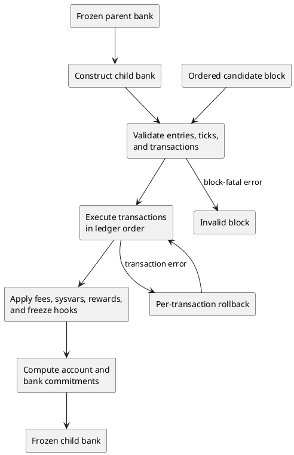

# 11. Deterministic state transition

## 11.1 State and function boundary

The consensus transition is modeled as:

**Normative algorithm.**

```text
ApplyBlock(parent_bank, ordered_block, protocol_configuration) -> child_bank | InvalidBlock
```

The parent bank contains the account state and consensus metadata defined in Chapter 4
and fixed by earlier slots. The ordered block contains the slot identity, leader
identity, entry/transaction order, ticks, and terminal PoH value defined by Chapters 8
through 10. The protocol configuration contains the genesis identity and parameters;
every mutable selector comes from the parent-derived bank state.

**Informative diagram.**



[SOL-STA-0001] `ApplyBlock` **MUST** be a deterministic function of the parent bank, the
byte-identical ordered block, and the protocol configuration; scheduling, thread count,
caches, host time, filesystem order, and network arrival order **MUST NOT** change its
result.

[SOL-STA-0002] `ApplyBlock` **MUST** create a child bank for the candidate slot without
modifying the frozen parent bank.

[SOL-STA-0003] A block that fails any block-wide validity condition **MUST** produce
`InvalidBlock` and **MUST NOT** expose a partially frozen child bank as a valid fork
state.

## 11.2 Child-bank construction and pre-transaction phase

[SOL-STA-0004] Child-bank construction **MUST** derive the child's slot, epoch, parent
hash, block height, tick bounds, feature set, epoch schedule, recent-blockhash queue,
replay-protection ancestry, program environment, capitalization, and inherited account
state from the frozen parent and protocol configuration using checked arithmetic where
the specified domain can overflow.

[SOL-STA-0005] At an epoch boundary, `ApplyBlock` **MUST** perform feature activation,
epoch stake/cache transition, and the applicable epoch-reward initialization before any
transaction in the child slot is executed.

[SOL-STA-0006] Before the first transaction, `ApplyBlock` **MUST** apply the slot's
scheduled partitioned-reward distribution and update the Clock, SlotHashes, StakeHistory
when applicable, LastRestartSlot, and executable sysvar cache in the protocol order
specified by Chapters 13 and 16.

[SOL-STA-0007] Every feature-dependent branch used by child-bank construction,
transaction processing, or freeze **MUST** be selected from the parent-derived bank's
activation state at this slot.

Stake-weighted timestamp and reward formulas are owned by Chapters 13 and 16; this
chapter fixes their position in the transition.

## 11.3 Ordered transaction transition

Let `B_i` be the visible bank state immediately before transaction `i` in ledger order,
including all committed effects of earlier transactions in the slot.

[SOL-STA-0008] Transactions **MUST** be validated, loaded, executed, and committed in
ledger order, and transaction `i` **MUST** read `B_i` rather than a snapshot that omits
an earlier transaction's committed writes.

[SOL-STA-0009] A parallel executor **MAY** speculate or execute concurrently only when
its committed account state, transaction dispositions, counters, fees, and errors are
identical to the sequential transition
required by `SOL-STA-0008`.

**Normative algorithm. Transaction phase and error precedence.**

```text
1  decode envelope and statically sanitize message fields
2  verify every required transaction signature
3  resolve every version-0 lookup table and append LW then LR
4  check resolved key count, then duplicate keys, and derive effective privileges
5  scan compute-budget instructions and derive fee/execution limits
6  validate recent blockhash, else durable nonce
7  query the replay-protection relation
8  load and validate fee payer, validate rent transition, deduct fee,
   and stage durable-nonce advancement
9  meter/load transaction accounts and resolve programs
10 verify precompiles and execute top-level instructions in order
11 validate post-state, then commit success or fee/nonce rollback state
12 update replay protection, signature, compute, fee, and block-cost counters
```

At every numbered phase, the first failing check in message/account order is the
transaction error; later phases are not evaluated for that transaction. Within phase 5,
scan top-level instructions in order and report the first malformed or repeated
compute-budget setting. Within phase 6, an ordinary recent blockhash takes precedence;
durable-nonce recognition is attempted only when the ordinary hash is not valid. Within
phase 9, use the exact ordering in Section 7.7.1. Within phase 10, precompile
verification follows message order and ordinary instruction execution stops at its first
failing index.

[SOL-STA-0010] Each transaction **MUST** pass through the phase order above. In
particular, compute-budget interpretation precedes age/nonce, age/nonce precedes
replay-protection lookup, signature verification precedes address-table resolution,
resolved account-count failure precedes duplicate-key failure, and all of those checks
precede fee deduction. Account contention is not a protocol phase; an implementation
that uses locks **MUST** wait, retry, or serialize without changing the selected error.

[SOL-STA-0011] An unprocessable transaction **MUST** leave the account map, fee
accumulators, processed-signature counter, executed-compute counter, and replay-
protection relation unchanged.

For the currently specified transition, a processed transaction has one of three
relevant results:

**Normative table.**

| Result | Account-map effect | Fee/counter effect | Transaction status |
|---|---|---|---|
| successful execution | commit protocol-permitted changes to touched writable accounts | charge fee and record execution usage | success |
| failed execution | commit only fee-payer and valid durable-nonce rollback accounts | charge fee and record execution usage | instruction/runtime error |
| fee-only loading failure | commit only fee-payer and valid durable-nonce rollback accounts | charge fee; no program execution | load error |

## 11.4 Instruction success and rollback

[SOL-STA-0012] A successfully executed transaction **MUST** commit only
protocol-permitted changes to its touched writable accounts, including account creation
or zero-lamport reclamation, and **MUST NOT** commit a change to a readonly account.

[SOL-STA-0013] A transaction whose instruction processing fails **MUST** discard every
program-produced account change and **MUST** commit only the already-deducted fee-payer
state and the advanced durable-nonce state when those are distinct rollback accounts.

[SOL-STA-0014] A post-fee account-loading failure **MUST** use the same fee-payer and
durable-nonce rollback rule as a failed execution and **MUST NOT** invoke any top-level
instruction.

[SOL-STA-0015] When the fee payer and durable-nonce address are the same, rollback
**MUST** preserve one account value containing both the nonce advancement and the fee
deduction, not two order-dependent overwrites.

[SOL-STA-0016] A valid durable-nonce transaction **MUST** advance the nonce to the
bank-derived next durable nonce before instruction execution, and failed execution or
fee-only loading failure **MUST NOT** roll that advancement back.

[SOL-STA-0017] Top-level instructions **MUST** execute in message order and processing
**MUST** stop at the first instruction error.

[SOL-STA-0018] At every successfully returned instruction boundary, the sum of lamports
across that instruction's transaction accounts **MUST** equal the sum on entry, and
outstanding account-data borrows **MUST** be released; violation **MUST** fail the
transaction.

The ownership, executable, data-length, rent, and CPI privilege rules that determine
whether a program-produced change is permitted are specified in Chapters 12 and 13.

## 11.5 Replay protection, counters, and fees

Define the replay-protection relation abstractly over the recent-blockhash window. Its
protocol key is `(recent_blockhash, message_hash)`, where `message_hash` is Section
14.3. A relation entry says that the message has already been processed on this fork;
its database representation, truncated index keys, and lookup acceleration are outside
scope.

[SOL-STA-0019] Each `P1`, `P2`, or successful processed transaction **MUST** add its
`(recent_blockhash, message_hash)` to the child fork's replay-protection relation, with
the transaction outcome needed by descendants. No signature value is a second
protocol replay key.

[SOL-STA-0020] A processed durable-nonce transaction **MUST** additionally obtain replay
protection from the committed nonce advancement specified in Section 11.4.

[SOL-STA-0021] The slot's processed-signature counter **MUST** add
`required_signature_count` for every processed transaction, whether execution succeeds,
fails, or stops at fee-only loading; precompile signature records affect the fee count
but **MUST NOT** be added to this bank-hash counter.

[SOL-STA-0022] Fee collection **MUST** add the charged base/signature and prioritization
components to the child bank's fee accumulators using the protocol overflow behavior,
and later distribution **MUST NOT** depend on transaction execution success.

[SOL-STA-0023] Compute consumption and transaction cost counters **MUST** be updated
from the processed result in ledger order using the limits and actual execution
measurements selected by Chapters 7 and 12.

## 11.6 Ticks, freeze, and post-state

[SOL-STA-0024] `ApplyBlock` **MUST** verify and register entries and ticks in ledger
order, and the final tick at the slot boundary **MUST** register the terminal PoH hash
in the recent-blockhash queue before incrementing the tick height to its complete value.

[SOL-STA-0025] The recent-blockhash and replay-protection age windows used by later
transactions and child slots **MUST** be derived from the protocol queues after the
ordered tick registrations, not from wall-clock time.

[SOL-STA-0026] Freeze **MUST** occur only after the slot is complete and every accepted
transaction result has been committed.

[SOL-STA-0027] Freeze **MUST** distribute the slot's accumulated fees, update
SlotHistory, process the incinerator account, finish all account-state accumulator
updates, and compute the bank hash in that order where Chapter 14 requires ordering.

[SOL-STA-0028] Incinerator processing **MUST** replace a present incinerator account
with the default zero-lamport account and subtract its former lamports from
capitalization using checked protocol arithmetic.

[SOL-STA-0029] Every protocol-owned account update performed outside a transaction,
including sysvar, reward, fee, and incinerator writes, **MUST** update capitalization
and the accounts-state accumulator by the same observable rules as an equivalent account
replacement.

[SOL-STA-0030] A successfully frozen child bank **MUST** expose the terminal recent
blockhash, complete tick height, final account map, capitalization, replay-protection
additions, accounts-state commitment, and bank hash as the post-state consumed by its
descendants.

## 11.7 Dependencies

This chapter establishes deterministic phase order and transaction commit/rollback
behavior. It relies on Chapters 8 through 10 for entry and tick validity, Chapter 12 for
executable semantics, Chapter 13 for protocol-owned state, Chapter 14 for hashes, and
Chapter 16 for epoch, reward, and fee arithmetic.
