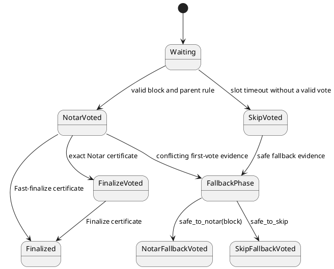

# 15. Consensus, voting, and finality

## 15.1 Consensus algorithm

Mainnet epoch `E` uses Alpenglow. Consensus operates on Section 14.5 block IDs and the
current epoch's admitted vote-account stake set. It does not use Tower lockouts, switch
proofs, or heaviest-observed-subtree fork choice.

## 15.2 Consensus wire codec and signer set

An `ALPENGLOW-WIRE-E1072` datagram is Wincode fixed-integer encoding with no alignment
padding. It begins with outer-version byte `1`, then one kind record, then shred version
`u16` little-endian. A block target is slot `u64` little-endian followed by its 32-byte
block ID. Vote signatures are uncompressed BLS12-381 signatures of 192 bytes.

**Normative table. Consensus-message kinds.**

| Tag | Kind | Target and payload before final shred version |
|---:|---|---|
| `1` | Notar vote | block; vote signature |
| `2` | Finalize vote | slot; vote signature |
| `3` | Skip vote | slot; vote signature |
| `4` | Notar-fallback vote | block; vote signature |
| `5` | Skip-fallback vote | slot; vote signature |
| `7` | Finalize certificate | slot; certificate signature |
| `8` | Fast-finalize certificate | block; certificate signature |
| `9` | Notar certificate | block; certificate signature |
| `10` | Notar-fallback certificate | block; certificate signature |
| `11` | Skip certificate | slot; certificate signature |

A certificate signature is a 192-byte uncompressed aggregate BLS signature, a bitmap
byte length as `u64` little-endian, and exactly that many bitmap bytes. Tags 6 and 12 are
reserved and rejected in the epoch-`E` profile. Every other tag is unknown and rejected.

The bitmap bytes begin with the one-byte version in the first column and then use the
corresponding exact encoding:

**Normative table. Certificate signer-map codec.**

| Version | Header | Payload | Permitted certificate kinds |
|---:|---|---|---|
| `0` | bit count, `u16` LE | `ceil(bits/8)` bytes, ranks packed LSB first; unused high bits zero | all active kinds |
| `1` | rank count, `u16` LE | `ceil(ranks/5)` bytes, five base-3 digits per byte | Notar-fallback and Skip only |

For version 1, rank `i` has digit 0 for absent, 1 for the primary vote, and 2 for the
fallback vote. Digits are grouped in increasing rank order; within a byte the first
digit is the least-significant base-3 digit. After the declared digits are removed, the
remaining quotient **MUST** be zero. The two signer sets are disjoint. For
Notar-fallback the primary and fallback payloads are Notar and Notar-fallback; for Skip
they are Skip and Skip-fallback. Version 1 is invalid for every other certificate.

The signed vote payload is Wincode encoding of the same vote tag and target followed by
shred version `u16`. The wire message then carries its own final shred-version field as
well. Certificate verification reconstructs these payloads from the certificate kind,
uses the bitmap ranks to select BLS public keys, and verifies the aggregate signature.

[SOL-CON-0001] A receiver **MUST** require the wire shred version to be `50093`, decode
the datagram exactly, and identify the sender's node identity from its authenticated
connection. It **MUST** map that identity to one admitted vote account and derive its
rank, BLS public key, and effective stake from the target slot's epoch stake map; none
of those values is supplied by the datagram. Signature verification **MUST** reconstruct
the signed vote payload with the same expected shred version.

[SOL-CON-0002] A vote **MUST** verify against the canonical signed payload under the
sender's BLS key. A certificate **MUST** have a canonical rank map, valid selected
public keys, a valid aggregate signature over the appropriate payload or payload pair,
and enough selected effective stake for its kind. A rank contributes at most once.

## 15.3 Certificates and exact stake thresholds

Let `T` be the sum of effective stake of all admitted epoch vote accounts and `S` the
sum for the unique ranks selected by a valid certificate. Compare exact integers; do not
convert them to floating point.

**Normative table. Certificate thresholds.**

| Certificate | Source votes | Acceptance condition |
|---|---|---|
| Notar | Notar for the exact block | `5*S >= 3*T` |
| Notar-fallback | Notar and/or Notar-fallback for the exact block | `5*S >= 3*T` |
| Skip | Skip and/or Skip-fallback for the slot | `5*S >= 3*T` |
| Finalize | Finalize for the slot | `5*S >= 3*T` |
| Fast-finalize | Notar for the exact block | `5*S >= 4*T` |

Equality passes every threshold. A certificate with zero total stake, a rank beyond the
admitted map, or a bitmap length inconsistent with that map is invalid.

[SOL-CON-0003] A participant **MUST** accumulate votes separately by kind and exact
target, construct only the certificate combinations in the table, and apply the integer
threshold before using or forwarding a certificate. Support for conflicting block IDs
or different slots **MUST NOT** be combined. At most four distinct Notar-fallback
certificates can exist for one slot; observing a fifth is a consensus-safety violation
and it **MUST NOT** be added to parent readiness.

## 15.4 Leader windows and parent readiness

One scheduled leader owns four consecutive slots. A slot whose index is divisible by
four is the first slot of its leader window. For a proposed first-slot block `x` with
parent `p`, `p` is parent-ready when:

1. a Notar, Notar-fallback, or Fast-finalize certificate exists for exactly `p`; and
2. every slot from `p.slot + 1` through `x.slot - 1` has a Skip certificate.

Within the remaining three slots of a leader window, the parent must be the immediately
preceding slot's exact block. A validator can extend it only after casting its own Notar
vote for that parent.

When several blocks are parent-ready for the same production window, choose the
lexicographically least `(slot,block_id)` pair. A leader does not produce a stale window
after observing a later parent-ready slot.

[SOL-CON-0004] A first-slot block **MUST NOT** be produced or Notar-voted without the
parent-ready certificate chain above. An intra-window block **MUST** name the preceding
slot and exact block ID, and a participant **MUST NOT** Notar-vote it unless its own
persisted history contains a Notar vote for that parent.

[SOL-CON-0005] Parent readiness **MUST** be derived from verified certificates, not
unaggregated vote counts. Every skipped slot in the gap requires its own Skip
certificate; a later certificate does not silently fill an uncertified gap.

## 15.5 Vote state and safe fallback predicates

For each slot, persistent safety state records the exact votes emitted and whether the
slot is over. The first ordinary vote is either Notar for one replayed block or Skip for
the slot, never both. Later fallback votes do not erase that first vote.

For one slot let `N(b)` be stake that sent a Notar vote for exact block `b`, `K` stake
that sent Skip, `N_all` the sum of Notar stake across all block IDs, and `N_max` the
largest `N(b)`. Count each admitted vote account once in each applicable set.

**Normative algorithm.**

```text
safe_to_notar(b) = N(b) * 5 >= T * 2
                or (N(b) * 5 >= T
                    and (N(b) + K) * 5 >= T * 3)

safe_to_skip = (K + N_all - N_max) * 5 >= T * 2
```

The first predicate means at least 40% Notar for `b`, or at least 20% Notar for `b`
and at least 60% combined Notar-for-`b` plus Skip. The second requires at least 40%
stake that cannot all support one block. Equality passes. Arithmetic uses exact `u128`
products and sums.

After the first-vote window, `safe_to_notar(b)` permits a Notar-fallback vote for `b`;
`safe_to_skip` permits a Skip-fallback vote for the slot. A participant may emit a
Notar-fallback vote once for each of at most three distinct block targets and may emit
one Skip-fallback vote. A fallback matching an already emitted vote is a duplicate, not
a second contribution. Every fallback retains the prior first vote.

**Normative table. Per-validator vote exclusions for one slot.**

| Proposed vote | Existing vote state that forbids it | Duplicate that contributes no additional stake |
|---|---|---|
| Notar for `b` | ordinary Skip; ordinary Notar for a different block | ordinary Notar or Notar-fallback for `b` |
| Skip | Finalize; ordinary Notar | prior Skip or Skip-fallback |
| Notar-fallback for `b` | Finalize; three distinct prior Notar-fallback targets | prior Notar or Notar-fallback for `b` |
| Skip-fallback | Finalize | prior Skip or Skip-fallback |
| Finalize | Skip, Skip-fallback, or any Notar-fallback | prior Finalize |

The exclusions apply irrespective of arrival order. An invalid combination is not
counted toward any predicate or certificate. An ordinary first vote and its permitted
fallback votes remain distinct signed messages, but one rank contributes at most once
to a certificate's union signer set.

[SOL-CON-0006] A participant **MUST** persist every emitted vote before another vote
that could conflict with it becomes externally visible. Restart, identity change, or
process failure **MUST NOT** permit two ordinary first votes, ordinary Notar votes for
different targets, more than three distinct Notar-fallback targets, or another
combination forbidden by the table for one slot.

[SOL-CON-0007] Fallback votes **MUST** use the exact predicates above and verified
first-vote observations. A participant **MUST NOT** treat a timeout, missing block, or
local preference as evidence that either stake predicate passed.

## 15.6 Notarization and finalization transitions

A validator emits a Notar vote only after the exact candidate has passed replay and the
parent rule in Section 15.4. On observing a Notar certificate for block `b`, it may emit
Finalize for `b.slot` only if its persisted first vote for that slot was Notar for exact
`b`, it has not already finalized the slot, and the leader window has not entered a
conflicting skip/fallback state. Finalize names only the slot because the prerequisite
local Notar vote binds the block.

**Informative diagram.**



[SOL-CON-0008] A participant **MUST NOT** Finalize a slot unless it previously Notar-
voted the exact certified block and the Notar certificate passes Section 15.3. It
**MUST NOT** emit Finalize for two blocks indirectly by changing its remembered first
vote.

[SOL-CON-0009] An observed certificate changes consensus state only after its aggregate
signature, signer map, threshold, target, shred version, and ancestry have all verified.
Unknown or unreplayed targets may trigger repair but **MUST NOT** be treated as locally
valid or rooted before replay succeeds.

## 15.7 Finality and ancestry

A block is fast-finalized by a valid Fast-finalize certificate for its exact block ID.
It is slow-finalized by a valid Notar certificate for the exact block plus a valid
Finalize certificate for its slot. Either route uses the thresholds in Section 15.3.
Finalizing a block also finalizes every block on its validated parent chain and skips
slots omitted by that chain.

[SOL-CON-0010] A participant **MUST** accept finality only for an exact block whose
header ancestry is available and internally consistent. Before advancing the execution
root, it **MUST** reconstruct and replay the block, match the Section 14.5 block ID, and
match the footer bank hash to the frozen bank. A certificate alone is not an execution
state commitment.

## 15.8 Duplicates, repair, and root advancement

Different block IDs at one slot are competing Alpenglow proposals. Votes and
certificates remain keyed to their exact target as required by Section 10.1. A valid
Notar or stronger certificate identifies the block version that may extend consensus;
it does not make missing ledger bytes, an invalid footer, or a bank-hash mismatch valid.

[SOL-CON-0011] On learning a certificate for an absent or conflicting version, a
participant **MUST** request and authenticate shreds for the certified block ID, keep
conflicting FEC sets separate, and replay the certified version before voting on a
descendant or advancing its root. It **MUST NOT** combine a certificate's stake with
votes for another block ID.

[SOL-CON-0012] Root advancement **MUST** follow a locally replayed finalized block.
Selectable state not descending from the new root is discarded; bytes retained for
equivocation evidence or repair remain nonselectable. A restart **MUST** restore the
highest durable root, emitted-vote history, and highest parent-ready state without
creating an opportunity to equivocate.

## 15.9 Timing and liveness policy

The protocol target is `200` milliseconds per slot. A leader window spans four slots.
Let `t0` be the local instant when parent readiness starts the window. The nominal
handover allowance is `400` milliseconds and each block allowance is `200`
milliseconds. The four nominal ordinary-Skip deadlines are therefore
`t0 + 600 ms`, `t0 + 800 ms`, `t0 + 1,000 ms`, and `t0 + 1,200 ms`. An already emitted
ordinary first vote suppresses the corresponding Skip.

Network synchrony analysis uses `DELTA = 250` milliseconds. Standstill backoff, a
separate crashed-leader notification, and delaying or abstaining from an otherwise
permitted Skip are local liveness policy. These clocks create Skip opportunities but do
not make an otherwise invalid vote or certificate valid.

[SOL-CON-0013] Persisted vote safety, exact-target separation, certificate thresholds,
parent readiness, and rooted-fork pruning are protocol requirements. Retry cadence,
certificate rebroadcast, standstill detection, queue sizing, and voluntary abstention
are local liveness policy except where a wire or timeout value is explicitly required
for interoperability.
