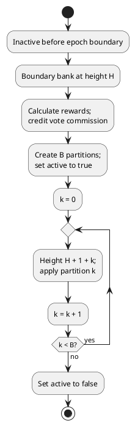

# 16. Epochs, leader schedule, stake, fees, and rewards

## 16.1 Epoch schedule

Mainnet has `slots_per_epoch = 432000`, `leader_schedule_slot_offset = 432000`,
`warmup = false`, `first_normal_epoch = 0`, and `first_normal_slot = 0`. Consequently,
`first(e) = 432000 * e`, `epoch(s) = floor(s / 432000)`, and the index of slot `s`
within its epoch is `s mod 432000`.

The active epoch-`E` slot-parameter profile has a target duration of exactly
`200,000,000` nanoseconds per slot. This target supplies the `157,784,629.968`
slots-per-year value used by Section 16.6; wall-clock arrival before or after that
target does not by itself make a block valid or invalid.

[SOL-EPO-0001] Slot `s` **MUST** map to the unique epoch `e` satisfying
`first(e) <= s < first(e)+slots(e)`, with slot index `s-first(e)`.

The leader-schedule epoch at every Mainnet slot `s` is `epoch(s) + 1`.

[SOL-EPO-0002] The stake snapshot used to construct an epoch's leader schedule **MUST**
be the ancestor-derived epoch-vote-account snapshot selected at the leader-schedule
boundary, not live stake observed later in that epoch.

## 16.2 Leader schedule input

For each vote account in the selected epoch snapshot with positive effective stake, form
`(node_identity, vote_address, stake)`. Sort records by decreasing stake; for equal
stake, sort by decreasing lexicographic vote-address bytes. Identical
`(vote_address,stake)` records collapse to one. Let the sorted stake weights be
`w[0..n)` and require `n>0` and checked `u64` sum `T>0`.

[SOL-EPO-0003] The leader schedule **MUST** contain exactly `slots(epoch)` assignments
and **MUST** repeat every sampled leader for four consecutive slot indices.

## 16.3 Deterministic weighted sampling

Initialize a ChaCha20 random generator with the following 32-byte seed; initial stream
and word position are zero.

**Normative table.**

| Byte offset | Size | Value |
|---:|---:|---|
| 0 | 8 | `LE(epoch,8)` |
| 8 | 24 | all zero bytes |

For each group of four slots, draw `r` as the generator's next little-endian `u64`. To
sample uniformly in `[0,T)` without modulo bias:

**Normative algorithm.**

```text
reject = (2^64 - T) mod T
zone   = (2^64 - 1) - reject
repeat:
    r = next_u64()
    z = r * T                         // exact u128
    hi = floor(z / 2^64)
    lo = z mod 2^64
until lo <= zone
x = hi
```

Construct checked prefix sums `p[i]=sum(w[0..=i])`. Select the least index `i` with
`p[i] > x`.

[SOL-EPO-0004] A leader scheduler **MUST** use the Section 16.3 rejection sampler and
first-prefix-greater selection; `% T`, floating-point weighted choice, or a different
random stream violates this rule even if its distribution is statistically equivalent.

[SOL-EPO-0005] Global slot `s` **MUST** be assigned to the leader at schedule index
`s-first(epoch(s))`; a block from another identity is not a votable candidate for that
slot.

## 16.4 Effective stake

Effective stake is derived from stake-account delegation
`(stake, activation_epoch,deactivation_epoch)`, its delegated vote address, and the
StakeHistory records in Section 13.4. The warmup/cooldown-rate transition activated at
slot `244,080,000`, the first slot of epoch `565`. For a change entering epoch `e`, the
integer rate is `2,500` basis points when `e < 565` and `900` basis points when
`e >= 565`.

[SOL-EPO-0006] Stake weight used for leader selection, voting thresholds, consensus
certificates, and rewards **MUST** come from the specific epoch snapshot named by the
applicable algorithm; current account lamports or a later epoch's effective stake
**MUST NOT** be substituted. Effective stake **MUST** use the epoch-565 rate transition
and the activation/deactivation arithmetic below.

For activation, begin with zero effective stake at `activation_epoch`. For each
following epoch, using the preceding StakeHistory record, let `A` be the account's
remaining activating stake, `CA` the cluster activating stake, `CE` cluster effective
stake, and `r` the selected basis-point rate. Calculate:

**Normative algorithm.**

```text
allowance = min(A, floor(sat_u128(A * CE * r) / (u128(CA) * 10000)))
delta = min(A, max(1, allowance))
```

If `A` is zero, stop. If `CA` is zero, stop without applying a delta. If `CE` is zero,
`allowance = 0` and the one-lamport progress rule applies. Add `delta`, capped at
delegated stake. Stop at the target or deactivation epoch, on missing later history, or
when fully effective. Missing the initial activation record makes the delegation fully
effective.

For deactivation, begin with the stake effective at `deactivation_epoch` and apply the
same formula with `A` equal to remaining effective stake and `CA` equal to cluster
deactivating stake; subtract `delta` saturating. Missing the initial deactivation record
makes the delegation fully inactive. All products are saturating `u128`; the denominator
is exact `u128`; division is integer floor. No floating-point operation is used.

## 16.5 Fees

A transaction's fee effects are part of Chapter 11's ordered state transition. The fee
contains the bank's signature fee and compute-budget-derived prioritization component.
Pre-execution rejection is distinct from an executed instruction failure; only the
latter class and the loading-failure class in Chapter 7 have the charged-fee/rollback
behavior stated in Chapters 7 and 11.

[SOL-EPO-0007] Fee calculation **MUST** use the arithmetic in Chapter 7, and fee debit,
burn, and collector credit **MUST** be committed or rolled back according to the
transaction disposition rather than instruction success alone.

[SOL-EPO-0008] Collected fees **MUST** be distributed during bank freeze before the bank
hash. Fifty percent of base fees **MUST** be burned and fifty percent credited to the
valid leader fee collector; priority fees **MUST** be credited in full to that
collector. An invalid collector causes its distributable amount to be burned.

The collector is read from the scheduled leader's vote state in the epoch-stakes
snapshot used to construct the current leader schedule. Use its V4
`block_revenue_collector`; if that field is unavailable, use the scheduled node identity.
Let `deposit` be the full priority fee plus the unburned half of the base/signature fee.
If `deposit=0`, do nothing. Otherwise load the collector account, substituting a default
zero-lamport System-owned account when absent, and add with checked `u64` arithmetic.

If the collector is the leader's vote address, the checked addition is sufficient. For
another address, validate in this order: its owner is the System Program; it is not in
the reserved set; and either it is the incinerator, or its rent rule passes. Because the
relaxed post-execution minimum-balance rule is active, a non-incinerator account with a
nonzero pre-balance may remain rent-paying after deposit; a zero-pre-balance account must
be rent-exempt after deposit. The incinerator bypasses the rent check and is burned at
the normal freeze point.

[SOL-EPO-0009] Fee-collector selection and validation **MUST** use the snapshot and
ordered rules above. Overflow maps to `DepositFeeError::LamportOverflow`; external
invalid owner to `InvalidAccountOwner`; reserved address to `ReservedCollector`; and
rent failure to `InvalidRentPayingAccount`. On the first failure, do not store the
account and burn the entire deposit. These are deterministic freeze-time dispositions,
not `TransactionError` values and not block-fatal. Capitalization **MUST** decrease by
the base burn plus every failed deposit.

## 16.6 Inflation and epoch rewards

### 16.6.1 Validator admission and the epoch boundary

Let `d` be a distribution epoch and `r = d-1` its rewarded epoch. At the first bank in
`d`, construct the distribution vote-account map from effective delegated stake. An
account is eligible only when it has nonzero delegated stake, a compressed BLS public
key, and enough lamports for its V4 vote-state rent minimum plus one Validator Admission
Ticket (VAT).

**Normative table. Epoch-`E` admission values.**

| Parameter | Active value |
|---|---:|
| maximum admitted vote accounts | `2,000` accounts |
| VoteStateV4 data length | `3,762` bytes |
| rent storage overhead | `128` bytes |
| rent lamports per byte-year | `5,080` lamports |
| exemption threshold | `1.0` years |
| rent-exempt vote minimum | `19,761,200` lamports |
| VAT per admitted account | `800,000,000` lamports/epoch |
| admission minimum balance | `819,761,200` lamports |
| stake-reward account stores | `2,048` accounts/block |

If more than 2,000 accounts pass the BLS, stake, and balance filters, determine the stake
of the first truncated entry after descending-stake selection and retain only accounts
with stake strictly greater than that value. Every account tied across the boundary is
removed; a public key is not a tie-breaker. The resulting set and rank map govern
Alpenglow transport, consensus stake, leader scheduling, reward certificates, and epoch
reward distribution.

For every admitted account, subtract exactly `800,000,000` lamports with checked
arithmetic, record a VAT-debit reward, and credit the sum to the incinerator. The normal
freeze-time incinerator transition removes that sum from capitalization.

[SOL-EPO-0010] Epoch-boundary processing **MUST** apply the filters, tie rule, and VAT
debit above before publishing the new epoch stake set. A vote account omitted from the
set contributes no Alpenglow stake and a delegation to it receives no inflation reward
for the distribution. The VAT is charged only to admitted accounts and is burned, not
paid to the leader or carried into the inflation pool.

### 16.6.2 Inflation curve and reward pool

The epoch inflation state is stored at
`3vJzniWALu2qGFJ1ZY6JD3Y2ZmA5zWqmVdDX7yBXHgu7`. This is the off-curve program
address derived with seed bytes `vote_reward_account`, bump `253`, and program ID
`A1pengvuM6JEcyNuTnMqepBKhwHE3N6PmUrdATGawhJS`. The account is System-owned,
nonexecutable, and rent-exempt under the Section 13.4 rent parameters. Its data is
the following `ALPENGLOW-STATE` fixed-integer record with no alignment padding.

Let `d` be the bank's actual epoch, `Q_d = slots(d)`, and `R_d` the reward budget
calculated at that epoch's boundary by the algorithm below. These are runtime inputs
and results, not the specification's reference epoch or fixed reference-state amounts.
When a previous record is present, let `p` be its stored epoch, with budget `R_p` and
epoch length `Q_p` retained from when that record was current.

**Normative table. Inflation-state account data.**

| Byte range | Field | Value or interpretation |
|---:|---|---:|
| `[0,8)` | `current.max_possible_validator_reward:u64` LE | `R_d` lamports |
| `[8,16)` | `current.slots_per_epoch:u64` LE | `Q_d` slots, from Section 16.1 |
| `[16,24)` | `current.epoch:u64` LE | `d` |
| `[24,25)` | previous-state option tag, `u8` | `0` when absent; `1` when present |
| `[25,33)` | `previous.max_possible_validator_reward:u64` LE | `R_p` lamports; present only for tag `1` |
| `[33,41)` | `previous.slots_per_epoch:u64` LE | `Q_p` slots; present only for tag `1` |
| `[41,49)` | `previous.epoch:u64` LE | `p`; present only for tag `1` |

An option tag of `0` ends the record at byte 25; tag `1` requires the complete 24-byte
previous state; every other tag, length, or trailing byte is invalid. At an epoch
boundary, move the old current state to previous, calculate the new current state from
the boundary capitalization and additional partitioned rewards below, serialize the
record, and set the account balance to the exact rent-exempt minimum for its data size.
The steady-state record with a previous entry is 49 bytes and has a rent-exempt
balance of `899,160` lamports under the active rent parameters. A non-boundary child
bank inherits the record without recomputing the budget. The previous entry retains
its actual stored epoch; do not assume it is `d-1` if the fork skips whole epochs.

[SOL-EPO-0011] A validator **MUST** decode, update, and use the epoch inflation account
at the address and with the byte layout above. A reward certificate for an epoch other
than the stored current or previous epoch has no inflation state and **MUST NOT** credit
rewards. At an epoch boundary, it **MUST** retain the inherited current record as the
previous record and store `(R_d,Q_d,d)` as the new current record. Within that epoch,
it **MUST NOT** replace the boundary budget with a recalculation using a later bank's
capitalization.

Mainnet full inflation has the following binary64 inputs. Foundation inflation is
disabled, so the validator rate equals the total rate.

**Normative table.**

| Curve parameter | Value |
|---|---:|
| initial annual rate `i` | `0.08` |
| terminal annual rate `z` | `0.015` |
| annual taper `a` | `0.15` |
| foundation fraction | `0.0` |
| foundation term | `0.0` years |

For elapsed inflation time `t` in years, the annual rate is:

**Normative algorithm.**

```text
base          = round_binary64(1.0 - a)
tapered(t)    = round_binary64(i * pow(base, t))
total(t)      = max(z, tapered(t))
foundation(t) = 0.0
validator(t)  = total(t)
```

Full inflation activated at slot `64,800,004`. The elapsed-time origin is aligned to the
first slot of the preceding epoch:

**Normative algorithm.**

```text
activation_epoch = floor(64,800,004 / 432,000) = 150
inflation_origin  = first(activation_epoch - 1) = 64,368,000
```

Elapsed inflation time is the sum of the wall-clock fractions in every active slot-time
regime. The transition applies at the first slot of the listed effective epoch:

**Normative table. Inflation-time regimes.**

| Slot range | Effective epoch | Slot duration | Slots/year binary64 input |
|---|---:|---:|---:|
| `[64,368,000,440,640,000)` | legacy through `1019` | `400,000,000` ns | `78,892,314.984` |
| `[440,640,000,442,368,000)` | `1020` | `350,000,000` ns | `90,162,645.696` |
| `[442,368,000,447,984,000)` | `1024` | `300,000,000` ns | `105,189,753.312` |
| `[447,984,000,454,896,000)` | `1037` | `250,000,000` ns | `126,227,703.974` |
| `[454,896,000,...)` | `1053` | `200,000,000` ns | `157,784,629.968` |

For the bank's actual epoch `d`, let `t_d` be the sum of
`(slots in regime)/(regime slots/year)` from inflation origin through `first(d)`.
Its epoch duration uses the slots/year value active at `first(d)`. The final regime
has no fixed end slot; it continues until a protocol change selects another regime.
The following calculation therefore applies without editing constants when an ordinary
epoch boundary is crossed.

**Normative algorithm.**

```text
t_d = binary64(0)
for each regime [start,end) with slots/year Y, in increasing start order:
    lo = max(start, inflation_origin)
    hi = min(end, first(d))           // end is unbounded for the final regime
    if hi > lo:
        years = round_binary64(binary64(hi - lo) / Y)
        t_d   = round_binary64(t_d + years)

period_d = round_binary64(binary64(slots(d)) / slots_per_year_at(first(d)))
rate_d   = validator(t_d)
```

Each curve parameter and slots/year literal denotes its binary64 value, rounded to
nearest with ties to even. Convert each nonempty interval's integer slot count to
binary64, round its division separately, then round the addition to the running sum.
Do not sum exact rational durations and round only once. `pow(base,t_d)` uses
binary64 inputs and returns binary64 before multiplication by `i`.

At the boundary entering epoch `d`, let `C` be the parent bank's capitalization in
lamports, captured before epoch-boundary processing. Let `A` be the additional
capitalization planned by reward preparation: commission lamports credited to
non-incinerator collectors at the boundary plus the total planned stake-reward
lamports for partitioned distribution. Exclude commissions sent to the incinerator
or burned after failed collector validation. This includes rewards already credited
by boundary processing as well as pending stake partitions; it is not just the
unpaid remainder or the preceding epoch's nominal inflation budget.

Form the integer sum `C+A` before converting it to binary64. The epoch's maximum
validator-reward budget is calculated in this exact operation order:

**Normative algorithm.**

```text
x0 = binary64(C + A)
x1 = round_binary64(rate_d * x0)
x2 = round_binary64(x1 * period_d)
R_d = trunc_u64(x2)
```

Each multiplication rounds separately; reassociation to
`binary64(C+A) * (rate_d * period_d)` or contraction into a fused operation is not
equivalent. Nor may `binary64(C) + binary64(A)` replace conversion of the integer sum,
because capitalization normally exceeds `2^53` lamports. `R_d`, `rate_d`, and `t_d`
are derived state and change as epochs advance; they are not specification constants.

[SOL-EPO-0012] The annual Mainnet inflation rate **MUST** use the curve and binary64
inputs above, with zero foundation allocation. Elapsed time **MUST** use the stated
inflation origin and every historical slot-time regime in the table, truncated at the
first slot of the bank's actual epoch as above. The reference epoch `E` **MUST NOT**
be substituted for that runtime epoch.

[SOL-EPO-0013] Each epoch's reward budget `R_d` **MUST** be computed from its boundary
inputs `C+A`, its annual rate `rate_d`, and its duration `period_d` using the
`x0`, `x1`, `x2`, `R_d` sequence above. Binary64 operations
**MUST** use round-to-nearest, ties-to-even; conversion to `u64` **MUST** truncate
toward zero; and reassociation, extended precision, or fused substitution **MUST NOT**
change `R_d`.

### 16.6.3 Per-slot reward certificates and vote credits

The footer in block `s+8` may contain a Skip reward certificate, a Notar reward
certificate, both, or neither for slot `s`. If both exist, their slot fields must match.
Each is base-2 signer encoding and verifies the canonical Skip or exact-block Notar
payload for shred version `50093`. Reward certificates have no minimum stake threshold;
every correctly signed selected rank earns its individual share. The union of the two
signer sets is deduplicated by vote-account address.

Let `R_e` be the Section 16.6.2 budget recorded for the epoch of the crediting block,
`V_s` one selected validator's effective delegated stake in the snapshot for slot `s`,
and `T_s` total admitted stake in that snapshot. With `Q = 432,000` slots/epoch:

**Normative algorithm.**

```text
gross_s_v     = floor(u128(R_e) * u128(V_s) / (u128(Q) * u128(T_s)))
validator_s_v = floor(gross_s_v / 2)
leader_s_v    = gross_s_v - validator_s_v
```

For every selected validator, add `validator_s_v` to that vote account's cumulative
epoch credits. Sum `leader_s_v` over all selected validators and add the sum to the
crediting block leader's vote account. These values are credit units denominated in
lamports; vote-account lamports are not minted at this step. The footer timestamp also
advances a selected vote state's latest vote/timestamp. Signers in a valid footer
finalization certificate advance their vote-state root and latest vote to the certified
slot.

[SOL-EPO-0014] A reward certificate **MUST** refer to exactly `current_slot - 8`, use
the rank and stake map for that reward slot, have canonical base-2 encoding, and have a
valid aggregate signature for exactly its selected signer set. A block **MUST** fail if
either certificate is malformed, targets another slot, or lacks its required rank map.
Reward arithmetic **MUST** use the exact `u128` multiply, denominator, floors, half
split, and vote-account updates above. An absent certificate simply issues no credits
for that vote kind.

### 16.6.4 Per-delegation reward and commission

At the next epoch boundary, redeem only the rewarded epoch's final vote-credit record.
For delegation `j`, calculate `earned_j` from its stored `credits_observed` and that
record's `(initial_credits,final_credits)` using:

**Normative algorithm.**

```text
if credits_observed < initial_credits:
    earned_j = final_credits - initial_credits
else if credits_observed < final_credits:
    earned_j = final_credits - credits_observed
else:
    earned_j = 0

gross_j = floor(u128(earned_j) * u128(effective_stake_j_r)
                / u128(total_effective_stake_to_vote_account_r))
```

The denominator is captured at the end of rewarded epoch `r` for the admitted vote
account. A missing or zero denominator, a missing distribution vote account, a record
for another epoch, zero earned credits, or zero effective delegation yields no payout.
For an active or activating delegation, Alpenglow still advances `credits_observed` to
the record's final credits when an integer-floor result is zero.

Commission is deliberately delayed. For distribution epoch `d` and rewarded epoch `r`,
select the commission for a vote address in this order:

1. its vote state in the epoch-stakes snapshot stored under key `r` (the snapshot made
   at the beginning of the epoch preceding `r`);
2. if unavailable because of a discontinuous bank history, its snapshot under key `d`;
3. otherwise, its state in the distribution vote-account map.

For a V4 state, `c` is its inflation commission in basis points. For a legacy state,
`c = 100 * commission_percent`. Clamp `c` to `0..=10,000`. The active Alpenglow split
preserves every whole lamport:

**Normative algorithm.**

```text
staker_j = floor(u128(gross_j) * u128(10000-c) / 10000)
voter_j  = gross_j - staker_j
```

Add `staker_j` to the stake account's lamports and, subject to the rent-adjustment rule,
its delegated stake. Set `credits_observed` to the final rewarded-epoch credits. Credit
`voter_j` to the vote state's `inflation_rewards_collector`, falling back to the vote
account itself if the field is unavailable. A collector equal to the vote account is
accepted. Another collector uses the same System owner, reserved-address, incinerator,
rent, and overflow validation as Section 16.5; a failed external deposit is burned.

[SOL-EPO-0015] Each gross delegation reward **MUST** be the exact `u128`
multiply-and-floor result above, using effective stake and the stored per-vote-account
denominator for the rewarded epoch. Epoch credits **MUST** advance under the zero-reward
credit rules above so old credits cannot be redeemed in a later epoch.

[SOL-EPO-0016] The commission rate **MUST** come from the delayed snapshot selection
above and **MUST** use the remainder-preserving split. Commission **MUST** be credited
to the configured inflation-rewards collector or deterministically burned on failed
external-collector validation.

[SOL-EPO-0017] A successful stake reward **MUST** increase account lamports and
delegated stake by `staker_j` except where the active rent adjustment caps delegated
stake to `post_lamports - rent_minimum`. It **MUST** set `credits_observed` to the
calculated final value and preserve remaining stake state. Commission for the same
collector is accumulated before the epoch-boundary deposit.

### 16.6.5 Partition assignment and distribution

Let `N` be the number of planned stake-account updates, including the named zero-lamport
forced-credit updates but excluding omitted payouts. The number of partitions is:

**Normative algorithm.**

```text
B = clamp(ceil(N / 2048), 1, 432000 / 10)
  = clamp(ceil(N / 2048), 1, 43200)
```

Let `seed` be the 32-byte last blockhash inherited from the parent by the epoch boundary
bank. For each planned stake-account address `A_j`, initialize SipHash-1-3 with 128-bit
key `(0,0)`, write `seed[32]`, then write `A_j[32]`, and let `h_j` be the resulting
unsigned `u64`. Assign the update to:

**Normative algorithm.**

```text
partition_j = floor(u128(B) * u128(h_j) / 2^64)
```

If the epoch-boundary bank has block height `H`, commission is credited in that bank,
reward calculation occupies that bank, and stake partition `k` is applied by the bank
whose block height is `H + 1 + k`. Block height—not slot offset—selects the partition,
so skipped slots do not skip rewards.

**Informative diagram.**



[SOL-EPO-0018] The reward transition **MUST** derive `B`, SipHash-1-3 input, unbiased
partition index, and distribution block height exactly as above. Each planned stake
update **MUST** occur in exactly one partition, and a bank **MUST NOT** expose a later
partition before all lower block-height partitions on its ancestry have been applied.

At the boundary, create or replace the EpochRewards sysvar with:

**Normative table.**

| Field | Boundary value |
|---|---|
| `distribution_starting_block_height` | `H + 1` |
| `num_partitions` | `B` |
| `parent_blockhash` | `seed` |
| `total_points` | `0` for a full Alpenglow rewarded epoch |
| `total_rewards` | the rewarded epoch's recorded inflation budget `R` |
| `distributed_rewards` | commission lamports credited, sent to the incinerator, or deterministically burned |
| `active` | `true` |

Each partition adds both successfully credited and deterministically discarded
stake-reward lamports to `distributed_rewards`. Successfully credited commission and
stake rewards increase capitalization, except amounts deposited to the incinerator,
which are burned. Overflowed or otherwise uncreditable rewards are not minted. After
partition `B-1`, set `active = false` and burn any remaining amount above the sysvar's
rent-exempt reserve. Integer-floor residue is never minted.

[SOL-EPO-0019] The EpochRewards sysvar **MUST** be initialized, advanced, and made
inactive with the field values and phases above. The inflation-derived capitalization
increase **MUST** contain only rewards actually credited to accounts; undistributed
rounding residue and failed credits **MUST NOT** be minted. Any separately specified
rent-exempt sysvar balance adjustment remains governed by Section 13.4.
